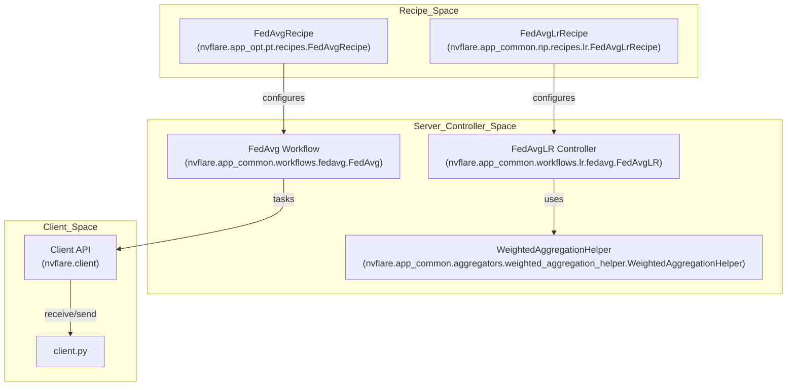
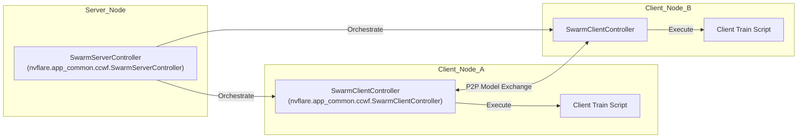

<!-- source: DeepWiki mcp.deepwiki.com · repo NVIDIA/NVFlare · page 13.3 Federated Learning Algorithms Examples · fetched 2026-10-26 -->

# Federated Learning Algorithms Examples

Relevant source files

The following files were used as context for generating this wiki page:

- [3rdParty/datasets.LICENSE.txt](3rdParty/datasets.LICENSE.txt)
- [docs/examples/hello_pt_job_api.rst](docs/examples/hello_pt_job_api.rst)
- [docs/examples/hello_tf_job_api.rst](docs/examples/hello_tf_job_api.rst)
- [docs/hello-world/hello-cyclic/index.rst](docs/hello-world/hello-cyclic/index.rst)
- [docs/hello-world/hello-lr/index.rst](docs/hello-world/hello-lr/index.rst)
- [docs/hello-world/hello-pt/index.rst](docs/hello-world/hello-pt/index.rst)
- [docs/hello-world/hello-tabular-stats/index.rst](docs/hello-world/hello-tabular-stats/index.rst)
- [docs/hello-world/hello-tf/index.rst](docs/hello-world/hello-tf/index.rst)
- [docs/hello-world/hello-xgboost/index.rst](docs/hello-world/hello-xgboost/index.rst)
- [examples/advanced/swarm_learning/README.md](examples/advanced/swarm_learning/README.md)
- [examples/hello-world/hello-cyclic/README.md](examples/hello-world/hello-cyclic/README.md)
- [examples/hello-world/hello-lr/README.md](examples/hello-world/hello-lr/README.md)
- [examples/hello-world/hello-lr/client.py](examples/hello-world/hello-lr/client.py)
- [examples/hello-world/hello-lr/download_data.py](examples/hello-world/hello-lr/download_data.py)
- [examples/hello-world/hello-lr/job.py](examples/hello-world/hello-lr/job.py)
- [examples/hello-world/hello-lr/prepare_data.py](examples/hello-world/hello-lr/prepare_data.py)
- [examples/hello-world/hello-lr/requirements.txt](examples/hello-world/hello-lr/requirements.txt)
- [examples/hello-world/hello-numpy-cross-val/README.md](examples/hello-world/hello-numpy-cross-val/README.md)
- [examples/hello-world/hello-numpy-cross-val/client.py](examples/hello-world/hello-numpy-cross-val/client.py)
- [examples/hello-world/hello-numpy-cross-val/job.py](examples/hello-world/hello-numpy-cross-val/job.py)
- [examples/hello-world/hello-numpy/client.py](examples/hello-world/hello-numpy/client.py)
- [examples/hello-world/hello-pt/README.md](examples/hello-world/hello-pt/README.md)
- [examples/hello-world/hello-pt/hello-pt.ipynb](examples/hello-world/hello-pt/hello-pt.ipynb)
- [examples/hello-world/hello-pt/job.py](examples/hello-world/hello-pt/job.py)
- [examples/hello-world/hello-tabular-stats/demo/visualization.ipynb](examples/hello-world/hello-tabular-stats/demo/visualization.ipynb)
- [examples/hello-world/hello-tabular-stats/df_stats.ipynb](examples/hello-world/hello-tabular-stats/df_stats.ipynb)
- [examples/hello-world/hello-tabular-stats/requirements.txt](examples/hello-world/hello-tabular-stats/requirements.txt)
- [examples/hello-world/hello-tf/README.md](examples/hello-world/hello-tf/README.md)
- [job_templates/sklearn_linear/config_fed_client.conf](job_templates/sklearn_linear/config_fed_client.conf)
- [job_templates/sklearn_linear/info.conf](job_templates/sklearn_linear/info.conf)
- [job_templates/sklearn_linear/info.md](job_templates/sklearn_linear/info.md)
- [job_templates/sklearn_svm/config_fed_client.conf](job_templates/sklearn_svm/config_fed_client.conf)
- [job_templates/swarm_cse_pt/config_fed_client.conf](job_templates/swarm_cse_pt/config_fed_client.conf)
- [job_templates/swarm_cse_pt/config_fed_server.conf](job_templates/swarm_cse_pt/config_fed_server.conf)
- [job_templates/swarm_cse_pt/info.conf](job_templates/swarm_cse_pt/info.conf)
- [job_templates/swarm_cse_pt/info.md](job_templates/swarm_cse_pt/info.md)
- [job_templates/xgboost_tree/config_fed_client.conf](job_templates/xgboost_tree/config_fed_client.conf)
- [nvflare/app_common/ccwf/cyclic_client_ctl.py](nvflare/app_common/ccwf/cyclic_client_ctl.py)
- [nvflare/app_common/ccwf/cyclic_server_ctl.py](nvflare/app_common/ccwf/cyclic_server_ctl.py)
- [nvflare/app_common/np/recipes/cross_site_eval.py](nvflare/app_common/np/recipes/cross_site_eval.py)
- [nvflare/app_common/workflows/lr/__init__.py](nvflare/app_common/workflows/lr/__init__.py)
- [nvflare/app_common/workflows/lr/fedavg.py](nvflare/app_common/workflows/lr/fedavg.py)
- [nvflare/app_opt/pt/fedopt_ctl.py](nvflare/app_opt/pt/fedopt_ctl.py)
- [nvflare/app_opt/tf/fedopt_ctl.py](nvflare/app_opt/tf/fedopt_ctl.py)
- [nvflare/recipe/session_mgr.py](nvflare/recipe/session_mgr.py)
- [tests/integration_test/client.py](tests/integration_test/client.py)
- [tests/unit_test/app_common/workflow/fedavg_lr_test.py](tests/unit_test/app_common/workflow/fedavg_lr_test.py)
- [tests/unit_test/app_opt/pt/pt_fedopt_ctl_test.py](tests/unit_test/app_opt/pt/pt_fedopt_ctl_test.py)
- [tests/unit_test/app_opt/tf/tf_fedopt_ctl_test.py](tests/unit_test/app_opt/tf/tf_fedopt_ctl_test.py)
- [tests/unit_test/recipe/hello_numpy_cross_val_client_test.py](tests/unit_test/recipe/hello_numpy_cross_val_client_test.py)

## Purpose and Scope

This page documents the federated learning algorithm examples provided in NVIDIA FLARE, including FedAvg, FedProx, FedOpt, SCAFFOLD, Cyclic Weight Transfer, and Swarm Learning. These examples demonstrate implementation via modern controllers and the high-level `Recipe` and `FedJob` APIs which simplify job configuration for researchers [nvflare/app_common/ccwf/ccwf_job.py:23-23]().

## Overview of FL Algorithm Examples

NVIDIA FLARE provides a comprehensive suite of federated learning algorithms. These are often demonstrated using standard datasets like CIFAR-10 for deep learning or the UCI Heart Disease dataset for tabular optimization [examples/hello-world/hello-pt/README.md:38-38](), [examples/hello-world/hello-lr/README.md:49-50]().

| Example | Algorithms | Frameworks | Location |
|---------|-----------|------------|----------|
| Hello PyTorch | FedAvg | PyTorch | `examples/hello-world/hello-pt/` |
| Hello TensorFlow | FedAvg | TensorFlow | `examples/hello-world/hello-tf/` |
| Hello LR | FedAvg (Newton-Raphson) | NumPy | `examples/hello-world/hello-lr/` |
| Hello Cyclic | Cyclic Weight Transfer | TensorFlow/PyTorch | `examples/hello-world/hello-cyclic/` |
| Swarm Learning | Swarm + LoRA | PyTorch | [examples/advanced/swarm_learning/README.md:7-7]() |
| Tabular Stats | Federated Statistics | Pandas | `examples/hello-world/hello-tabular-stats/` |

**Sources:** [examples/hello-world/hello-pt/README.md:2-3](), [examples/hello-world/hello-tf/README.md:1-3](), [examples/hello-world/hello-lr/README.md:1-4](), [examples/hello-world/hello-cyclic/README.md:1-4](), [examples/advanced/swarm_learning/README.md:1-7]().

## FedAvg (Federated Averaging)

FedAvg is the fundamental FL algorithm that aggregates model updates from multiple clients by computing a weighted average based on the amount of local training data [examples/hello-world/hello-pt/README.md:121-125]().

### Framework Implementations
NVFlare provides framework-specific recipes to automate server-side logic:

*   **PyTorch (`FedAvgRecipe`):** Handles `nn.Module` models. It manages the `ScatterAndGather` workflow to sample clients, distribute the global model, and aggregate updates [examples/hello-world/hello-pt/README.md:118-127]().
*   **TensorFlow (`FedAvgRecipe`):** Handles Keras models. It supports `.h5` or `SavedModel` formats and handles GPU memory growth flags for multi-client simulation [examples/hello-world/hello-tf/README.md:86-97](), [examples/hello-world/hello-tf/README.md:143-149]().
*   **Logistic Regression (`FedAvgLrRecipe`):** A specialized NumPy implementation for binary classification using second-order Newton-Raphson optimization. Clients compute local gradients and Hessians, which the server aggregates to update the global parameter vector $\theta$ [nvflare/app_common/workflows/lr/fedavg.py:37-78](), [examples/hello-world/hello-lr/README.md:138-143]().

### Code Interaction for FedAvg
Title: FedAvg Recipe to Runtime Entity Mapping

**Sources:** [examples/hello-world/hello-pt/README.md:131-144](), [examples/hello-world/hello-lr/job.py:40-48](), [nvflare/app_common/workflows/lr/fedavg.py:138-164]().

## Cyclic Weight Transfer

Cyclic Weight Transfer (CWT) implements sequential training where the model is passed from one site to the next for repeated fine-tuning, rather than parallel aggregation [examples/hello-world/hello-cyclic/README.md:3-4]().

**Implementation Details:**
*   **Controller:** Uses the `CyclicRecipe` which configures the `CyclicController` workflow [examples/hello-world/hello-cyclic/README.md:108-112]().
*   **Workflow:** The server passes model weights to Site A; Site A trains and sends back to server; Server passes updated weights to Site B, and so on [examples/hello-world/hello-cyclic/README.md:97-99]().

**Sources:** [examples/hello-world/hello-cyclic/README.md:1-5](), [examples/hello-world/hello-cyclic/job.py:103-120]().

## Swarm Learning

Swarm Learning is a decentralized federated workflow where clients act as both trainers and aggregators in a peer-to-peer fashion [examples/advanced/swarm_learning/README.md:1-3]().

**Framework Architecture:**
- **Decentralization:** Unlike FedAvg, there is no central aggregator for weights; clients coordinate updates [examples/advanced/swarm_learning/README.md:3-3]().
- **LoRA Integration:** The `swarm_pt` example demonstrates decentralized fine-tuning of LLMs (like Qwen2.5) using Low-Rank Adaptation [examples/advanced/swarm_learning/README.md:7-7]().
- **Configuration:** Managed via `SwarmClientController` and `SwarmServerController` logic within the `ccwf` (Cross-Client Workflow) framework [job_templates/swarm_cse_pt/info.md:1-5]().

Title: Swarm Learning Code Interaction

**Sources:** [examples/advanced/swarm_learning/README.md:1-16](), [job_templates/swarm_cse_pt/info.conf:1-5]().

## Cross-Site Validation

Cross-site validation (CSE) creates a performance matrix showing how each client's model performs on every other client's local data without sharing the data itself [examples/hello-world/hello-numpy-cross-val/README.md:5-11]().

**Implementation Patterns:**
1.  **Standalone CSE:** Evaluate pre-trained models by pointing a `ModelLocator` to existing weights [examples/hello-world/hello-numpy-cross-val/README.md:23-25]().
2.  **Training + CSE:** Use `add_cross_site_evaluation(recipe)` to automatically trigger validation after a FedAvg or Cyclic run completes [examples/hello-world/hello-numpy-cross-val/README.md:137-142]().

**Sources:** [examples/hello-world/hello-numpy-cross-val/README.md:1-13](), [examples/hello-world/hello-numpy-cross-val/job.py:121-143]().

## Algorithm Summary Table

| Algorithm | Primary Controller / Workflow | Communication Pattern | Key Components |
|-----------|------------------------------|-----------------------|----------------|
| **FedAvg** | `FedAvg` / `ScatterAndGather` | Hub-and-Spoke | `WeightedAggregationHelper`, `InTimeAccumulateWeightedAggregator` |
| **FedOpt** | `FedAvg` (with server opt) | Hub-and-Spoke | `DataKind.WEIGHT_DIFF` |
| **Cyclic** | `CyclicController` | Sequential | `CyclicClientController`, `CyclicServerController` |
| **Swarm** | `SwarmServerController` | Peer-to-Peer | `SwarmClientController`, `CrossClientWorkflow` |
| **FedLR** | `FedAvgLR` | Hub-and-Spoke | `LRModelPersistor`, Newton-Raphson Aggregator |

**Sources:** [nvflare/app_common/workflows/lr/fedavg.py:37-78](), [examples/hello-world/hello-cyclic/README.md:3-4](), [examples/advanced/swarm_learning/README.md:1-3](), [examples/hello-world/hello-pt/README.md:118-127]().

---

