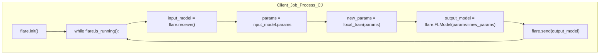
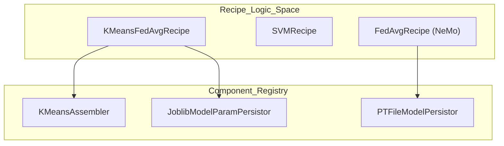

<!-- source: DeepWiki mcp.deepwiki.com · repo NVIDIA/NVFlare · page 13.4 Framework Integration Examples · fetched 2026-10-26 -->

# Framework Integration Examples

Relevant source files

The following files were used as context for generating this wiki page:

- [docs/hello-world/hello-lightning/index.rst](docs/hello-world/hello-lightning/index.rst)
- [docs/release_notes/flare_290.rst](docs/release_notes/flare_290.rst)
- [examples/advanced/bionemo/README.md](examples/advanced/bionemo/README.md)
- [examples/advanced/bionemo/downstream/README.md](examples/advanced/bionemo/downstream/README.md)
- [examples/advanced/bionemo/downstream/bionemo_filters.py](examples/advanced/bionemo/downstream/bionemo_filters.py)
- [examples/advanced/bionemo/downstream/client.py](examples/advanced/bionemo/downstream/client.py)
- [examples/advanced/bionemo/downstream/downstream_nvflare.ipynb](examples/advanced/bionemo/downstream/downstream_nvflare.ipynb)
- [examples/advanced/bionemo/downstream/sabdab/job.py](examples/advanced/bionemo/downstream/sabdab/job.py)
- [examples/advanced/bionemo/downstream/scl/job.py](examples/advanced/bionemo/downstream/scl/job.py)
- [examples/advanced/bionemo/downstream/tap/job.py](examples/advanced/bionemo/downstream/tap/job.py)
- [examples/advanced/bionemo/start_bionemo.sh](examples/advanced/bionemo/start_bionemo.sh)
- [examples/advanced/bionemo/task_fitting/README.md](examples/advanced/bionemo/task_fitting/README.md)
- [examples/advanced/bionemo/task_fitting/job_inference/README.md](examples/advanced/bionemo/task_fitting/job_inference/README.md)
- [examples/advanced/bionemo/task_fitting/job_inference/job.py](examples/advanced/bionemo/task_fitting/job_inference/job.py)
- [examples/advanced/bionemo/task_fitting/task_fitting.ipynb](examples/advanced/bionemo/task_fitting/task_fitting.ipynb)
- [examples/advanced/bionemo/task_fitting/tb_curve.png](examples/advanced/bionemo/task_fitting/tb_curve.png)
- [examples/advanced/gnn/finance/job.py](examples/advanced/gnn/finance/job.py)
- [examples/advanced/gnn/protein/job.py](examples/advanced/gnn/protein/job.py)
- [examples/advanced/sklearn-kmeans/README.md](examples/advanced/sklearn-kmeans/README.md)
- [examples/advanced/sklearn-kmeans/figs/minibatch.png](examples/advanced/sklearn-kmeans/figs/minibatch.png)
- [examples/advanced/sklearn-kmeans/job.py](examples/advanced/sklearn-kmeans/job.py)
- [examples/advanced/sklearn-kmeans/prepare_data.sh](examples/advanced/sklearn-kmeans/prepare_data.sh)
- [examples/advanced/sklearn-kmeans/utils/prepare_data.py](examples/advanced/sklearn-kmeans/utils/prepare_data.py)
- [examples/advanced/sklearn-kmeans/utils/split_data.py](examples/advanced/sklearn-kmeans/utils/split_data.py)
- [examples/advanced/sklearn-linear/README.md](examples/advanced/sklearn-linear/README.md)
- [examples/advanced/sklearn-linear/job.py](examples/advanced/sklearn-linear/job.py)
- [examples/advanced/sklearn-svm/README.md](examples/advanced/sklearn-svm/README.md)
- [examples/advanced/sklearn-svm/job.py](examples/advanced/sklearn-svm/job.py)
- [examples/advanced/xgboost/README.md](examples/advanced/xgboost/README.md)
- [examples/hello-world/hello-lightning/README.md](examples/hello-world/hello-lightning/README.md)
- [examples/hello-world/hello-lightning/job.py](examples/hello-world/hello-lightning/job.py)
- [examples/hello-world/hello-lightning/requirements.txt](examples/hello-world/hello-lightning/requirements.txt)
- [integration/nemo/examples/README.md](integration/nemo/examples/README.md)
- [integration/nemo/examples/peft/README.md](integration/nemo/examples/peft/README.md)
- [integration/nemo/examples/peft/adapter_checkpoint.py](integration/nemo/examples/peft/adapter_checkpoint.py)
- [integration/nemo/examples/peft/automodel_adapter_loader.py](integration/nemo/examples/peft/automodel_adapter_loader.py)
- [integration/nemo/examples/peft/automodel_financial_phrase_dataset.py](integration/nemo/examples/peft/automodel_financial_phrase_dataset.py)
- [integration/nemo/examples/peft/automodel_peft_client.py](integration/nemo/examples/peft/automodel_peft_client.py)
- [integration/nemo/examples/peft/data/split_financial_phrase_data.py](integration/nemo/examples/peft/data/split_financial_phrase_data.py)
- [integration/nemo/examples/peft/evaluate_sentiment.py](integration/nemo/examples/peft/evaluate_sentiment.py)
- [integration/nemo/examples/peft/job.py](integration/nemo/examples/peft/job.py)
- [integration/nemo/examples/peft/peft.ipynb](integration/nemo/examples/peft/peft.ipynb)
- [integration/nemo/examples/peft/predict_sentiment.py](integration/nemo/examples/peft/predict_sentiment.py)
- [integration/nemo/examples/supervised_fine_tuning/README.md](integration/nemo/examples/supervised_fine_tuning/README.md)
- [job_templates/sag_nemo/app_server/config_fed_server.conf](job_templates/sag_nemo/app_server/config_fed_server.conf)
- [nvflare/app_common/workflows/cmd_task_controller.py](nvflare/app_common/workflows/cmd_task_controller.py)
- [nvflare/app_opt/lightning/algorithm.py](nvflare/app_opt/lightning/algorithm.py)
- [nvflare/app_opt/lightning/api.py](nvflare/app_opt/lightning/api.py)
- [nvflare/app_opt/lightning/scaffold.py](nvflare/app_opt/lightning/scaffold.py)
- [nvflare/app_opt/sklearn/recipes/kmeans.py](nvflare/app_opt/sklearn/recipes/kmeans.py)
- [nvflare/app_opt/sklearn/recipes/svm.py](nvflare/app_opt/sklearn/recipes/svm.py)
- [nvflare/recipe/fed_task.py](nvflare/recipe/fed_task.py)
- [nvflare/utils/configs.py](nvflare/utils/configs.py)
- [tests/unit_test/app_opt/lightning/api_test.py](tests/unit_test/app_opt/lightning/api_test.py)
- [tests/unit_test/recipe/fed_task_recipe_test.py](tests/unit_test/recipe/fed_task_recipe_test.py)
- [tests/unit_test/utils/configs_test.py](tests/unit_test/utils/configs_test.py)

## Purpose and Scope

This page documents how NVIDIA FLARE integrates with popular machine learning and deep learning frameworks. It covers example implementations and integration patterns for PyTorch, PyTorch Lightning, TensorFlow, Scikit-learn, NumPy, XGBoost, MONAI, NeMo, BioNeMo, and AMPLIFY. Each framework integration demonstrates how to adapt centralized training code to federated learning with minimal code changes using the FLARE Client API or specialized recipes.

---

## Supported Frameworks Overview

NVIDIA FLARE supports a wide range of ML/DL frameworks through a consistent Client API and Recipe API abstraction:

| Framework | Type | Primary Use Case | Example Location | Integration Method |
|-----------|------|------------------|------------------|--------------------|
| **PyTorch** | Deep Learning | Image classification (CIFAR-10) | `examples/hello-world/hello-pt/` | `flare.init`, `receive`, `send` |
| **PyTorch Lightning** | Deep Learning | Image classification, SCAFFOLD | `examples/hello-world/hello-lightning/` | `flare.patch(trainer)` |
| **Scikit-learn** | Tabular ML | SVM, K-Means, Linear Models | `examples/advanced/sklearn-*` | `KMeansFedAvgRecipe`, `SVMRecipe` |
| **NeMo** | LLM Training | PEFT, SFT, Prompt Learning | `integration/nemo/` | `flare.init`, `FedAvgRecipe` |
| **BioNeMo** | Biology/Chemistry | Protein property prediction | `examples/advanced/bionemo/` | `FedAvgRecipe`, `flare.init` |
| **XGBoost** | Gradient Boosting | Tabular data (Horizontal/Vertical) | `examples/advanced/xgboost/` | `XGBFedAvgRecipe` |

Sources: [examples/hello-world/hello-lightning/README.md:5-9](), [nvflare/app_opt/lightning/api.py:35-37](), [nvflare/app_opt/sklearn/recipes/kmeans.py:43-60](), [integration/nemo/examples/peft/README.md:1-10](), [examples/advanced/bionemo/task_fitting/task_fitting.ipynb:8-12]()

---

## Core Integration Patterns

### Client API (Deep Learning & LLM)
The modern integration pattern uses the `nvflare.client` API to wrap existing training scripts. This requires approximately five lines of code changes to centralized scripts:
1. `flare.init()`: Initializes the FLARE Client API environment [nvflare/app_opt/lightning/api.py:136-136]().
2. `flare.receive()`: Receives the `FLModel` from the FL server [nvflare/app_opt/lightning/api.py:25-25]().
3. `flare.send()`: Sends the updated `FLModel` back to the server [nvflare/app_opt/lightning/api.py:25-25]().

**Code Entity Bridge: Standard Client API Flow**

Sources: [nvflare/app_opt/lightning/api.py:25-25](), [integration/nemo/examples/peft/README.md:6-8]()

### PyTorch Lightning Patching
For PyTorch Lightning, NVFlare provides a `patch()` function that automates the integration by injecting an `FLCallback` into the `pl.Trainer` [nvflare/app_opt/lightning/api.py:35-38](). This callback handles the `flare.receive()` and `flare.send()` calls automatically during the training loop [nvflare/app_opt/lightning/api.py:107-111]().

Key features of the Lightning patch include:
- **SCAFFOLD/FedProx Support**: Automatically applies `PTScaffoldHelper` or proximal gradients if the received model contains the required metadata [nvflare/app_opt/lightning/api.py:55-71]().
- **Fit Loop Management**: Automatically updates `max_epochs` and `max_steps` for each FL round if `update_fit_loop=True` [nvflare/app_opt/lightning/api.py:52-53]().

Sources: [nvflare/app_opt/lightning/api.py:35-118](), [docs/hello-world/hello-lightning/index.rst:5-9]()

---

## Tabular Data Frameworks (Scikit-learn & XGBoost)

### Scikit-learn Integration
NVFlare supports Scikit-learn through specialized recipes that handle the specific aggregation logic for different algorithms:
- **K-Means**: Uses `KMeansFedAvgRecipe` with a `KMeansAssembler` to perform mini-batch center aggregation [nvflare/app_opt/sklearn/recipes/kmeans.py:50-59]().
- **SVM**: Involves collecting support vectors from clients and training a global SVM on the server [examples/advanced/sklearn-svm/README.md:26-30]().
- **Linear Models**: Uses `SGDClassifier` with `warm_start=True` to allow repeated fitting across FL rounds [examples/advanced/sklearn-linear/README.md:27-30]().

### XGBoost Integration
XGBoost integration supports multiple collaboration modes with built-in security mitigations:
- **Horizontal**: Clients send local trees (Tree-based) or histograms (Histogram-based) to the server [examples/advanced/xgboost/README.md:97-98]().
- **Vertical**: Active party computes gradients, which are routed to passive parties to compute histograms [examples/advanced/xgboost/README.md:99-99]().
- **Security**: Mitigates "Model Statistics Leakage" by removing `sum_hessian` values before transmission [examples/advanced/xgboost/README.md:97-97]().

Sources: [nvflare/app_opt/sklearn/recipes/kmeans.py:158-164](), [examples/advanced/xgboost/README.md:32-47](), [examples/advanced/xgboost/README.md:95-99]()

---

## LLM and Biology Frameworks

### NeMo AutoModel (PEFT & SFT)
- **PEFT**: Fine-tunes Nemotron 3 Nano models with LoRA adapters. The server uses `PTFileModelPersistor` with adapter-only checkpoints, avoiding base model instantiation on the server [integration/nemo/examples/peft/README.md:3-10]().
- **Full SFT**: Fine-tunes all trainable weights. It uses multi-round FedAvg where the client warm-starts all matching tensors from the incoming global state to maintain continuity [integration/nemo/examples/supervised_fine_tuning/README.md:106-121]().

### BioNeMo
BioNeMo integration allows clients to obtain protein learned representations (embeddings) using models like ESM-1nv [examples/advanced/bionemo/task_fitting/task_fitting.ipynb:8-12](). These embeddings are then used to train downstream task models (e.g., MLPs for subcellular location prediction) in a federated setting [examples/advanced/bionemo/task_fitting/task_fitting.ipynb:74-79]().

**Code Entity Bridge: Framework Recipe Configuration**

Sources: [nvflare/app_opt/sklearn/recipes/kmeans.py:158-164](), [integration/nemo/examples/peft/README.md:9-10](), [examples/advanced/sklearn-svm/job.py:59-60]()

---

## Release Notes & Compatibility (v2.9.0)
- **Lightning Metrics**: Patched clients now report `NUM_STEPS_CURRENT_ROUND` as the actual change in `trainer.global_step` to ensure correct weighted aggregation [docs/release_notes/flare_290.rst:28-35]().
- **Recipe Discovery**: `FedProxRecipe` for PyTorch is now exposed as `fedprox-pt` [docs/release_notes/flare_290.rst:36-39]().
- **External Process Execution**: `ScriptRunner` now exports `ClientAPIExecutor` for both in-process and external-process execution [docs/release_notes/flare_290.rst:63-65]().

Sources: [docs/release_notes/flare_290.rst:28-35](), [docs/release_notes/flare_290.rst:63-65]()

---

