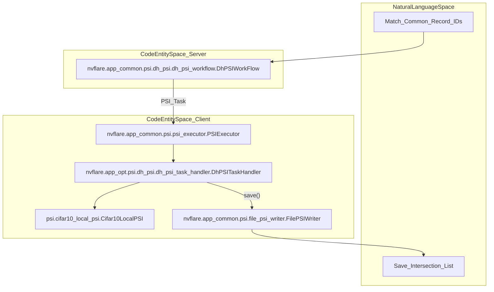
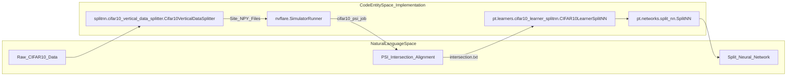

<!-- source: DeepWiki mcp.deepwiki.com · repo NVIDIA/NVFlare · page 13.6 Privacy and Security Examples · fetched 2026-10-26 -->

# Privacy and Security Examples

Relevant source files

The following files were used as context for generating this wiki page:

- [docs/user_guide/edge_development/edge_devices.rst](docs/user_guide/edge_development/edge_devices.rst)
- [examples/.gitignore](examples/.gitignore)
- [examples/advanced/psi/user_email_match/requirements.txt](examples/advanced/psi/user_email_match/requirements.txt)
- [examples/advanced/vertical_federated_learning/.gitignore](examples/advanced/vertical_federated_learning/.gitignore)
- [examples/advanced/vertical_federated_learning/cifar10-splitnn/README.md](examples/advanced/vertical_federated_learning/cifar10-splitnn/README.md)
- [examples/advanced/vertical_federated_learning/cifar10-splitnn/cifar10_split_data_vertical.py](examples/advanced/vertical_federated_learning/cifar10-splitnn/cifar10_split_data_vertical.py)
- [examples/advanced/vertical_federated_learning/cifar10-splitnn/cifar10_split_learning.ipynb](examples/advanced/vertical_federated_learning/cifar10-splitnn/cifar10_split_learning.ipynb)
- [examples/advanced/vertical_federated_learning/cifar10-splitnn/figs/split_learning.svg](examples/advanced/vertical_federated_learning/cifar10-splitnn/figs/split_learning.svg)
- [examples/advanced/vertical_federated_learning/cifar10-splitnn/jobs/cifar10_psi/meta.json](examples/advanced/vertical_federated_learning/cifar10-splitnn/jobs/cifar10_psi/meta.json)
- [examples/advanced/vertical_federated_learning/cifar10-splitnn/jobs/cifar10_psi/server/config/config_fed_server.json](examples/advanced/vertical_federated_learning/cifar10-splitnn/jobs/cifar10_psi/server/config/config_fed_server.json)
- [examples/advanced/vertical_federated_learning/cifar10-splitnn/jobs/cifar10_psi/site-1/config/config_fed_client.json](examples/advanced/vertical_federated_learning/cifar10-splitnn/jobs/cifar10_psi/site-1/config/config_fed_client.json)
- [examples/advanced/vertical_federated_learning/cifar10-splitnn/jobs/cifar10_psi/site-2/config/config_fed_client.json](examples/advanced/vertical_federated_learning/cifar10-splitnn/jobs/cifar10_psi/site-2/config/config_fed_client.json)
- [examples/advanced/vertical_federated_learning/cifar10-splitnn/jobs/cifar10_splitnn/meta.json](examples/advanced/vertical_federated_learning/cifar10-splitnn/jobs/cifar10_splitnn/meta.json)
- [examples/advanced/vertical_federated_learning/cifar10-splitnn/jobs/cifar10_splitnn/server/config/config_fed_server.json](examples/advanced/vertical_federated_learning/cifar10-splitnn/jobs/cifar10_splitnn/server/config/config_fed_server.json)
- [examples/advanced/vertical_federated_learning/cifar10-splitnn/jobs/cifar10_splitnn/site-1/config/config_fed_client.json](examples/advanced/vertical_federated_learning/cifar10-splitnn/jobs/cifar10_splitnn/site-1/config/config_fed_client.json)
- [examples/advanced/vertical_federated_learning/cifar10-splitnn/jobs/cifar10_splitnn/site-2/config/config_fed_client.json](examples/advanced/vertical_federated_learning/cifar10-splitnn/jobs/cifar10_splitnn/site-2/config/config_fed_client.json)
- [examples/advanced/vertical_federated_learning/cifar10-splitnn/requirements.txt](examples/advanced/vertical_federated_learning/cifar10-splitnn/requirements.txt)
- [examples/advanced/xgboost/fedxgb/README.md](examples/advanced/xgboost/fedxgb/README.md)
- [examples/advanced/xgboost/fedxgb/job.py](examples/advanced/xgboost/fedxgb/job.py)
- [examples/advanced/xgboost/fedxgb/job_tree.py](examples/advanced/xgboost/fedxgb/job_tree.py)
- [examples/advanced/xgboost/fedxgb/job_vertical.py](examples/advanced/xgboost/fedxgb/job_vertical.py)
- [examples/advanced/xgboost/fedxgb_secure/README.md](examples/advanced/xgboost/fedxgb_secure/README.md)
- [examples/advanced/xgboost/fedxgb_secure/job.py](examples/advanced/xgboost/fedxgb_secure/job.py)
- [examples/advanced/xgboost/fedxgb_secure/job_vertical.py](examples/advanced/xgboost/fedxgb_secure/job_vertical.py)
- [examples/advanced/xgboost/requirements.txt](examples/advanced/xgboost/requirements.txt)
- [nvflare/app_opt/xgboost/recipes/bagging.py](nvflare/app_opt/xgboost/recipes/bagging.py)
- [nvflare/app_opt/xgboost/recipes/histogram.py](nvflare/app_opt/xgboost/recipes/histogram.py)
- [nvflare/app_opt/xgboost/recipes/vertical.py](nvflare/app_opt/xgboost/recipes/vertical.py)
- [nvflare/edge/tools/edge_fed_buff_recipe.py](nvflare/edge/tools/edge_fed_buff_recipe.py)
- [nvflare/edge/tools/edge_job.py](nvflare/edge/tools/edge_job.py)
- [nvflare/edge/tools/et_fed_buff_recipe.py](nvflare/edge/tools/et_fed_buff_recipe.py)
- [research/one-shot-vfl/jobs/cifar10_oneshotVFL/server/config/config_fed_server.json](research/one-shot-vfl/jobs/cifar10_oneshotVFL/server/config/config_fed_server.json)
- [research/one-shot-vfl/jobs/cifar10_psi/server/config/config_fed_server.json](research/one-shot-vfl/jobs/cifar10_psi/server/config/config_fed_server.json)
- [research/one-shot-vfl/jobs/cifar10_psi/site-1/config/config_fed_client.json](research/one-shot-vfl/jobs/cifar10_psi/site-1/config/config_fed_client.json)
- [research/one-shot-vfl/jobs/cifar10_psi/site-2/config/config_fed_client.json](research/one-shot-vfl/jobs/cifar10_psi/site-2/config/config_fed_client.json)
- [research/quantifying-data-leakage/jobs/app_template/server/config/config_fed_server.json](research/quantifying-data-leakage/jobs/app_template/server/config/config_fed_server.json)
- [research/quantifying-data-leakage/requirements.txt](research/quantifying-data-leakage/requirements.txt)
- [tests/unit_test/private/fed/utils/fed_utils_test.py](tests/unit_test/private/fed/utils/fed_utils_test.py)
- [tests/unit_test/recipe/edge_recipe_test.py](tests/unit_test/recipe/edge_recipe_test.py)

## Purpose and Scope

This page documents examples that demonstrate privacy-preserving techniques and security mechanisms in NVIDIA FLARE. These examples show how to implement differential privacy, homomorphic encryption (HE), private set intersection (PSI), and secure XGBoost in federated learning workflows.

For information about the underlying security architecture, see [Security and Encryption](#4.5). For general FL algorithm examples, see [Federated Learning Algorithms Examples](#13.3).

**Sources:** [examples/advanced/xgboost/fedxgb_secure/README.md:1-25]()

## Overview of Privacy and Security Features

NVIDIA FLARE provides multiple layers of privacy protection that can be applied to federated learning workflows:

| Privacy Technique | Use Case | Implementation | Example Location |
|------------------|----------|----------------|------------------|
| Federated Statistics | Privacy-preserving data analytics | `StatisticsController` | `hello-tabular-stats` |
| Differential Privacy | Mathematical privacy guarantees | `SVTPrivacy`, `PercentilePrivacy`, `Opacus` | `hello-dp`, `brats18` |
| Homomorphic Encryption | Encrypted aggregation (HE) | `TenSEAL` / `IPCL` | `advanced/kaplan-meier-he`, `advanced/xgboost/fedxgb_secure` |
| Private Set Intersection | Secure record linkage | `DhPSITaskHandler` / `PSI` | `advanced/psi`, `advanced/vertical_federated_learning/cifar10-splitnn` |
| Secure XGBoost | Histogram/Gradient protection | `Paillier` / `CKKS` | `examples/advanced/xgboost/fedxgb_secure` |

**Sources:** [examples/advanced/xgboost/fedxgb_secure/README.md:18-25](), [examples/advanced/vertical_federated_learning/cifar10-splitnn/jobs/cifar10_psi/site-1/config/config_fed_client.json:18-24]()

## Differential Privacy (DP)

FLARE supports DP at two levels: local DP (client-side filters) and sample-level DP (training-time noise injection via Opacus).

### Privacy-Preserving Filters
FLARE provides built-in filters in `nvflare.app_common.filters` that apply privacy transformations to model updates before they leave the client.

*   **`SVTPrivacy`**: Implements the standard Sparse Vector Technique (SVT). It uses Laplace noise to perturb a threshold and query results, selectively sharing only the top fraction of weight updates.
*   **`PercentilePrivacy`**: Implements the "largest percentile to share" policy. It truncates weight differences using a `gamma` threshold and only updates values exceeding a specific `percentile`.
*   **`ExcludeVars`**: Allows excluding specific variables or layers from the `Shareable` using list matching or regex patterns.

## Private Set Intersection (PSI)

### Overview
PSI allows parties to compute the intersection of their sets (e.g., user IDs) without revealing any elements that are not in the intersection. This is critical for vertical learning (VFL) where data must be aligned by common keys before training [examples/advanced/xgboost/fedxgb_secure/README.md:70-75]().

**Example Locations:** 
- `examples/advanced/psi/`
- `examples/advanced/vertical_federated_learning/cifar10-splitnn/`
- `nvflare/app_common/psi/`

### Architecture: PSI Workflow and Components

**Diagram: PSI Protocol Implementation and Data Alignment**

**Sources:** [examples/advanced/vertical_federated_learning/cifar10-splitnn/jobs/cifar10_psi/site-1/config/config_fed_client.json:3-40](), [examples/advanced/vertical_federated_learning/cifar10-splitnn/cifar10_split_learning.ipynb:118-129]()

### Implementation Details
The implementation typically uses a Diffie-Hellman based protocol.
- **`DhPSITaskHandler`**: A client-side component that manages the local cryptographic operations for PSI [examples/advanced/vertical_federated_learning/cifar10-splitnn/jobs/cifar10_psi/site-1/config/config_fed_client.json:18-24]().
- **`PSIExecutor`**: Dispatches the PSI task to the appropriate algorithm handler [examples/advanced/vertical_federated_learning/cifar10-splitnn/jobs/cifar10_psi/site-1/config/config_fed_client.json:8-15]().
- **`FilePSIWriter`**: Persists the resulting intersection to a text file for subsequent training stages [examples/advanced/vertical_federated_learning/cifar10-splitnn/jobs/cifar10_psi/site-1/config/config_fed_client.json:34-40]().

**Sources:** [examples/advanced/vertical_federated_learning/cifar10-splitnn/cifar10_split_learning.ipynb:161-175](), [examples/advanced/vertical_federated_learning/cifar10-splitnn/jobs/cifar10_psi/site-1/config/config_fed_client.json:1-41]()

## Secure Federated XGBoost

### Overview
XGBoost training faces risks like Model Statistics Leakage and Gradient Leakage. NVFlare provides mitigations including encryption plugins for high-performance homomorphic operations [examples/advanced/xgboost/fedxgb_secure/README.md:1-25]().

**Example Location:** `examples/advanced/xgboost/fedxgb_secure/`

### Risk Mitigation Strategies

| Collaboration | Algorithm | Data Exchange | Security Measure |
|---------------|-----------|---------------|------------------|
| **Horizontal** | Histogram-based | Histograms | Encrypt histograms using HE (CKKS/Paillier) [examples/advanced/xgboost/fedxgb_secure/README.md:9-21]() |
| **Vertical** | Split-learning | Gradients | Encrypt gradients with HE (Paillier/IPCL); Align data with PSI [examples/advanced/xgboost/fedxgb_secure/README.md:10-21]() |

### Implementation with Recipes
Secure XGBoost can be configured using specialized Recipes:
- **`XGBHorizontalRecipe`**: Supports secure horizontal training by setting `secure=True` in the recipe constructor.
- **`XGBVerticalRecipe`**: Implements vertical federated learning where different clients have different features [examples/advanced/xgboost/fedxgb_secure/job_vertical.py:104-113](). It uses the `histogram_v2` algorithm.
- **Encryption Plugins**: Requires building `libcuda_paillier.so` or `libnvflare.so` (using IPCL) to handle encrypted computation [examples/advanced/xgboost/fedxgb_secure/README.md:30-40]().
- **`XGBBaggingRecipe`**: Implements tree-based federated XGBoost with Bagging (Random Forest) or Cyclic modes [nvflare/app_opt/xgboost/recipes/bagging.py:75-85]().

**Sources:** [examples/advanced/xgboost/fedxgb_secure/job_vertical.py:104-113](), [nvflare/app_opt/xgboost/recipes/bagging.py:75-103](), [examples/advanced/xgboost/fedxgb_secure/README.md:30-40]()

## Split Learning with PSI Alignment

### Overview
In vertical federated learning scenarios like `cifar10-splitnn`, one client holds images while another holds labels. Data must be aligned using PSI before the split learning process begins [examples/advanced/vertical_federated_learning/cifar10-splitnn/README.md:1-9]().

### Secure Split Learning Flow

**Diagram: Secure Split Learning Workflow with PSI**

*   **Vertical Data Splitting**: The `Cifar10VerticalDataSplitter` distributes the dataset such that sites have overlapping samples but different features/labels [examples/advanced/vertical_federated_learning/cifar10-splitnn/cifar10_split_learning.ipynb:67-79]().
*   **Alignment**: The PSI job generates `intersection.txt` which is then passed to the `CIFAR10LearnerSplitNN` to ensure batch alignment during training [examples/advanced/vertical_federated_learning/cifar10-splitnn/cifar10_split_learning.ipynb:182-197]().
*   **Task Execution**: `PSIExecutor` handles the "PSI" task using the `DhPSITaskHandler` [examples/advanced/vertical_federated_learning/cifar10-splitnn/jobs/cifar10_psi/site-1/config/config_fed_client.json:3-15]().

**Sources:** [examples/advanced/vertical_federated_learning/cifar10-splitnn/cifar10_split_learning.ipynb:67-79](), [examples/advanced/vertical_federated_learning/cifar10-splitnn/jobs/cifar10_psi/site-1/config/config_fed_client.json:3-41](), [examples/advanced/vertical_federated_learning/cifar10-splitnn/README.md:1-9]()

## Audit Logging

The system provides auditing via `Auditor` and `AuditService` to log security-relevant events.

*   **Event Logging**: `AuditService.add_event` captures the user, action, and a reference ID for tracking.
*   **Job Events**: `AuditService.add_job_event` specifically tracks task execution within the context of a job ID and scope.
*   **Component Authorization**: The `ComponentPathAuthorizer` ensures that only authorized classes (e.g., from `nvflare.` or `torch.`) are instantiated during job execution [tests/unit_test/recipe/edge_recipe_test.py:80-108]().

**Sources:** [tests/unit_test/recipe/edge_recipe_test.py:80-108]()

---

