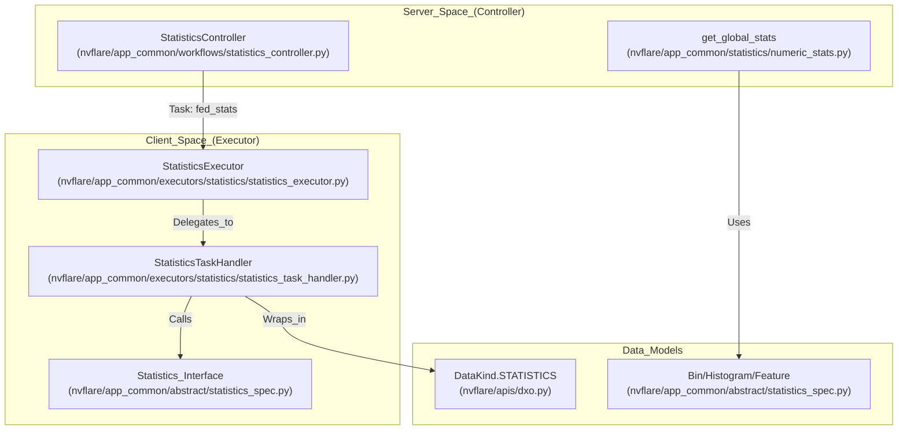
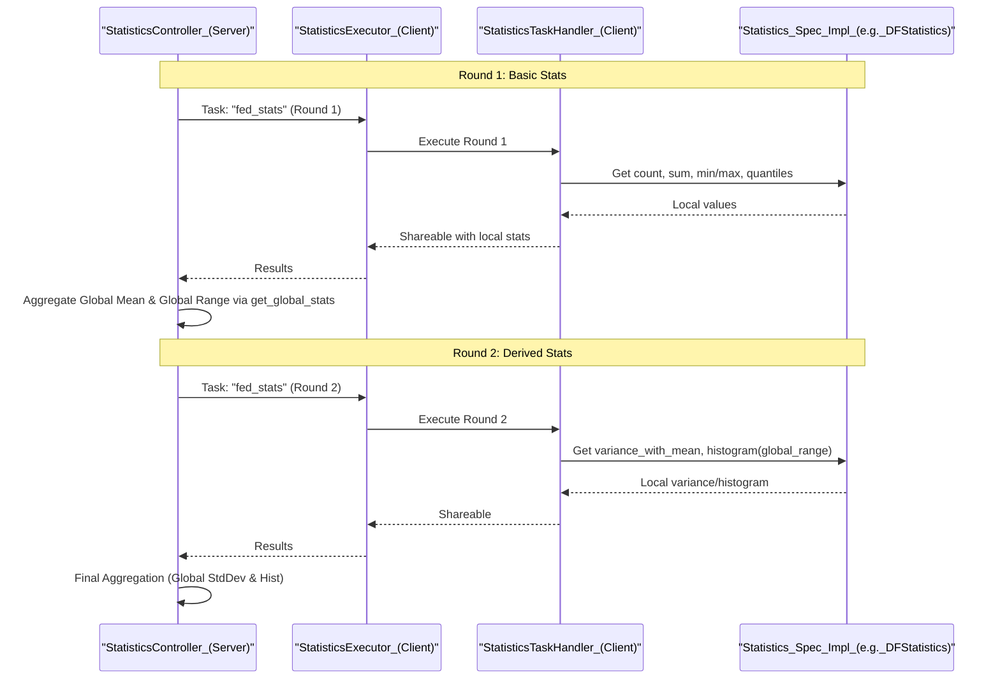

<!-- source: DeepWiki mcp.deepwiki.com · repo NVIDIA/NVFlare · page 13.7 Federated Statistics · fetched 2026-10-26 -->

# Federated Statistics

<details>
<summary>Relevant source files</summary>

The following files were used as context for generating this wiki page:

- [examples/advanced/federated-policies/requirements.txt](examples/advanced/federated-policies/requirements.txt)
- [examples/advanced/federated-statistics/README.md](examples/advanced/federated-statistics/README.md)
- [examples/advanced/federated-statistics/df_stats/README.md](examples/advanced/federated-statistics/df_stats/README.md)
- [examples/advanced/federated-statistics/df_stats/prepare_data.py](examples/advanced/federated-statistics/df_stats/prepare_data.py)
- [examples/advanced/federated-statistics/df_stats/requirements.txt](examples/advanced/federated-statistics/df_stats/requirements.txt)
- [examples/advanced/federated-statistics/hierarchical_stats/demo/hierarchical_stats.json](examples/advanced/federated-statistics/hierarchical_stats/demo/hierarchical_stats.json)
- [examples/advanced/federated-statistics/image_stats/README.md](examples/advanced/federated-statistics/image_stats/README.md)
- [examples/advanced/federated-statistics/image_stats/demo/visualization.ipynb](examples/advanced/federated-statistics/image_stats/demo/visualization.ipynb)
- [examples/advanced/federated-statistics/image_stats/image_stats.ipynb](examples/advanced/federated-statistics/image_stats/image_stats.ipynb)
- [examples/advanced/federated-statistics/image_stats/requirements.txt](examples/advanced/federated-statistics/image_stats/requirements.txt)
- [examples/advanced/sklearn-kmeans/requirements.txt](examples/advanced/sklearn-kmeans/requirements.txt)
- [examples/advanced/sklearn-linear/requirements.txt](examples/advanced/sklearn-linear/requirements.txt)
- [examples/advanced/sklearn-svm/requirements.txt](examples/advanced/sklearn-svm/requirements.txt)
- [examples/hello-world/hello-tabular-stats/README.md](examples/hello-world/hello-tabular-stats/README.md)
- [nvflare/app_common/abstract/statistics_spec.py](nvflare/app_common/abstract/statistics_spec.py)
- [nvflare/app_common/executors/statistics/statistics_executor.py](nvflare/app_common/executors/statistics/statistics_executor.py)
- [nvflare/app_common/statistics/numeric_stats.py](nvflare/app_common/statistics/numeric_stats.py)
- [nvflare/app_common/statistics/statisitcs_objects_decomposer.py](nvflare/app_common/statistics/statisitcs_objects_decomposer.py)
- [nvflare/app_common/statistics/statistics_config_utils.py](nvflare/app_common/statistics/statistics_config_utils.py)
- [nvflare/app_common/workflows/statistics_controller.py](nvflare/app_common/workflows/statistics_controller.py)
- [nvflare/app_opt/statistics/quantile_stats.py](nvflare/app_opt/statistics/quantile_stats.py)
- [tests/unit_test/app_common/executors/statistics/statistics_executor_test.py](tests/unit_test/app_common/executors/statistics/statistics_executor_test.py)
- [tests/unit_test/app_common/statistics/min_max_cleanser_test.py](tests/unit_test/app_common/statistics/min_max_cleanser_test.py)
- [tests/unit_test/app_common/statistics/numeric_stats_test.py](tests/unit_test/app_common/statistics/numeric_stats_test.py)
- [tests/unit_test/app_common/statistics/statistics_objects_descomposer_test.py](tests/unit_test/app_common/statistics/statistics_objects_descomposer_test.py)
- [tests/unit_test/app_common/workflow/mock_statistics_controller.py](tests/unit_test/app_common/workflow/mock_statistics_controller.py)
- [tests/unit_test/app_common/workflow/statistics_controller_test.py](tests/unit_test/app_common/workflow/statistics_controller_test.py)

</details>


## Purpose and Scope

Federated Statistics provides a framework for computing global statistical summaries across distributed datasets without sharing raw data. Before implementing federated training workflows, data scientists typically need to perform data exploration, analysis, and feature engineering. Federated Statistics enables this exploratory phase by allowing sites to calculate local statistics that are aggregated into global metrics while preserving data privacy. [`nvflare/app_common/abstract/statistics_spec.py:21-25`]()

This page covers the federated statistics workflow, built-in operators, privacy protection mechanisms, and implementation patterns for tabular, image, and hierarchical data.

## Overview

NVIDIA FLARE provides built-in federated statistics operators consisting of a server-side controller and client-side executors that generate global statistics from local client-side statistics. The system supports multiple datasets per client (e.g., "train" and "test"); each dataset may have many features. For each feature in the dataset, the system calculates statistics and then combines them to produce global statistics for all numeric features. [`nvflare/app_common/workflows/statistics_controller.py:129-132`](), [`examples/advanced/federated-statistics/df_stats/README.md:37-40`](), [`nvflare/app_common/executors/statistics/statistics_executor.py:21-24`]()

Supported statistics include:
- **count**: Number of samples (always required for privacy enforcement). [`nvflare/app_common/abstract/statistics_spec.py:144-147`]()
- **sum**: Sum of values. [`nvflare/app_common/abstract/statistics_spec.py:160-161`]()
- **mean**: Average value (calculated from count and sum). [`nvflare/app_common/abstract/statistics_spec.py:176-177`]()
- **stddev**: Standard deviation. [`nvflare/app_common/abstract/statistics_spec.py:193-194`]()
- **histogram**: Distribution with configurable bins. [`nvflare/app_common/abstract/statistics_spec.py:60-74`]()
- **quantile**: Percentile-based measures (median, quartiles, etc.). [`examples/advanced/federated-statistics/df_stats/README.md:41-43`]()

The framework allows for dynamic estimation of histogram ranges by calculating global min/max from local values, typically with added noise to prevent data leakage. [`nvflare/app_common/workflows/statistics_controller.py:99-104`]()

**Sources:** [`nvflare/app_common/workflows/statistics_controller.py:59-104`](), [`nvflare/app_common/abstract/statistics_spec.py:144-215`](), [`examples/advanced/federated-statistics/df_stats/README.md:80-93`]()

## Architecture and Components

### Code Entity Mapping

The following diagram bridges the natural language concepts to the specific classes and files in the codebase.



**Diagram: Federated Statistics Component Mapping**

**Sources:** [`nvflare/app_common/workflows/statistics_controller.py:35-35`](), [`nvflare/app_common/executors/statistics/statistics_executor.py:27-27`](), [`nvflare/app_common/executors/statistics/statistics_executor.py:46-49`](), [`nvflare/app_common/abstract/statistics_spec.py:44-80`]()

### Key Components

*   **`StatisticsController`**: Orchestrates the multi-round statistics workflow. It manages the lifecycle of tasks and handles the aggregation of partial results from clients using `get_global_stats`. [`nvflare/app_common/workflows/statistics_controller.py:35-45`](), [`nvflare/app_common/statistics/numeric_stats.py:44-46`]()
*   **`StatisticsExecutor`**: A specialized client-side executor that performs local statistics generation and communication to the server. It delegates the actual calculation to a `StatisticsTaskHandler`. [`nvflare/app_common/executors/statistics/statistics_executor.py:21-27`](), [`nvflare/app_common/executors/statistics/statistics_executor.py:46-49`]()
*   **`Statistics` (Abstract Interface)**: Defines the methods that must be implemented by the user to provide local data statistics, such as `count`, `sum`, `histogram`, and `quantiles`. [`nvflare/app_common/abstract/statistics_spec.py:88-125`]()
*   **`DFStatisticsCore`**: A base implementation for tabular data using Pandas DataFrames. Users typically subclass this and implement `load_data`. [`examples/advanced/federated-statistics/df_stats/README.md:134-141`]()
*   **`StatisticsWriter`**: Abstract base class used by the controller to output results. [`nvflare/app_common/abstract/statistics_writer.py:28-28`]()

**Sources:** [`nvflare/app_common/workflows/statistics_controller.py:35-153`](), [`nvflare/app_common/executors/statistics/statistics_executor.py:21-50`](), [`nvflare/app_common/abstract/statistics_spec.py:88-215`](), [`examples/advanced/federated-statistics/df_stats/README.md:97-141`](), [`nvflare/app_common/abstract/statistics_writer.py:28-28`]()

## Multi-Round Workflow

The statistics workflow executes in multiple rounds to handle metrics requiring global information (e.g., histogram bin ranges or standard deviation using the global mean).



**Diagram: Multi-Round Federated Statistics Execution**

### Workflow Phases

1.  **First Statistics Task**: Clients calculate single-pass statistics like `count`, `sum`, `min`, `max`, and `quantile`. The server aggregates these via `get_global_stats` to compute the global mean and estimated global min/max for histogram bin ranges. [`nvflare/app_common/workflows/statistics_controller.py:150-150`](), [`nvflare/app_common/statistics/numeric_stats.py:44-46`]()
2.  **Second Statistics Task**: Using global values from Phase 1, clients calculate `variance_with_mean` (using global mean) and `histogram` (using global range). The server then produces final global standard deviation and histograms. [`nvflare/app_common/workflows/statistics_controller.py:151-151`](), [`nvflare/app_common/abstract/statistics_spec.py:208-215`]()
3.  **Pre-run Task**: Optionally, the pre-run task can be used for an initial handshake where the controller passes all requested statistics configurations to the client. [`nvflare/app_common/workflows/statistics_controller.py:44-44`](), [`nvflare/app_common/abstract/statistics_spec.py:101-125`]()

**Sources:** [`nvflare/app_common/workflows/statistics_controller.py:149-152`](), [`nvflare/app_common/statistics/numeric_stats.py:44-92`](), [`nvflare/app_common/abstract/statistics_spec.py:101-215`]()

## Privacy Protection and Filters

NVFLARE provides data privacy protection through specialized privacy filters and cleansers that prevent the leakage of information from small datasets.

### Privacy Mechanisms

| Mechanism | Purpose | Implementation |
| :--- | :--- | :--- |
| `min_count` | Removes features where the sample count is below a threshold to avoid leaking info from small datasets. | [`examples/advanced/federated-statistics/image_stats/README.md:149-166`]() |
| `failure_count` | Tracks failed data points to ensure privacy against the effective count (count - failure_count). | [`examples/advanced/federated-statistics/image_stats/README.md:95-102`](), [`nvflare/app_common/abstract/statistics_spec.py:220-234`]() |
| `Noise Addition` | Noise is added to local min/max values before sending to the controller to protect global range estimation. | [`nvflare/app_common/workflows/statistics_controller.py:99-104`]() |
| `Min/Max Exclusion` | Controller gets 'estimated' values, and global min/max are noised to protect data privacy. | [`nvflare/app_common/workflows/statistics_controller.py:102-104`]() |

### Implementation Patterns
Users can implement a `failure_count` method in their `Statistics` implementation to provide more granular privacy control. [`nvflare/app_common/abstract/statistics_spec.py:220-234`]() If the effective count is too small, the feature may be excluded from the global report.

**Sources:** [`nvflare/app_common/workflows/statistics_controller.py:99-105`](), [`nvflare/app_common/abstract/statistics_spec.py:220-234`](), [`examples/advanced/federated-statistics/image_stats/README.md:95-106`]()

## Quantile Calculation

To calculate federated quantiles (median, percentiles) without transmitting raw data, NVFLARE uses a distributed digest approach.

*   **Algorithm**: Based on the `fastdigest` Python package (Rust-based). The digest carries cluster coordinates rather than raw data points. [`examples/advanced/federated-statistics/df_stats/README.md:52-54`]()
*   **Privacy**: By default, data is compressed with `max_bin = sqrt(datasize)` to ensure coordinates do not leak original data points. [`examples/advanced/federated-statistics/df_stats/README.md:53-54`]()
*   **Implementation**: Quantiles are calculated via the `get_quantiles` utility function in `nvflare.app_opt.statistics.quantile_stats`. [`nvflare/app_common/statistics/numeric_stats.py:89-90`]()
*   **Dependency**: Requires `fastdigest==0.4.0`. [`examples/advanced/federated-statistics/df_stats/README.md:59-59`]()

**Sources:** [`examples/advanced/federated-statistics/df_stats/README.md:41-61`](), [`nvflare/app_common/statistics/numeric_stats.py:89-90`]()

## Configuration and Visualization

### Statistic Configurations

The `statistic_configs` dictionary defines which metrics to calculate and their parameters.

```python
statistic_configs = {
    "count": {},
    "mean": {},
    "sum": {},
    "stddev": {},
    "histogram": {"*": {"bins": 20}, "Age": {"bins": 20, "range": [0, 100]}},
    "quantile": {"*": [0.1, 0.5, 0.9]},
}
```

In this configuration, `"*"` indicates the default settings for all features, while specific features like `"Age"` can have overrides for bin counts and ranges. [`nvflare/app_common/workflows/statistics_controller.py:64-132`]()

**Sources:** [`examples/advanced/federated-statistics/df_stats/README.md:80-89`](), [`nvflare/app_common/workflows/statistics_controller.py:64-132`]()

### Visualization Utility

The `Visualization` class provides methods to display results in Jupyter notebooks. [`examples/advanced/federated-statistics/image_stats/demo/visualization.ipynb:51-52`]()

| Function | Description |
| :--- | :--- |
| `show_stats(data)` | Shows tabular statistics for each feature, site, and dataset. |
| `show_histograms(data)` | Visualizes distributions for numeric features. |
| `get_histogram_dataframes(data)` | Converts JSON results to Pandas DataFrames for custom plotting. |

**Sources:** [`examples/advanced/federated-statistics/image_stats/demo/visualization.ipynb:92-248`]()

---

