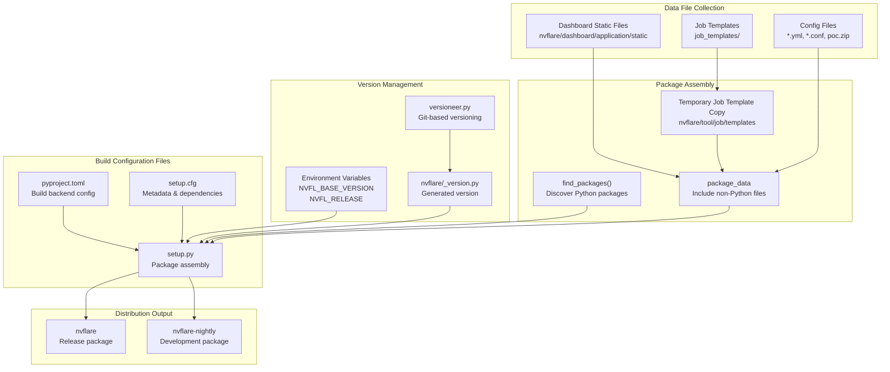

<!-- source: DeepWiki mcp.deepwiki.com · repo NVIDIA/NVFlare · page 14 Build System and Development · fetched 2026-10-26 -->

# Build System and Development

Relevant source files

The following files were used as context for generating this wiki page:

- [.dockerignore](.dockerignore)
- [.github/workflows/auto-format.yml](.github/workflows/auto-format.yml)
- [.github/workflows/blossom-ci.yml](.github/workflows/blossom-ci.yml)
- [.github/workflows/codeql.yml](.github/workflows/codeql.yml)
- [.github/workflows/dispatch-format-command.yml](.github/workflows/dispatch-format-command.yml)
- [.github/workflows/premerge.yml](.github/workflows/premerge.yml)
- [.github/workflows/relative-links-check.yml](.github/workflows/relative-links-check.yml)
- [ci/check_relative_doc_links.py](ci/check_relative_doc_links.py)
- [codecov.yml](codecov.yml)
- [examples/advanced/job_api/README.md](examples/advanced/job_api/README.md)
- [examples/tutorials/self-paced-training/part-5_federated_learning_applications_in_industries/chapter-11_federated_learning_in_healthcare_lifescience/11.3_medical_devices/code/visualization/backend/README.md](examples/tutorials/self-paced-training/part-5_federated_learning_applications_in_industries/chapter-11_federated_learning_in_healthcare_lifescience/11.3_medical_devices/code/visualization/backend/README.md)
- [nvflare/__init__.py](nvflare/__init__.py)
- [nvflare/fuel/hci/chunk.py](nvflare/fuel/hci/chunk.py)
- [nvflare/lighter/poc.py](nvflare/lighter/poc.py)
- [nvflare/private/fed/app/utils.py](nvflare/private/fed/app/utils.py)
- [pyproject.toml](pyproject.toml)
- [runtest.sh](runtest.sh)
- [setup.cfg](setup.cfg)
- [setup.py](setup.py)
- [tests/integration_test/data/jobs/np_loop/app_client/config/config_fed_client.conf](tests/integration_test/data/jobs/np_loop/app_client/config/config_fed_client.conf)
- [tests/integration_test/data/jobs/np_loop/app_client/custom/train_diff.py](tests/integration_test/data/jobs/np_loop/app_client/custom/train_diff.py)
- [tests/integration_test/data/jobs/np_loop/app_client/custom/train_full.py](tests/integration_test/data/jobs/np_loop/app_client/custom/train_full.py)
- [tests/integration_test/data/jobs/np_loop/app_client/custom/train_loop.py](tests/integration_test/data/jobs/np_loop/app_client/custom/train_loop.py)
- [tests/integration_test/data/jobs/np_loop/app_client/custom/train_metrics.py](tests/integration_test/data/jobs/np_loop/app_client/custom/train_metrics.py)
- [tests/unit_test/app_common/utils/__init__.py](tests/unit_test/app_common/utils/__init__.py)
- [tests/unit_test/app_common/utils/fl_model_utils_test.py](tests/unit_test/app_common/utils/fl_model_utils_test.py)
- [tests/unit_test/fuel/f3/streaming/stream_types_test.py](tests/unit_test/fuel/f3/streaming/stream_types_test.py)

This document explains the build system, package distribution, version management, and development environment setup for NVIDIA FLARE. It covers the setuptools-based build configuration, dependency management, version control integration, and development tool configuration.

For information about the CLI commands and their usage, see [Command-Line Interface](#9). For information about provisioning and deployment artifacts, see [Provisioning System](#10).

---

## Package Structure and Build Configuration

NVIDIA FLARE uses a standard Python setuptools-based build system configured through three primary files: `setup.py`, `setup.cfg`, and `pyproject.toml`.

### Build System Architecture

**Sources:** [setup.py:22-115](), [setup.cfg:1-194](), [pyproject.toml:1-4]()

### Setup.py: Package Assembly Logic

The `setup()` function in [setup.py:96-115]() orchestrates package creation with several key features:

| Feature | Implementation | Lines |
|---------|---------------|-------|
| **Version Management** | Versioneer integration with environment variable overrides | [setup.py:39-51]() |
| **Package Naming** | Dynamic selection between `nvflare` and `nvflare-nightly` | [setup.py:53-58]() |
| **Data File Discovery** | Custom `package_files()` function for recursive file collection | [setup.py:60-69]() |
| **Job Template Copying** | Temporary copy from `job_templates/` to package directory | [setup.py:88-89]() |
| **Test Exclusion** | Exclude `tests` and `dev_tools` from distribution | [setup.py:106]() |

**Sources:** [setup.py:39-115]()

---

## Version Management System

NVIDIA FLARE uses **Versioneer** for automatic version string generation from Git tags and commits.

### Version String Construction
The version generation logic in [setup.py:39-51]() implements a fallback mechanism that generates a development version with a datestamp (e.g., `2.6.0.dev250101`) if Git information is unavailable or if overridden by `NVFL_BASE_VERSION`.

**Package Name Selection** ([setup.py:53-58]()):
- `NVFL_RELEASE == "1"` → Package name: `nvflare` (official release).
- `NVFL_RELEASE` unset or other → Package name: `nvflare-nightly` (development).

**Sources:** [setup.py:39-58](), [setup.cfg:188-194]()

---

## Dependency Management

Dependencies are organized hierarchically in [setup.cfg:21-147]() using extras syntax for modularity.

### Core and Optional Dependencies

| Category | Extra Name | Key Packages | Purpose |
|----------|-----------|--------------|---------|
| **Core** | _(always installed)_ | cryptography, Flask, grpcio, PyYAML, msgpack, docker, pydantic | Essential runtime dependencies [setup.cfg:21-38]() |
| **Privacy** | `HE`, `PSI` | tenseal, openmined.psi | Homomorphic encryption and PSI [setup.cfg:41-46]() |
| **Frameworks** | `PT`, `SKLEARN` | torch, scikit-learn, pandas | ML framework integration [setup.cfg:47-52]() |
| **Monitoring** | `TRACKING`, `MONITORING` | mlflow, wandb, tensorboard, datadog | Experiment tracking [setup.cfg:53-58]() |
| **App Options** | `app_opt` | pytorch_lightning, xgboost, bitsandbytes | Optional high-level dependencies [setup.cfg:63-73]() |
| **Development** | `test_support`, `doc` | pytest, flake8, black, sphinx | Testing and documentation tools [setup.cfg:81-104]() |

**Platform and CPU Variations:** [setup.cfg:123-147]() define specialized variants like `app_opt_cpu` which omit GPU-only packages like `bitsandbytes`. Note that `tenseal` has specific version constraints based on Python 3.13/3.14 availability [setup.cfg:42-44](). NVFLARE supports Python versions 3.10 through 3.14 [nvflare/private/fed/app/utils.py:30-42]().

**Sources:** [setup.cfg:21-147](), [nvflare/private/fed/app/utils.py:30-42]()

---

## Development Tools and CI/CD

### Unified Test Script (`runtest.sh`)
The `runtest.sh` script provides a unified interface for development:
- **Dependency Installation**: Supports `uv` for faster installs [runtest.sh:45-55]().
- **Style Checks**: Runs `black`, `isort`, `flake8`, and a specialized `skill_lint_check` for agent skills [runtest.sh:186-201]().
- **Unit Testing**: Executes `pytest` with support for parallel execution via `pytest-xdist` [runtest.sh:21-22]().

### CI/CD Pipeline
The project uses GitHub Actions for automated validation:
- **Pre-merge Workflow**: Runs license checks, style checks (on Python 3.14), and unit tests across Python 3.10-3.14 [.github/workflows/premerge.yml:24-67](). It also includes specialized contract tests for HuggingFace `transformers` and `trl` [.github/workflows/premerge.yml:68-104]().
- **Coverage**: Generates XML coverage reports and uploads to Codecov [.github/workflows/premerge.yml:105-133]().
- **CodeQL**: Automated security analysis for the Python codebase [.github/workflows/codeql.yml:15-74]().
- **Blossom CI**: NVIDIA-internal CI trigger for specialized hardware testing [.github/workflows/blossom-ci.yml:101-112]().

### Package Entry Points
The `nvflare` CLI is registered as a console script entry point, mapping the command to the `main` function in `nvflare.cli` [setup.cfg:152-154]().

**Sources:** [runtest.sh:1-201](), [.github/workflows/premerge.yml:1-133](), [.github/workflows/codeql.yml:1-74](), [setup.cfg:152-154]()

---

## Child Pages

For more detailed information, please see the following child pages:

- [Package Structure and Distribution](#14.1) — Detailed look at `setup.py`, version management, the `nvflight` lightweight distribution, and Docker image configurations including `Dockerfile.parent` and `Dockerfile.job`.
- [Package Initialization and Entry Points](#14.2) — Technical details of `nvflare.__init__.py` [nvflare/__init__.py:1-24](), module structure, and the `nvflare` console script entry point [setup.cfg:152-154]().
- [CI/CD and Testing Infrastructure](#14.3) — In-depth guide to GitHub Actions, `runtest.sh` patterns, preflight checks, and the `devops/` Kubernetes deployment scripts for AWS EKS, GCP GKE, and Azure AKS.

---

