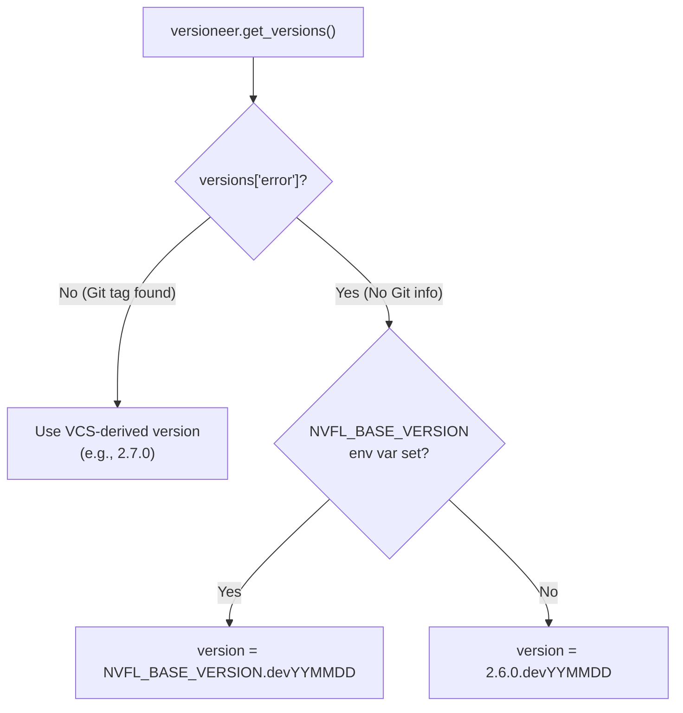
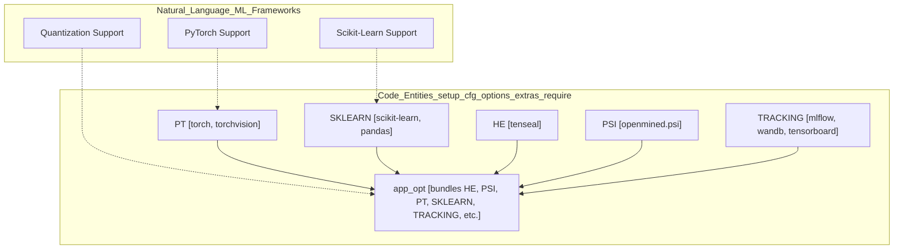
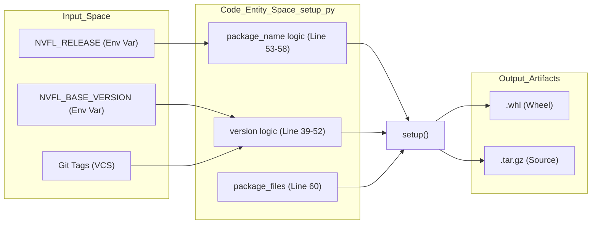
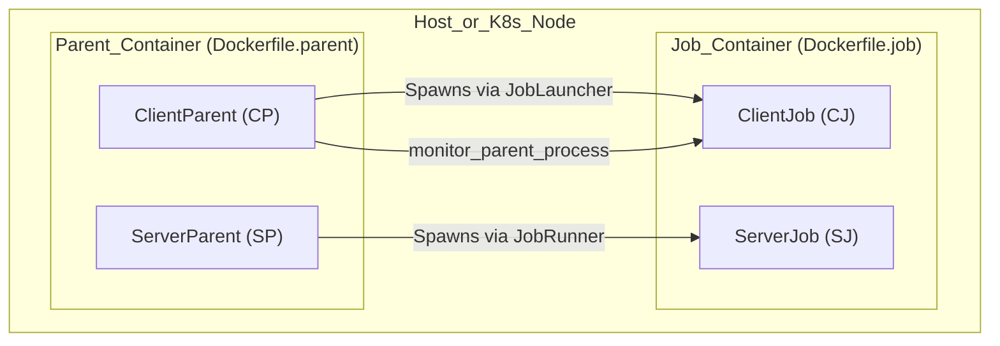

<!-- source: DeepWiki mcp.deepwiki.com · repo NVIDIA/NVFlare · page 14.1 Package Structure and Distribution · fetched 2026-10-26 -->

# Package Structure and Distribution

<details>
<summary>Relevant source files</summary>

The following files were used as context for generating this wiki page:

- [.dockerignore](.dockerignore)
- [.github/workflows/premerge.yml](.github/workflows/premerge.yml)
- [codecov.yml](codecov.yml)
- [docker/Dockerfile.parent](docker/Dockerfile.parent)
- [docs/resources/brev_config_instance.png](docs/resources/brev_config_instance.png)
- [docs/resources/brev_creating.png](docs/resources/brev_creating.png)
- [docs/resources/brev_deploy.png](docs/resources/brev_deploy.png)
- [docs/resources/brev_instance.png](docs/resources/brev_instance.png)
- [docs/resources/brev_port.png](docs/resources/brev_port.png)
- [docs/resources/brev_select_k8s.png](docs/resources/brev_select_k8s.png)
- [docs/resources/brev_ssh.png](docs/resources/brev_ssh.png)
- [docs/user_guide/admin_guide/deployment/brev_deployment.rst](docs/user_guide/admin_guide/deployment/brev_deployment.rst)
- [docs/user_guide/admin_guide/deployment/brev_scripts/launch_brev_nvflare.sh](docs/user_guide/admin_guide/deployment/brev_scripts/launch_brev_nvflare.sh)
- [docs/user_guide/admin_guide/deployment/brev_scripts/prepare_brev_startup_kits.sh](docs/user_guide/admin_guide/deployment/brev_scripts/prepare_brev_startup_kits.sh)
- [docs/user_guide/admin_guide/deployment/index.rst](docs/user_guide/admin_guide/deployment/index.rst)
- [examples/devops/multicloud/README.md](examples/devops/multicloud/README.md)
- [examples/devops/multicloud/build_and_push.py](examples/devops/multicloud/build_and_push.py)
- [examples/devops/multicloud/deploy.py](examples/devops/multicloud/deploy.py)
- [examples/devops/multicloud/setting-up-dev-cluster.md](examples/devops/multicloud/setting-up-dev-cluster.md)
- [nvflare/__init__.py](nvflare/__init__.py)
- [nvflare/fuel/hci/chunk.py](nvflare/fuel/hci/chunk.py)
- [nvflare/lighter/poc.py](nvflare/lighter/poc.py)
- [nvflare/private/fed/app/utils.py](nvflare/private/fed/app/utils.py)
- [pyproject.toml](pyproject.toml)
- [runtest.sh](runtest.sh)
- [setup.cfg](setup.cfg)
- [setup.py](setup.py)
- [tests/unit_test/app_common/utils/__init__.py](tests/unit_test/app_common/utils/__init__.py)
- [tests/unit_test/app_common/utils/fl_model_utils_test.py](tests/unit_test/app_common/utils/fl_model_utils_test.py)
- [tests/unit_test/fuel/f3/streaming/stream_types_test.py](tests/unit_test/fuel/f3/streaming/stream_types_test.py)

</details>


This page covers how NVIDIA FLARE is packaged, versioned, and distributed as a Python package. It describes the build configuration files (`setup.py`, `setup.cfg`, `pyproject.toml`), dependency groups, optional extras, the mechanics of version management using `versioneer`, and the distribution of Docker images for server/client orchestration and job execution.

---

## Build Configuration Files

The NVIDIA FLARE build system utilizes three primary configuration files to define the package environment and distribution metadata:

| File | Role |
|---|---|
| `pyproject.toml` | Declares the build backend (`setuptools`) and tool configurations for development utilities like `black` and `isort`. [pyproject.toml:1-15]() |
| `setup.cfg` | Contains static package metadata, core installation dependencies, optional "extras" groups, linting rules, and `versioneer` configuration. [setup.cfg:1-191]() |
| `setup.py` | Contains imperative build logic, including dynamic version resolution, conditional package naming (nightly vs. release), and complex data file assembly (e.g., job templates). [setup.py:1-118]() |

**Build System Declaration** — `pyproject.toml` [pyproject.toml:1-3]() specifies the requirements for the build environment:

```toml
[build-system]
requires = ["setuptools>=61.0", "wheel", "versioneer", "PyYAML>=6.0"]
build-backend = "setuptools.build_meta"
```

Sources: [pyproject.toml:1-15](), [setup.cfg:1-191](), [setup.py:1-118]()

---

## Package Naming and Versioning

### Production vs. Nightly Distributions

The environment variable `NVFL_RELEASE` determines the identity of the package during the build process [setup.py:53-58]():

| `NVFL_RELEASE` value | Resulting Package Name |
|---|---|
| `"1"` | `nvflare` (Stable Release) |
| Not set or other | `nvflare-nightly` (Development Build) |

### Version Derivation with Versioneer

NVFlare uses `versioneer` to manage version strings based on Git tags. If a Git-derived version is unavailable (e.g., building from a source tarball without `.git`), the system falls back to date-based development versions [setup.py:39-52]().

**Figure 1: Version Resolution Logic**



The resolved version is written to `nvflare/_version.py` by `versioneer` [setup.cfg:188-192]().

Sources: [setup.py:39-58](), [setup.cfg:188-194]()

---

## Package Contents and Data Files

The `setup()` function in `setup.py` aggregates several non-Python assets into the final distribution [setup.py:96-115]():

| Data Category | Source Location | Destination in Package |
|---|---|---|
| **Dashboard Assets** | `nvflare/dashboard/application/static/` | `nvflare.dashboard.application` [setup.py:87, 110]() |
| **Job Templates** | `job_templates/` (repo root) | `nvflare.tool.job.templates` [setup.py:88-90, 111]() |
| **Deployment Templates** | `nvflare/tool/deploy/templates` | `nvflare.tool.deploy` [setup.py:91, 112]() |
| **Configuration** | `*.yml`, `*.yaml`, `*.tpl`, `*.html`, `*.js`, `poc.zip`, `*.config`, `*.conf` | Distributed across modules [setup.py:109]() |

### Dynamic Asset Handling
* **Job Templates:** The `copy_package` function [setup.py:72-81]() moves `job_templates/` from the repository root into a temporary folder `nvflare/tool/job/templates/` during the build [setup.py:88-89](). It removes `.md` files to keep the distribution lightweight [setup.py:78-79](). The temporary folder is cleaned up after `setup()` completes [setup.py:117]().

Sources: [setup.py:60-118]()

---

## Dependencies and Optional Extras

### Core Dependencies
Required packages for the FLARE runtime are defined in `setup.cfg` under `install_requires` [setup.cfg:21-38](). Key dependencies include `cryptography`, `Flask`, `grpcio`, `numpy`, `protobuf`, `psutil`, `PyYAML`, and `pydantic`.

### Optional Extras
Extras allow users to install only the dependencies needed for specific workflows [setup.cfg:40-147]().

**Figure 2: Extra Dependency Composition (Natural Language to Code Entity Space)**



| Extra Group | Key Dependencies |
|---|---|
| `HE` | `tenseal` (Supports Python < 3.14) [setup.cfg:41-44]() |
| `PSI` | `openmined.psi` [setup.cfg:45-46]() |
| `PT` | `torch`, `torchvision` [setup.cfg:47-49]() |
| `SKLEARN` | `scikit-learn`, `pandas` [setup.cfg:50-52]() |
| `TRACKING` | `mlflow`, `wandb`, `tensorboard` [setup.cfg:53-56]() |
| `app_opt` | Bundles `HE`, `PSI`, `PT`, `SKLEARN`, `TRACKING`, `xgboost`, `bitsandbytes` [setup.cfg:63-74]() |
| `K8S` | `kubernetes` [setup.cfg:61-62]() |

Sources: [setup.cfg:21-147]()

---

## Build and Distribution Data Flow

The following diagram illustrates how the various build files and environment variables interact to produce the final distribution.

**Figure 3: Distribution Data Flow (Natural Language to Code Entity Space)**



Sources: [setup.py:39-115](), [setup.cfg:1-191](), [pyproject.toml:1-15]()

---

## Development and Test Environment

Development utilities and testing frameworks are configured to ensure code quality.

* **Style Checks:** The project uses `flake8`, `black`, and `isort` with configurations defined in `setup.cfg` [setup.cfg:156-181]() and `pyproject.toml` [pyproject.toml:5-36](). The `runtest.sh` script provides wrappers for these checks [runtest.sh:126-155]().
* **Testing:** The `test` and `test_support` extras provide the necessary environment for running the suite, including `pytest-cov`, `pytest-xdist`, and `nbmake` [setup.cfg:96-113]().
* **Python Support:** NVFlare supports Python versions 3.10 through 3.14 [setup.cfg:10-14](). Runtime version checks are performed in `nvflare/private/fed/app/utils.py` [nvflare/private/fed/app/utils.py:96-110]().
* **CI/CD Integration:** GitHub Actions workflows (e.g., `premerge.yml`) execute unit tests and style checks across the matrix of supported Python versions [ .github/workflows/premerge.yml:42-67](). It also validates license headers using `ci/check_license_header.py` [ .github/workflows/premerge.yml:24-30]().

Sources: [setup.cfg:10-181](), [pyproject.toml:5-36](), [runtest.sh:1-155](), [.github/workflows/premerge.yml:1-135](), [nvflare/private/fed/app/utils.py:96-110]()

---

## Docker Distribution

NVFlare utilizes Docker containers for deployment, particularly in cloud and Kubernetes environments. The `docker/` directory contains definitions for different container roles.

### Parent and Job Containers

The system distinguishes between the orchestration process and the training workload:

* **Dockerfile.parent**: A distroless NVIDIA-based image (`nvcr.io/nvidia/distroless/python`) used for the Server and Client parent processes (SP/CP). These processes manage the lifecycle of jobs but do not contain the ML framework dependencies. It installs the `[K8S]` extra for Kubernetes orchestration [docker/Dockerfile.parent:4-30]().
* **Dockerfile.job**: Typically based on NGC PyTorch images, these are used for submitted jobs (SJ/CJ). These images contain the full training stack required for the Job processes to execute training or validation tasks.

### Process Isolation

The isolation model ensures that training workloads (Jobs) run in separate environments from the management infrastructure (Parent processes). The `monitor_parent_process` and `check_parent_alive` functions ensure that if a parent process dies, the child job processes are terminated to prevent "zombie" workloads [nvflare/private/fed/app/utils.py:45-71]().

**Figure 4: Containerized Process Isolation**



Sources: [docker/Dockerfile.parent:1-50](), [nvflare/private/fed/app/utils.py:45-71]()

---

