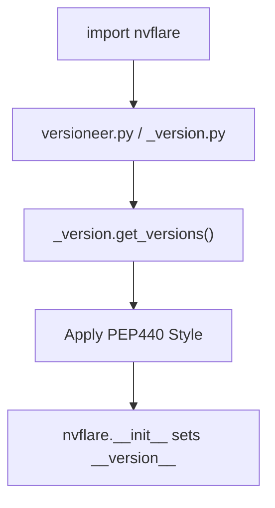
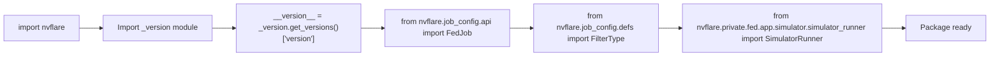

<!-- source: DeepWiki mcp.deepwiki.com · repo NVIDIA/NVFlare · page 14.2 Package Initialization and Entry Points · fetched 2026-10-26 -->

# Package Initialization and Entry Points

Relevant source files

The following files were used as context for generating this wiki page:

- [.dockerignore](.dockerignore)
- [.github/workflows/premerge.yml](.github/workflows/premerge.yml)
- [codecov.yml](codecov.yml)
- [nvflare/__init__.py](nvflare/__init__.py)
- [nvflare/fuel/hci/chunk.py](nvflare/fuel/hci/chunk.py)
- [nvflare/lighter/poc.py](nvflare/lighter/poc.py)
- [nvflare/private/fed/app/utils.py](nvflare/private/fed/app/utils.py)
- [pyproject.toml](pyproject.toml)
- [runtest.sh](runtest.sh)
- [setup.cfg](setup.cfg)
- [setup.py](setup.py)
- [tests/unit_test/app_common/utils/__init__.py](tests/unit_test/app_common/utils/__init__.py)
- [tests/unit_test/app_common/utils/fl_model_utils_test.py](tests/unit_test/app_common/utils/fl_model_utils_test.py)
- [tests/unit_test/fuel/f3/streaming/stream_types_test.py](tests/unit_test/fuel/f3/streaming/stream_types_test.py)

This document describes how NVIDIA FLARE is packaged for distribution, how it initializes when imported, and the console script entry points that provide CLI access.

## Overview

NVIDIA FLARE's package initialization involves three key aspects:
1.  **Build-time configuration** via `setup.py` and `setup.cfg` that defines package metadata, version, dependencies, and entry points.
2.  **Console script entry points** that map the `nvflare` command to Python functions.
3.  **Runtime initialization** in `nvflare/__init__.py` that exposes key APIs and establishes version information.

The package supports multiple environments, with dependencies managed through optional extras for various machine learning frameworks and specialized features.

---

## Package Distribution Configuration

### Build System and Metadata

NVIDIA FLARE uses `setuptools` as the build backend. The setup process is dynamically managed by `setup.py` and metadata is defined in `setup.cfg`.

**Build System Configuration**
The build system requirements are specified in `[pyproject.toml:1-3]()`, requiring `setuptools`, `wheel`, `versioneer`, and `PyYAML`. The `setup()` function call in `[setup.py:96-115]()` defines the package name, version, and data files to be included.

**Package Data and Templates**
NVIDIA FLARE bundles several non-Python resources required for operation:
*   **Dashboard Assets**: Static files for the web dashboard `[setup.py:87]()`, `[setup.py:110]()`.
*   **Job Templates**: Default templates for creating federated jobs, copied from the `job_templates` directory to `nvflare/tool/job/templates` during the build `[setup.py:88-90]()`, `[setup.py:111]()`.
*   **Deployment Templates**: Infrastructure templates for various cloud providers `[setup.py:91]()`, `[setup.py:112]()`.
*   **POC and Config Assets**: A `poc.zip` file and configuration files (`.conf`, `.config`, `.yml`) `[setup.py:109]()`.

**Sources:** `[setup.py:87-115]()`, `[setup.cfg:1-39]()`, `[pyproject.toml:1-3]()`

---

### Version Management

NVIDIA FLARE uses `versioneer` for automatic version string generation from Git tags and commits.

**Version Resolution Logic**

During the build process, `setup.py` loads `versioneer` locally to resolve the version string `[setup.py:25-35]()`, `[setup.py:39]()`. If Git information is missing (e.g., building from a source tarball), it falls back to a date-based development version `[setup.py:41-49]()`. The resolved version is then used for the package name, supporting either `nvflare` or `nvflare-nightly` based on the `NVFL_RELEASE` environment variable `[setup.py:53-57]()`.

**Sources:** `[setup.py:25-57]()`, `[nvflare/__init__.py:15-17]()`, `[setup.cfg:188-194]()`

---

## Console Script Entry Points

The primary entry point for the NVIDIA FLARE CLI is the `nvflare` command, which is registered via `options.entry_points` in the configuration.

### CLI Registration

| Entry Point | Target Function | Purpose |
|-------------|-----------------|---------|
| `nvflare`   | `nvflare.cli:main` | Main CLI entry point for all subcommands `[setup.cfg:154]()` |

### Command Implementation and Deprecation

The `nvflare` command acts as a router for various sub-systems (poc, job, provision, dashboard, etc.). 

Some legacy entry points are preserved for backward compatibility but marked as deprecated. For example, the standalone `poc` command script prints a warning directing users to the modern `nvflare poc` command `[nvflare/lighter/poc.py:16-19]()`.

**Sources:** `[setup.cfg:152-154]()`, `[nvflare/lighter/poc.py:16-19]()`

---

## Package Initialization

The `nvflare/__init__.py` file controls the public API surface and initializes versioning.

### Initialization Sequence

**Package Import Lifecycle**

### Top-Level Exports

`[nvflare/__init__.py:15-24]()` initializes the package and exposes key classes for job definition and simulation:

| Symbol | Purpose |
|--------|---------|
| `__version__` | Version string resolved by `versioneer` `[nvflare/__init__.py:17]()` |
| `FedJob` | Primary API for programmatic job definition `[nvflare/__init__.py:21]()` |
| `FilterType` | Definition of data/result filter categories `[nvflare/__init__.py:22]()` |
| `SimulatorRunner` | Entry point for running the FL Simulator programmatically `[nvflare/__init__.py:23]()` |

### Runtime Environment Checks

The system performs Python version validation during startup to ensure compatibility. The `version_check()` function ensures the environment is within the supported range of 3.10 through 3.14 `[nvflare/private/fed/app/utils.py:30-42]()`, `[nvflare/private/fed/app/utils.py:96-109]()`.

**Sources:** `[nvflare/__init__.py:1-24]()`, `[nvflare/private/fed/app/utils.py:30-109]()`, `[setup.cfg:10-14]()`

---

## Dependency Management

NVIDIA FLARE uses `options.extras_require` to manage optional dependencies for different use cases and frameworks.

| Extra | Purpose | Key Dependencies |
|-------|---------|------------------|
| `PT` | PyTorch integration | `torch`, `torchvision` `[setup.cfg:47-49]()` |
| `HE` | Homomorphic Encryption | `tenseal` `[setup.cfg:41-44]()` |
| `TRACKING` | Experiment tracking | `mlflow`, `wandb`, `tensorboard` `[setup.cfg:53-56]()` |
| `K8S` | Kubernetes support | `kubernetes` `[setup.cfg:61-62]()` |
| `app_opt` | All application optimizations | Includes HE, PSI, PT, SKLEARN, TRACKING, etc. `[setup.cfg:63-74]()` |
| `test` | Development and testing | Includes `all` plus `pytest`, `flake8`, `black` `[setup.cfg:110-113]()` |

**Sources:** `[setup.cfg:40-150]()`

---

## Build and Test Infrastructure

The codebase includes specialized scripts for managing the development lifecycle.

### Testing Entry Points
The `runtest.sh` script serves as the unified entry point for CI/CD and local testing. It handles:
*   **Dependency Installation**: Automatically installs the correct `extras_require` based on the platform (e.g., `dev_mac`, `dev_cpu`, or `dev`) `[runtest.sh:29-58]()`.
*   **Style Checks**: Executes `flake8`, `black`, and `isort` `[runtest.sh:126-155]()`.
*   **Agent Skill Validation**: Includes a specific `skill_lint_check` for AI Agent skills `[runtest.sh:186-193]()`.

### CI/CD Integration
GitHub Actions workflows (e.g., `premerge.yml`) utilize these entry points to perform license checks, style checks, and unit tests across multiple Python versions (3.10 to 3.14) and operating systems `[.github/workflows/premerge.yml:24-67]()`.

**Sources:** `[runtest.sh:1-193]()`, `[.github/workflows/premerge.yml:15-67]()`

---

