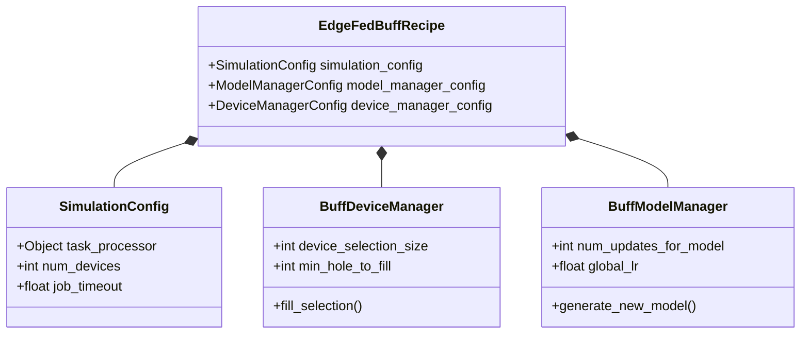
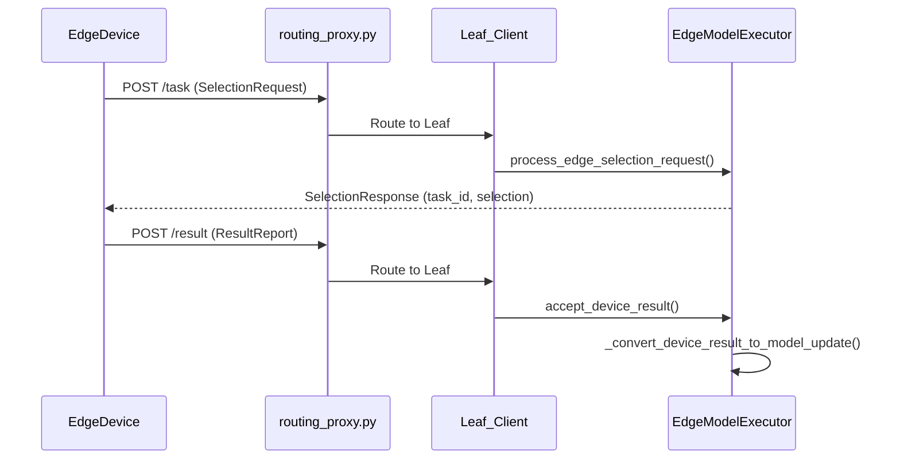

<!-- source: DeepWiki mcp.deepwiki.com · repo NVIDIA/NVFlare · page 15 Edge and Mobile Federated Learning · fetched 2026-10-26 -->

# Edge and Mobile Federated Learning

<details>
<summary>Relevant source files</summary>

The following files were used as context for generating this wiki page:

- [examples/advanced/edge/README.md](examples/advanced/edge/README.md)
- [examples/advanced/edge/baselines/cifar_fl_base.py](examples/advanced/edge/baselines/cifar_fl_base.py)
- [examples/advanced/edge/baselines/cifar_fl_base_job.py](examples/advanced/edge/baselines/cifar_fl_base_job.py)
- [examples/advanced/edge/baselines/cifar_train_central.py](examples/advanced/edge/baselines/cifar_train_central.py)
- [examples/advanced/edge/figs/async_comp.png](examples/advanced/edge/figs/async_comp.png)
- [examples/advanced/edge/figs/cifar10_acc.png](examples/advanced/edge/figs/cifar10_acc.png)
- [examples/advanced/edge/jobs/et_job.py](examples/advanced/edge/jobs/et_job.py)
- [examples/advanced/edge/jobs/processors/xor_et_task_processor.py](examples/advanced/edge/jobs/processors/xor_et_task_processor.py)
- [examples/advanced/edge/jobs/pt_job.py](examples/advanced/edge/jobs/pt_job.py)
- [examples/advanced/edge/jobs/pt_job_adv.py](examples/advanced/edge/jobs/pt_job_adv.py)
- [examples/advanced/edge/project.yml](examples/advanced/edge/project.yml)
- [examples/advanced/edge/requirements.txt](examples/advanced/edge/requirements.txt)
- [examples/advanced/federated-statistics/df_stats/client.py](examples/advanced/federated-statistics/df_stats/client.py)
- [examples/advanced/federated-statistics/image_stats/client.py](examples/advanced/federated-statistics/image_stats/client.py)
- [nvflare/edge/aggregators/model_update_dxo.py](nvflare/edge/aggregators/model_update_dxo.py)
- [nvflare/edge/assessors/async_num.py](nvflare/edge/assessors/async_num.py)
- [nvflare/edge/assessors/buff_device_manager.py](nvflare/edge/assessors/buff_device_manager.py)
- [nvflare/edge/assessors/buff_model_manager.py](nvflare/edge/assessors/buff_model_manager.py)
- [nvflare/edge/assessors/device_manager.py](nvflare/edge/assessors/device_manager.py)
- [nvflare/edge/assessors/model_manager.py](nvflare/edge/assessors/model_manager.py)
- [nvflare/edge/assessors/model_update.py](nvflare/edge/assessors/model_update.py)
- [nvflare/edge/executors/edge_model_executor.py](nvflare/edge/executors/edge_model_executor.py)
- [nvflare/edge/mud.py](nvflare/edge/mud.py)
- [nvflare/edge/updaters/emd.py](nvflare/edge/updaters/emd.py)
- [nvflare/edge/web/service/query.py](nvflare/edge/web/service/query.py)
- [nvflare/edge/widgets/api_service.py](nvflare/edge/widgets/api_service.py)
- [nvflare/edge/widgets/evaluator.py](nvflare/edge/widgets/evaluator.py)

</details>


NVIDIA FLARE extends federated learning (FL) capabilities to edge computing environments, supporting large-scale cross-device FL with mobile (Android/iOS) and IoT devices. This system addresses challenges inherent to edge environments, such as massive scalability, intermittent connectivity, and heterogeneous hardware [examples/advanced/edge/README.md:1-3]().

### Key Capabilities
*   **Hierarchical Topology**: Supports a server-relay-client structure to manage millions of devices without overloading the central server [examples/advanced/edge/README.md:17-17](), [examples/advanced/edge/README.md:38-42]().
*   **Asynchronous Learning**: Implements buffered asynchronous aggregation via `BuffModelManager` and `BuffDeviceManager` to handle devices that join, leave, or fail to return results due to network interruptions [nvflare/edge/assessors/buff_model_manager.py:42-71](), [nvflare/edge/assessors/buff_device_manager.py:24-68]().
*   **On-Device Training**: Integration with **ExecuTorch** for high-performance inference and training on mobile platforms, allowing deployment on Android and iOS devices [examples/advanced/edge/README.md:105-106]().
*   **Edge Simulation**: Tools to simulate thousands of edge devices on local infrastructure using `SimulationConfig` and specialized task processors like `Cifar10PTTaskProcessor` [examples/advanced/edge/jobs/pt_job.py:89-94](), [examples/advanced/edge/jobs/et_job.py:102-109]().

---

## Edge Architecture and Hierarchical Topology
The edge system relies on a hierarchical topology: **Server → Relays → Leaf Clients → Devices** [examples/advanced/edge/README.md:17-17](). 

*   **Relays & Non-Leaf Clients**: Used for intermediate message updates and routing through the hierarchy to maintain scalability [examples/advanced/edge/README.md:44-45]().
*   **Leaf Clients**: The termination points of the NVFLARE infrastructure (e.g., C11, C12) that connect to real mobile devices or run device simulations [examples/advanced/edge/README.md:44-45]().
*   **Routing Proxy**: The `routing_proxy.py` component facilitates communication between mobile devices and leaf clients, utilizing a `lcp_map.json` to route traffic based on device IDs [examples/advanced/edge/README.md:81-87](), [examples/advanced/edge/README.md:48-51]().

For details, see [Edge Architecture and Hierarchical Topology](#15.1).

### System Topology Diagram
The following diagram illustrates the flow from the central server through the hierarchy to the training components on an edge device.

```mermaid
graph TD
    subgraph "CloudInfrastructure"
        [S]Server
    end

    subgraph "RegionalRelay"
        [R]Relay_Non-Leaf_Client
    end

    subgraph "EdgeSite"
        [LC]Leaf_Client
        [RP]routing_proxy.py
    end

    subgraph "EdgeDevice"
        [EME]EdgeModelExecutor
        [MU]EdgeModelUpdater
    end

    [S] <--> [R]
    [R] <--> [LC]
    [LC] <--> [RP]
    [RP] <--> [EME]
    [EME] <--> [MU]
```
**Sources**: [examples/advanced/edge/README.md:38-45](), [nvflare/edge/executors/edge_model_executor.py:35-48](), [nvflare/edge/updaters/emd.py:64-78]()

---

## Android SDK and ExecuTorch Integration
NVFLARE provides a specialized Android SDK that allows mobile applications to participate in FL jobs. This integration leverages PyTorch's **ExecuTorch** runtime for efficient on-device execution.

*   **Job Recipes**: Developers use `ETFedBuffRecipe` or `EdgeFedBuffRecipe` to define jobs, specifying the `device_model`, `input_shape`, and `output_shape` [examples/advanced/edge/jobs/et_job.py:85-91](), [examples/advanced/edge/jobs/pt_job.py:109-125]().
*   **Model Management**: The `BuffModelManager` tracks model versions and aggregates updates using asynchronous schemes inspired by the FedBuff paper, supporting `staleness_weight` calculation [nvflare/edge/assessors/buff_model_manager.py:42-52](), [nvflare/edge/assessors/buff_model_manager.py:110-115]().
*   **Device Management**: `BuffDeviceManager` manages device selection, supporting "balanced" or "random" sampling strategies to handle large device pools [nvflare/edge/assessors/buff_device_manager.py:24-49](), [nvflare/edge/assessors/buff_device_manager.py:69-126]().

For details, see [Android SDK and ExecuTorch Integration](#15.2).

### Mobile Execution Logic
| Component | Code Entity | Responsibility |
| :--- | :--- | :--- |
| **Executor** | `EdgeModelExecutor` | Orchestrates task conversion and result reporting between the FLARE system and edge devices [nvflare/edge/executors/edge_model_executor.py:35-48]() |
| **Updater** | `EdgeModelUpdater` | Manages local aggregation states (`ModelAggrState`) and prepares updates for the parent server [nvflare/edge/updaters/emd.py:64-78]() |
| **Assessor** | `ModelUpdateAssessor` | Server-side component that coordinates model and device managers to drive the FL workflow [nvflare/edge/assessors/model_update.py:29-65]() |
| **Recipe** | `ETFedBuffRecipe` | High-level API for defining ExecuTorch-based asynchronous FL jobs [examples/advanced/edge/jobs/et_job.py:85-111]() |

---

## Edge Device Simulation
To test large-scale edge deployments without requiring thousands of physical devices, NVFLARE provides a simulation mechanism that runs directly on leaf nodes.

*   **Hierarchical Compatibility**: Unlike the standard `SimEnv`, edge simulation requires a provisioned hierarchical system (`ProdEnv`) because it relies on the relay-client architecture [examples/advanced/edge/README.md:16-17]().
*   **Task Processors**: Simulation uses task processors (e.g., `Cifar10ETTaskProcessor`, `Cifar10PTTaskProcessor`) to define how simulated devices process data locally [examples/advanced/edge/jobs/et_job.py:51-60](), [examples/advanced/edge/jobs/pt_job.py:62-67]().
*   **Worker Scaling**: `SimulationConfig` allows setting `num_devices` and `num_workers` to scale the local simulation workload per leaf client [examples/advanced/edge/jobs/et_job.py:102-109](), [examples/advanced/edge/jobs/pt_job.py:89-94]().

For details, see [Edge Device Simulation](#15.3).

### Simulation Configuration Diagram
This diagram maps the simulation configuration entities to their implementation classes within the Edge FL framework.


**Sources**: [examples/advanced/edge/jobs/pt_job.py:81-96](), [nvflare/edge/assessors/buff_device_manager.py:24-68](), [nvflare/edge/assessors/buff_model_manager.py:42-71]()

---

## Edge Workflow Components
The edge system introduces specific controllers and assessors to manage asynchronous workflows and device pools.

*   **Asynchronous Aggregation**: `BuffModelManager` supports `staleness_weight` to adjust the contribution of updates based on how many versions behind they are [nvflare/edge/assessors/buff_model_manager.py:48-52]().
*   **Device Management**: `BuffDeviceManager` implements `min_hole_to_fill`, which determines how many device slots must become empty (after receiving updates) before refilling the selection from the available pool [nvflare/edge/assessors/buff_device_manager.py:29-40]().
*   **Model Update Assessor**: `ModelUpdateAssessor` handles the `START_RUN` event to initialize persistors and managers, and monitors `device_wait_timeout` to ensure the job makes progress [nvflare/edge/assessors/model_update.py:65-95]().
*   **Global Evaluation**: The `GlobalEvaluator` widget enables centralized validation of the global model against a specified dataset (e.g., CIFAR10) at defined round frequencies [nvflare/edge/widgets/evaluator.py:35-89]().

### SDK and Proxy Interaction
The routing proxy acts as the gateway for mobile devices, translating HTTP/HTTPS requests into FLARE internal communication.


**Sources**: [nvflare/edge/executors/edge_model_executor.py:124-152](), [nvflare/edge/executors/edge_model_executor.py:70-97](), [examples/advanced/edge/README.md:81-87]()

**Sources**: [examples/advanced/edge/README.md:1-111](), [examples/advanced/edge/jobs/et_job.py:85-111](), [nvflare/edge/assessors/buff_model_manager.py:42-71](), [nvflare/edge/assessors/buff_device_manager.py:24-68](), [nvflare/edge/assessors/model_update.py:29-101](), [nvflare/edge/updaters/emd.py:64-129](), [nvflare/edge/widgets/evaluator.py:35-89]()

---

