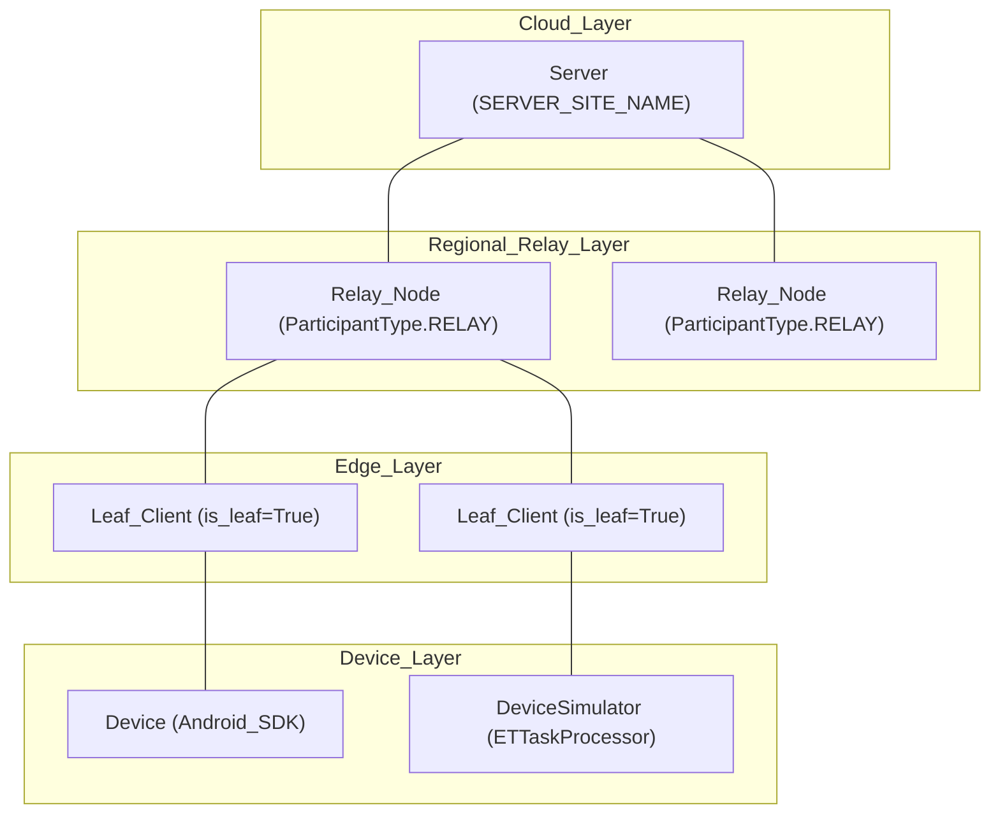
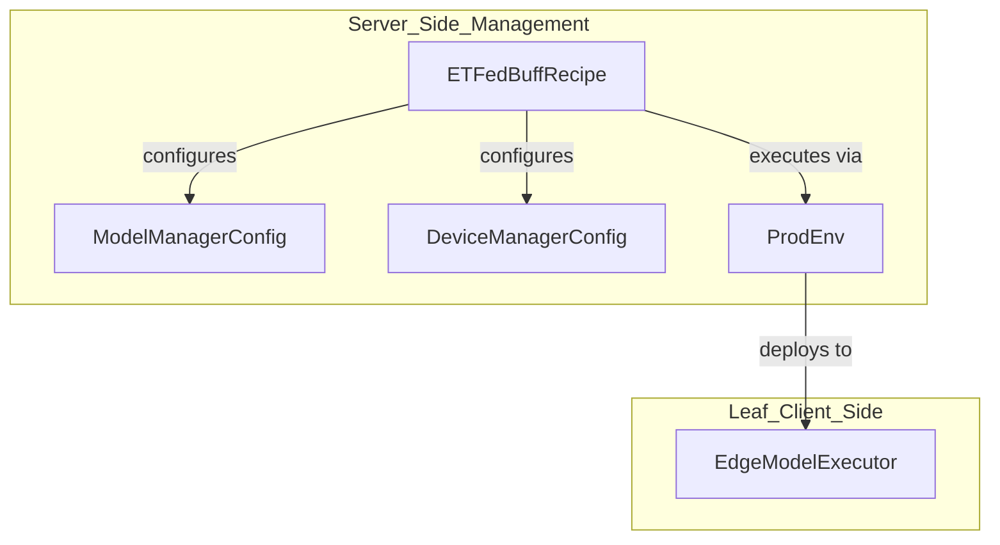

<!-- source: DeepWiki mcp.deepwiki.com · repo NVIDIA/NVFlare · page 15.1 Edge Architecture and Hierarchical Topology · fetched 2026-10-26 -->

# Edge Architecture and Hierarchical Topology

Relevant source files

The following files were used as context for generating this wiki page:

- [docs/user_guide/admin_guide/security/unsafe_component_detection.rst](docs/user_guide/admin_guide/security/unsafe_component_detection.rst)
- [docs/user_guide/nvflare_cli/provision_command.rst](docs/user_guide/nvflare_cli/provision_command.rst)
- [examples/advanced/edge/README.md](examples/advanced/edge/README.md)
- [examples/advanced/edge/baselines/cifar_fl_base.py](examples/advanced/edge/baselines/cifar_fl_base.py)
- [examples/advanced/edge/baselines/cifar_fl_base_job.py](examples/advanced/edge/baselines/cifar_fl_base_job.py)
- [examples/advanced/edge/baselines/cifar_train_central.py](examples/advanced/edge/baselines/cifar_train_central.py)
- [examples/advanced/edge/figs/async_comp.png](examples/advanced/edge/figs/async_comp.png)
- [examples/advanced/edge/figs/cifar10_acc.png](examples/advanced/edge/figs/cifar10_acc.png)
- [examples/advanced/edge/jobs/et_job.py](examples/advanced/edge/jobs/et_job.py)
- [examples/advanced/edge/jobs/processors/xor_et_task_processor.py](examples/advanced/edge/jobs/processors/xor_et_task_processor.py)
- [examples/advanced/edge/jobs/pt_job.py](examples/advanced/edge/jobs/pt_job.py)
- [examples/advanced/edge/jobs/pt_job_adv.py](examples/advanced/edge/jobs/pt_job_adv.py)
- [examples/advanced/edge/project.yml](examples/advanced/edge/project.yml)
- [examples/advanced/edge/requirements.txt](examples/advanced/edge/requirements.txt)
- [examples/advanced/federated-statistics/df_stats/client.py](examples/advanced/federated-statistics/df_stats/client.py)
- [examples/advanced/federated-statistics/image_stats/client.py](examples/advanced/federated-statistics/image_stats/client.py)
- [nvflare/apis/utils/format_check.py](nvflare/apis/utils/format_check.py)
- [nvflare/app_common/default_component_policy.py](nvflare/app_common/default_component_policy.py)
- [nvflare/app_common/widgets/component_path_authorizer.py](nvflare/app_common/widgets/component_path_authorizer.py)
- [nvflare/edge/aggregators/model_update_dxo.py](nvflare/edge/aggregators/model_update_dxo.py)
- [nvflare/edge/assessors/async_num.py](nvflare/edge/assessors/async_num.py)
- [nvflare/edge/assessors/buff_device_manager.py](nvflare/edge/assessors/buff_device_manager.py)
- [nvflare/edge/assessors/buff_model_manager.py](nvflare/edge/assessors/buff_model_manager.py)
- [nvflare/edge/assessors/device_manager.py](nvflare/edge/assessors/device_manager.py)
- [nvflare/edge/assessors/model_manager.py](nvflare/edge/assessors/model_manager.py)
- [nvflare/edge/assessors/model_update.py](nvflare/edge/assessors/model_update.py)
- [nvflare/edge/executors/edge_model_executor.py](nvflare/edge/executors/edge_model_executor.py)
- [nvflare/edge/mud.py](nvflare/edge/mud.py)
- [nvflare/edge/simulation/README.md](nvflare/edge/simulation/README.md)
- [nvflare/edge/updaters/emd.py](nvflare/edge/updaters/emd.py)
- [nvflare/edge/web/service/query.py](nvflare/edge/web/service/query.py)
- [nvflare/edge/widgets/api_service.py](nvflare/edge/widgets/api_service.py)
- [nvflare/edge/widgets/evaluator.py](nvflare/edge/widgets/evaluator.py)
- [nvflare/fuel/hci/server/authz.py](nvflare/fuel/hci/server/authz.py)
- [nvflare/fuel/sec/authz.py](nvflare/fuel/sec/authz.py)
- [nvflare/lighter/constants.py](nvflare/lighter/constants.py)
- [nvflare/lighter/ctx.py](nvflare/lighter/ctx.py)
- [nvflare/lighter/dummy_project.yml](nvflare/lighter/dummy_project.yml)
- [nvflare/lighter/edge_project.yml](nvflare/lighter/edge_project.yml)
- [nvflare/lighter/entity.py](nvflare/lighter/entity.py)
- [nvflare/lighter/impl/cert.py](nvflare/lighter/impl/cert.py)
- [nvflare/lighter/impl/docker.py](nvflare/lighter/impl/docker.py)
- [nvflare/lighter/impl/static_file.py](nvflare/lighter/impl/static_file.py)
- [nvflare/lighter/provision.py](nvflare/lighter/provision.py)
- [nvflare/lighter/provisioner.py](nvflare/lighter/provisioner.py)
- [nvflare/lighter/templates/master_template.yml](nvflare/lighter/templates/master_template.yml)
- [nvflare/lighter/tree_prov.py](nvflare/lighter/tree_prov.py)
- [nvflare/private/fed/utils/site_config.py](nvflare/private/fed/utils/site_config.py)
- [tests/unit_test/app_common/widgets/component_path_authorizer_test.py](tests/unit_test/app_common/widgets/component_path_authorizer_test.py)
- [tests/unit_test/fuel/flare_api_test.py](tests/unit_test/fuel/flare_api_test.py)
- [tests/unit_test/fuel/hci/server/authz_filter_test.py](tests/unit_test/fuel/hci/server/authz_filter_test.py)
- [tests/unit_test/lighter/__init__.py](tests/unit_test/lighter/__init__.py)
- [tests/unit_test/lighter/cert_builder_test.py](tests/unit_test/lighter/cert_builder_test.py)
- [tests/unit_test/lighter/participant_test.py](tests/unit_test/lighter/participant_test.py)
- [tests/unit_test/lighter/project_test.py](tests/unit_test/lighter/project_test.py)
- [tests/unit_test/lighter/static_file_builder_test.py](tests/unit_test/lighter/static_file_builder_test.py)
- [tests/unit_test/private/fed/utils/site_config_test.py](tests/unit_test/private/fed/utils/site_config_test.py)

This page describes the NVIDIA FLARE hierarchical architecture designed for cross-edge and cross-device federated learning. Unlike standard flat topologies, the edge architecture supports a multi-layered structure of servers, relays, and leaf clients to manage millions of intermittent devices efficiently.

## 1. Hierarchical Topology Overview

The edge system utilizes a tree-like structure to distribute communication loads and manage device connectivity. This topology is essential for scaling to large numbers of edge devices (e.g., mobile phones or IoT sensors) where a central server would become a bottleneck.

### Node Roles
*   **Server**: The root of the hierarchy, responsible for global orchestration and final aggregation [examples/advanced/edge/README.md:38-42]().
*   **Relay (Non-leaf Client)**: Intermediate nodes that forward messages and can perform partial aggregation. They do not execute training tasks directly [examples/advanced/edge/README.md:44-45](). 
*   **Leaf Client**: The bottom-most NVFLARE clients in the hierarchy. They act as gateways (Leaf Client Proxies) for real or simulated devices [examples/advanced/edge/README.md:44-45]().
*   **Device**: The actual end-point (Android, iOS, or simulated) where local training occurs [examples/advanced/edge/README.md:129-131]().

### Topology Visualization
The following diagram maps the logical hierarchy to the communication components and identifiers defined in the codebase.

**Hierarchical Data Flow and Code Entities**

Sources: [examples/advanced/edge/README.md:38-45](), [nvflare/lighter/constants.py:24-30](), [examples/advanced/edge/README.md:54-72](), [nvflare/lighter/templates/master_template.yml:123-124]()

## 2. FQSN Addressing and Routing

In a hierarchical setup, every node is identified by a **Fully Qualified Site Name (FQSN)**. This allows the communication layer to route messages through multiple hops.

*   **FQSN (Fully Qualified Site Name)**: Defines a site's position in the tree hierarchy [nvflare/lighter/constants.py:78-78](). It is rendered into the `fed_client.json` during provisioning [nvflare/lighter/templates/master_template.yml:123-123]().
*   **Leaf Client Proxy (LCP)**: Leaf nodes expose a proxy interface that devices use to connect. The mapping is stored in `lcp_map.json` [examples/advanced/edge/README.md:46-52]().
*   **lcp_map.json**: A configuration file generated during provisioning that maps leaf client names to their specific host/port for device ingestion [examples/advanced/edge/README.md:48-72]().
*   **Routing Proxy**: The `nvflare.edge.web.routing_proxy` module handles the HTTP/HTTPS traffic from devices to the leaf clients [examples/advanced/edge/README.md:100-101]().
*   **Flask-based Web Server**: The edge communication layer uses a Flask-based server (located in `nvflare/edge/web/`) to facilitate communication between devices and the leaf clients.

Sources: [examples/advanced/edge/README.md:46-72](), [examples/advanced/edge/README.md:100-101](), [nvflare/lighter/constants.py:75-81](), [nvflare/lighter/templates/master_template.yml:106-127]()

## 3. Edge Provisioning and Deployment

Provisioning an edge system requires defining the hierarchy structure in the project configuration (typically `project.yml`). The `hierachical_provision` function in `tree_prov.py` handles the logic for generating these multi-layered startup kits [nvflare/lighter/provision.py:30-30]().

### Provisioning Parameters
Users define the tree structure using specific depth and width parameters in the `project.yml` [examples/advanced/edge/README.md:38-42]().

| Parameter | Description |
| :--- | :--- |
| `depth` | Number of levels in the hierarchy (e.g., 1 indicates one layer of relays) [examples/advanced/edge/README.md:40-41]() |
| `width` | Number of connections for each node (e.g., 2 relays connecting to server) [examples/advanced/edge/README.md:42-42]() |
| `clients` | Number of leaf clients connecting to each relay [examples/advanced/edge/README.md:42-43]() |

### Execution and Scripts
*   **`start_all.sh`**: A master script generated in the workspace to start the entire hierarchical NVFlare system [nvflare/lighter/constants.py:193-193](), [examples/advanced/edge/README.md:75-79]().
*   **`start_rp.sh`**: Starts the Routing Proxy to listen for device connections [examples/advanced/edge/README.md:81-87]().
*   **HTTPS Support**: The proxy can be configured with SSL certificates (`--ssl-cert`, `--ssl-key`) to secure device-to-leaf communication [examples/advanced/edge/README.md:90-103]().

Sources: [examples/advanced/edge/README.md:38-42](), [examples/advanced/edge/README.md:75-103](), [nvflare/lighter/constants.py:160-194](), [nvflare/lighter/provision.py:24-31]()

## 4. Buffered Asynchronous Aggregation (FedBuff)

The edge architecture often utilizes asynchronous workflows to handle devices that connect at different times. The implementation follows a buffered asynchronous pattern (FedBuff).

### Key Components and Recipes
*   **`ETFedBuffRecipe`**: Configures and executes ExecuTorch-based federated buffering jobs [examples/advanced/edge/jobs/et_job.py:18-24]().
*   **`ModelManagerConfig`**: Defines parameters for asynchronous model management, such as `num_updates_for_model` and `max_model_version` [examples/advanced/edge/jobs/et_job.py:90-96]().
*   **`DeviceManagerConfig`**: Configures device selection strategies, including `device_selection_size` and `min_hole_to_fill` [examples/advanced/edge/jobs/et_job.py:97-100]().
*   **`ProdEnv`**: The production environment runner used to execute edge recipes in a provisioned hierarchical system [examples/advanced/edge/jobs/et_job.py:117-118]().

**Aggregation Code Entity Relationship**

Sources: [examples/advanced/edge/jobs/et_job.py:18-121](), [nvflare/lighter/constants.py:150-151]()

## 5. Edge Device Simulation

For prototyping and testing without physical hardware, NVFLARE provides a mechanism to run simulated device processes directly on leaf nodes [examples/advanced/edge/README.md:146-150]().

*   **`Cifar10ETTaskProcessor`**: An implementation for ExecuTorch-based simulation on the CIFAR-10 dataset [examples/advanced/edge/jobs/et_job.py:42-60]().
*   **`SimulationConfig`**: Defines parameters for the simulation, including `num_devices` and the `task_processor` to use [examples/advanced/edge/jobs/et_job.py:102-109]().
*   **`total_num_of_devices`**: The total number of devices (real + simulated) expected by the server for aggregation [examples/advanced/edge/jobs/et_job.py:32-38]().

**Simulation Flow**
1.  `ETFedBuffRecipe` configures the job for hierarchical execution using `ProdEnv` [examples/advanced/edge/jobs/et_job.py:85-118]().
2.  `ETTaskProcessor` (e.g., `Cifar10ETTaskProcessor`) is initialized with training configurations like batch size and epochs [examples/advanced/edge/jobs/et_job.py:51-60]().
3.  The `recipe.execute(env)` call triggers the deployment and execution of the simulation on the provisioned hierarchical system [examples/advanced/edge/jobs/et_job.py:117-118]().
4.  Leaf clients execute the training logic and report results back up the hierarchy to the server.

Sources: [examples/advanced/edge/README.md:146-150](), [examples/advanced/edge/jobs/et_job.py:42-118]()

---

