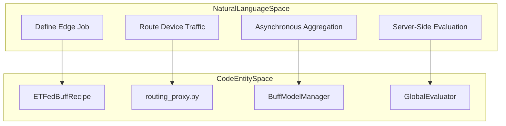
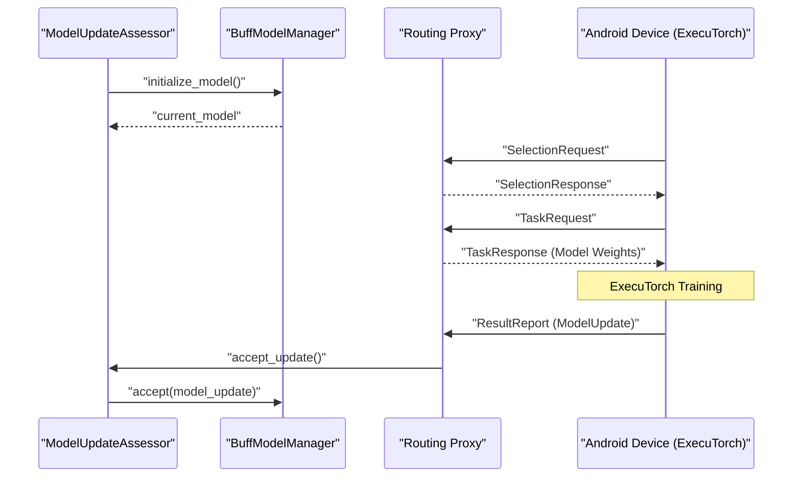
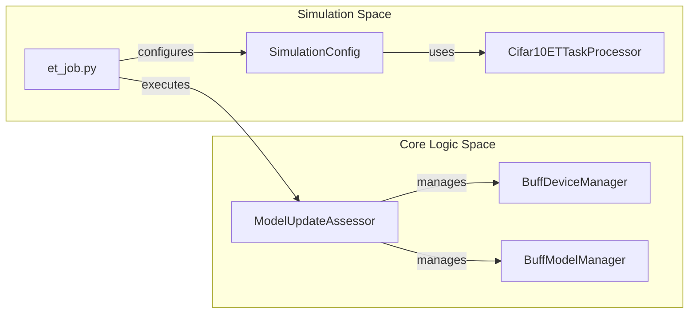

<!-- source: DeepWiki mcp.deepwiki.com · repo NVIDIA/NVFlare · page 15.2 Android SDK and ExecuTorch Integration · fetched 2026-10-26 -->

# Android SDK and ExecuTorch Integration

Relevant source files

The following files were used as context for generating this wiki page:

- [docs/programming_guide/hierarchical_communication.rst](docs/programming_guide/hierarchical_communication.rst)
- [docs/release_notes/extra_270.rst](docs/release_notes/extra_270.rst)
- [docs/release_notes/flare_270.rst](docs/release_notes/flare_270.rst)
- [docs/resources/FQSN_relay_hierarchy.png](docs/resources/FQSN_relay_hierarchy.png)
- [docs/resources/FQSN_server_directly.png](docs/resources/FQSN_server_directly.png)
- [docs/resources/client_hierarchy.png](docs/resources/client_hierarchy.png)
- [docs/resources/communication_hierarchy_clients.png](docs/resources/communication_hierarchy_clients.png)
- [docs/resources/communication_hierarchy_intermediary_nodes.png](docs/resources/communication_hierarchy_intermediary_nodes.png)
- [docs/self-paced-training/index.rst](docs/self-paced-training/index.rst)
- [docs/tutorials.rst](docs/tutorials.rst)
- [docs/user_guide/admin_guide/configurations/server_port_consolidation.rst](docs/user_guide/admin_guide/configurations/server_port_consolidation.rst)
- [docs/user_guide/edge_development/flare_mobile.rst](docs/user_guide/edge_development/flare_mobile.rst)
- [docs/user_guide/edge_development/index.rst](docs/user_guide/edge_development/index.rst)
- [docs/user_guide/edge_development/mobile_android.rst](docs/user_guide/edge_development/mobile_android.rst)
- [examples/advanced/edge/README.md](examples/advanced/edge/README.md)
- [examples/advanced/edge/baselines/cifar_fl_base.py](examples/advanced/edge/baselines/cifar_fl_base.py)
- [examples/advanced/edge/baselines/cifar_fl_base_job.py](examples/advanced/edge/baselines/cifar_fl_base_job.py)
- [examples/advanced/edge/baselines/cifar_train_central.py](examples/advanced/edge/baselines/cifar_train_central.py)
- [examples/advanced/edge/figs/async_comp.png](examples/advanced/edge/figs/async_comp.png)
- [examples/advanced/edge/figs/cifar10_acc.png](examples/advanced/edge/figs/cifar10_acc.png)
- [examples/advanced/edge/jobs/et_job.py](examples/advanced/edge/jobs/et_job.py)
- [examples/advanced/edge/jobs/processors/xor_et_task_processor.py](examples/advanced/edge/jobs/processors/xor_et_task_processor.py)
- [examples/advanced/edge/jobs/pt_job.py](examples/advanced/edge/jobs/pt_job.py)
- [examples/advanced/edge/jobs/pt_job_adv.py](examples/advanced/edge/jobs/pt_job_adv.py)
- [examples/advanced/edge/project.yml](examples/advanced/edge/project.yml)
- [examples/advanced/edge/requirements.txt](examples/advanced/edge/requirements.txt)
- [examples/advanced/federated-statistics/df_stats/client.py](examples/advanced/federated-statistics/df_stats/client.py)
- [examples/advanced/federated-statistics/image_stats/client.py](examples/advanced/federated-statistics/image_stats/client.py)
- [examples/tutorials/self-paced-training/README.md](examples/tutorials/self-paced-training/README.md)
- [examples/tutorials/self-paced-training/part-1_federated_learning_introduction/README.md](examples/tutorials/self-paced-training/part-1_federated_learning_introduction/README.md)
- [examples/tutorials/self-paced-training/part-1_federated_learning_introduction/part-1_introduction.ipynb](examples/tutorials/self-paced-training/part-1_federated_learning_introduction/part-1_introduction.ipynb)
- [examples/tutorials/self-paced-training/part-2_federated_learning_system/README.md](examples/tutorials/self-paced-training/part-2_federated_learning_system/README.md)
- [examples/tutorials/self-paced-training/part-2_federated_learning_system/part-2_introduction.ipynb](examples/tutorials/self-paced-training/part-2_federated_learning_system/part-2_introduction.ipynb)
- [examples/tutorials/self-paced-training/part-5_federated_learning_applications_in_industries/chapter-11_federated_learning_in_healthcare_lifescience/video.md](examples/tutorials/self-paced-training/part-5_federated_learning_applications_in_industries/chapter-11_federated_learning_in_healthcare_lifescience/video.md)
- [nvflare/edge/aggregators/model_update_dxo.py](nvflare/edge/aggregators/model_update_dxo.py)
- [nvflare/edge/assessors/async_num.py](nvflare/edge/assessors/async_num.py)
- [nvflare/edge/assessors/buff_device_manager.py](nvflare/edge/assessors/buff_device_manager.py)
- [nvflare/edge/assessors/buff_model_manager.py](nvflare/edge/assessors/buff_model_manager.py)
- [nvflare/edge/assessors/device_manager.py](nvflare/edge/assessors/device_manager.py)
- [nvflare/edge/assessors/model_manager.py](nvflare/edge/assessors/model_manager.py)
- [nvflare/edge/assessors/model_update.py](nvflare/edge/assessors/model_update.py)
- [nvflare/edge/executors/edge_model_executor.py](nvflare/edge/executors/edge_model_executor.py)
- [nvflare/edge/mud.py](nvflare/edge/mud.py)
- [nvflare/edge/updaters/emd.py](nvflare/edge/updaters/emd.py)
- [nvflare/edge/web/service/query.py](nvflare/edge/web/service/query.py)
- [nvflare/edge/widgets/api_service.py](nvflare/edge/widgets/api_service.py)
- [nvflare/edge/widgets/evaluator.py](nvflare/edge/widgets/evaluator.py)

The NVFlare Android SDK enables federated learning on mobile devices by providing a runtime that integrates with the NVFlare hierarchical edge architecture. It leverages **ExecuTorch** for high-performance, on-device training and inference. The system is designed to allow data scientists to deploy models to Android without writing native Java or Kotlin code, as NVFlare handles the PyTorch to ExecuTorch conversion and orchestration automatically [docs/release_notes/flare_270.rst:156-158]().

## System Architecture

The Android integration is built upon a hierarchical topology where mobile devices (leaf nodes) connect to the NVFlare system via a **Routing Proxy (RP)** [examples/advanced/edge/README.md:81-87](). This proxy routes traffic to the appropriate leaf clients in the FL hierarchy based on a mapping configuration defined in `lcp_map.json` [examples/advanced/edge/README.md:48-51](), [examples/advanced/edge/README.md:135-135]().

### High-Level Data Flow
1.  **Job Submission**: A job is submitted using the `ETFedBuffRecipe`, which handles the export of the `device_model` and configuration for ExecuTorch training [examples/advanced/edge/jobs/et_job.py:85-111]().
2.  **Model Distribution**: The server distributes the model to leaf clients. Mobile devices connect to the Routing Proxy to fetch these tasks via `SelectionRequest` and `TaskRequest` [examples/advanced/edge/executors/edge_model_executor.py:147-172](), [examples/advanced/edge/README.md:131-135]().
3.  **On-Device Execution**: The mobile app uses the SDK to download the model, performs local training using ExecuTorch, and computes parameter updates [examples/advanced/edge/README.md:141-141]().
4.  **Aggregation**: Results are sent back through the proxy to the leaf clients as a `ResultReport`, which then propagate updates up the hierarchy for global aggregation [examples/advanced/edge/executors/edge_model_executor.py:124-135](), [examples/advanced/edge/README.md:141-142]().

### Code Entity Mapping: Orchestration
The following diagram maps the logical FL phases to specific code entities within the NVFlare Edge and Android ecosystem.

**Orchestration and Task Flow**

**Sources:** [examples/advanced/edge/jobs/et_job.py:85-111](), [examples/advanced/edge/README.md:100-101](), [nvflare/edge/assessors/buff_model_manager.py:42-43](), [nvflare/edge/widgets/evaluator.py:35-42]()

## ExecuTorch Integration

The integration utilizes ExecuTorch's training extension to perform updates on-device. The system supports asynchronous federated learning (FedBuff) to handle intermittent device participation [docs/release_notes/flare_270.rst:153-154]().

### Key Components
*   **ETFedBuffRecipe**: A specialized recipe for ExecuTorch-based Federated Buffering. It configures the `ModelManagerConfig`, `DeviceManagerConfig`, and `SimulationConfig` for edge environments [examples/advanced/edge/jobs/et_job.py:85-111]().
*   **BuffModelManager**: Implements the aggregation scheme following the FedBuff paper. It manages model versions and applies staleness weights to updates using `staleness_weight` logic [nvflare/edge/assessors/buff_model_manager.py:42-53](), [nvflare/edge/assessors/buff_model_manager.py:111-114]().
*   **BuffDeviceManager**: Responsible for selecting devices for training. It maintains available device pools and refills the selection based on `min_hole_to_fill`. It supports `balanced` and `random` sampling strategies [nvflare/edge/assessors/buff_device_manager.py:24-49]().
*   **EdgeModelExecutor**: Handles the conversion of tasks and results between the NVFlare `DXO` format and the on-device communication format [nvflare/edge/executors/edge_model_executor.py:35-47]().

### Model Processing and Training
The training loop on the device (or simulated device) involves converting parameters and calculating differences between initial and final weights. On the server side, `ModelUpdateAssessor` coordinates the flow between the persistor and the managers [nvflare/edge/assessors/model_update.py:133-158]().

**Training Execution Logic**

**Sources:** [nvflare/edge/assessors/model_update.py:154-158](), [nvflare/edge/assessors/buff_model_manager.py:73-77](), [nvflare/edge/executors/edge_model_executor.py:147-172](), [nvflare/edge/assessors/buff_model_manager.py:36-39]()

## Mobile App Setup

Mobile application developers integrate the SDK to handle communication with the Routing Proxy. The Android example provided in the codebase is source-only and requires an Android Studio project for deployment [examples/advanced/edge/README.md:131-131]().

### Configuration and Connectivity
Mobile devices connect to the system using the IP address of the machine running the Routing Proxy, typically on port 4321 [examples/advanced/edge/README.md:135-138]().

| Requirement | Value / Path |
| :--- | :--- |
| **Routing Proxy Port** | 4321 (default) [examples/advanced/edge/README.md:87-87]() |
| **Leaf Client Map** | `lcp_map.json` [examples/advanced/edge/README.md:48-51]() |
| **Security** | Supports HTTPS with self-signed certs via `--ssl-cert` [examples/advanced/edge/README.md:98-101]() |
| **Device Training** | Configured via `device_training_params` in the recipe [examples/advanced/edge/jobs/et_job.py:110-110]() |

### Provisioning the Hierarchical System
The edge system is provisioned using a `project.yml` that defines the hierarchy depth and width.
*   **Depth**: Number of levels in the hierarchy [examples/advanced/edge/README.md:40-40]().
*   **Width**: Number of connections for each node [examples/advanced/edge/README.md:41-41]().
*   **Leaf Clients**: The nodes that mobile devices or simulators connect to; non-leaf clients are used for intermediate updates [examples/advanced/edge/README.md:44-44]().

**Sources:** [examples/advanced/edge/README.md:38-44](), [examples/advanced/edge/jobs/et_job.py:110-110]()

## Simulation and Prototyping

Before deploying to real Android hardware, NVFlare provides tools to simulate the cross-device pipeline using task processors like `Cifar10ETTaskProcessor` [examples/advanced/edge/jobs/et_job.py:42-51]().

*   **Device Simulation**: The `SimulationConfig` within the recipe allows running multiple simulated devices on each leaf client [examples/advanced/edge/jobs/et_job.py:102-109]().
*   **Hybrid Jobs**: Developers can run jobs with a mix of simulated and real devices by adjusting `total_num_of_devices` relative to the simulated count [examples/advanced/edge/README.md:117-126]().
*   **Sampling Strategies**: `BuffDeviceManager` supports `balanced` (try to balance usage across clients) or `random` sampling strategies for filling device slots [nvflare/edge/assessors/buff_device_manager.py:46-49]().

**Progress and Simulation Mapping**

**Sources:** [examples/advanced/edge/jobs/et_job.py:102-115](), [nvflare/edge/assessors/model_update.py:143-152](), [nvflare/edge/assessors/buff_device_manager.py:24-32]()

---

