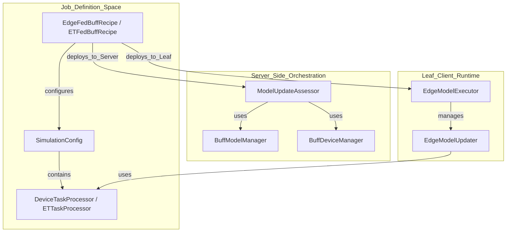
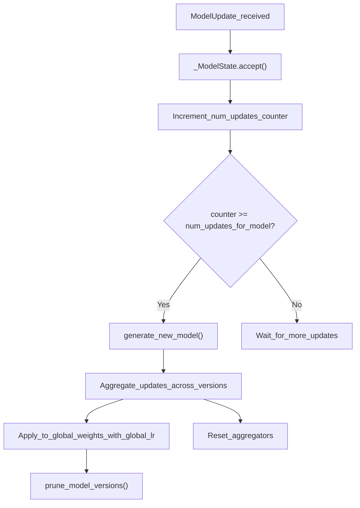

<!-- source: DeepWiki mcp.deepwiki.com · repo NVIDIA/NVFlare · page 15.3 Edge Device Simulation · fetched 2026-10-26 -->

# Edge Device Simulation

Relevant source files

The following files were used as context for generating this wiki page:

- [examples/advanced/edge/README.md](examples/advanced/edge/README.md)
- [examples/advanced/edge/baselines/cifar_fl_base.py](examples/advanced/edge/baselines/cifar_fl_base.py)
- [examples/advanced/edge/baselines/cifar_fl_base_job.py](examples/advanced/edge/baselines/cifar_fl_base_job.py)
- [examples/advanced/edge/baselines/cifar_train_central.py](examples/advanced/edge/baselines/cifar_train_central.py)
- [examples/advanced/edge/figs/async_comp.png](examples/advanced/edge/figs/async_comp.png)
- [examples/advanced/edge/figs/cifar10_acc.png](examples/advanced/edge/figs/cifar10_acc.png)
- [examples/advanced/edge/jobs/et_job.py](examples/advanced/edge/jobs/et_job.py)
- [examples/advanced/edge/jobs/processors/xor_et_task_processor.py](examples/advanced/edge/jobs/processors/xor_et_task_processor.py)
- [examples/advanced/edge/jobs/pt_job.py](examples/advanced/edge/jobs/pt_job.py)
- [examples/advanced/edge/jobs/pt_job_adv.py](examples/advanced/edge/jobs/pt_job_adv.py)
- [examples/advanced/edge/project.yml](examples/advanced/edge/project.yml)
- [examples/advanced/edge/requirements.txt](examples/advanced/edge/requirements.txt)
- [examples/advanced/federated-statistics/df_stats/client.py](examples/advanced/federated-statistics/df_stats/client.py)
- [examples/advanced/federated-statistics/image_stats/client.py](examples/advanced/federated-statistics/image_stats/client.py)
- [nvflare/edge/aggregators/model_update_dxo.py](nvflare/edge/aggregators/model_update_dxo.py)
- [nvflare/edge/assessors/async_num.py](nvflare/edge/assessors/async_num.py)
- [nvflare/edge/assessors/buff_device_manager.py](nvflare/edge/assessors/buff_device_manager.py)
- [nvflare/edge/assessors/buff_model_manager.py](nvflare/edge/assessors/buff_model_manager.py)
- [nvflare/edge/assessors/device_manager.py](nvflare/edge/assessors/device_manager.py)
- [nvflare/edge/assessors/model_manager.py](nvflare/edge/assessors/model_manager.py)
- [nvflare/edge/assessors/model_update.py](nvflare/edge/assessors/model_update.py)
- [nvflare/edge/executors/edge_model_executor.py](nvflare/edge/executors/edge_model_executor.py)
- [nvflare/edge/mud.py](nvflare/edge/mud.py)
- [nvflare/edge/updaters/emd.py](nvflare/edge/updaters/emd.py)
- [nvflare/edge/web/service/query.py](nvflare/edge/web/service/query.py)
- [nvflare/edge/widgets/api_service.py](nvflare/edge/widgets/api_service.py)
- [nvflare/edge/widgets/evaluator.py](nvflare/edge/widgets/evaluator.py)

Edge Device Simulation provides a mechanism to test cross-device Federated Learning (FL) pipelines locally by simulating thousands of edge devices (e.g., mobile or IoT) within a hierarchical NVIDIA FLARE topology. This allows developers to prototype and validate asynchronous FL workflows, such as those based on the FedBuff algorithm, without requiring physical mobile hardware.

## Overview and Purpose

The edge simulation system is distinct from the standard `SimulatorRunner`. While the standard simulator handles flat client-server topologies, the edge system relies on a hierarchical topology (**Server → Relays → Leaf Clients → Devices**) [examples/advanced/edge/README.md:16-17](). In this architecture, leaf clients (e.g., C11, C12) act as gateways that run device simulations or connect to real devices [examples/advanced/edge/README.md:43-45]().

The simulation capability is primarily implemented through `SimulationConfig` and specialized task processors [examples/advanced/edge/jobs/et_job.py:102-109](). This allows for high-fidelity testing of asynchronous aggregation logic where devices report updates at different times based on simulated computation speeds and data availability.

### Key Capabilities
*   **Hierarchical Simulation:** Supports multi-layer topologies with relays and leaf clients defined in `project.yml` [examples/advanced/edge/README.md:30-42]().
*   **Scale Testing:** Simulate numerous devices per leaf node by defining `num_devices` in the simulation configuration [examples/advanced/edge/jobs/et_job.py:105-105]().
*   **Framework Support:** Includes simulations for both pure PyTorch and ExecuTorch-based cross-edge FL [examples/advanced/edge/README.md:7-9]().
*   **Recipe-Based Deployment:** Uses `EdgeFedBuffRecipe` or `ETFedBuffRecipe` to automate the configuration of server controllers and client executors [examples/advanced/edge/jobs/et_job.py:85-111]().

**Sources:** [examples/advanced/edge/README.md:1-45](), [examples/advanced/edge/jobs/et_job.py:15-111]()

---

## System Architecture and Data Flow

The simulation is orchestrated through "Recipes" which encapsulate the components needed for edge orchestration, such as the `ModelUpdateAssessor` on the server and `EdgeModelExecutor` on the leaf clients [nvflare/edge/assessors/model_update.py:29-65](), [nvflare/edge/executors/edge_model_executor.py:35-45]().

### Code Entity Relationship Diagram

This diagram maps edge simulation components to the specific classes and configurations in the codebase.

Title: "Edge Simulation Code Entity Mapping"

**Sources:** [nvflare/edge/assessors/model_update.py:29-65](), [nvflare/edge/assessors/buff_model_manager.py:42-72](), [nvflare/edge/assessors/buff_device_manager.py:24-68](), [nvflare/edge/executors/edge_model_executor.py:35-60](), [nvflare/edge/updaters/emd.py:64-91](), [examples/advanced/edge/jobs/et_job.py:85-111]()

### Data Flow: Simulation Execution
1.  **Device Discovery:** In simulation mode, the leaf client accepts "alive" devices based on the `num_devices` configuration. This is reported to the server via `accept_alive_device` in the `EdgeModelExecutor` [nvflare/edge/executors/edge_model_executor.py:99-122]().
2.  **Server State Management:** The `ModelUpdateAssessor` receives device availability and updates the `BuffDeviceManager` [nvflare/edge/assessors/model_update.py:149-152]().
3.  **Task Distribution:** When the server determines enough devices are available, it triggers a task. The `EdgeModelExecutor` processes the task request and returns a model version and selection ID to the simulated device [nvflare/edge/executors/edge_model_executor.py:147-172]().
4.  **Local Simulation:** The `EdgeModelExecutor` manages the `EdgeModelUpdater`, which prepares updates for the parent node [nvflare/edge/updaters/emd.py:97-129](). The training logic is encapsulated in task processors like `Cifar10ETTaskProcessor` [examples/advanced/edge/jobs/et_job.py:42-60]().
5.  **Result Reporting:** Simulated results are converted back to `ModelUpdate` objects and sent to the server for buffered aggregation [nvflare/edge/executors/edge_model_executor.py:70-97]().

**Sources:** [nvflare/edge/executors/edge_model_executor.py:35-172](), [nvflare/edge/assessors/model_update.py:29-160](), [nvflare/edge/updaters/emd.py:97-129](), [examples/advanced/edge/jobs/et_job.py:42-60]()

---

## Configuration and Simulation Parameters

Simulation parameters are defined within the `SimulationConfig` and passed to the recipe.

### Simulation Settings
| Parameter | Source | Description |
| :--- | :--- | :--- |
| `num_devices` | `SimulationConfig` | Number of simulated devices to run on each leaf node [examples/advanced/edge/jobs/et_job.py:105-105](). |
| `task_processor` | `SimulationConfig` | The `DeviceTaskProcessor` implementation containing training logic [examples/advanced/edge/jobs/et_job.py:104-104](). |
| `job_timeout` | `SimulationConfig` | Timeout in seconds for the simulation job [examples/advanced/edge/jobs/pt_job_adv.py:91-91](). |
| `num_workers` | `SimulationConfig` | Number of worker processes for parallel simulation execution [examples/advanced/edge/jobs/pt_job_adv.py:92-92](). |

**Sources:** [examples/advanced/edge/jobs/et_job.py:102-109](), [examples/advanced/edge/jobs/pt_job_adv.py:89-94]()

### Asynchronous Logic Configuration
The `BuffModelManager` and `BuffDeviceManager` control the buffered behavior:
*   `num_updates_for_model`: Number of updates required before generating a new global model version [nvflare/edge/assessors/buff_model_manager.py:45-45]().
*   `device_selection_size`: Number of devices to select for each model update round [nvflare/edge/assessors/buff_device_manager.py:58-58]().
*   `min_hole_to_fill`: Minimum number of empty slots in device selection before refilling the pool [nvflare/edge/assessors/buff_device_manager.py:60-60]().

**Sources:** [nvflare/edge/assessors/buff_model_manager.py:42-72](), [nvflare/edge/assessors/buff_device_manager.py:24-68]()

---

## Implementation Details

### Buffered Aggregation (FedBuff)
The `BuffModelManager` implements the FedBuff algorithm. It maintains multiple active model versions and aggregates updates with optional `staleness_weight` [nvflare/edge/assessors/buff_model_manager.py:42-72](). When `num_updates_for_model` is reached, it generates a new global model version by applying aggregated updates to the current weights using a `global_lr` [nvflare/edge/assessors/buff_model_manager.py:105-142]().

Title: "Buffered Aggregation Flow"

**Sources:** [nvflare/edge/assessors/buff_model_manager.py:30-153](), [nvflare/edge/assessors/model_update.py:206-225]()

### Device Management and Sampling
The `BuffDeviceManager` handles device selection strategies. The `balanced` strategy attempts to distribute work evenly across different leaf clients by grouping devices by their parent client and performing round-robin sampling [nvflare/edge/assessors/buff_device_manager.py:69-125]().

### Variable Substitution and Deployment
Edge simulation relies on hierarchical provisioning. The `nvflare provision` command uses a `project.yml` to define the tree structure [examples/advanced/edge/README.md:30-42](). This produces a `lcp_map.json` that maps leaf client names (e.g., "C11") to their internal host and port, which routing proxies use to route traffic [examples/advanced/edge/README.md:48-72]().

The `EdgeModelExecutor` dynamically handles device IDs. If a range is provided (using `MAX_INDICATOR`), it automatically registers multiple simulated devices for that leaf node [nvflare/edge/executors/edge_model_executor.py:99-122]().

**Sources:** [nvflare/edge/assessors/buff_device_manager.py:69-148](), [nvflare/edge/executors/edge_model_executor.py:99-122](), [examples/advanced/edge/README.md:30-72]()

---

