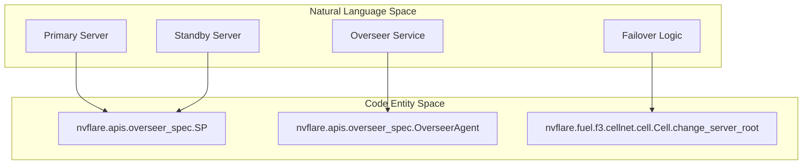
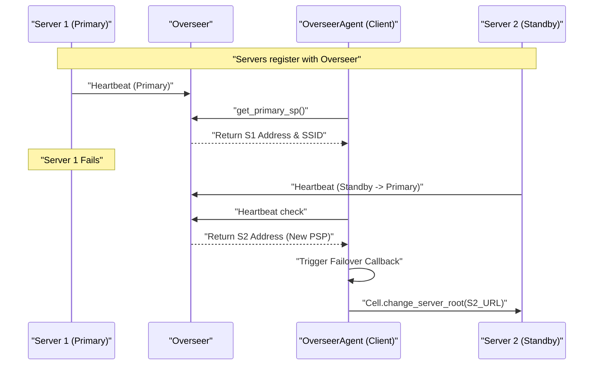

<!-- source: DeepWiki mcp.deepwiki.com · repo NVIDIA/NVFlare · page 16 High Availability and Overseer · fetched 2026-10-26 -->

# High Availability and Overseer

Relevant source files

The following files were used as context for generating this wiki page:

- [docs/release_notes/flare_280.rst](docs/release_notes/flare_280.rst)
- [docs/resources/server_peak_memory_disk_offload.png](docs/resources/server_peak_memory_disk_offload.png)
- [nvflare/apis/client_engine_spec.py](nvflare/apis/client_engine_spec.py)
- [nvflare/apis/fl_constant.py](nvflare/apis/fl_constant.py)
- [nvflare/apis/job_scheduler_spec.py](nvflare/apis/job_scheduler_spec.py)
- [nvflare/apis/server_engine_spec.py](nvflare/apis/server_engine_spec.py)
- [nvflare/app_common/job_schedulers/job_scheduler.py](nvflare/app_common/job_schedulers/job_scheduler.py)
- [nvflare/fuel/common/fqn.py](nvflare/fuel/common/fqn.py)
- [nvflare/fuel/f3/cellnet/core_cell.py](nvflare/fuel/f3/cellnet/core_cell.py)
- [nvflare/fuel/f3/cellnet/defs.py](nvflare/fuel/f3/cellnet/defs.py)
- [nvflare/fuel/f3/cellnet/fqcn.py](nvflare/fuel/f3/cellnet/fqcn.py)
- [nvflare/fuel/f3/cellnet/identity.py](nvflare/fuel/f3/cellnet/identity.py)
- [nvflare/fuel/f3/cellnet/utils.py](nvflare/fuel/f3/cellnet/utils.py)
- [nvflare/fuel/utils/pipe/cell_pipe.py](nvflare/fuel/utils/pipe/cell_pipe.py)
- [nvflare/private/aux_runner.py](nvflare/private/aux_runner.py)
- [nvflare/private/fed/app/client/client_train.py](nvflare/private/fed/app/client/client_train.py)
- [nvflare/private/fed/app/client/sub_worker_process.py](nvflare/private/fed/app/client/sub_worker_process.py)
- [nvflare/private/fed/app/client/worker_process.py](nvflare/private/fed/app/client/worker_process.py)
- [nvflare/private/fed/app/server/runner_process.py](nvflare/private/fed/app/server/runner_process.py)
- [nvflare/private/fed/app/server/server_train.py](nvflare/private/fed/app/server/server_train.py)
- [nvflare/private/fed/authenticator.py](nvflare/private/fed/authenticator.py)
- [nvflare/private/fed/client/client_app_runner.py](nvflare/private/fed/client/client_app_runner.py)
- [nvflare/private/fed/client/client_engine.py](nvflare/private/fed/client/client_engine.py)
- [nvflare/private/fed/client/client_engine_executor_spec.py](nvflare/private/fed/client/client_engine_executor_spec.py)
- [nvflare/private/fed/client/client_engine_internal_spec.py](nvflare/private/fed/client/client_engine_internal_spec.py)
- [nvflare/private/fed/client/client_executor.py](nvflare/private/fed/client/client_executor.py)
- [nvflare/private/fed/client/client_run_manager.py](nvflare/private/fed/client/client_run_manager.py)
- [nvflare/private/fed/client/client_runner.py](nvflare/private/fed/client/client_runner.py)
- [nvflare/private/fed/client/command_agent.py](nvflare/private/fed/client/command_agent.py)
- [nvflare/private/fed/client/communicator.py](nvflare/private/fed/client/communicator.py)
- [nvflare/private/fed/client/fed_client.py](nvflare/private/fed/client/fed_client.py)
- [nvflare/private/fed/client/fed_client_base.py](nvflare/private/fed/client/fed_client_base.py)
- [nvflare/private/fed/server/fed_server.py](nvflare/private/fed/server/fed_server.py)
- [nvflare/private/fed/server/job_runner.py](nvflare/private/fed/server/job_runner.py)
- [nvflare/private/fed/server/server_command_agent.py](nvflare/private/fed/server/server_command_agent.py)
- [nvflare/private/fed/server/server_commands.py](nvflare/private/fed/server/server_commands.py)
- [nvflare/private/fed/server/server_engine.py](nvflare/private/fed/server/server_engine.py)
- [nvflare/private/fed/server/server_runner.py](nvflare/private/fed/server/server_runner.py)
- [nvflare/private/fed/utils/fed_utils.py](nvflare/private/fed/utils/fed_utils.py)
- [tests/integration_test/data/test_configs/standalone_job/ext_process_streaming.yml](tests/integration_test/data/test_configs/standalone_job/ext_process_streaming.yml)
- [tests/unit_test/app_common/job_schedulers/job_scheduler_test.py](tests/unit_test/app_common/job_schedulers/job_scheduler_test.py)
- [tests/unit_test/fuel/f3/cellnet/__init__.py](tests/unit_test/fuel/f3/cellnet/__init__.py)
- [tests/unit_test/fuel/f3/cellnet/core_cell_routing_test.py](tests/unit_test/fuel/f3/cellnet/core_cell_routing_test.py)
- [tests/unit_test/fuel/f3/cellnet/identity_binding_test.py](tests/unit_test/fuel/f3/cellnet/identity_binding_test.py)
- [tests/unit_test/fuel/f3/cellnet/utils_test.py](tests/unit_test/fuel/f3/cellnet/utils_test.py)
- [tests/unit_test/fuel/hci/admin_api_test.py](tests/unit_test/fuel/hci/admin_api_test.py)
- [tests/unit_test/fuel/utils/pipe/cell_pipe_test.py](tests/unit_test/fuel/utils/pipe/cell_pipe_test.py)
- [tests/unit_test/private/fed/authenticator_test.py](tests/unit_test/private/fed/authenticator_test.py)
- [tests/unit_test/private/fed/client/client_executor_test.py](tests/unit_test/private/fed/client/client_executor_test.py)
- [tests/unit_test/private/fed/server/fed_server_test.py](tests/unit_test/private/fed/server/fed_server_test.py)
- [tests/unit_test/private/fed/server/job_runner_test.py](tests/unit_test/private/fed/server/job_runner_test.py)

NVIDIA FLARE provides a High Availability (HA) framework to ensure continuous operation of the federated learning ecosystem even in the event of a server failure. The system relies on a centralized **Overseer** service that coordinates between multiple server instances and clients to manage failover and maintain system state.

### High Availability Overview

The HA architecture introduces a multi-server deployment model where one server acts as the **Primary Service Provider (PSP)** while others remain in a standby state. The Overseer acts as the source of truth for the current state of the federation, directing clients and admin consoles to the active primary server.

#### Key Components
*   **Overseer**: A standalone service (typically a web service) that maintains the list of available servers and their statuses.
*   **OverseerAgent**: A component integrated into Servers, Clients, and Admin consoles to communicate with the Overseer.
*   **Service Provider (SP)**: A data structure representing a server instance, including its connectivity details and session ID.
*   **SSID (Service Session ID)**: A unique identifier used to track session continuity across failovers, stored in the `FLContext` under the key `__ssid__` [nvflare/apis/fl_constant.py:171-171]().

### System Topology and Code Entities

The following diagram illustrates how natural language concepts map to specific classes and data structures within the `nvflare` codebase.

**HA Entity Mapping**

**Sources:** [nvflare/private/fed/client/fed_client_base.py:134-135](), [nvflare/apis/fl_constant.py:171-171](), [nvflare/private/fed/server/fed_server.py:183-190]()

---

### Overseer Architecture
The Overseer service facilitates the "election" and maintenance of the Primary Service Provider. It does not handle FL data itself; instead, it manages the metadata required for participants to find the correct server. Participants use an `OverseerAgent` to communicate with this service. In the client, the `FederatedClientBase` manages connectivity to the server, including switching targets if the Overseer indicates a change [nvflare/private/fed/client/fed_client_base.py:114-140]().

| Component | Responsibility | Code Reference |
| :--- | :--- | :--- |
| **SP Dataclass** | Holds connectivity info like `name`, `fl_port`, and `admin_port`. | `nvflare.apis.overseer_spec.SP` |
| **OverseerAgent** | Abstract base class defining `start()`, `get_primary_sp()`, and `promote_sp()`. | `nvflare.apis.overseer_spec.OverseerAgent` |
| **Cell Integration** | The `Cell` object provides `change_server_root` to redirect traffic to a new PSP. | [nvflare/private/fed/client/fed_client_base.py:134-135]() |
| **SSID** | Service Session ID used to track session continuity in `FLContext`. | [nvflare/apis/fl_constant.py:171-171]() |

For a deep dive into the heartbeat mechanism, server election, and agent implementation, see **[Overseer Architecture](#16.1)**.

**Sources:** [nvflare/private/fed/client/fed_client_base.py:114-140](), [nvflare/apis/fl_constant.py:171-171](), [nvflare/private/fed/server/fed_server.py:183-190](), [nvflare/fuel/f3/cellnet/cell.py:134-135]()

---

### HA Configuration and Failover
Failover is triggered when the `OverseerAgent` detects that the current Primary SP is no longer available. The system uses a **Service Session ID (SSID)** to ensure that clients and servers are synchronized on the same session [nvflare/private/fed/client/communicator.py:113-118](). When a new primary SP is identified, the client updates its internal server target via the `connect_to_server` logic [nvflare/private/fed/client/fed_client_base.py:114-130]().

**Failover Sequence**

**Sources:** [nvflare/private/fed/client/fed_client_base.py:114-140](), [nvflare/private/fed/client/communicator.py:113-118](), [nvflare/private/fed/server/fed_server.py:183-192]()

The provisioning system supports HA by generating configurations for multiple servers. During execution, the `ServerEngine` [nvflare/private/fed/server/server_engine.py:89-128]() and `JobRunner` [nvflare/private/fed/server/job_runner.py:94-102]() handle the deployment of jobs across the cluster, ensuring that the `job_id` [nvflare/apis/fl_constant.py:156-156]() and session state remain consistent across potential failovers [nvflare/private/fed/server/server_engine.py:177-190](), [nvflare/private/fed/server/job_runner.py:125-148](). The `JobRunner` specifically manages job deployment to participants [nvflare/private/fed/server/job_runner.py:125-133]() and coordinates site-specific application data [nvflare/private/fed/server/job_runner.py:149-151]().

For details on configuring HA in the project `project.yml`, SSID management, and automatic reconnection logic, see **[HA Configuration and Failover](#16.2)**.

**Sources:** [nvflare/private/fed/client/fed_client_base.py:114-140](), [nvflare/private/fed/client/communicator.py:113-118](), [nvflare/private/fed/server/server_engine.py:89-190](), [nvflare/private/fed/server/job_runner.py:94-151](), [nvflare/apis/fl_constant.py:156-171]()

---

