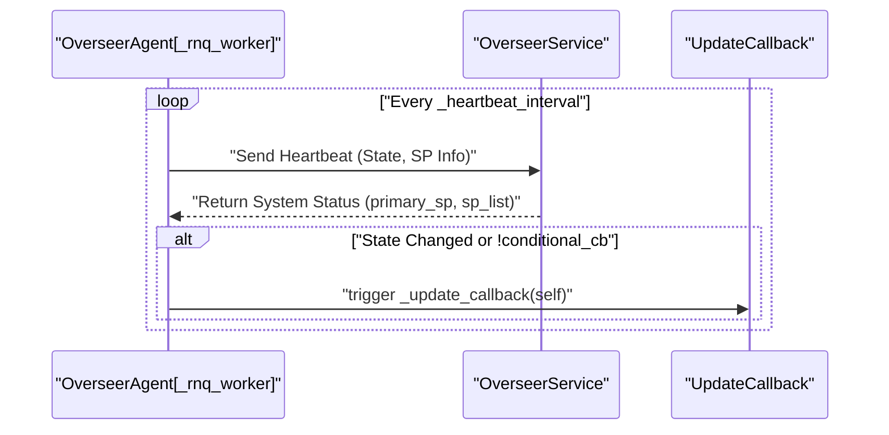
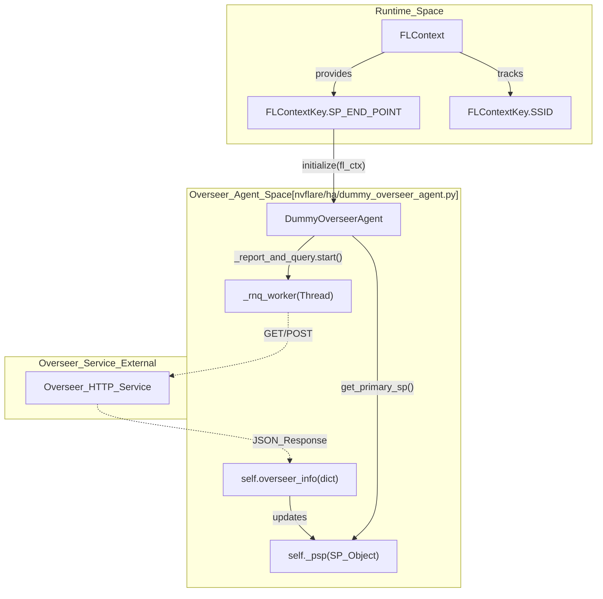
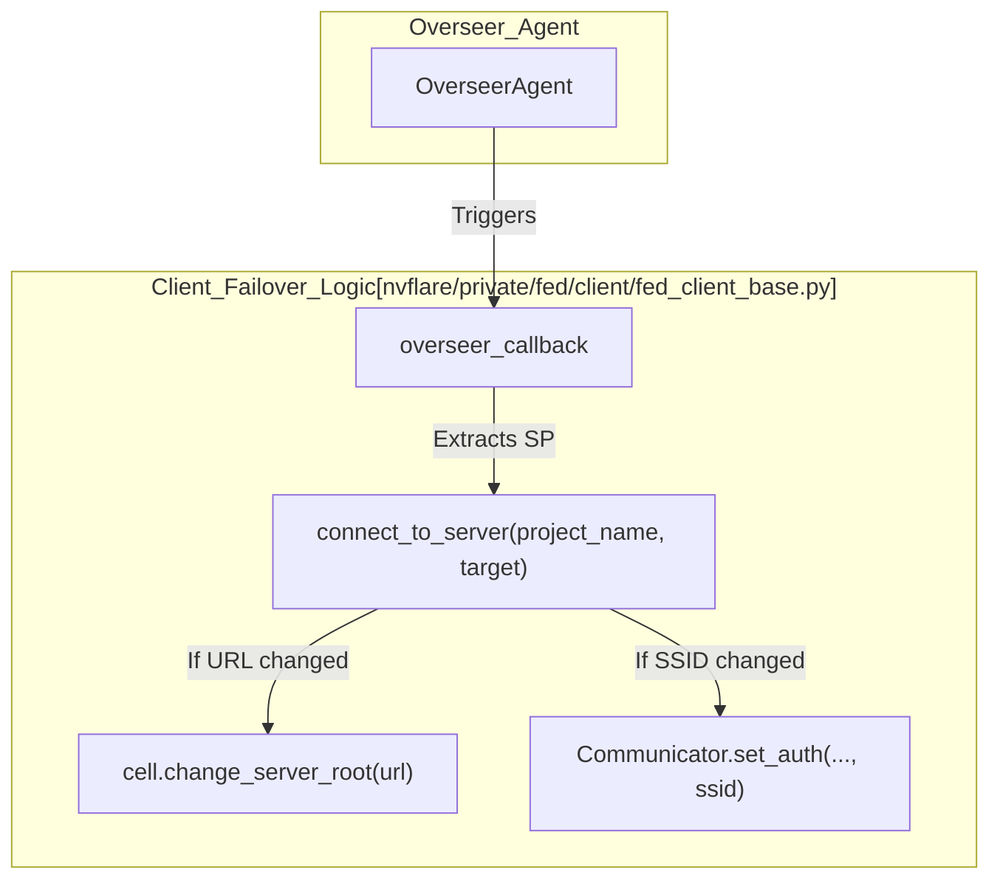

<!-- source: DeepWiki mcp.deepwiki.com · repo NVIDIA/NVFlare · page 16.1 Overseer Architecture · fetched 2026-10-26 -->

# Overseer Architecture

Relevant source files

The following files were used as context for generating this wiki page:

- [docs/release_notes/flare_280.rst](docs/release_notes/flare_280.rst)
- [docs/resources/server_peak_memory_disk_offload.png](docs/resources/server_peak_memory_disk_offload.png)
- [nvflare/apis/client_engine_spec.py](nvflare/apis/client_engine_spec.py)
- [nvflare/apis/fl_constant.py](nvflare/apis/fl_constant.py)
- [nvflare/apis/job_scheduler_spec.py](nvflare/apis/job_scheduler_spec.py)
- [nvflare/apis/server_engine_spec.py](nvflare/apis/server_engine_spec.py)
- [nvflare/app_common/job_schedulers/job_scheduler.py](nvflare/app_common/job_schedulers/job_scheduler.py)
- [nvflare/fuel/common/fqn.py](nvflare/fuel/common/fqn.py)
- [nvflare/fuel/f3/cellnet/core_cell.py](nvflare/fuel/f3/cellnet/core_cell.py)
- [nvflare/fuel/f3/cellnet/defs.py](nvflare/fuel/f3/cellnet/defs.py)
- [nvflare/fuel/f3/cellnet/fqcn.py](nvflare/fuel/f3/cellnet/fqcn.py)
- [nvflare/fuel/f3/cellnet/identity.py](nvflare/fuel/f3/cellnet/identity.py)
- [nvflare/fuel/f3/cellnet/utils.py](nvflare/fuel/f3/cellnet/utils.py)
- [nvflare/fuel/utils/pipe/cell_pipe.py](nvflare/fuel/utils/pipe/cell_pipe.py)
- [nvflare/private/aux_runner.py](nvflare/private/aux_runner.py)
- [nvflare/private/fed/app/client/client_train.py](nvflare/private/fed/app/client/client_train.py)
- [nvflare/private/fed/app/client/sub_worker_process.py](nvflare/private/fed/app/client/sub_worker_process.py)
- [nvflare/private/fed/app/client/worker_process.py](nvflare/private/fed/app/client/worker_process.py)
- [nvflare/private/fed/app/server/runner_process.py](nvflare/private/fed/app/server/runner_process.py)
- [nvflare/private/fed/app/server/server_train.py](nvflare/private/fed/app/server/server_train.py)
- [nvflare/private/fed/authenticator.py](nvflare/private/fed/authenticator.py)
- [nvflare/private/fed/client/client_app_runner.py](nvflare/private/fed/client/client_app_runner.py)
- [nvflare/private/fed/client/client_engine.py](nvflare/private/fed/client/client_engine.py)
- [nvflare/private/fed/client/client_engine_executor_spec.py](nvflare/private/fed/client/client_engine_executor_spec.py)
- [nvflare/private/fed/client/client_engine_internal_spec.py](nvflare/private/fed/client/client_engine_internal_spec.py)
- [nvflare/private/fed/client/client_executor.py](nvflare/private/fed/client/client_executor.py)
- [nvflare/private/fed/client/client_run_manager.py](nvflare/private/fed/client/client_run_manager.py)
- [nvflare/private/fed/client/client_runner.py](nvflare/private/fed/client/client_runner.py)
- [nvflare/private/fed/client/command_agent.py](nvflare/private/fed/client/command_agent.py)
- [nvflare/private/fed/client/communicator.py](nvflare/private/fed/client/communicator.py)
- [nvflare/private/fed/client/fed_client.py](nvflare/private/fed/client/fed_client.py)
- [nvflare/private/fed/client/fed_client_base.py](nvflare/private/fed/client/fed_client_base.py)
- [nvflare/private/fed/server/fed_server.py](nvflare/private/fed/server/fed_server.py)
- [nvflare/private/fed/server/job_runner.py](nvflare/private/fed/server/job_runner.py)
- [nvflare/private/fed/server/server_command_agent.py](nvflare/private/fed/server/server_command_agent.py)
- [nvflare/private/fed/server/server_commands.py](nvflare/private/fed/server/server_commands.py)
- [nvflare/private/fed/server/server_engine.py](nvflare/private/fed/server/server_engine.py)
- [nvflare/private/fed/server/server_runner.py](nvflare/private/fed/server/server_runner.py)
- [nvflare/private/fed/utils/fed_utils.py](nvflare/private/fed/utils/fed_utils.py)
- [tests/integration_test/data/test_configs/standalone_job/ext_process_streaming.yml](tests/integration_test/data/test_configs/standalone_job/ext_process_streaming.yml)
- [tests/unit_test/app_common/job_schedulers/job_scheduler_test.py](tests/unit_test/app_common/job_schedulers/job_scheduler_test.py)
- [tests/unit_test/fuel/f3/cellnet/__init__.py](tests/unit_test/fuel/f3/cellnet/__init__.py)
- [tests/unit_test/fuel/f3/cellnet/core_cell_routing_test.py](tests/unit_test/fuel/f3/cellnet/core_cell_routing_test.py)
- [tests/unit_test/fuel/f3/cellnet/identity_binding_test.py](tests/unit_test/fuel/f3/cellnet/identity_binding_test.py)
- [tests/unit_test/fuel/f3/cellnet/utils_test.py](tests/unit_test/fuel/f3/cellnet/utils_test.py)
- [tests/unit_test/fuel/hci/admin_api_test.py](tests/unit_test/fuel/hci/admin_api_test.py)
- [tests/unit_test/fuel/utils/pipe/cell_pipe_test.py](tests/unit_test/fuel/utils/pipe/cell_pipe_test.py)
- [tests/unit_test/private/fed/authenticator_test.py](tests/unit_test/private/fed/authenticator_test.py)
- [tests/unit_test/private/fed/client/client_executor_test.py](tests/unit_test/private/fed/client/client_executor_test.py)
- [tests/unit_test/private/fed/server/fed_server_test.py](tests/unit_test/private/fed/server/fed_server_test.py)
- [tests/unit_test/private/fed/server/job_runner_test.py](tests/unit_test/private/fed/server/job_runner_test.py)

The Overseer is a central component of the NVIDIA FLARE High Availability (HA) system. It acts as a lightweight service that coordinates the state of multiple Service Providers (Servers) and guides clients and admin tools to the current primary server. By maintaining a global view of the system's health and roles, the Overseer enables automatic failover and session management without requiring a complex distributed consensus protocol within the servers themselves.

## Overseer Components and Specifications

The architecture relies on a clear separation between the Overseer service (the source of truth) and the agents that interact with it.

### SP (Service Provider) Data Object
The `SP` dataclass represents a server instance within the HA cluster. It tracks the connection endpoints and the session identity.

| Field | Type | Description |
| :--- | :--- | :--- |
| `name` | `str` | The hostname or IP of the server. |
| `fl_port` | `str` | The port used for FL communication (CellNet). |
| `admin_port` | `str` | The port used for administrative commands. |
| `service_session_id` | `str` | A unique identifier (SSID) for the current server session. |
| `primary` | `bool` | Flag indicating if this SP is the elected leader. |

Sources: `[nvflare/apis/overseer_spec.py:24-30]()`

### OverseerAgent
The `OverseerAgent` is an abstract base class that defines the interface for components (Servers, Clients, and Admin tools) to communicate with the Overseer. It manages the heartbeat mechanism and triggers callbacks when the system state (such as the Primary SP) changes.

Key methods include:
* `start()`: Begins the heartbeat/polling thread.
* `get_primary_sp()`: Retrieves the currently elected leader.
* `promote_sp()`: Requests the Overseer to promote a specific SP to primary.
* `set_state()`: Updates the state of the caller (e.g., setting a server to "online" or "shutdown").

Sources: `[nvflare/apis/overseer_spec.py:33-81]()`

## Heartbeat and Server Election

The Overseer maintains the "Primary" status of a server based on heartbeats and administrative overrides. 

### Heartbeat Mechanism
The `OverseerAgent` implementations typically run a background worker thread. In the `DummyOverseerAgent`, this is the `_rnq_worker` (Report and Query) which executes at a defined `heartbeat_interval`.

**Code Entity Interaction: Heartbeat Loop**

Sources: `[nvflare/ha/dummy_overseer_agent.py:33-39]()`, `[nvflare/ha/dummy_overseer_agent.py:108-114]()`

### Server Election Flow
1. **Reporting**: All servers (SPs) initialize an `OverseerAgent` and report their status to the Overseer.
2. **Election**: The Overseer service (backend) selects one SP as the primary based on availability and priority.
3. **Distribution**: Clients and other SPs receive the `primary_sp` information in the response to their heartbeats.
4. **Failover**: If the primary SP stops sending heartbeats, the Overseer selects a new primary from the list of available "online" SPs.

## Implementation: DummyOverseerAgent

The `DummyOverseerAgent` provides a simplified implementation used for testing or environments where a full Overseer service is not deployed. It simulates a static environment where the primary SP is fixed.

* **Initialization**: It takes an `sp_end_point` and parses it into name, FL port, and admin port via `_base_init`.
* **State Updates**: It can be initialized via `FLContext` using `FLContextKey.SP_END_POINT`.
* **Static SSID**: It uses a hardcoded `SSID` (`ebc6125d-0a56-4688-9b08-355fe9e4d61a`) to identify the session.
* **State Management**: While it supports `pause()` and `resume()` to control the heartbeat thread, it does not support remote promotion or state updates, returning an error response if `promote_sp` or `set_state` is called.

Sources: `[nvflare/ha/dummy_overseer_agent.py:26-114]()`

## Integration in Server and Client

Both the `BaseServer` and `FederatedClientBase` integrate with the HA system to handle connectivity and failover.

### Server-Side Integration
The server uses the agent to monitor its status and participate in elections. The server engine tracks the machine status, moving between `STOPPED`, `STARTING`, and `STARTED` `[nvflare/private/fed/server/server_engine.py:141-145]()`, `[nvflare/apis/fl_constant.py:56-68]()`. 

The `ServerEngine` manages the server's lifecycle and reports status via `MachineStatus` during the `start_app_on_server` call `[nvflare/private/fed/server/server_engine.py:189-190]()`.

### Client-Side Integration
The `FederatedClientBase` establishes the connection to the FL Server using the configured target `[nvflare/private/fed/client/fed_client_base.py:114-125]()`. In HA mode, the client registers a callback that triggers whenever the primary SP changes. When a new primary SP is detected, the client updates its server target location and reconfigures its communication layer via `cell.change_server_root(scheme_location)` `[nvflare/private/fed/client/fed_client_base.py:134-136]()`. 

If the Service Session ID (`SSID`) has changed, it is tracked via `FLContextKey.SSID` `[nvflare/apis/fl_constant.py:171-171]()` and updated in the `Communicator` via `set_auth` to ensure proper authentication headers and CellNet filtering `[nvflare/private/fed/client/communicator.py:113-126]()`.

## Data Flow Architecture

The following diagram illustrates how the `OverseerAgent` bridges the gap between the runtime context and the High Availability management logic.

**Bridge: Natural Language to Code Entities**

Sources: `[nvflare/ha/dummy_overseer_agent.py:51-61]()`, `[nvflare/ha/dummy_overseer_agent.py:108-114]()`, `[nvflare/apis/fl_constant.py:171-171]()`.

**Bridge: Failover Logic Flow**

Sources: `[nvflare/private/fed/client/fed_client_base.py:114-139]()`, `[nvflare/private/fed/client/communicator.py:113-126]()`.

## Provisioning for High Availability

The High Availability configuration is embedded during the provisioning phase. While not explicitly detailed in the server engine code provided, the `BaseServer` handles deployment logic including security credentials for the CellNet infrastructure `[nvflare/private/fed/server/fed_server.py:148-168]()`.

* **Connection Properties**: Connection security is managed through `ConnPropKey.CONNECTION_SECURITY` `[nvflare/private/fed/server/fed_server.py:164-166]()`.
* **Identity Management**: Authenticated identities are mapped via `ConnPropKey.AUTH_IDENTITY_MAP` to ensure that clients and servers recognize each other across failovers `[nvflare/private/fed/server/fed_server.py:187-196]()`.

Sources: `[nvflare/private/fed/server/fed_server.py:148-196]()`.

## Summary of Key Classes

| Class | Location | Role |
| :--- | :--- | :--- |
| `SP` | `nvflare/apis/overseer_spec.py` | Data structure for Service Provider connection details. |
| `OverseerAgent` | `nvflare/apis/overseer_spec.py` | Abstract interface for all HA-aware components. |
| `DummyOverseerAgent` | `nvflare/ha/dummy_overseer_agent.py` | Local simulation of an Overseer for single-server setups. |
| `BaseServer` | `nvflare/private/fed/server/fed_server.py` | Core server implementation that manages cell and client connections `[nvflare/private/fed/server/fed_server.py:85-103]()`. |
| `Communicator` | `nvflare/private/fed/client/communicator.py` | Handles client-side authentication and session (SSID) updates `[nvflare/private/fed/client/communicator.py:113-126]()`. |
| `ServerEngine` | `nvflare/private/fed/server/server_engine.py` | Manages server runtime status and job execution `[nvflare/private/fed/server/server_engine.py:89-157]()`. |

Sources: `[nvflare/private/fed/server/fed_server.py:85-103]()`, `[nvflare/private/fed/client/communicator.py:113-126]()`, `[nvflare/private/fed/server/server_engine.py:89-157]()`

---

