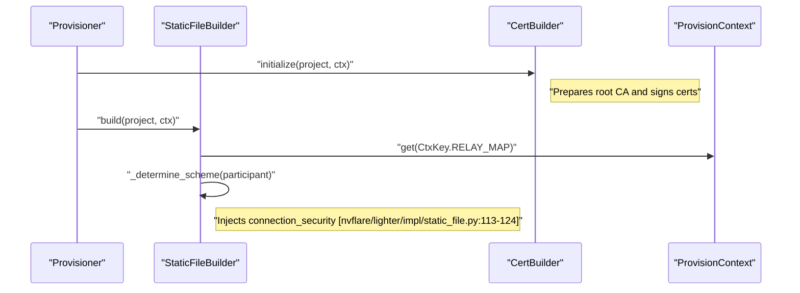

<!-- source: DeepWiki mcp.deepwiki.com · repo NVIDIA/NVFlare · page 16.2 HA Configuration and Failover · fetched 2026-10-26 -->

# HA Configuration and Failover

<details>
<summary>Relevant source files</summary>

The following files were used as context for generating this wiki page:

- [docs/user_guide/admin_guide/security/unsafe_component_detection.rst](docs/user_guide/admin_guide/security/unsafe_component_detection.rst)
- [docs/user_guide/nvflare_cli/provision_command.rst](docs/user_guide/nvflare_cli/provision_command.rst)
- [nvflare/apis/client_engine_spec.py](nvflare/apis/client_engine_spec.py)
- [nvflare/apis/fl_constant.py](nvflare/apis/fl_constant.py)
- [nvflare/apis/job_scheduler_spec.py](nvflare/apis/job_scheduler_spec.py)
- [nvflare/apis/server_engine_spec.py](nvflare/apis/server_engine_spec.py)
- [nvflare/apis/utils/format_check.py](nvflare/apis/utils/format_check.py)
- [nvflare/app_common/default_component_policy.py](nvflare/app_common/default_component_policy.py)
- [nvflare/app_common/job_schedulers/job_scheduler.py](nvflare/app_common/job_schedulers/job_scheduler.py)
- [nvflare/app_common/widgets/component_path_authorizer.py](nvflare/app_common/widgets/component_path_authorizer.py)
- [nvflare/edge/simulation/README.md](nvflare/edge/simulation/README.md)
- [nvflare/fuel/hci/server/authz.py](nvflare/fuel/hci/server/authz.py)
- [nvflare/fuel/sec/authz.py](nvflare/fuel/sec/authz.py)
- [nvflare/lighter/constants.py](nvflare/lighter/constants.py)
- [nvflare/lighter/ctx.py](nvflare/lighter/ctx.py)
- [nvflare/lighter/dummy_project.yml](nvflare/lighter/dummy_project.yml)
- [nvflare/lighter/edge_project.yml](nvflare/lighter/edge_project.yml)
- [nvflare/lighter/entity.py](nvflare/lighter/entity.py)
- [nvflare/lighter/impl/cert.py](nvflare/lighter/impl/cert.py)
- [nvflare/lighter/impl/docker.py](nvflare/lighter/impl/docker.py)
- [nvflare/lighter/impl/static_file.py](nvflare/lighter/impl/static_file.py)
- [nvflare/lighter/provision.py](nvflare/lighter/provision.py)
- [nvflare/lighter/provisioner.py](nvflare/lighter/provisioner.py)
- [nvflare/lighter/templates/master_template.yml](nvflare/lighter/templates/master_template.yml)
- [nvflare/lighter/tree_prov.py](nvflare/lighter/tree_prov.py)
- [nvflare/private/aux_runner.py](nvflare/private/aux_runner.py)
- [nvflare/private/fed/app/client/client_train.py](nvflare/private/fed/app/client/client_train.py)
- [nvflare/private/fed/app/client/sub_worker_process.py](nvflare/private/fed/app/client/sub_worker_process.py)
- [nvflare/private/fed/app/client/worker_process.py](nvflare/private/fed/app/client/worker_process.py)
- [nvflare/private/fed/app/server/runner_process.py](nvflare/private/fed/app/server/runner_process.py)
- [nvflare/private/fed/app/server/server_train.py](nvflare/private/fed/app/server/server_train.py)
- [nvflare/private/fed/client/client_app_runner.py](nvflare/private/fed/client/client_app_runner.py)
- [nvflare/private/fed/client/client_engine.py](nvflare/private/fed/client/client_engine.py)
- [nvflare/private/fed/client/client_engine_executor_spec.py](nvflare/private/fed/client/client_engine_executor_spec.py)
- [nvflare/private/fed/client/client_engine_internal_spec.py](nvflare/private/fed/client/client_engine_internal_spec.py)
- [nvflare/private/fed/client/client_executor.py](nvflare/private/fed/client/client_executor.py)
- [nvflare/private/fed/client/client_run_manager.py](nvflare/private/fed/client/client_run_manager.py)
- [nvflare/private/fed/client/client_runner.py](nvflare/private/fed/client/client_runner.py)
- [nvflare/private/fed/client/command_agent.py](nvflare/private/fed/client/command_agent.py)
- [nvflare/private/fed/client/communicator.py](nvflare/private/fed/client/communicator.py)
- [nvflare/private/fed/client/fed_client.py](nvflare/private/fed/client/fed_client.py)
- [nvflare/private/fed/client/fed_client_base.py](nvflare/private/fed/client/fed_client_base.py)
- [nvflare/private/fed/server/fed_server.py](nvflare/private/fed/server/fed_server.py)
- [nvflare/private/fed/server/job_runner.py](nvflare/private/fed/server/job_runner.py)
- [nvflare/private/fed/server/server_command_agent.py](nvflare/private/fed/server/server_command_agent.py)
- [nvflare/private/fed/server/server_commands.py](nvflare/private/fed/server/server_commands.py)
- [nvflare/private/fed/server/server_engine.py](nvflare/private/fed/server/server_engine.py)
- [nvflare/private/fed/server/server_runner.py](nvflare/private/fed/server/server_runner.py)
- [nvflare/private/fed/utils/fed_utils.py](nvflare/private/fed/utils/fed_utils.py)
- [nvflare/private/fed/utils/site_config.py](nvflare/private/fed/utils/site_config.py)
- [tests/unit_test/app_common/job_schedulers/job_scheduler_test.py](tests/unit_test/app_common/job_schedulers/job_scheduler_test.py)
- [tests/unit_test/app_common/widgets/component_path_authorizer_test.py](tests/unit_test/app_common/widgets/component_path_authorizer_test.py)
- [tests/unit_test/fuel/flare_api_test.py](tests/unit_test/fuel/flare_api_test.py)
- [tests/unit_test/fuel/hci/server/authz_filter_test.py](tests/unit_test/fuel/hci/server/authz_filter_test.py)
- [tests/unit_test/lighter/__init__.py](tests/unit_test/lighter/__init__.py)
- [tests/unit_test/lighter/cert_builder_test.py](tests/unit_test/lighter/cert_builder_test.py)
- [tests/unit_test/lighter/participant_test.py](tests/unit_test/lighter/participant_test.py)
- [tests/unit_test/lighter/project_test.py](tests/unit_test/lighter/project_test.py)
- [tests/unit_test/lighter/static_file_builder_test.py](tests/unit_test/lighter/static_file_builder_test.py)
- [tests/unit_test/private/fed/client/client_executor_test.py](tests/unit_test/private/fed/client/client_executor_test.py)
- [tests/unit_test/private/fed/server/fed_server_test.py](tests/unit_test/private/fed/server/fed_server_test.py)
- [tests/unit_test/private/fed/server/job_runner_test.py](tests/unit_test/private/fed/server/job_runner_test.py)
- [tests/unit_test/private/fed/utils/site_config_test.py](tests/unit_test/private/fed/utils/site_config_test.py)

</details>


High Availability (HA) in NVIDIA FLARE ensures the continuity of federated learning operations by managing multiple server instances and providing mechanisms for automatic failover. This system relies on the **Overseer** service to coordinate server roles and the **OverseerAgent** within participants to track the current primary service provider.

## HA Project Configuration and Session Tracking

The HA architecture distinguishes between multiple Service Providers (SPs) by assigning a unique **Service Session ID (SSID)** to each server instance. This SSID is crucial for session tracking and ensuring that clients and admin consoles are communicating with the correct primary server.

### SSID-based Session Tracking
The SSID is a session identifier that ensures messages are only accepted if they belong to the current valid session. On the client side, the `Communicator` [nvflare/private/fed/client/communicator.py:52-95]() uses this SSID to maintain session integrity. When authentication is established, the `set_auth` method [nvflare/private/fed/client/communicator.py:113-132]() stores the `ssid` and applies it to the communication filters via `set_add_auth_headers_filters` [nvflare/private/fed/client/communicator.py:121]().

In the provisioning phase, the `StaticFileBuilder` [nvflare/lighter/impl/static_file.py:38-49]() configures the communication parameters that support these sessions. It maps project settings from the `Project` definition to participant-specific configurations.

| Field | Description |
| :--- | :--- |
| `name` | The hostname or IP of the server, used in the `fed_server.json` configuration [nvflare/lighter/templates/master_template.yml:193-200](). |
| `admin_port` | The port used for administrative commands, extracted during server deployment [nvflare/private/fed/server/fed_server.py:178](). |
| `connection_security` | Security level (e.g., `mtls`) used for the session, validated by `StaticFileBuilder` [nvflare/lighter/impl/static_file.py:114-124](). |
| `ssid` | The Service Session ID tracked in the `FLContext` [nvflare/apis/fl_constant.py:171]() and used by the `Communicator` [nvflare/private/fed/client/communicator.py:114](). |

### Code Entity Association: HA Provisioning Entities
The following diagram illustrates how HA-related entities are managed during the provisioning process, associating the `Project` model with the `Builder` implementations that generate HA-ready configurations.

**Diagram: HA Provisioning Data Flow**
```mermaid
classDiagram
    class "Project" {
        +str "name"
        +List "participants"
    }
    
    class "Participant" {
        +str "name"
        +str "type"
        +dict "props"
        +get_prop(key)
    }

    class "StaticFileBuilder" {
        +str "scheme"
        +build(project, ctx)
        +_build_conn_properties(site, ctx)
        +_determine_scheme(participant)
    }

    class "CertBuilder" {
        +initialize(project, ctx)
        +build(project, ctx)
    }

    "Project" *-- "Participant" : "contains"
    "StaticFileBuilder" ..> "Participant" : "reads HA props"
    "StaticFileBuilder" ..> "Project" : "resolves relay/FQCN maps"
    "CertBuilder" ..> "Participant" : "generates certs for site_name"
```
Sources: [nvflare/lighter/spec.py:33-33](), [nvflare/lighter/entity.py:32-32](), [nvflare/lighter/impl/static_file.py:38-49](), [nvflare/lighter/impl/static_file.py:113-129](), [nvflare/lighter/impl/cert.py:1-20]()

## Automatic Failover Behavior

Failover is managed through a heartbeat and callback mechanism. The system monitors the connection to the primary server. If the connection fails or the Overseer elects a new primary Service Provider (SP), a failover is triggered.

### Provisioning for Failover
The `StaticFileBuilder` [nvflare/lighter/impl/static_file.py:38]() prepares the `fed_server.json` and `fed_client.json` with the necessary endpoints. It uses the `scheme` and `target` to define communication targets [nvflare/lighter/templates/master_template.yml:112-115]().

1.  **Server Target Definition**: The builder sets the target using `Participant` properties [nvflare/lighter/impl/static_file.py:130-140]().
2.  **Scheme Determination**: The communication scheme (e.g., `grpc`, `tcp`, `http`) is determined [nvflare/lighter/impl/static_file.py:130-140](), potentially using asynchronous variants (`atcp`, `agrpc`) if `use_aio` is enabled [nvflare/lighter/impl/static_file.py:135-139]().
3.  **Connection Security**: The `_build_conn_properties` method ensures that `mtls`, `tls`, or `clear` settings are applied consistently to allow seamless reconnection during failover [nvflare/lighter/impl/static_file.py:113-129]().

### Failover Implementation Logic
The diagram below maps the logic used by the provisioning system to ensure that participants are HA-capable.

**Diagram: HA Configuration Logic**

Sources: [nvflare/lighter/impl/cert.py:1-20](), [nvflare/lighter/impl/static_file.py:113-140](), [nvflare/lighter/impl/static_file.py:178-185]()

## Server State Transitions and Runtime Failover

In an HA environment, servers must handle transitions between active and passive roles. Deployment artifacts ensure that all instances are configured identically.

### ServerEngine and SSID Handling
The `ServerEngine` [nvflare/private/fed/server/server_engine.py:89]() handles the runtime state of the server. When a server becomes primary, it manages the job lifecycle through the `JobRunner` [nvflare/private/fed/server/job_runner.py:94](). The `BaseServer` [nvflare/private/fed/server/fed_server.py:85]() initializes the `Cell` [nvflare/private/fed/server/fed_server.py:188]() which uses the FQCN `ROOT_SERVER` [nvflare/private/fed/server/fed_server.py:185]().

### Client-Side Reconnection
The `FederatedClientBase` [nvflare/private/fed/client/fed_client_base.py:39]() manages the connection to the server. The `connect_to_server` method [nvflare/private/fed/client/fed_client_base.py:114-140]() updates the server target and triggers `_create_cell` [nvflare/private/fed/client/fed_client_base.py:137-138](). This method resolves the correct `FQCN` and `auth_identity_map` [nvflare/private/fed/client/fed_client_base.py:165-177]() to ensure the client can authenticate with the new primary SP.

| Component | Role in HA Runtime |
| :--- | :--- |
| `Communicator` | Maintains the `ssid` and applies it to message headers for session tracking [nvflare/private/fed/client/communicator.py:113-132](). |
| `FederatedClientBase` | Handles the low-level `Cell` creation and target switching during failover [nvflare/private/fed/client/fed_client_base.py:141-180](). |
| `ServerEngine` | Manages the `run_processes` [nvflare/private/fed/server/server_engine.py:102]() and coordinating job startup [nvflare/private/fed/server/server_engine.py:177-195](). |

## Security in HA

Security is the anchor of the HA system. All participants in an HA cluster must share a common root of trust.

### Certificate Management
The `CertBuilder` [nvflare/lighter/impl/cert.py:1-20]() handles the creation of the root CA and signs participant certificates. It ensures that even if the primary server fails, the replacement server uses a certificate signed by the same root CA, allowing clients to maintain trust.

### Connection Security (ConnSec)
The system supports levels of connection security defined in `ConnSecurity`: `clear`, `tls`, and `mtls` [nvflare/lighter/impl/static_file.py:114](). The `_build_conn_properties` method [nvflare/lighter/impl/static_file.py:113-129]() validates these settings to ensure failover happens over secure channels.

Sources: [nvflare/lighter/impl/cert.py:1-20](), [nvflare/lighter/impl/static_file.py:113-129](), [nvflare/private/fed/client/communicator.py:113-132](), [nvflare/private/fed/client/fed_client_base.py:165-177](), [nvflare/private/fed/server/fed_server.py:185-195]()

---

