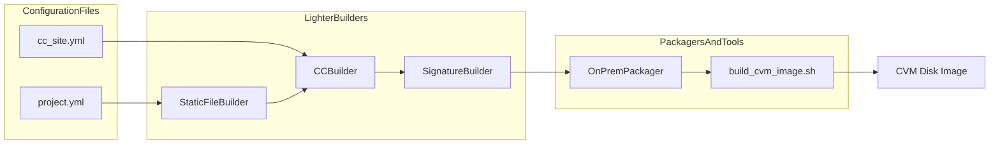

<!-- source: DeepWiki mcp.deepwiki.com · repo NVIDIA/NVFlare · page 17 Confidential Computing · fetched 2026-10-26 -->

# Confidential Computing

<details>
<summary>Relevant source files</summary>

The following files were used as context for generating this wiki page:

- [docs/industry_use_cases.rst](docs/industry_use_cases.rst)
- [docs/resources/ccprep.json](docs/resources/ccprep.json)
- [docs/user_guide/confidential_computing/azure/azure_confidential_virtual_machine_deployment.rst](docs/user_guide/confidential_computing/azure/azure_confidential_virtual_machine_deployment.rst)
- [docs/user_guide/confidential_computing/azure/confidential_azure_container_instances_deployment.rst](docs/user_guide/confidential_computing/azure/confidential_azure_container_instances_deployment.rst)
- [docs/user_guide/confidential_computing/azure/index.rst](docs/user_guide/confidential_computing/azure/index.rst)
- [docs/user_guide/confidential_computing/index.rst](docs/user_guide/confidential_computing/index.rst)
- [docs/user_guide/confidential_computing/on_premises/attestation.rst](docs/user_guide/confidential_computing/on_premises/attestation.rst)
- [docs/user_guide/confidential_computing/on_premises/base_image_build.rst](docs/user_guide/confidential_computing/on_premises/base_image_build.rst)
- [docs/user_guide/confidential_computing/on_premises/cc_deployment_guide.rst](docs/user_guide/confidential_computing/on_premises/cc_deployment_guide.rst)
- [docs/user_guide/confidential_computing/on_premises/hashicorp_vault_trustee_kbs_deployment.rst](docs/user_guide/confidential_computing/on_premises/hashicorp_vault_trustee_kbs_deployment.rst)
- [docs/user_guide/confidential_computing/on_premises/index.rst](docs/user_guide/confidential_computing/on_premises/index.rst)
- [examples/advanced/cc_provision/README.md](examples/advanced/cc_provision/README.md)
- [examples/advanced/cc_provision/cc_server1.yml](examples/advanced/cc_provision/cc_server1.yml)
- [examples/advanced/cc_provision/cc_site-1.yml](examples/advanced/cc_provision/cc_site-1.yml)
- [examples/advanced/cc_provision/docker/Dockerfile](examples/advanced/cc_provision/docker/Dockerfile)
- [examples/advanced/cc_provision/docker/README.md](examples/advanced/cc_provision/docker/README.md)
- [examples/advanced/cc_provision/docker/code/client.py](examples/advanced/cc_provision/docker/code/client.py)
- [examples/advanced/cc_provision/docker/code/simple_network.py](examples/advanced/cc_provision/docker/code/simple_network.py)
- [examples/advanced/cc_provision/docker/requirements.txt](examples/advanced/cc_provision/docker/requirements.txt)
- [examples/advanced/cc_provision/jobs/hello-pt_cifar10_fedavg/app_server/config/config_fed_server.json](examples/advanced/cc_provision/jobs/hello-pt_cifar10_fedavg/app_server/config/config_fed_server.json)
- [examples/advanced/cc_provision/jobs/hello-pt_cifar10_fedavg/app_site-1/config/config_fed_client.json](examples/advanced/cc_provision/jobs/hello-pt_cifar10_fedavg/app_site-1/config/config_fed_client.json)
- [examples/advanced/cc_provision/jobs/hello-pt_cifar10_fedavg/meta.json](examples/advanced/cc_provision/jobs/hello-pt_cifar10_fedavg/meta.json)
- [examples/advanced/cc_provision/project.yml](examples/advanced/cc_provision/project.yml)
- [nvflare/app_opt/confidential_computing/__init__.py](nvflare/app_opt/confidential_computing/__init__.py)
- [nvflare/app_opt/confidential_computing/aci_authorizer.py](nvflare/app_opt/confidential_computing/aci_authorizer.py)
- [nvflare/app_opt/confidential_computing/az_cvm_authorizer.py](nvflare/app_opt/confidential_computing/az_cvm_authorizer.py)
- [nvflare/app_opt/confidential_computing/cc_authorizer.py](nvflare/app_opt/confidential_computing/cc_authorizer.py)
- [nvflare/app_opt/confidential_computing/cc_manager.py](nvflare/app_opt/confidential_computing/cc_manager.py)
- [nvflare/app_opt/confidential_computing/gpu_authorizer.py](nvflare/app_opt/confidential_computing/gpu_authorizer.py)
- [nvflare/app_opt/confidential_computing/mock_authorizer.py](nvflare/app_opt/confidential_computing/mock_authorizer.py)
- [nvflare/app_opt/confidential_computing/snp_authorizer.py](nvflare/app_opt/confidential_computing/snp_authorizer.py)
- [nvflare/app_opt/confidential_computing/tdx_authorizer.py](nvflare/app_opt/confidential_computing/tdx_authorizer.py)
- [nvflare/app_opt/confidential_computing/utils.py](nvflare/app_opt/confidential_computing/utils.py)
- [nvflare/lighter/cc_provision/cc_constants.py](nvflare/lighter/cc_provision/cc_constants.py)
- [nvflare/lighter/cc_provision/impl/azure.py](nvflare/lighter/cc_provision/impl/azure.py)
- [nvflare/lighter/cc_provision/impl/cc.py](nvflare/lighter/cc_provision/impl/cc.py)
- [nvflare/lighter/cc_provision/impl/onprem_cvm.py](nvflare/lighter/cc_provision/impl/onprem_cvm.py)
- [nvflare/lighter/cc_provision/impl/onprem_packager.py](nvflare/lighter/cc_provision/impl/onprem_packager.py)
- [tests/unit_test/app_opt/confidential_computing/cc_manager_test.py](tests/unit_test/app_opt/confidential_computing/cc_manager_test.py)
- [tests/unit_test/lighter/cc_provision/impl/test_cc.py](tests/unit_test/lighter/cc_provision/impl/test_cc.py)
- [tests/unit_test/lighter/cc_provision/impl/test_onprem_cvm.py](tests/unit_test/lighter/cc_provision/impl/test_onprem_cvm.py)

</details>


Confidential Computing (CC) in NVIDIA FLARE provides hardware-backed security for federated learning workloads. By leveraging Trusted Execution Environments (TEEs), NVFLARE ensures that sensitive model code, data, and gradients remain protected even from host administrators or malicious infrastructure owners.

### Purpose and Scope
The CC features in NVFLARE aim to mitigate risks such as code tampering, model theft, and data leakage through memory extraction or unauthorized access [docs/user_guide/confidential_computing/index.rst:15-55](). NVFLARE extends protection from the CPU (e.g., AMD SEV-SNP) to the GPU (NVIDIA H100/Blackwell), creating a secure end-to-end pipeline [docs/user_guide/confidential_computing/index.rst:60-67]().

**Note:** This feature is currently in **Technical Preview**. Reach out to the NVIDIA FLARE team (federatedlearning@nvidia.com) for build scripts and CVM access [docs/user_guide/confidential_computing/index.rst:7-10]().

For deep technical details, refer to the child pages:
- [Confidential Computing Architecture](#17.1): Details on TEE security models (AMD SEV-SNP, NVIDIA GPU TEEs) and the attestation flow.
- [Confidential Computing Deployment](#17.2): Guides for on-premises and Azure deployment, HashiCorp Vault KBS integration, and `cc_provision` tooling.

---

## High-Level Architecture

The NVFLARE Confidential Computing framework is built around the `CCManager` component, which orchestrates the generation and verification of attestation tokens across the federated network.

### Key Components
- **`CCManager`**: An `FLComponent` that handles system-wide CC validation logic, including token attachment during registration and periodic re-validation [nvflare/app_opt/confidential_computing/cc_manager.py:57-75](). It manages cross-site validation to ensure all participants meet CC requirements before jobs are scheduled [nvflare/app_opt/confidential_computing/cc_manager.py:160-166]().
- **Authorizers**: Specialized classes inheriting from `CCAuthorizer` [nvflare/app_opt/confidential_computing/cc_authorizer.py:27-27]() that interface with hardware-specific attestation mechanisms:
    - **`SNPAuthorizer`**: Handles AMD SEV-SNP attestation by utilizing the `snpguest` binary to generate and verify reports [nvflare/app_opt/confidential_computing/snp_authorizer.py:87-115](). It implements replay protection using `NonceHistory` [nvflare/app_opt/confidential_computing/snp_authorizer.py:118-119]().
    - **`GPUAuthorizer`**: Interfaces with the `nv_attestation_sdk` for NVIDIA GPU security, supporting H100 and Blackwell architectures [nvflare/app_opt/confidential_computing/gpu_authorizer.py:75-91]().
    - **`ACIAuthorizer` / `AZCVMAuthorizer`**: Support for Azure Confidential Container Instances and Confidential VMs using Microsoft Azure Attestation (MAA) endpoints [nvflare/app_opt/confidential_computing/aci_authorizer.py:20-20](), [nvflare/app_opt/confidential_computing/az_cvm_authorizer.py:20-20]().
    - **`TDXAuthorizer`**: Support for Intel Trust Domain Extensions [nvflare/app_opt/confidential_computing/tdx_authorizer.py:20-20]().

### Attestation Flow
The system enforces a "trust but verify" model where every participant (Server and Client) must prove they are running inside a valid TEE before being allowed to join the federation. This is handled during registration events like `EventType.CLIENT_REGISTER_RECEIVED` [nvflare/app_opt/confidential_computing/cc_manager.py:148-159]().

**Confidential Computing Entity Mapping**
```mermaid
graph TD
    subgraph "NaturalLanguageSpace"
        ["TEE (Trusted Execution Environment)"]
        ["Hardware Attestation"]
        ["Security Token"]
    end

    subgraph "CodeEntitySpace"
        CCM["CCManager"]
        Auth["CCAuthorizer"]
        SNP["SNPAuthorizer"]
        GPU["GPUAuthorizer"]
        Event["EventType.SYSTEM_BOOTSTRAP"]
    end

    ["TEE (Trusted Execution Environment)"] --> CCM
    ["Hardware Attestation"] --> Auth
    Auth --> SNP
    Auth --> GPU
    CCM -- "handles" --> Event
    SNP -- "calls" --> SNPG["snpguest_binary"]
    GPU -- "uses" --> SDK["nv_attestation_sdk"]
    SNP -- "generates" --> ["Security Token"]
    GPU -- "generates" --> ["Security Token"]
```
Sources: [nvflare/app_opt/confidential_computing/cc_manager.py:57-132](), [nvflare/app_opt/confidential_computing/snp_authorizer.py:87-115](), [nvflare/app_opt/confidential_computing/gpu_authorizer.py:75-100]()

---

## Security Model and Risk Mitigation

NVFLARE's CC solution addresses several critical security risks [docs/user_guide/confidential_computing/index.rst:68-88]():
1. **Secure Aggregation**: The FL server operates within a TEE to aggregate updates, preventing model inversion attacks and ensuring parameters cannot be intercepted.
2. **IP Protection**: Model code and weights are protected within confidential VMs (CVMs). In CC mode, **custom code execution is restricted**; all required code and dependencies must be built into the Docker image [examples/advanced/cc_provision/README.md:9-10]().
3. **CVM Lockdown**: Comprehensive hardening includes disabling interactive login, blocking SSH, and restricting network ports to essential FL communication channels like `8002` [examples/advanced/cc_provision/cc_server1.yml:14-15](), [docs/user_guide/confidential_computing/index.rst:77-79]().

---

## Deployment and Provisioning

Deploying CC requires a specialized workflow because custom code execution is restricted at runtime. All application code must be pre-built into a Docker image which is then packaged into a CVM disk image.

### Provisioning Workflow
1. **Docker Build**: Create an image containing `nvflare` and all required application code [examples/advanced/cc_provision/docker/Dockerfile:1-14]().
2. **CC Configuration**: Define site-specific requirements in a `cc_config` file (e.g., `cc_server1.yml`), specifying issuers like `SNPAuthorizer` and attestation frequency [examples/advanced/cc_provision/cc_server1.yml:17-25]().
3. **CCBuilder**: Use the `CCBuilder` in `project.yml` to coordinate CC implementations and set up the `CCManager` component for each participant. It must be placed after `StaticFileBuilder` and before `SignatureBuilder` [nvflare/lighter/cc_provision/impl/cc.py:50-55](), [examples/advanced/cc_provision/README.md:72-77]().
4. **OnPremPackager**: For on-premises setups, use the `OnPremPackager` to build CVM images using a provided `build_image_cmd` script [nvflare/lighter/cc_provision/impl/onprem_packager.py:114-129]().

**Provisioning System Integration**

Sources: [examples/advanced/cc_provision/README.md:19-102](), [examples/advanced/cc_provision/project.yml:29-50](), [nvflare/lighter/cc_provision/impl/onprem_packager.py:142-174]()

---

## Summary of Authorizers

| Hardware/Platform | Authorizer Class | Key Requirement |
| :--- | :--- | :--- |
| **AMD SEV-SNP** | `SNPAuthorizer` | `snpguest` binary and AMD root certificates [nvflare/app_opt/confidential_computing/snp_authorizer.py:90-115]() |
| **NVIDIA GPU** | `GPUAuthorizer` | `nv_attestation_sdk` and H100/Blackwell GPUs [nvflare/app_opt/confidential_computing/gpu_authorizer.py:75-91]() |
| **Azure CVM** | `AZCVMAuthorizer` | Azure Attestation endpoint (MAA) [nvflare/app_opt/confidential_computing/az_cvm_authorizer.py:20-20]() |
| **Azure ACI** | `ACIAuthorizer` | Azure Confidential Container Instances [nvflare/app_opt/confidential_computing/aci_authorizer.py:20-20]() |
| **Intel TDX** | `TDXAuthorizer` | Intel Trust Domain Extensions support [nvflare/app_opt/confidential_computing/tdx_authorizer.py:20-20]() |

Sources: [nvflare/app_opt/confidential_computing/cc_manager.py:27](), [nvflare/app_opt/confidential_computing/snp_authorizer.py:87](), [nvflare/app_opt/confidential_computing/gpu_authorizer.py:75-80]()

---

