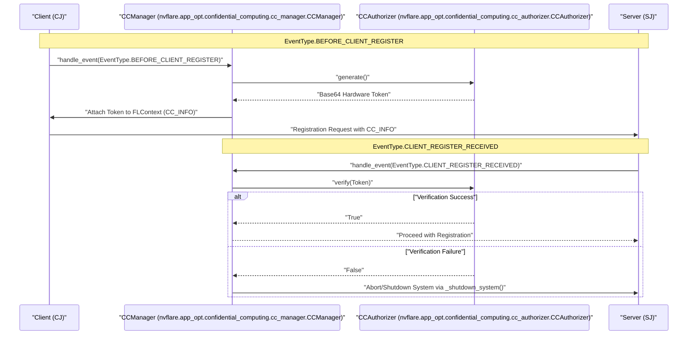

<!-- source: DeepWiki mcp.deepwiki.com · repo NVIDIA/NVFlare · page 17.1 Confidential Computing Architecture · fetched 2026-10-26 -->

# Confidential Computing Architecture

<details>
<summary>Relevant source files</summary>

The following files were used as context for generating this wiki page:

- [docs/industry_use_cases.rst](docs/industry_use_cases.rst)
- [docs/resources/ccprep.json](docs/resources/ccprep.json)
- [docs/user_guide/confidential_computing/azure/azure_confidential_virtual_machine_deployment.rst](docs/user_guide/confidential_computing/azure/azure_confidential_virtual_machine_deployment.rst)
- [docs/user_guide/confidential_computing/azure/confidential_azure_container_instances_deployment.rst](docs/user_guide/confidential_computing/azure/confidential_azure_container_instances_deployment.rst)
- [docs/user_guide/confidential_computing/azure/index.rst](docs/user_guide/confidential_computing/azure/index.rst)
- [docs/user_guide/confidential_computing/index.rst](docs/user_guide/confidential_computing/index.rst)
- [docs/user_guide/confidential_computing/on_premises/attestation.rst](docs/user_guide/confidential_computing/on_premises/attestation.rst)
- [docs/user_guide/confidential_computing/on_premises/base_image_build.rst](docs/user_guide/confidential_computing/on_premises/base_image_build.rst)
- [docs/user_guide/confidential_computing/on_premises/cc_deployment_guide.rst](docs/user_guide/confidential_computing/on_premises/cc_deployment_guide.rst)
- [docs/user_guide/confidential_computing/on_premises/hashicorp_vault_trustee_kbs_deployment.rst](docs/user_guide/confidential_computing/on_premises/hashicorp_vault_trustee_kbs_deployment.rst)
- [docs/user_guide/confidential_computing/on_premises/index.rst](docs/user_guide/confidential_computing/on_premises/index.rst)
- [examples/advanced/cc_provision/README.md](examples/advanced/cc_provision/README.md)
- [examples/advanced/cc_provision/cc_server1.yml](examples/advanced/cc_provision/cc_server1.yml)
- [examples/advanced/cc_provision/cc_site-1.yml](examples/advanced/cc_provision/cc_site-1.yml)
- [examples/advanced/cc_provision/docker/Dockerfile](examples/advanced/cc_provision/docker/Dockerfile)
- [examples/advanced/cc_provision/docker/README.md](examples/advanced/cc_provision/docker/README.md)
- [examples/advanced/cc_provision/docker/code/client.py](examples/advanced/cc_provision/docker/code/client.py)
- [examples/advanced/cc_provision/docker/code/simple_network.py](examples/advanced/cc_provision/docker/code/simple_network.py)
- [examples/advanced/cc_provision/docker/requirements.txt](examples/advanced/cc_provision/docker/requirements.txt)
- [examples/advanced/cc_provision/jobs/hello-pt_cifar10_fedavg/app_server/config/config_fed_server.json](examples/advanced/cc_provision/jobs/hello-pt_cifar10_fedavg/app_server/config/config_fed_server.json)
- [examples/advanced/cc_provision/jobs/hello-pt_cifar10_fedavg/app_site-1/config/config_fed_client.json](examples/advanced/cc_provision/jobs/hello-pt_cifar10_fedavg/app_site-1/config/config_fed_client.json)
- [examples/advanced/cc_provision/jobs/hello-pt_cifar10_fedavg/meta.json](examples/advanced/cc_provision/jobs/hello-pt_cifar10_fedavg/meta.json)
- [examples/advanced/cc_provision/project.yml](examples/advanced/cc_provision/project.yml)
- [nvflare/app_opt/confidential_computing/__init__.py](nvflare/app_opt/confidential_computing/__init__.py)
- [nvflare/app_opt/confidential_computing/aci_authorizer.py](nvflare/app_opt/confidential_computing/aci_authorizer.py)
- [nvflare/app_opt/confidential_computing/az_cvm_authorizer.py](nvflare/app_opt/confidential_computing/az_cvm_authorizer.py)
- [nvflare/app_opt/confidential_computing/cc_authorizer.py](nvflare/app_opt/confidential_computing/cc_authorizer.py)
- [nvflare/app_opt/confidential_computing/cc_manager.py](nvflare/app_opt/confidential_computing/cc_manager.py)
- [nvflare/app_opt/confidential_computing/gpu_authorizer.py](nvflare/app_opt/confidential_computing/gpu_authorizer.py)
- [nvflare/app_opt/confidential_computing/mock_authorizer.py](nvflare/app_opt/confidential_computing/mock_authorizer.py)
- [nvflare/app_opt/confidential_computing/snp_authorizer.py](nvflare/app_opt/confidential_computing/snp_authorizer.py)
- [nvflare/app_opt/confidential_computing/tdx_authorizer.py](nvflare/app_opt/confidential_computing/tdx_authorizer.py)
- [nvflare/app_opt/confidential_computing/utils.py](nvflare/app_opt/confidential_computing/utils.py)
- [nvflare/lighter/cc_provision/cc_constants.py](nvflare/lighter/cc_provision/cc_constants.py)
- [nvflare/lighter/cc_provision/impl/azure.py](nvflare/lighter/cc_provision/impl/azure.py)
- [nvflare/lighter/cc_provision/impl/cc.py](nvflare/lighter/cc_provision/impl/cc.py)
- [nvflare/lighter/cc_provision/impl/onprem_cvm.py](nvflare/lighter/cc_provision/impl/onprem_cvm.py)
- [nvflare/lighter/cc_provision/impl/onprem_packager.py](nvflare/lighter/cc_provision/impl/onprem_packager.py)
- [tests/unit_test/app_opt/confidential_computing/cc_manager_test.py](tests/unit_test/app_opt/confidential_computing/cc_manager_test.py)
- [tests/unit_test/lighter/cc_provision/impl/test_cc.py](tests/unit_test/lighter/cc_provision/impl/test_cc.py)
- [tests/unit_test/lighter/cc_provision/impl/test_onprem_cvm.py](tests/unit_test/lighter/cc_provision/impl/test_onprem_cvm.py)

</details>


The Confidential Computing (CC) architecture in NVIDIA FLARE provides a hardware-backed security model for federated learning. It leverages Trusted Execution Environments (TEEs) to protect sensitive assets—including model IP, training code, and aggregation logic—from unauthorized access, even by host administrators or hypervisors.

## Overview

The CC framework addresses critical trust challenges in federated learning:
1.  **Model IP Protection**: Ensuring model code and weights are protected within confidential VMs on client sites, preventing model theft [docs/user_guide/confidential_computing/index.rst:74-75]().
2.  **Data Leakage Prevention**: Ensuring that only authorized, pre-approved training code runs in isolated TEEs, preventing malicious code from exfiltrating data [docs/user_guide/confidential_computing/index.rst:75-76]().
3.  **Secure Aggregation**: Running the FL server within a TEE to prevent model inversion attacks and ensure aggregated parameters cannot be intercepted [docs/user_guide/confidential_computing/index.rst:73-74]().

**Sources:** [docs/user_guide/confidential_computing/index.rst:15-88]()

## TEE-Based Security Model

The security model relies on a hardware root of trust and remote attestation. NVIDIA FLARE supports both CPU-based and GPU-based TEEs across on-premises and cloud environments.

### Supported Technologies
*   **AMD SEV-SNP**: Secure Encrypted Virtualization-Secure Nested Paging provides VM-level isolation where memory is protected from the host OS and hypervisor [docs/user_guide/confidential_computing/index.rst:62-63](). Support is implemented via `SNPAuthorizer`, which utilizes the `snpguest` binary to generate and verify reports [nvflare/app_opt/confidential_computing/snp_authorizer.py:87-125]().
*   **Intel TDX**: Trust Domain Extensions support for isolated, encrypted virtual machines where memory is protected from the host OS and hypervisor [docs/user_guide/confidential_computing/index.rst:62-63](). Support is implemented via `TDXAuthorizer` [nvflare/app_opt/confidential_computing/tdx_authorizer.py:1-1]().
*   **NVIDIA GPU TEE**: Extends protection to GPU workloads (H100/Blackwell), enabling hardware-accelerated encrypted data transfer between CPU and GPU [docs/user_guide/confidential_computing/index.rst:63-65](). Use of `GPUAuthorizer` requires the `nv_attestation_sdk` [nvflare/app_opt/confidential_computing/gpu_authorizer.py:21-21]() and is configured via `cc_config` [examples/advanced/cc_provision/README.md:133-148]().
*   **Azure CVM/ACI**: Support for Azure Confidential Virtual Machines (via `AZCVMAuthorizer`) and Confidential Azure Container Instances (via `ACIAuthorizer`) [nvflare/app_opt/confidential_computing/aci_authorizer.py:21-21](), [docs/user_guide/confidential_computing/azure/confidential_azure_container_instances_deployment.rst:121-124]().

### Attestation Flow
The attestation flow ensures that a participant is running in a genuine, unmodified environment before sensitive data is exchanged.

1.  **Token Generation**: A `CCAuthorizer` generates a hardware-signed evidence report (token). The `SNPAuthorizer` generates a report by writing a 64-byte nonce to `REQUEST_PATH` (`request.bin`) and calling `snpguest report` [nvflare/app_opt/confidential_computing/snp_authorizer.py:146-158]().
2.  **Token Exchange**: Tokens are attached to the `FLContext` during registration or via the dedicated `cc_validation` channel [nvflare/app_opt/confidential_computing/cc_manager.py:52-53](), [nvflare/app_opt/confidential_computing/cc_manager.py:144-144]().
3.  **Verification**: The receiving site validates the token. For AMD SEV-SNP, the `SNPAuthorizer` ensures AMD CA certificates are present, parses the report for the VCEK cache key, and runs `snpguest verify attestation` [nvflare/app_opt/confidential_computing/snp_authorizer.py:160-185]().

**Sources:** [nvflare/app_opt/confidential_computing/cc_manager.py:57-103](), [nvflare/app_opt/confidential_computing/snp_authorizer.py:87-194]()

## Core Components and Implementation

The CC logic is encapsulated in the `CCManager` component, which coordinates with specialized `CCAuthorizer` implementations.

### CCManager
The `CCManager` is an `FLComponent` that handles the lifecycle of CC validation. It manages its own tokens and validates tokens from other sites [nvflare/app_opt/confidential_computing/cc_manager.py:57-75]().

| Function | Description |
| :--- | :--- |
| `handle_event` | Orchestrates CC logic across the FL lifecycle, including `SYSTEM_BOOTSTRAP`, `BEFORE_CLIENT_REGISTER`, and `CLIENT_REGISTER_RECEIVED` [nvflare/app_opt/confidential_computing/cc_manager.py:131-160](). |
| `_generate_and_attach_tokens` | Generates tokens using configured issuers and stores them in `FLContext` under `CC_INFO` [nvflare/app_opt/confidential_computing/cc_manager.py:144-144](). |
| `_validate_client_tokens` | Server-side validation of tokens received from clients during registration. It skips validation for admin clients [nvflare/app_opt/confidential_computing/cc_manager.py:148-158](). |
| `_perform_cross_site_validation` | Periodically re-validates all enabled sites to ensure continuous compliance [nvflare/app_opt/confidential_computing/cc_manager.py:165-165](). |

### CCAuthorizers
Authorizers implement platform-specific logic for interacting with hardware security modules.

*   **`SNPAuthorizer`**: Handles AMD SEV-SNP report generation and verification using the `snpguest` tool. It parses the Chip ID and Reported TCB from the hardware evidence [nvflare/app_opt/confidential_computing/snp_authorizer.py:40-85]().
*   **`GPUAuthorizer`**: Uses the `nv_attestation_sdk` to verify NVIDIA GPU TEE status by checking claims like `x-nvidia-gpu-attestation-report-signature-verified` [nvflare/app_opt/confidential_computing/gpu_authorizer.py:21-72]().
*   **`ACIAuthorizer`**: Specifically for Azure Container Instances, validating environment and hardware claims [nvflare/app_opt/confidential_computing/aci_authorizer.py:21-21]().

### Data Flow: Registration Attestation
The following diagram illustrates how CC tokens are integrated into the NVFlare registration flow.

**Confidential Registration Flow**

**Sources:** [nvflare/app_opt/confidential_computing/cc_manager.py:131-160](), [nvflare/app_opt/confidential_computing/cc_manager.py:221-225]()

## Provisioning and Deployment

The provisioning system is extended to generate CVM-compatible startup kits and disk images.

### Provisioning Components
*   **`CCBuilder`**: A specialized builder that processes `cc_config` files to set up TEE-specific metadata and component IDs. It must be placed after `StaticFileBuilder` and before `SignatureBuilder` [examples/advanced/cc_provision/README.md:72-79](), [nvflare/lighter/cc_provision/impl/cc.py:50-55](). It maps `compute_env` values like `onprem_cvm` to specific implementation builders like `OnPremCVMBuilder` [nvflare/lighter/cc_provision/impl/cc.py:42-47]().
*   **`OnPremPackager`**: Used for on-premises deployments to invoke a build command (e.g., `build_cvm_image.sh`), which constructs a full CVM disk image from a base image and a Docker archive [nvflare/lighter/cc_provision/impl/onprem_packager.py:114-129]().

### CC Configuration Structure
Each site defines its TEE requirements in a `cc_config` file (e.g., `cc_server1.yml`) [examples/advanced/cc_provision/cc_server1.yml:1-26]().

```yaml
compute_env: onprem_cvm
cc_cpu_mechanism: amd_sev_snp
role: server
root_drive_size: 45
docker_archive: /tmp/nvflare-site.tar.gz
cc_issuers:
  - id: snp_authorizer
    path: nvflare.app_opt.confidential_computing.snp_authorizer.SNPAuthorizer
    token_expiration: 100
    args:
      snpguest_binary: "/host/bin/snpguest"
```
**Sources:** [examples/advanced/cc_provision/cc_server1.yml:1-26](), [examples/advanced/cc_provision/README.md:26-52]()

### System Entities and Code Mapping
The following diagram maps the logical CC entities to their implementation classes and configuration keys.

**CC Architecture Entity Mapping**
```mermaid
graph TD
    subgraph "Provisioning_Time"
        P["project.yml"] -->|builders| CB["CCBuilder (nvflare.lighter.cc_provision.impl.cc.CCBuilder)"]
        P -->|packager| OP["OnPremPackager (nvflare.lighter.cc_provision.impl.onprem_packager.OnPremPackager)"]
        CB -->|reads| CC_CFG["cc_config (.yml)"]
        CB -->|instantiates| OPCVM["OnPremCVMBuilder (nvflare.lighter.cc_provision.impl.onprem_cvm.OnPremCVMBuilder)"]
        CB -->|instantiates| AZB["AzureSimpleBuilder (nvflare.lighter.cc_provision.impl.azure.AzureSimpleBuilder)"]
    end

    subgraph "Runtime_Environment"
        CCM["CCManager (nvflare.app_opt.confidential_computing.cc_manager.CCManager)"]
        CCM -->|uses| AUTH["CCAuthorizer (nvflare.app_opt.confidential_computing.cc_authorizer.CCAuthorizer)"]
        AUTH <|-- SNPA["SNPAuthorizer (nvflare.app_opt.confidential_computing.snp_authorizer.SNPAuthorizer)"]
        AUTH <|-- GPUA["GPUAuthorizer (nvflare.app_opt.confidential_computing.gpu_authorizer.GPUAuthorizer)"]
        AUTH <|-- ACIA["ACIAuthorizer (nvflare.app_opt.confidential_computing.aci_authorizer.ACIAuthorizer)"]
        
        CCM -->|validates| TKN["_cc_token (Context Key)"]
        CCM -->|tracks| NH["NonceHistory (nvflare.app_opt.confidential_computing.utils.NonceHistory)"]
    end

    OP -->|calls| SH["build_cvm_image.sh"]
    SH -->|generates| IMG["CVM_Disk_Image"]
    IMG -->|runs| CCM
```
**Sources:** [nvflare/app_opt/confidential_computing/cc_manager.py:57-57](), [nvflare/app_opt/confidential_computing/snp_authorizer.py:87-87](), [nvflare/lighter/cc_provision/impl/onprem_packager.py:114-129](), [nvflare/app_opt/confidential_computing/gpu_authorizer.py:75-75](), [nvflare/lighter/cc_provision/impl/cc.py:42-47]()

## Security Hardening (CVM Lockdown)

To provide meaningful security guarantees, the CC architecture includes CVM hardening and operational constraints:
*   **Disabled Access**: Interactive login and SSH access are disabled to prevent administrator access to memory [docs/user_guide/confidential_computing/index.rst:77-79]().
*   **Network Restriction**: Network ports are restricted to essential communication channels only (e.g., ports 443, 8002, 8999) [examples/advanced/cc_provision/cc_site-1.yml:17-17]().
*   **No Custom Code**: For CC jobs, custom code at runtime is not allowed. All application code must be built into the Docker image [examples/advanced/cc_provision/README.md:9-12]().
*   **Continuous Validation**: The `CCManager` periodically re-validates all CC tokens (frequency defined by `verify_frequency`) and will shut down the system if validation fails [nvflare/app_opt/confidential_computing/cc_manager.py:61-75]().
*   **Class Allow-listing**: NVFlare checks a `class_allow_list` before loading components. The provisioner extends this list based on the `cc_config` to ensure only certified code runs [docs/user_guide/confidential_computing/on_premises/cc_deployment_guide.rst:166-175]().
*   **Workspace Protection**: While startup kits live in plaintext `/user_config`, runtime artifacts (models, checkpoints) are directed to an encrypted workspace, typically `/vault/workspace` [examples/advanced/cc_provision/README.md:124-127]().

**Sources:** [docs/user_guide/confidential_computing/index.rst:81-88](), [examples/advanced/cc_provision/README.md:9-12](), [nvflare/app_opt/confidential_computing/cc_manager.py:57-103](), [examples/advanced/cc_provision/cc_server1.yml:14-15](), [docs/user_guide/confidential_computing/on_premises/cc_deployment_guide.rst:166-175]()

---

