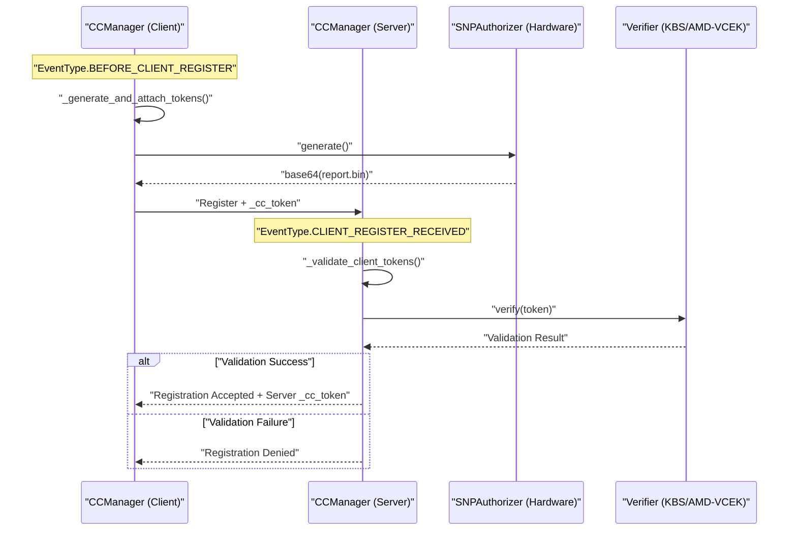
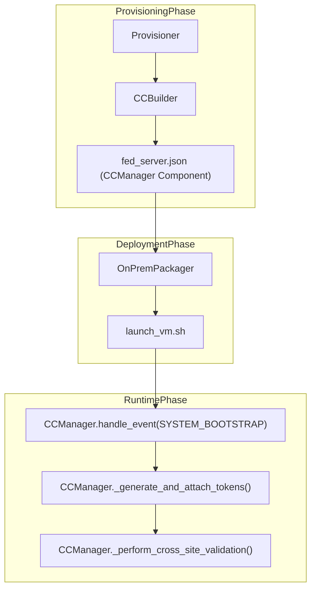

<!-- source: DeepWiki mcp.deepwiki.com · repo NVIDIA/NVFlare · page 17.2 Confidential Computing Deployment · fetched 2026-10-26 -->

# Confidential Computing Deployment

<details>
<summary>Relevant source files</summary>

The following files were used as context for generating this wiki page:

- [docs/industry_use_cases.rst](docs/industry_use_cases.rst)
- [docs/resources/ccprep.json](docs/resources/ccprep.json)
- [docs/user_guide/confidential_computing/azure/azure_confidential_virtual_machine_deployment.rst](docs/user_guide/confidential_computing/azure/azure_confidential_virtual_machine_deployment.rst)
- [docs/user_guide/confidential_computing/azure/confidential_azure_container_instances_deployment.rst](docs/user_guide/confidential_computing/azure/confidential_azure_container_instances_deployment.rst)
- [docs/user_guide/confidential_computing/azure/index.rst](docs/user_guide/confidential_computing/azure/index.rst)
- [docs/user_guide/confidential_computing/index.rst](docs/user_guide/confidential_computing/index.rst)
- [docs/user_guide/confidential_computing/on_premises/attestation.rst](docs/user_guide/confidential_computing/on_premises/attestation.rst)
- [docs/user_guide/confidential_computing/on_premises/base_image_build.rst](docs/user_guide/confidential_computing/on_premises/base_image_build.rst)
- [docs/user_guide/confidential_computing/on_premises/cc_deployment_guide.rst](docs/user_guide/confidential_computing/on_premises/cc_deployment_guide.rst)
- [docs/user_guide/confidential_computing/on_premises/hashicorp_vault_trustee_kbs_deployment.rst](docs/user_guide/confidential_computing/on_premises/hashicorp_vault_trustee_kbs_deployment.rst)
- [docs/user_guide/confidential_computing/on_premises/index.rst](docs/user_guide/confidential_computing/on_premises/index.rst)
- [examples/advanced/cc_provision/README.md](examples/advanced/cc_provision/README.md)
- [examples/advanced/cc_provision/cc_server1.yml](examples/advanced/cc_provision/cc_server1.yml)
- [examples/advanced/cc_provision/cc_site-1.yml](examples/advanced/cc_provision/cc_site-1.yml)
- [examples/advanced/cc_provision/docker/Dockerfile](examples/advanced/cc_provision/docker/Dockerfile)
- [examples/advanced/cc_provision/docker/README.md](examples/advanced/cc_provision/docker/README.md)
- [examples/advanced/cc_provision/docker/code/client.py](examples/advanced/cc_provision/docker/code/client.py)
- [examples/advanced/cc_provision/docker/code/simple_network.py](examples/advanced/cc_provision/docker/code/simple_network.py)
- [examples/advanced/cc_provision/docker/requirements.txt](examples/advanced/cc_provision/docker/requirements.txt)
- [examples/advanced/cc_provision/jobs/hello-pt_cifar10_fedavg/app_server/config/config_fed_server.json](examples/advanced/cc_provision/jobs/hello-pt_cifar10_fedavg/app_server/config/config_fed_server.json)
- [examples/advanced/cc_provision/jobs/hello-pt_cifar10_fedavg/app_site-1/config/config_fed_client.json](examples/advanced/cc_provision/jobs/hello-pt_cifar10_fedavg/app_site-1/config/config_fed_client.json)
- [examples/advanced/cc_provision/jobs/hello-pt_cifar10_fedavg/meta.json](examples/advanced/cc_provision/jobs/hello-pt_cifar10_fedavg/meta.json)
- [examples/advanced/cc_provision/project.yml](examples/advanced/cc_provision/project.yml)
- [nvflare/app_opt/confidential_computing/__init__.py](nvflare/app_opt/confidential_computing/__init__.py)
- [nvflare/app_opt/confidential_computing/aci_authorizer.py](nvflare/app_opt/confidential_computing/aci_authorizer.py)
- [nvflare/app_opt/confidential_computing/az_cvm_authorizer.py](nvflare/app_opt/confidential_computing/az_cvm_authorizer.py)
- [nvflare/app_opt/confidential_computing/cc_authorizer.py](nvflare/app_opt/confidential_computing/cc_authorizer.py)
- [nvflare/app_opt/confidential_computing/cc_manager.py](nvflare/app_opt/confidential_computing/cc_manager.py)
- [nvflare/app_opt/confidential_computing/gpu_authorizer.py](nvflare/app_opt/confidential_computing/gpu_authorizer.py)
- [nvflare/app_opt/confidential_computing/mock_authorizer.py](nvflare/app_opt/confidential_computing/mock_authorizer.py)
- [nvflare/app_opt/confidential_computing/snp_authorizer.py](nvflare/app_opt/confidential_computing/snp_authorizer.py)
- [nvflare/app_opt/confidential_computing/tdx_authorizer.py](nvflare/app_opt/confidential_computing/tdx_authorizer.py)
- [nvflare/app_opt/confidential_computing/utils.py](nvflare/app_opt/confidential_computing/utils.py)
- [nvflare/lighter/cc_provision/cc_constants.py](nvflare/lighter/cc_provision/cc_constants.py)
- [nvflare/lighter/cc_provision/impl/azure.py](nvflare/lighter/cc_provision/impl/azure.py)
- [nvflare/lighter/cc_provision/impl/cc.py](nvflare/lighter/cc_provision/impl/cc.py)
- [nvflare/lighter/cc_provision/impl/onprem_cvm.py](nvflare/lighter/cc_provision/impl/onprem_cvm.py)
- [nvflare/lighter/cc_provision/impl/onprem_packager.py](nvflare/lighter/cc_provision/impl/onprem_packager.py)
- [tests/unit_test/app_opt/confidential_computing/cc_manager_test.py](tests/unit_test/app_opt/confidential_computing/cc_manager_test.py)
- [tests/unit_test/lighter/cc_provision/impl/test_cc.py](tests/unit_test/lighter/cc_provision/impl/test_cc.py)
- [tests/unit_test/lighter/cc_provision/impl/test_onprem_cvm.py](tests/unit_test/lighter/cc_provision/impl/test_onprem_cvm.py)

</details>


This page details the deployment of NVIDIA FLARE in Confidential Computing (CC) environments. NVFLARE supports hardware-backed security through Trusted Execution Environments (TEEs), specifically focusing on Confidential Virtual Machines (CVMs) and Confidential Containers. The deployment infrastructure ensures that code and data are protected during execution via hardware-level encryption and remote attestation.

## Overview of Confidential Deployment

Confidential Computing in NVFLARE addresses risks such as model theft, unauthorized runtime access, and data leakage by utilizing hardware roots of trust [docs/user_guide/confidential_computing/index.rst:60-75](). The deployment flow is characterized by a "lockdown" model where interactive logins and SSH are disabled, and only pre-approved, certified code within Docker images is permitted to run [docs/user_guide/confidential_computing/index.rst:77-88]().

### Key Deployment Components
*   **Confidential VMs (CVMs):** Isolated virtual machines using AMD SEV-SNP or Intel TDX [docs/user_guide/confidential_computing/index.rst:62-67]().
*   **CC Provisioning Tooling:** Extensions to the NVFLARE `Provisioner` that generate CVM disk images and specialized startup kits [examples/advanced/cc_provision/README.md:1-4]().
*   **Key Broker Service (KBS):** Services like HashiCorp Vault with Trustee for managing secrets and attestation policies [docs/user_guide/confidential_computing/on_premises/cc_deployment_guide.rst:126-129]().
*   **Attestation Authorizers:** Components that generate and verify hardware-signed evidence (e.g., `SNPAuthorizer`, `GPUAuthorizer`, `ACIAuthorizer`) [nvflare/app_opt/confidential_computing/snp_authorizer.py:87-88]().

**Sources:** [docs/user_guide/confidential_computing/index.rst:60-88](), [examples/advanced/cc_provision/README.md:1-4](), [docs/user_guide/confidential_computing/on_premises/cc_deployment_guide.rst:126-129](), [nvflare/app_opt/confidential_computing/snp_authorizer.py:87-88]()

---

## On-Premises Deployment

On-premises deployment typically utilizes AMD SEV-SNP enabled hardware. The process involves building a hardened disk image that contains the NVFLARE runtime and the user's application.

### Data Flow and Attestation

The following diagram illustrates the interaction between the `CCManager`, `CCAuthorizer` implementations, and the hardware during the registration phase.

**Registration and Attestation Flow**

**Sources:** [nvflare/app_opt/confidential_computing/snp_authorizer.py:146-185](), [nvflare/app_opt/confidential_computing/cc_manager.py:142-159](), [nvflare/app_opt/confidential_computing/cc_manager.py:38-43]()

### Configuration for On-Premises
Each site requires a `cc_config` file (e.g., `cc_site-1.yml`) defining the hardware mechanism and authorizers.

| Key | Description | Example |
| :--- | :--- | :--- |
| `compute_env` | The target environment | `onprem_cvm` [examples/advanced/cc_provision/cc_site-1.yml:1-1]() |
| `cc_cpu_mechanism` | Hardware TEE type | `amd_sev_snp` [examples/advanced/cc_provision/cc_site-1.yml:2-2]() |
| `docker_archive` | Path to the application container | `/tmp/nvflare-site.tar.gz` [examples/advanced/cc_provision/cc_site-1.yml:12-12]() |
| `cc_issuers` | List of authorizer components | `SNPAuthorizer`, `GPUAuthorizer` [examples/advanced/cc_provision/cc_site-1.yml:19-24]() |

**Sources:** [examples/advanced/cc_provision/cc_site-1.yml:1-28](), [examples/advanced/cc_provision/README.md:19-53]()

---

## Azure Confidential Deployment

NVFLARE supports Azure Confidential Computing through two primary paths:
1.  **Azure Confidential VMs:** Using `AZCVMAuthorizer` which interacts with the Microsoft Azure Attestation (MAA) service [docs/user_guide/confidential_computing/azure/azure_confidential_virtual_machine_deployment.rst:133-144]().
2.  **Confidential Azure Container Instances (ACI):** Used primarily for the NVFLARE Server to perform secure aggregation in a serverless confidential environment [docs/user_guide/confidential_computing/azure/confidential_azure_container_instances_deployment.rst:10-13]().

### Azure Component Mapping
The `AZCVMAuthorizer` and `ACIAuthorizer` implement the `CCAuthorizer` interface to handle Azure-specific JWT-based attestation tokens.

**Azure Code Entity Mapping**
```mermaid
classDiagram
    class "CCAuthorizer" {
        <<interface>>
        +generate()
        +verify(token)
    }
    class "AZCVMAuthorizer" {
        +verify(token)
    }
    class "ACIAuthorizer" {
        +verify(token)
    }
    class "CCManager" {
        -cc_issuers: dict
        -cc_verifiers: dict
        +handle_event(event_type, fl_ctx)
        -_validate_client_tokens(fl_ctx)
    }

    "CCAuthorizer" <|-- "AZCVMAuthorizer"
    "CCAuthorizer" <|-- "ACIAuthorizer"
    "CCManager" o-- "CCAuthorizer" : "uses via cc_verifier_ids"
```
**Sources:** [nvflare/app_opt/confidential_computing/cc_authorizer.py:20-27](), [docs/user_guide/confidential_computing/azure/confidential_azure_container_instances_deployment.rst:120-124](), [nvflare/app_opt/confidential_computing/cc_manager.py:57-118]()

---

## CC Provisioning Tooling (`cc_provision`)

The `cc_provision` module extends NVFLARE's `Provisioner` to handle the complexity of building encrypted disk images and integrating CC metadata into startup kits.

### The CCBuilder and Packager
To enable CC provisioning, the `project.yml` must include the `CCBuilder` and a specific `packager`.

```yaml
builders:
  - path: nvflare.lighter.impl.workspace.WorkspaceBuilder
  - path: nvflare.lighter.impl.static_file.StaticFileBuilder
  - path: nvflare.lighter.impl.cert.CertBuilder
  - path: nvflare.lighter.cc_provision.impl.cc.CCBuilder
  - path: nvflare.lighter.impl.signature.SignatureBuilder

packager:
  path: nvflare.lighter.cc_provision.impl.onprem_packager.OnPremPackager
  args:
    build_image_cmd: build_cvm_image.sh
```
**Sources:** [examples/advanced/cc_provision/project.yml:29-51](), [examples/advanced/cc_provision/README.md:67-89](), [nvflare/lighter/cc_provision/impl/cc.py:50-55]()

### Image Building Workflow
The `OnPremPackager` orchestrates the conversion of standard NVFLARE startup kits into confidential VM images.

1.  **Docker Preparation:** User builds a Docker image containing all dependencies and application code [examples/advanced/cc_provision/README.md:7-18](). In CC mode, **custom code execution is not allowed**; all code must be built into the image [examples/advanced/cc_provision/README.md:9-10]().
2.  **CVM Image Generation:** The `OnPremPackager` executes `_build_cc_image` which calls the `build_image_cmd` (e.g., `build_cvm_image.sh`) [nvflare/lighter/cc_provision/impl/onprem_packager.py:120-128]().
3.  **Startup Kit Packaging:** The `CCBuilder` injects `CCManager` configurations into the participant's `fed_server.json` or `fed_client.json` [nvflare/lighter/cc_provision/impl/cc.py:129-171](). The `OnPremPackager` then updates the `cc_config` with the startup kit path before building the image [nvflare/lighter/cc_provision/impl/onprem_packager.py:158-162]().

**Sources:** [nvflare/lighter/cc_provision/impl/onprem_packager.py:114-186](), [examples/advanced/cc_provision/README.md:7-93](), [nvflare/lighter/cc_provision/impl/cc.py:111-128]()

---

## Hardware Authorizers

NVFLARE uses specific classes to interface with hardware security features.

### SNPAuthorizer (AMD SEV-SNP)
The `SNPAuthorizer` uses the `snpguest` binary to interact with the hardware to fetch attestation reports [nvflare/app_opt/confidential_computing/snp_authorizer.py:108-115]().
*   **Report Generation:** `generate()` creates a 64-byte nonce, writes it to `request.bin`, and calls `snpguest report` [nvflare/app_opt/confidential_computing/snp_authorizer.py:146-158]().
*   **Verification:** `verify()` validates the hardware signature against AMD Root of Trust certificates (ARK, ASK, VCEK) [nvflare/app_opt/confidential_computing/snp_authorizer.py:160-185](). It performs replay protection by checking the nonce against `seen_nonce_history` [nvflare/app_opt/confidential_computing/snp_authorizer.py:177-182]().

### GPUAuthorizer (NVIDIA H100/Blackwell)
The `GPUAuthorizer` utilizes the `nv_attestation_sdk` to verify the security posture of NVIDIA GPUs [examples/advanced/cc_provision/README.md:133-138]().
*   It ensures the environment is secure by checking GPU attestation tokens against NVIDIA's remote services [examples/advanced/cc_provision/README.md:138-147]().
*   Requirements include `nv_attestation_sdk` in the application Docker image [examples/advanced/cc_provision/README.md:139-148]().

| Authorizer Class | Target Hardware | Verification Service |
| :--- | :--- | :--- |
| `SNPAuthorizer` | AMD SEV-SNP CPU | Local (via AMD Certs) [nvflare/app_opt/confidential_computing/snp_authorizer.py:172-173]() |
| `GPUAuthorizer` | NVIDIA H100/Blackwell | NVIDIA Remote Attestation [examples/advanced/cc_provision/README.md:138-138]() |
| `AZCVMAuthorizer` | Azure CVM | MAA (Microsoft Azure Attestation) [docs/user_guide/confidential_computing/azure/azure_confidential_virtual_machine_deployment.rst:133-144]() |
| `ACIAuthorizer` | Azure ACI | MAA [docs/user_guide/confidential_computing/azure/confidential_azure_container_instances_deployment.rst:120-124]() |

**Sources:** [nvflare/app_opt/confidential_computing/snp_authorizer.py:87-125](), [examples/advanced/cc_provision/README.md:124-148](), [docs/user_guide/confidential_computing/azure/azure_confidential_virtual_machine_deployment.rst:133-144]()

---

## Runtime Management (`CCManager`)

The `CCManager` is the primary component that coordinates the CC lifecycle during the NVFLARE process execution.

### Configuration and Injection
The `CCManager` manages CC tokens, validates tokens from other sites, and prevents system startup if validation fails [nvflare/app_opt/confidential_computing/cc_manager.py:67-75]().
*   **Initialization:** It sets up authorizers during `SYSTEM_BOOTSTRAP` [nvflare/app_opt/confidential_computing/cc_manager.py:132-137]().
*   **Periodic Re-validation:** It periodically re-validates all CC tokens and shuts down the system if validation fails [nvflare/app_opt/confidential_computing/cc_manager.py:73-75]().

### CC Manager State Flow

**Sources:** [nvflare/app_opt/confidential_computing/cc_manager.py:57-137](), [nvflare/app_opt/confidential_computing/cc_manager.py:160-167](), [examples/advanced/cc_provision/README.md:113-122](), [nvflare/lighter/cc_provision/impl/cc.py:129-171]()

---

