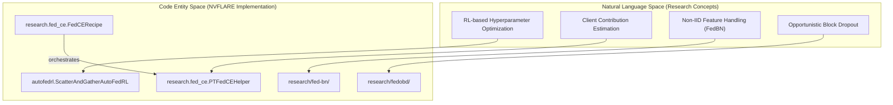
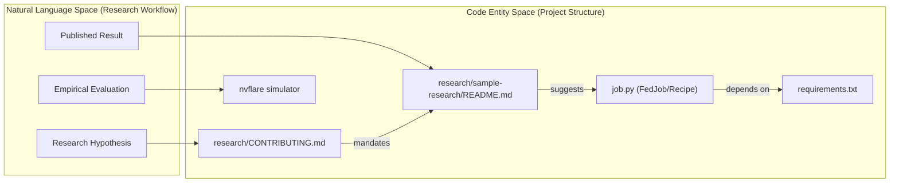

<!-- source: DeepWiki mcp.deepwiki.com · repo NVIDIA/NVFlare · page 18 Research Implementations · fetched 2026-10-26 -->

# Research Implementations

Relevant source files

The following files were used as context for generating this wiki page:

- [CITATION.cff](CITATION.cff)
- [docs/publications_and_talks.rst](docs/publications_and_talks.rst)
- [docs/resources/researcher.svg](docs/resources/researcher.svg)
- [examples/advanced/bionemo/task_fitting/job_inference/client.py](examples/advanced/bionemo/task_fitting/job_inference/client.py)
- [examples/advanced/cifar10/pt/src/data/cifar10_data_split.py](examples/advanced/cifar10/pt/src/data/cifar10_data_split.py)
- [integration/README.md](integration/README.md)
- [integration/sample/README.md](integration/sample/README.md)
- [research/CONTRIBUTING.md](research/CONTRIBUTING.md)
- [research/README.md](research/README.md)
- [research/auto-fed-rl/README.md](research/auto-fed-rl/README.md)
- [research/auto-fed-rl/jobs/cifar10_autofedrl/cifar10_autofedrl/config/config_fed_server.json](research/auto-fed-rl/jobs/cifar10_autofedrl/cifar10_autofedrl/config/config_fed_server.json)
- [research/auto-fed-rl/src/autofedrl/autofedrl_cifar10_learner.py](research/auto-fed-rl/src/autofedrl/autofedrl_cifar10_learner.py)
- [research/auto-fed-rl/src/autofedrl/autofedrl_fedopt.py](research/auto-fed-rl/src/autofedrl/autofedrl_fedopt.py)
- [research/auto-fed-rl/src/autofedrl/autofedrl_learner_executor.py](research/auto-fed-rl/src/autofedrl/autofedrl_learner_executor.py)
- [research/auto-fed-rl/src/autofedrl/cifar10_learner.py](research/auto-fed-rl/src/autofedrl/cifar10_learner.py)
- [research/auto-fed-rl/src/autofedrl/pt_autofedrl.py](research/auto-fed-rl/src/autofedrl/pt_autofedrl.py)
- [research/fed-ce/README.md](research/fed-ce/README.md)
- [research/fed-sm/README.md](research/fed-sm/README.md)
- [research/fed-sm/jobs/fedsm_prostate/app/custom/learners/supervised_learner.py](research/fed-sm/jobs/fedsm_prostate/app/custom/learners/supervised_learner.py)
- [research/fed-sm/jobs/fedsm_prostate/app/custom/learners/supervised_monai_prostate_fedsm_learner.py](research/fed-sm/jobs/fedsm_prostate/app/custom/learners/supervised_monai_prostate_fedsm_learner.py)
- [research/fedobd/README.md](research/fedobd/README.md)
- [research/fedobd/requirements.txt](research/fedobd/requirements.txt)
- [research/quantifying-data-leakage/src/nvflare_gradinv/learners/cxr_learner.py](research/quantifying-data-leakage/src/nvflare_gradinv/learners/cxr_learner.py)
- [research/quantifying-data-leakage/start_fl_sim.sh](research/quantifying-data-leakage/start_fl_sim.sh)
- [research/sample-research/README.md](research/sample-research/README.md)

NVIDIA FLARE serves as a robust platform for federated learning research, enabling the implementation and validation of novel algorithms in realistic, distributed environments. The codebase includes a dedicated `research` directory containing reference implementations for several peer-reviewed studies spanning medical imaging, natural language processing (NLP), and privacy-preserving finance [research/README.md:1-7]().

These implementations demonstrate how to extend core NVFLARE components—such as controllers, aggregators, and learners—to support advanced research techniques like personalized FL, hyperparameter optimization, and parameter-efficient fine-tuning for Large Language Models (LLMs).

### Research Domains and Studies

The repository hosts a diverse collection of published research, often providing the exact configurations and custom components used to generate results in papers.

| Research Area | Study / Algorithm | Publication |
| :--- | :--- | :--- |
| **Medical Imaging** | BraTS18 Brain Tumor Segmentation | MLMI 2019 |
| | FedBN (Local Batch Normalization) | ICLR 2021 |
| | FedSM (Personalized FL) | CVPR 2022 |
| | Auto-FedRL (Auto-HPO) | ECCV 2022 |
| | FedCE (Fairness/Contribution) | CVPR 2023 |
| | ConDistFL (Conditional Distillation) | DeCaF 2023 |
| | FedHCA2 (Hetero-Client Multi-Task) | CVPR 2024 |
| | FedNCA (Equitable FL) | MICCAI 2025 |
| | FeTTL (Template and Task Learning) | preprint 2026 |
| **Privacy & Security** | Gradient Inversion Quantification | IEEE TMI 2022 |
| | Federated Fraud Detection | arXiv 2026 |
| | FedOBD (Block Dropout) | IJCAI 2023 |
| **NLP & LLMs** | FedBPT (Black-box Prompt Tuning) | ICML 2024 |
| | FedUMM (Unified Multimodal Models) | arXiv 2026 |
| **VFL** | One-Shot Vertical FL | ICCV 2023 |

**Sources:** [research/README.md:14-31](), [docs/publications_and_talks.rst:10-43]()

---

### Mapping Research Logic to Code Entities

Research implementations typically customize the standard FL workflow by subclassing `Learner` [research/auto-fed-rl/src/autofedrl/autofedrl_cifar10_learner.py:39-47]() or implementing specialized `Controller` logic [research/auto-fed-rl/jobs/cifar10_autofedrl/cifar10_autofedrl/config/config_fed_server.json:131-149](). The diagram below illustrates how research concepts map to specific classes and configurations.

**Diagram: Research-to-Code Entity Mapping**

**Sources:** [research/auto-fed-rl/jobs/cifar10_autofedrl/cifar10_autofedrl/config/config_fed_server.json:134-148](), [research/fed-ce/README.md:41-44](), [research/README.md:21-30]()

---

### Implementation Patterns

Most research projects follow a consistent structure to ensure reproducibility within the NVFLARE ecosystem:

1.  **Simulation Workflow**: Research code extensively uses the `nvflare simulator` [research/fed-sm/README.md:42-45]() to mimic multi-site deployments locally for rapid iteration.
2.  **Recipe-Based Jobs**: Modern research implementations often utilize the `FedJob` or `Recipe` API (e.g., `FedCERecipe`) to programmatically define the federated job structure [research/fed-ce/README.md:41-44]().
3.  **Specialized Helpers**: Researchers implement helper classes, such as `PTFedCEHelper`, to manage complex local calculations like leave-one-out model validation required for contribution scoring [research/fed-ce/README.md:43-44]().
4.  **Standardized Documentation**: Contributors follow the `research/sample-research/README.md` template, which defines sections for Abstract, Objective, Method Summary, and Repository Layout [research/sample-research/README.md:1-52]().

**Diagram: Research Contribution Workflow**

**Sources:** [research/CONTRIBUTING.md:1-64](), [research/sample-research/README.md:33-52](), [research/fed-sm/README.md:42-45]()

---

### Detailed Research Areas

Research implementations are categorized into specialized domains. For detailed technical breakdowns of specific studies, refer to the child pages:

#### Medical Imaging Research
Covers implementations for multi-institutional studies, including brain tumor segmentation (BraTS18) and prostate segmentation [research/README.md:31-43](). These examples focus on handling non-IID data distributions and closing the generalization gap using methods like **FedCE** (Client Contribution Estimation), **FedSM** (Personalized FL), and **ConDistFL** (Conditional Distillation) [research/fed-ce/README.md:1-10](), [research/fed-sm/README.md:1-10]().
For details, see [Medical Imaging Research](#18.1).

#### Privacy and Security Research
Focuses on quantifying data leakage from gradient inversion attacks [research/README.md:28-28](), implementing privacy-preserving federated fraud detection for financial institutions [research/README.md:18-18](), and communication-efficient schemes like **FedOBD** (Opportunistic Block Dropout) [research/fedobd/README.md:1-17]().
For details, see [Privacy and Security Research](#18.2).

**Sources:** [research/README.md:1-57](), [research/CONTRIBUTING.md:1-42](), [docs/publications_and_talks.rst:12-21](), [research/fed-ce/README.md:1-10]()

---

