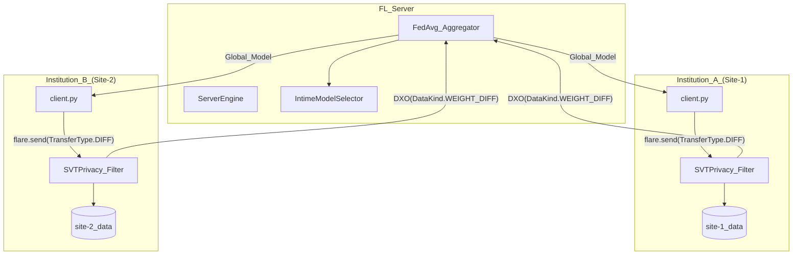
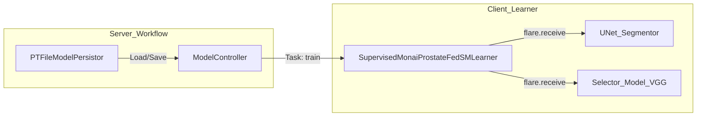
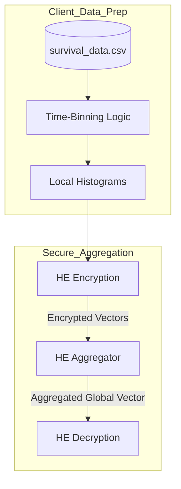
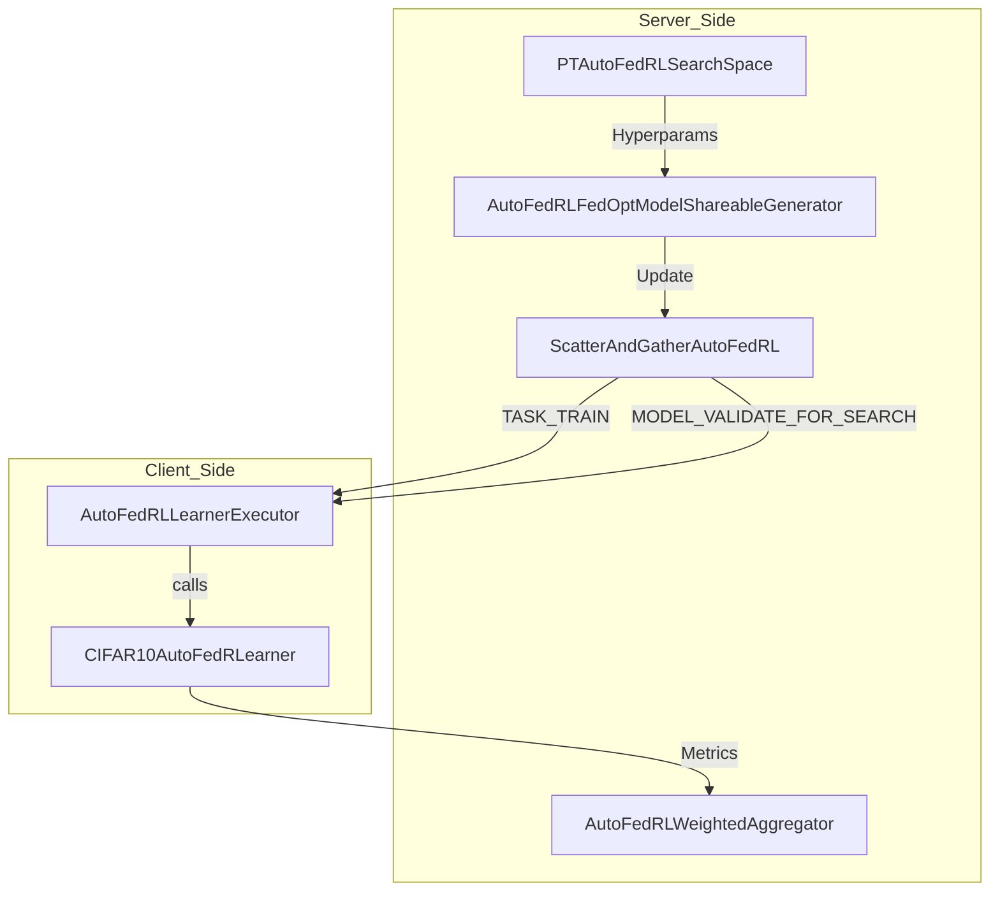
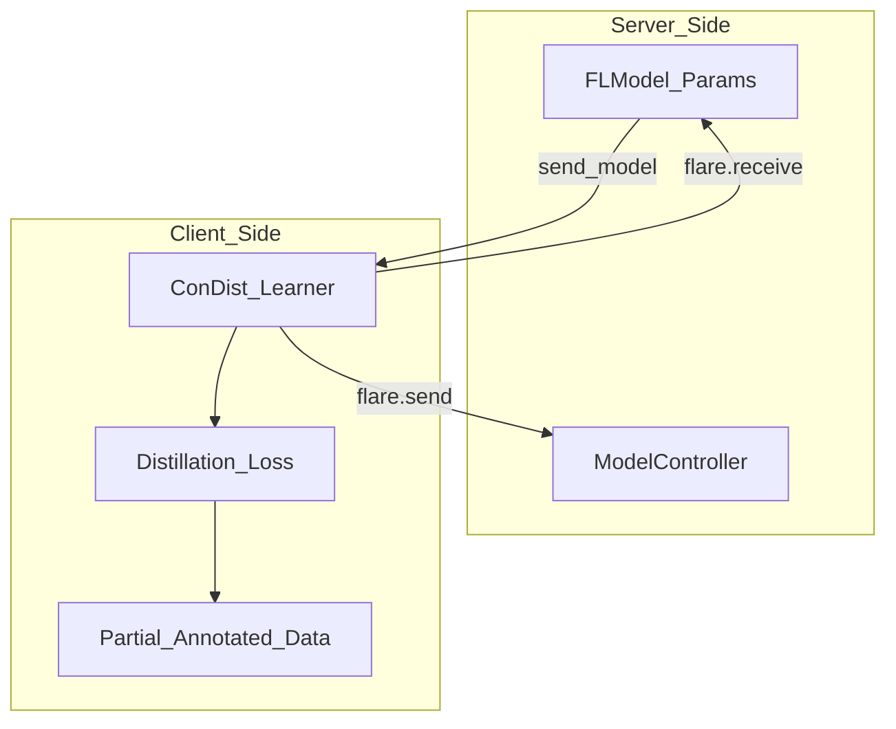

<!-- source: DeepWiki mcp.deepwiki.com · repo NVIDIA/NVFlare · page 18.1 Medical Imaging Research · fetched 2026-10-26 -->

# Medical Imaging Research

Relevant source files

The following files were used as context for generating this wiki page:

- [CITATION.cff](CITATION.cff)
- [docs/publications_and_talks.rst](docs/publications_and_talks.rst)
- [docs/resources/researcher.svg](docs/resources/researcher.svg)
- [examples/advanced/bionemo/task_fitting/job_inference/client.py](examples/advanced/bionemo/task_fitting/job_inference/client.py)
- [examples/advanced/cifar10/pt/src/data/cifar10_data_split.py](examples/advanced/cifar10/pt/src/data/cifar10_data_split.py)
- [integration/README.md](integration/README.md)
- [integration/sample/README.md](integration/sample/README.md)
- [research/CONTRIBUTING.md](research/CONTRIBUTING.md)
- [research/README.md](research/README.md)
- [research/auto-fed-rl/README.md](research/auto-fed-rl/README.md)
- [research/auto-fed-rl/jobs/cifar10_autofedrl/cifar10_autofedrl/config/config_fed_server.json](research/auto-fed-rl/jobs/cifar10_autofedrl/cifar10_autofedrl/config/config_fed_server.json)
- [research/auto-fed-rl/src/autofedrl/autofedrl_cifar10_learner.py](research/auto-fed-rl/src/autofedrl/autofedrl_cifar10_learner.py)
- [research/auto-fed-rl/src/autofedrl/autofedrl_fedopt.py](research/auto-fed-rl/src/autofedrl/autofedrl_fedopt.py)
- [research/auto-fed-rl/src/autofedrl/autofedrl_learner_executor.py](research/auto-fed-rl/src/autofedrl/autofedrl_learner_executor.py)
- [research/auto-fed-rl/src/autofedrl/cifar10_learner.py](research/auto-fed-rl/src/autofedrl/cifar10_learner.py)
- [research/auto-fed-rl/src/autofedrl/pt_autofedrl.py](research/auto-fed-rl/src/autofedrl/pt_autofedrl.py)
- [research/fed-ce/README.md](research/fed-ce/README.md)
- [research/fed-sm/README.md](research/fed-sm/README.md)
- [research/fed-sm/jobs/fedsm_prostate/app/custom/learners/supervised_learner.py](research/fed-sm/jobs/fedsm_prostate/app/custom/learners/supervised_learner.py)
- [research/fed-sm/jobs/fedsm_prostate/app/custom/learners/supervised_monai_prostate_fedsm_learner.py](research/fed-sm/jobs/fedsm_prostate/app/custom/learners/supervised_monai_prostate_fedsm_learner.py)
- [research/fedobd/README.md](research/fedobd/README.md)
- [research/fedobd/requirements.txt](research/fedobd/requirements.txt)
- [research/quantifying-data-leakage/src/nvflare_gradinv/learners/cxr_learner.py](research/quantifying-data-leakage/src/nvflare_gradinv/learners/cxr_learner.py)
- [research/quantifying-data-leakage/start_fl_sim.sh](research/quantifying-data-leakage/start_fl_sim.sh)
- [research/sample-research/README.md](research/sample-research/README.md)

NVIDIA FLARE provides a robust foundation for multi-institutional medical imaging studies, enabling collaborative model training while maintaining strict data sovereignty. This page details the implementation of key research studies focusing on brain tumor segmentation, prostate segmentation, survival analysis, hyperparameter optimization, and distillation from partially annotated data.

## 1. Federated Brain Tumor Segmentation (BraTS18)

The BraTS18 implementation demonstrates privacy-preserving federated learning for brain tumor segmentation. This research highlights the ability to train high-performing models across multiple sites without centralizing sensitive patient MRI data [research/README.md:31-31]().

### Implementation Architecture
The system uses the `FedAvgRecipe` (or legacy `ScatterAndGather` workflows) to orchestrate training across institutions holding subsets of the BraTS 2018 dataset [docs/publications_and_talks.rst:43-43]().

*   **Data Flow**: Clients perform local training using their private MRI volumes (T1c, T1, T2, FLAIR) and send model updates to the server. The server aggregates these updates using weighted averaging.
*   **Differential Privacy**: The implementation applies the **Sparse Vector Technique (SVT)** to model updates to ensure formal privacy guarantees [docs/publications_and_talks.rst:49-49]().
*   **Model Structure**: Utilizes a MONAI-based wrapper for volumetric segmentation of 3 nested subregions: Enhancing Tumor (ET), Tumor Core (TC), and Whole Tumor (WT).

### Key Components
| Component | Responsibility |
| :--- | :--- |
| `BratsSegResNet` | Volumetric segmentation model based on MONAI architectures [docs/publications_and_talks.rst:49-49](). |
| `SVTPrivacy` | A filter that implements Sparse Vector Technique for model update DP. |
| `FedAvgRecipe` | The Job Recipe entrypoint that configures the federated averaging workflow. |

### BraTS18 Federated Data Flow
Title: "BraTS18 Federated Data Flow with SVT Privacy"

**Sources:**
- [research/README.md:31-31]()
- [docs/publications_and_talks.rst:43-49]()

---

## 2. Multi-source Prostate Segmentation

Research in prostate segmentation focuses on overcoming domain shift across different medical centers (I2CVB, MSD, NCI_ISBI, Promise12, etc.) using 2D axial slices of T2-weighted MRIs [research/README.md:41-43]().

### 2.1 FedSM: Federated SoftPull and Model Selection
FedSM addresses the "client drift" issue caused by non-IID data distributions in medical imaging [research/fed-sm/README.md:1-10](). It involves training a selector model, a global model, and personalized models.

*   **Workflow**: Implements a novel personalized FL objective formulation and the `SoftPull` method to solve it [research/fed-sm/README.md:10-10]().
*   **Personalization**: The selector model distinguishes data from different sites to achieve better accuracy than a single global model. Test Dice scores showed 0.7274 for personalized models vs 0.7178 for the global model [research/fed-sm/README.md:76-76]().
*   **Implementation**: Uses the `SupervisedMonaiProstateFedSMLearner` for 2D axial slice segmentation [research/fed-sm/jobs/fedsm_prostate/app/custom/learners/supervised_monai_prostate_fedsm_learner.py:1-20]().

### 2.2 FedCE: Fair Federated Learning via Client Contribution Estimation
FedCE focuses on both collaboration fairness (rewarding contribution) and performance fairness (uniformity across clients) [research/fed-ce/README.md:10-10]().

*   **Mechanism**: Estimates client contribution in both gradient space (gradient direction differences) and data space (prediction error via an auxiliary model) [research/fed-ce/README.md:10-10]().
*   **Implementation**: Utilizes `PTFedCEHelper` to construct and validate the leave-one-out model required by the `FedCERecipe` [research/fed-ce/README.md:43-44]().

Title: "FedSM Model Orchestration"

**Sources:**
- [research/README.md:25-27]()
- [research/fed-sm/README.md:1-76]()
- [research/fed-ce/README.md:1-62]()

---

## 3. Secure Federated Kaplan-Meier Analysis

This implementation provides a secure mechanism for collaborative survival analysis using time-binning and Homomorphic Encryption (HE).

### 3.1 Privacy Mechanisms
To prevent raw event list exposure (Status and Survival Days), two techniques are employed:
*   **Time-Binning**: Raw survival times are discretized into bins (e.g., weekly intervals) to create histograms.
*   **Homomorphic Encryption**: Local histograms are encrypted before transmission. The server performs global aggregation entirely within the encryption space using HE.

### 3.2 Data Preparation and Analysis
*   **Logic**: The final analysis is performed locally on global aggregated histograms recovered from decrypted global data.

Title: "Secure Kaplan-Meier Data Transformation"

---

## 4. Auto-FedRL: Hyperparameter Optimization

Auto-FedRL implements an efficient reinforcement learning (RL)-based federated hyperparameter optimization algorithm [research/auto-fed-rl/README.md:9-9](). An online RL agent dynamically adjusts hyperparameters of each client based on current training progress [research/auto-fed-rl/README.md:1-11]().

### 4.1 Implementation and Data Flow
The system manages a search space for hyperparameters like learning rate (`lr`), number of local epochs (`ne`), aggregation weights (`aw`), and server learning rate (`slr`) [research/auto-fed-rl/jobs/cifar10_autofedrl/cifar10_autofedrl/config/config_fed_server.json:51-89]().

*   **Controller**: Uses `ScatterAndGatherAutoFedRL` to coordinate the RL-based search workflow [research/auto-fed-rl/jobs/cifar10_autofedrl/cifar10_autofedrl/config/config_fed_server.json:134-134]().
*   **Learner**: `CIFAR10AutoFedRLearner` manages a validation set specifically for hyperparameter search (`val_loader_search`) [research/auto-fed-rl/src/autofedrl/autofedrl_cifar10_learner.py:141-143]().
*   **Data Handling**: Uses `Cifar10DataSplitter` for Dirichlet-based heterogeneous partitioning [research/auto-fed-rl/jobs/cifar10_autofedrl/cifar10_autofedrl/config/config_fed_server.json:15-20]().

### 4.2 Key Components
| Component | Responsibility |
| :--- | :--- |
| `PTAutoFedRLSearchSpace` | Defines search ranges for `lr`, `ne`, `aw`, and `slr` [research/auto-fed-rl/jobs/cifar10_autofedrl/cifar10_autofedrl/config/config_fed_server.json:52-52](). |
| `AutoFedRLWeightedAggregator` | Performs aggregation using weights determined by the RL agent [research/auto-fed-rl/jobs/cifar10_autofedrl/cifar10_autofedrl/config/config_fed_server.json:93-93](). |
| `AutoFedRLFedOptModelShareableGenerator` | Generates shareables using optimized server-side updates [research/auto-fed-rl/jobs/cifar10_autofedrl/cifar10_autofedrl/config/config_fed_server.json:36-36](). |

Title: "Auto-FedRL Workflow Architecture"

**Sources:**
- [research/auto-fed-rl/README.md:1-11]()
- [research/auto-fed-rl/jobs/cifar10_autofedrl/cifar10_autofedrl/config/config_fed_server.json:15-149]()
- [research/auto-fed-rl/src/autofedrl/autofedrl_cifar10_learner.py:39-158]()

---

## 5. Quantifying Data Leakage (Gradient Inversion)

This research evaluates the security of FL against gradient inversion attacks using medical imaging data [research/README.md:28-28]().

*   **Attack Simulation**: Analyzes how much information can be recovered from shared gradients in medical contexts [docs/publications_and_talks.rst:51-51]().
*   **Learner**: `CXRLearner` implements training loops for Chest X-Ray classification that expose gradients for quantification analysis [research/quantifying-data-leakage/src/nvflare_gradinv/learners/cxr_learner.py:47-47](). It supports deterministic training via `monai.utils.misc.set_determinism` [research/quantifying-data-leakage/src/nvflare_gradinv/learners/cxr_learner.py:156-156]().

**Sources:**
- [research/README.md:28-28]()
- [docs/publications_and_talks.rst:51-51]()
- [research/quantifying-data-leakage/src/nvflare_gradinv/learners/cxr_learner.py:47-156]()

---

## 6. ConDistFL: Distillation from Partially Annotated Data

ConDistFL addresses the common medical imaging challenge where some sites lack full ground truth (e.g., only one organ annotated per site) [research/README.md:23-23]().

### 6.1 Technical Implementation
The framework uses conditional distillation to allow clients to learn from partially annotated data by leveraging knowledge from the global model [docs/publications_and_talks.rst:40-40]().

*   **Workflow**: Orchestrates the transfer of "soft labels" from the server to clients to guide training on unannotated classes.
*   **Client Logic**: Uses the Client API to receive the global model, compute distillation loss against local partial labels, and send back refined updates.

Title: "ConDistFL Research Components"

**Sources:**
- [research/README.md:23-23]()
- [docs/publications_and_talks.rst:40-40]()

---

## 7. Multi-Task Learning (FedHCA2)

FedHCA2 focuses on heterogeneous-client federated multi-task learning, allowing clients with different tasks or data types to collaborate effectively [research/README.md:21-21]().

*   **Heterogeneity**: Handles variations in client tasks (e.g., different organ segmentation tasks) within a single federated job [docs/publications_and_talks.rst:32-32]().
*   **Implementation**: Utilizes specialized multi-task learning components to manage complex task-specific aggregation and distribution logic.

**Sources:**
- [research/README.md:21-21]()
- [docs/publications_and_talks.rst:32-32]()

---

