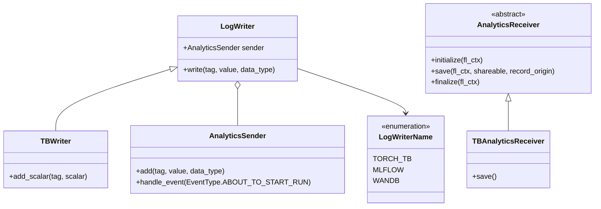

<!-- source: DeepWiki mcp.deepwiki.com · repo NVIDIA/NVFlare · page 19.1 Streaming Analytics Architecture · fetched 2026-10-26 -->

# Streaming Analytics Architecture

<details>
<summary>Relevant source files</summary>

The following files were used as context for generating this wiki page:

- [nvflare/apis/analytix.py](nvflare/apis/analytix.py)
- [nvflare/apis/utils/analytix_utils.py](nvflare/apis/utils/analytix_utils.py)
- [nvflare/app_common/app_event_type.py](nvflare/app_common/app_event_type.py)
- [nvflare/app_common/tracking/log_writer.py](nvflare/app_common/tracking/log_writer.py)
- [nvflare/app_common/tracking/tracker_types.py](nvflare/app_common/tracking/tracker_types.py)
- [nvflare/app_common/widgets/streaming.py](nvflare/app_common/widgets/streaming.py)
- [nvflare/app_opt/tracking/mlflow/__init__.py](nvflare/app_opt/tracking/mlflow/__init__.py)
- [nvflare/app_opt/tracking/mlflow/mlflow_receiver.py](nvflare/app_opt/tracking/mlflow/mlflow_receiver.py)
- [nvflare/app_opt/tracking/mlflow/mlflow_writer.py](nvflare/app_opt/tracking/mlflow/mlflow_writer.py)
- [nvflare/app_opt/tracking/tb/tb_receiver.py](nvflare/app_opt/tracking/tb/tb_receiver.py)
- [nvflare/app_opt/tracking/tb/tb_writer.py](nvflare/app_opt/tracking/tb/tb_writer.py)
- [nvflare/app_opt/tracking/wandb/wandb_receiver.py](nvflare/app_opt/tracking/wandb/wandb_receiver.py)
- [nvflare/app_opt/tracking/wandb/wandb_writer.py](nvflare/app_opt/tracking/wandb/wandb_writer.py)
- [nvflare/client/tracking.py](nvflare/client/tracking.py)
- [tests/unit_test/apis/analytix_test.py](tests/unit_test/apis/analytix_test.py)
- [tests/unit_test/app_common/widgets/streaming_test.py](tests/unit_test/app_common/widgets/streaming_test.py)

</details>


The Streaming Analytics Architecture in NVIDIA FLARE provides a unified mechanism for capturing, transmitting, and visualizing experiment metrics (scalars, images, text) from distributed clients to a centralized tracking backend (e.g., TensorBoard, MLflow, or Weights & Biases). This system abstracts the underlying tracking SDKs, allowing users to write framework-agnostic logging code that works across different visualization tools.

## System Overview

The architecture follows a Producer-Consumer pattern using `AnalyticsSender` and `AnalyticsReceiver` components.

1.  **Producers (Clients):** Use `LogWriter` implementations (like `TBWriter`, `MLflowWriter`, or `WandBWriter`) to capture metrics. These are converted into `DXO` (Data Exchange Objects) and fired as local events. [nvflare/app_common/tracking/log_writer.py:25-32](), [nvflare/app_opt/tracking/tb/tb_writer.py:21-28](), [nvflare/app_opt/tracking/mlflow/mlflow_writer.py:21-32](), [nvflare/app_opt/tracking/wandb/wandb_writer.py:21-22]()
2.  **Transmission:** Metrics are sent from the Client process to the Server via auxiliary communication. `AnalyticsSender` creates an analytic DXO and triggers the event system. [nvflare/app_common/widgets/streaming.py:52-71]()
3.  **Consumers (Server/Client):** `AnalyticsReceiver` components listen for analytic events, decode the `DXO` back into `AnalyticsData`, and write them to the final backend. [nvflare/app_common/widgets/streaming.py:79-136]()

### Data Flow Diagram

The following diagram illustrates how a metric flows from a training script to a tracking backend.

**Metric Flow: From Code to Backend**
```mermaid
graph TD
    subgraph "Client_Job_Process"
        [A_Training_Script] -- "writer.add_scalar()" --> [B_TBWriter_/_MLflowWriter]
        [B_TBWriter_/_MLflowWriter] -- "LogWriter.write()" --> [C_AnalyticsSender]
        [C_AnalyticsSender] -- "engine.fire_event(ANALYTIC_EVENT_TYPE)" --> [D_Client_Engine]
    end

    subgraph "Communication_Layer"
        [D_Client_Engine] -- "Aux_Communication" --> [E_Server_Engine]
    end

    subgraph "Server_Process"
        [E_Server_Engine] -- "fire_event('fed.analytix_log_stats')" --> [F_AnalyticsReceiver_Implementation]
        [F_AnalyticsReceiver_Implementation] -- "save()" --> [G_Tracking_Backend]
    end

    [B_TBWriter_/_MLflowWriter] -- "inherits" --> [LW_LogWriter]
    [LW_LogWriter] -- "contains" --> [C_AnalyticsSender]
    [F_AnalyticsReceiver_Implementation] -- "MLflowReceiver" --> [G_Tracking_Backend]
    [F_AnalyticsReceiver_Implementation] -- "WandBReceiver" --> [G_Tracking_Backend]
    [F_AnalyticsReceiver_Implementation] -- "TBAnalyticsReceiver" --> [G_Tracking_Backend]
```
Sources: [nvflare/app_common/widgets/streaming.py:28-79](), [nvflare/apis/analytix.py:76-122](), [nvflare/app_common/tracking/log_writer.py:25-44](), [nvflare/app_opt/tracking/tb/tb_writer.py:36-45]()

---

## Key Components

### AnalyticsData and DXO
All streaming data is encapsulated in `AnalyticsData`. This class handles the validation of data types and the conversion to/from a `DXO` with `DataKind.ANALYTIC`. [nvflare/apis/analytix.py:76-84]()

*   **Supported Data Types:** `SCALARS`, `SCALAR`, `IMAGE`, `TEXT`, `LOG_RECORD`, `PARAMETER`, `PARAMETERS`, `METRIC`, `METRICS`, `MODEL`, `TAG`, `TAGS`, and `INIT_DATA`. [nvflare/apis/analytix.py:57-74]()
*   **Conversion:** `to_dxo()` packages the tag, value, and global step into a `DXO` for transport. [nvflare/apis/analytix.py:108-125]()
*   **Validation:** The `_validate_data_types` method ensures that values match the expected Python types (e.g., `SCALAR` must be `float` or `int`, while `SCALARS` or `METRICS` must be a `dict`). [nvflare/apis/analytix.py:165-200]()

### AnalyticsSender
The `AnalyticsSender` is a `Widget` that resides on the client side. Its primary function is the `add()` method, which creates a `DXO` and uses the engine to fire an event of type `analytix_log_stats`. [nvflare/app_common/widgets/streaming.py:28-43]()

*   **Implementation:** [nvflare/app_common/widgets/streaming.py:28-79]()
*   **Event Firing:** It uses `send_analytic_dxo` from `analytix_utils` to broadcast the metric via the `FLContext`. [nvflare/app_common/widgets/streaming.py:71]()

### AnalyticsReceiver
The `AnalyticsReceiver` is an abstract base class for components that consume analytic events. It manages the lifecycle (`initialize`, `save`, `finalize`) and ensures thread-safe data handling via a `Lock`. [nvflare/app_common/widgets/streaming.py:79-93]()

*   **Implementation:** [nvflare/app_common/widgets/streaming.py:79-181]()
*   **Event Handling:** It listens for `ANALYTIC_EVENT_TYPE` and `fed.ANALYTIC_EVENT_TYPE`. [nvflare/app_common/widgets/streaming.py:88]()
*   **State Management:** Tracks initialization and run termination to prevent processing events after a run ends. [nvflare/app_common/widgets/streaming.py:146-160]()

### MetricRelay
The `MetricRelay` is a specialized `Widget` designed to relay metrics across a `Pipe` interface, typically used in scenarios where the training script runs in an external process (e.g., via `LauncherExecutor`).

*   **Data Conversion:** When a message is received via the pipe, it expects the data to be a `DXO`. It then uses `send_analytic_dxo` to fire the event within the FLARE engine. [nvflare/apis/utils/analytix_utils.py:24]()
*   **Configuration Export:** It implements `AttributesExportable`, allowing it to export pipe configuration details to the client configuration.

Sources: [nvflare/app_common/widgets/streaming.py:28-128](), [nvflare/apis/utils/analytix_utils.py:19-24]()

---

## Tracking Writers

Writers provide a familiar API for users, mimicking popular tracking SDKs while routing data through the FLARE event system.

### LogWriter Base Class
The `LogWriter` class is the foundation for all specific tracking writers. It initializes an `AnalyticsSender` during the `ABOUT_TO_START_RUN` event. [nvflare/app_common/tracking/log_writer.py:25-44]()

### Specific Implementations
*   **TBWriter:** Mimics PyTorch TensorBoard's `SummaryWriter`. It provides `add_scalar` and `add_scalars` methods. [nvflare/app_opt/tracking/tb/tb_writer.py:21-56]()
*   **MLflowWriter:** Mimics the `mlflow` module, supporting `log_param`, `log_params`, `log_metric`, `log_metrics`, `log_text`, and `set_tag`. [nvflare/app_opt/tracking/mlflow/mlflow_writer.py:21-118]()
*   **WandBWriter:** Mimics Weights & Biases logging, providing a `log()` method for dictionary-based metrics. [nvflare/app_opt/tracking/wandb/wandb_writer.py:21-40]()
*   **Client API Writers:** The `nvflare.client.tracking` module provides `SummaryWriter`, `MLflowWriter`, and `WandBWriter` that use the `log()` function to send data through the Client API context. [nvflare/client/tracking.py:29-170]()

---

## Backend Implementations

### TensorBoard (TBAnalyticsReceiver)
Integrates with TensorBoard by writing events to a specified folder structure using `TensorBoardEventWriter`. [nvflare/app_opt/tracking/tb/tb_receiver.py:47-73](), [nvflare/app_opt/tracking/tb/tb_receiver.py:113-117]()
*   **Folder Structure:** Creates subdirectories for each peer (client) under a root `tb_events` directory within the job's run directory. [nvflare/app_opt/tracking/tb/tb_receiver.py:54-68](), [nvflare/app_opt/tracking/tb/tb_receiver.py:75-80]()
*   **Mapping:** Uses `FUNCTION_MAPPING` to route `AnalyticsDataType` to specific methods like `add_scalar`, `add_text`, or `add_image`. [nvflare/app_opt/tracking/tb/tb_receiver.py:26-33](), [nvflare/app_opt/tracking/tb/tb_receiver.py:127-137]()

### MLflow (MLflowReceiver)
Integrates with the MLflow tracking server or local file store. [nvflare/app_opt/tracking/mlflow/mlflow_receiver.py:53-84]()
*   **Buffering:** Implements a buffer to batch metrics for efficiency, controlled by `buffer_flush_time` (default 1 second). [nvflare/app_opt/tracking/mlflow/mlflow_receiver.py:97-101]()
*   **Multi-site Tracking:** Maintains a dictionary of `MlflowClient` instances and `run_ids`, allowing the server to track multiple clients simultaneously. [nvflare/app_opt/tracking/mlflow/mlflow_receiver.py:94-96]()

### Weights & Biases (WandBReceiver)
Uses a multi-processing approach to handle W&B logging for process isolation and to prevent blocking the main FLARE engine. [nvflare/app_opt/tracking/wandb/wandb_receiver.py:58-73]()
*   **Process Isolation:** Spawns a separate `Process` for each site to manage the `wandb.init` and `wandb.log` calls via a `Queue`. [nvflare/app_opt/tracking/wandb/wandb_receiver.py:161-169]()
*   **Buffering:** Buffers metrics by step to ensure `wandb.log` is called correctly with ordered global steps. [nvflare/app_opt/tracking/wandb/wandb_receiver.py:95-112]()

---

## External Process Support

For jobs running in external processes, metrics are streamed via a `Pipe`.

### Launcher and Pipe Interaction
The `ClientAPILauncherExecutor` manages the external process and configures the `Pipe`.

**External Process Metric Bridge**
```mermaid
graph LR
    subgraph "External_Process"
        [flare.tracking] -- "Message" --> [Pipe_Client_End]
    end
    
    subgraph "Client_Job_Process_CJ"
        [Pipe_Server_End] -- "receive()" --> [PipeHandler]
        [PipeHandler] -- "callback" --> [MetricRelay]
        [MetricRelay] -- "fire_event" --> [ClientEngine]
    end
    
    [Pipe_Client_End] <--> [Pipe_Server_End]
```
Sources: [nvflare/client/tracking.py:29-170](), [nvflare/app_common/widgets/streaming.py:28-52]()

---

## Code Entity Association

**Relationship between Writers, Senders, and Receivers**

Sources: [nvflare/app_common/tracking/log_writer.py:25-64](), [nvflare/app_common/widgets/streaming.py:28-128](), [nvflare/apis/analytix.py:22-25]()

---

## Implementation Details: Event Flow

The system relies on the NVFlare Event System to move data across process boundaries.

| Event Name | Scope | Description |
| :--- | :--- | :--- |
| `analytix_log_stats` | Local | Fired by `AnalyticsSender` on the client. [nvflare/apis/analytix.py:19]() |
| `fed.analytix_log_stats` | Federated | Broadcast by the engine to the server (or other sites). [nvflare/app_common/widgets/streaming.py:88]() |
| `EventType.START_RUN` | Local | Triggers `receiver.initialize()`. [nvflare/app_common/widgets/streaming.py:130-131]() |
| `EventType.END_RUN` | Local | Triggers `receiver.finalize()` and flushes buffers. [nvflare/app_common/widgets/streaming.py:134-135]() |

**Code Citation Summary:**
*   `AnalyticsSender` definition: [nvflare/app_common/widgets/streaming.py:28]()
*   `AnalyticsReceiver` definition: [nvflare/app_common/widgets/streaming.py:79]()
*   `MLflowReceiver` logic: [nvflare/app_opt/tracking/mlflow/mlflow_receiver.py:53]()
*   `TBAnalyticsReceiver` logic: [nvflare/app_opt/tracking/tb/tb_receiver.py:47]()
*   `WandBReceiver` logic: [nvflare/app_opt/tracking/wandb/wandb_receiver.py:58]()
*   `AnalyticsDataType` enum: [nvflare/apis/analytix.py:57]()

Sources: [nvflare/app_common/widgets/streaming.py:129-136](), [nvflare/apis/analytix.py:19-25](), [nvflare/app_common/tracking/log_writer.py:33-44]()

---

