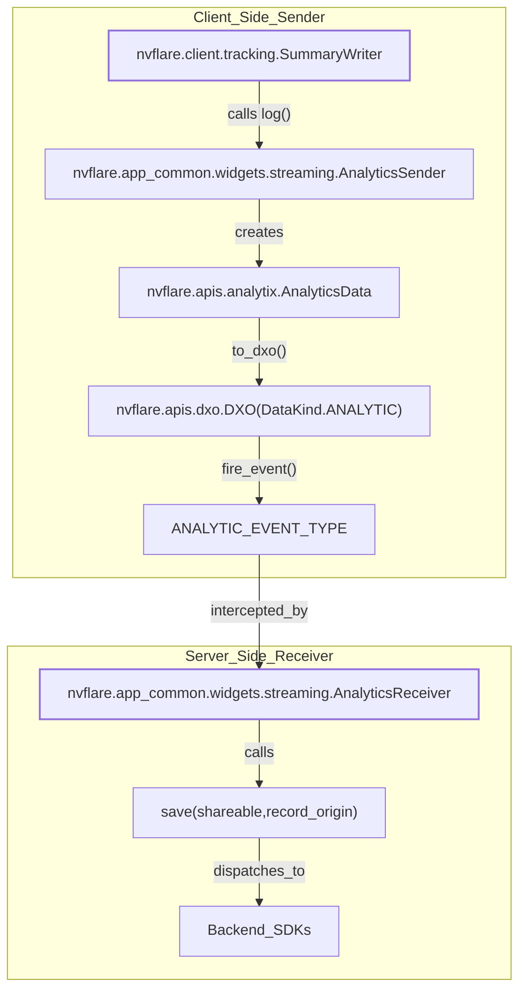
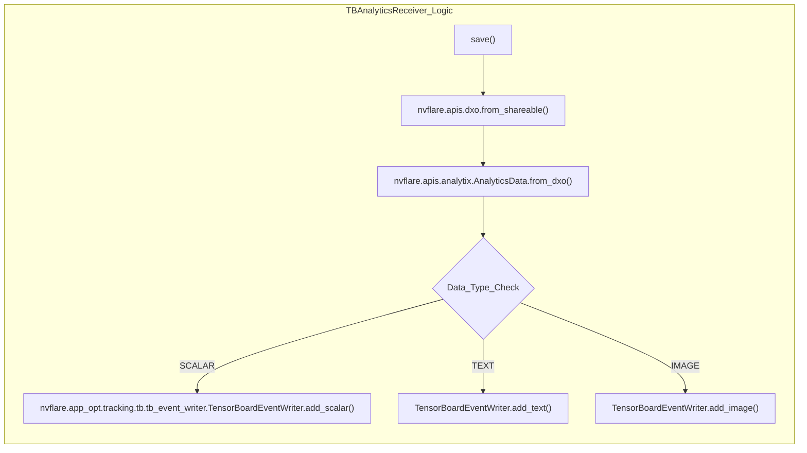
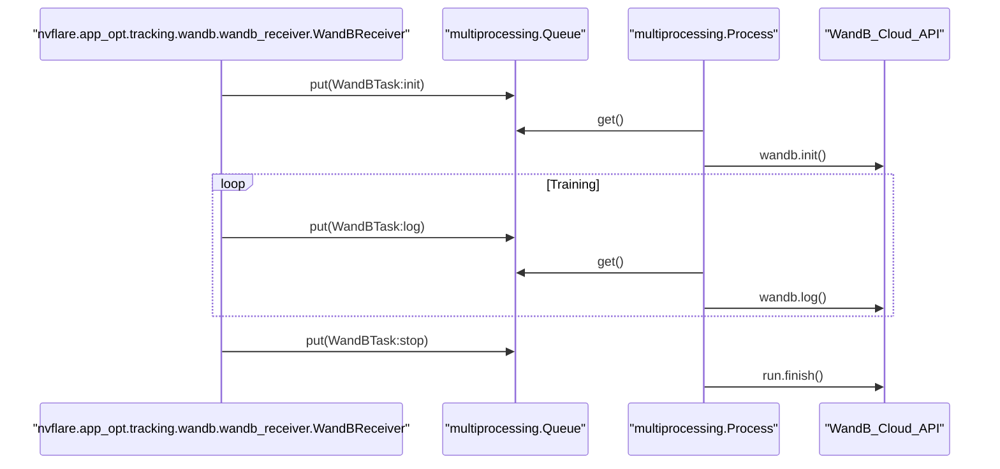
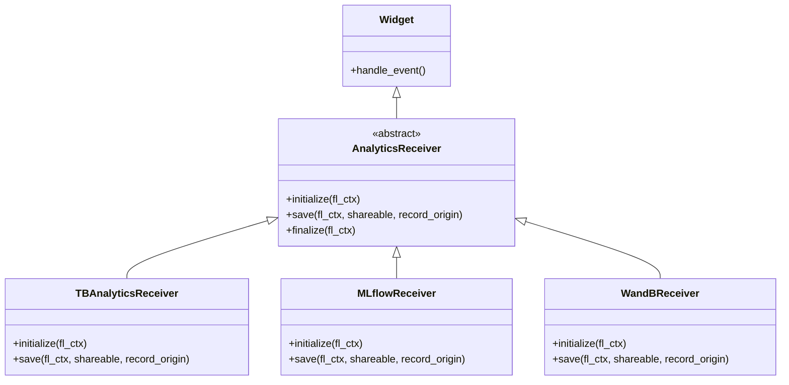

<!-- source: DeepWiki mcp.deepwiki.com · repo NVIDIA/NVFlare · page 19.2 TensorBoard, MLflow, and W&B Integration · fetched 2026-10-26 -->

# TensorBoard, MLflow, and W&B Integration

<details>
<summary>Relevant source files</summary>

The following files were used as context for generating this wiki page:

- [nvflare/apis/analytix.py](nvflare/apis/analytix.py)
- [nvflare/apis/utils/analytix_utils.py](nvflare/apis/utils/analytix_utils.py)
- [nvflare/app_common/app_event_type.py](nvflare/app_common/app_event_type.py)
- [nvflare/app_common/tracking/log_writer.py](nvflare/app_common/tracking/log_writer.py)
- [nvflare/app_common/tracking/tracker_types.py](nvflare/app_common/tracking/tracker_types.py)
- [nvflare/app_common/widgets/streaming.py](nvflare/app_common/widgets/streaming.py)
- [nvflare/app_opt/tracking/mlflow/__init__.py](nvflare/app_opt/tracking/mlflow/__init__.py)
- [nvflare/app_opt/tracking/mlflow/mlflow_receiver.py](nvflare/app_opt/tracking/mlflow/mlflow_receiver.py)
- [nvflare/app_opt/tracking/mlflow/mlflow_writer.py](nvflare/app_opt/tracking/mlflow/mlflow_writer.py)
- [nvflare/app_opt/tracking/tb/tb_receiver.py](nvflare/app_opt/tracking/tb/tb_receiver.py)
- [nvflare/app_opt/tracking/tb/tb_writer.py](nvflare/app_opt/tracking/tb/tb_writer.py)
- [nvflare/app_opt/tracking/wandb/wandb_receiver.py](nvflare/app_opt/tracking/wandb/wandb_receiver.py)
- [nvflare/app_opt/tracking/wandb/wandb_writer.py](nvflare/app_opt/tracking/wandb/wandb_writer.py)
- [nvflare/client/tracking.py](nvflare/client/tracking.py)
- [tests/unit_test/apis/analytix_test.py](tests/unit_test/apis/analytix_test.py)
- [tests/unit_test/app_common/widgets/streaming_test.py](tests/unit_test/app_common/widgets/streaming_test.py)

</details>


This page details the technical implementation and configuration of experiment tracking integrations in NVIDIA FLARE. NVFLARE provides a unified streaming analytics architecture that allows metrics, parameters, and artifacts to be collected from distributed clients and recorded in popular tracking backends like TensorBoard, MLflow, and Weights & Biases (W&B).

## Streaming Analytics Architecture

The integration relies on a sender-receiver pattern. Analytics data is encapsulated in a `DXO` (Data Exchange Object) of kind `DataKind.ANALYTIC` and streamed across the federated network via the NVFLARE event system [nvflare/apis/analytix.py:122-125]().

### Data Flow Overview

1.  **Sender**: The training code on the client uses a `LogWriter` (e.g., `SummaryWriter`, `MLflowWriter`, `WandBWriter`) to record metrics [nvflare/client/tracking.py:29-180]().
2.  **Event Injection**: The writer calls `AnalyticsSender.add()` which fires an `analytix_log_stats` event [nvflare/app_common/widgets/streaming.py:52-71]().
3.  **Receiver**: An `AnalyticsReceiver` (configured on the server or client) handles the event, converts the DXO back to `AnalyticsData`, and writes it to the specific backend [nvflare/app_common/widgets/streaming.py:129-136]().

### Code Entity Association

The following diagram maps the high-level streaming concepts to the specific classes and constants used in the codebase.

**Analytics Streaming Logic Mapping**

Sources: [nvflare/apis/analytix.py:19-25](), [nvflare/app_common/widgets/streaming.py:28-43](), [nvflare/app_common/widgets/streaming.py:79-85](), [nvflare/client/tracking.py:41-115]()

## Core Data Structures

### AnalyticsDataType
The system defines standard types for analytics in `AnalyticsDataType` [nvflare/apis/analytix.py:57-75](). These include:
*   `SCALAR` / `SCALARS`: Numerical values [nvflare/apis/analytix.py:58-59]().
*   `PARAMETER` / `PARAMETERS`: Model hyperparameters [nvflare/apis/analytix.py:64-65]().
*   `TEXT`: Log messages or artifact descriptions [nvflare/apis/analytix.py:61]().
*   `IMAGE`: Visualization data [nvflare/apis/analytix.py:60]().
*   `METRIC` / `METRICS`: Specific to MLflow/W&B tracking [nvflare/apis/analytix.py:66-67]().

### AnalyticsData Class
This class acts as the bridge between raw metrics and the NVFLARE communication layer. It handles validation and conversion to/from `DXO` [nvflare/apis/analytix.py:76-125](). It uses `TrackConst` keys like `TRACK_KEY` and `TRACK_VALUE` to structure the internal dictionary [nvflare/apis/analytix.py:115-125]().

The class also provides a utility `convert_data_type` to map between different tracker naming conventions (e.g., mapping `SCALAR` in TensorBoard to `METRIC` in MLflow) [nvflare/apis/analytix.py:154-156]().

Sources: [nvflare/apis/analytix.py:57-125](), [nvflare/apis/analytix.py:28-55](), [tests/unit_test/apis/analytix_test.py:112-137]()

---

## TensorBoard Integration

The TensorBoard integration mimics the standard `torch.utils.tensorboard.SummaryWriter` API.

### Implementation
*   **Sender**: `nvflare.client.tracking.SummaryWriter` provides an interface for client-side logging [nvflare/client/tracking.py:29-39](). It sends data with `LogWriterName.TORCH_TB` [nvflare/client/tracking.py:55]().
*   **Receiver**: `TBAnalyticsReceiver` creates a separate `TensorBoardEventWriter` instance for each client (site) to prevent data interleaving [nvflare/app_opt/tracking/tb/tb_receiver.py:113-117]().

### Data Flow
The receiver maps `AnalyticsDataType` to specific TensorBoard functions via `FUNCTION_MAPPING` [nvflare/app_opt/tracking/tb/tb_receiver.py:26-33]().

**TensorBoard Dispatch Flow**

Sources: [nvflare/app_opt/tracking/tb/tb_receiver.py:107-138](), [nvflare/app_opt/tracking/tb/tb_receiver.py:26-33]()

---

## MLflow Integration

MLflow integration supports tracking experiments, runs, parameters, and metrics across the federated infrastructure.

### MLflowReceiver
The `MLflowReceiver` manages the connection to the MLflow Tracking Server. It can be configured for centralized tracking (server-side) or site-specific tracking (client-side) [nvflare/app_opt/tracking/mlflow/mlflow_receiver.py:143-154]().

Key features:
*   **Site Separation**: It creates a unique `run_id` for each participating site within a single experiment [nvflare/app_opt/tracking/mlflow/mlflow_receiver.py:157-160]().
*   **Buffering**: Metrics are buffered and flushed according to `buffer_flush_time` to reduce network overhead [nvflare/app_opt/tracking/mlflow/mlflow_receiver.py:97-101]().

### Configuration Parameters
| Parameter | Type | Description |
| :--- | :--- | :--- |
| `tracking_uri` | `str` | URI of the MLflow server (defaults to local SQLite database in job result directory) [nvflare/app_opt/tracking/mlflow/mlflow_receiver.py:103-110]() |
| `experiment_name` | `str` | Name of the experiment in MLflow (defaults to "FLARE FL Experiment") [nvflare/app_opt/tracking/mlflow/mlflow_receiver.py:136]() |
| `buffer_flush_time` | `int` | Frequency of batching updates to the server [nvflare/app_opt/tracking/mlflow/mlflow_receiver.py:101]() |

Sources: [nvflare/app_opt/tracking/mlflow/mlflow_receiver.py:53-101](), [nvflare/app_opt/tracking/mlflow/mlflow_writer.py:21-32](), [nvflare/client/tracking.py:109-115]()

---

## Weights & Biases (W&B) Integration

The W&B integration handles the asynchronous nature of W&B logging by using a multi-process architecture.

### WandBReceiver Architecture
Because `wandb.init()` and `wandb.log()` can block or interfere with the main FL process, `WandBReceiver` spawns a separate `multiprocessing.Process` for each client site [nvflare/app_opt/tracking/wandb/wandb_receiver.py:161-168](). It uses a `Queue` to communicate between the main process and the site-specific W&B process [nvflare/app_opt/tracking/wandb/wandb_receiver.py:161-165]().

**W&B Multi-Process Receiver**

Sources: [nvflare/app_opt/tracking/wandb/wandb_receiver.py:58-120](), [nvflare/app_opt/tracking/wandb/wandb_receiver.py:161-168](), [nvflare/client/tracking.py:84-106]()

### Usage in Client Code
Users can simply use `SummaryWriter`, `MLflowWriter`, or `WandBWriter` from `nvflare.client.tracking` [nvflare/client/tracking.py:19-22](). In the client training script, a writer is initialized after `flare.init()` to begin tracking.

**Client-Side Example (TensorFlow/PyTorch):**
```python
import nvflare.client as flare
from nvflare.client.tracking import SummaryWriter

flare.init()
writer = SummaryWriter()
# ... inside training loop ...
writer.add_scalar(tag="local_acc", scalar=test_global_acc, global_step=current_round)
```
Sources: [nvflare/client/tracking.py:41-58](), [nvflare/app_common/widgets/streaming.py:52-71]()

---

## Analytics Receiver Lifecycle

The `AnalyticsReceiver` is an abstract base class that manages the lifecycle of tracking components through NVFLARE events [nvflare/app_common/widgets/streaming.py:79-136]().

### Lifecycle Events
*   **`EventType.START_RUN`**: Triggers `initialize()`. Receivers set up their respective backend connections or file systems here [nvflare/app_common/widgets/streaming.py:130-131]().
*   **`ANALYTIC_EVENT_TYPE`** (or `fed.analytix_log_stats`): Triggers `save()`. The receiver extracts the `Shareable` data and persists it [nvflare/app_common/widgets/streaming.py:132-133]().
*   **`EventType.END_RUN`**: Triggers `finalize()`. Receivers flush remaining buffers and close connections [nvflare/app_common/widgets/streaming.py:134-135]().

**Receiver Class Hierarchy**

Sources: [nvflare/app_common/widgets/streaming.py:79-127](), [nvflare/app_opt/tracking/tb/tb_receiver.py:47-48](), [nvflare/app_opt/tracking/mlflow/mlflow_receiver.py:53-54](), [nvflare/app_opt/tracking/wandb/wandb_receiver.py:58-59]()

---

## Configuration and Recipes

NVFLARE supports easy integration of experiment tracking via the Recipe API or by adding the receiver widgets to the job configuration.

### Centralized vs. Decentralized Tracking
*   **Server-Side (Centralized)**: Metrics are streamed from clients to the server. The receiver on the server listens for `fed.analytix_log_stats` and writes to the backend [nvflare/app_common/widgets/streaming.py:88-89]().
*   **Client-Side (Decentralized)**: Metrics are logged locally at each client. The receiver on the client listens for local `analytix_log_stats` events [nvflare/app_common/widgets/streaming.py:88-89]().

For W&B, the `WandBReceiver` determines the site name from the `FLContext` to initialize site-specific runs [nvflare/app_opt/tracking/wandb/wandb_receiver.py:123-133](). Similarly, `MLflowReceiver` initializes `MlflowClient` for each site based on the process type (Server vs Client) [nvflare/app_opt/tracking/mlflow/mlflow_receiver.py:144-154]().

Sources: [nvflare/app_opt/tracking/mlflow/mlflow_receiver.py:143-154](), [nvflare/app_opt/tracking/wandb/wandb_receiver.py:122-135](), [nvflare/app_common/widgets/streaming.py:80-90]()

---

