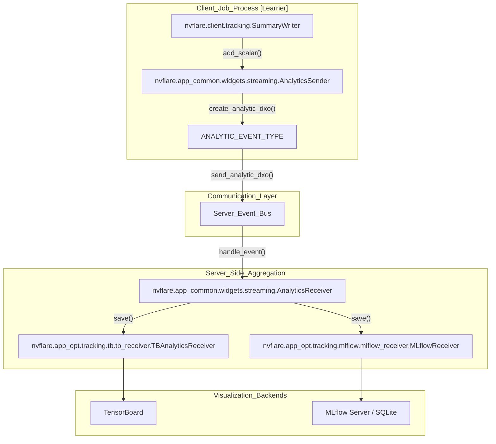
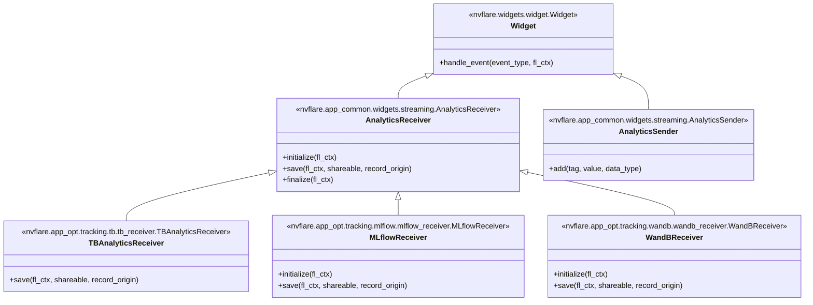

<!-- source: DeepWiki mcp.deepwiki.com · repo NVIDIA/NVFlare · page 19.3 System Metrics Monitoring · fetched 2026-10-26 -->

# System Metrics Monitoring

Relevant source files

The following files were used as context for generating this wiki page:

- [docs/resources/log_config.json](docs/resources/log_config.json)
- [docs/user_guide/admin_guide/configurations/logging_configuration.rst](docs/user_guide/admin_guide/configurations/logging_configuration.rst)
- [docs/user_guide/nvflare_cli/fl_simulator.rst](docs/user_guide/nvflare_cli/fl_simulator.rst)
- [examples/tutorials/logging.ipynb](examples/tutorials/logging.ipynb)
- [examples/tutorials/self-paced-training/part-1_federated_learning_introduction/chapter-1_running_federated_learning_applications/01.7_logging/logging.ipynb](examples/tutorials/self-paced-training/part-1_federated_learning_introduction/chapter-1_running_federated_learning_applications/01.7_logging/logging.ipynb)
- [nvflare/apis/analytix.py](nvflare/apis/analytix.py)
- [nvflare/apis/utils/analytix_utils.py](nvflare/apis/utils/analytix_utils.py)
- [nvflare/app_common/app_event_type.py](nvflare/app_common/app_event_type.py)
- [nvflare/app_common/tracking/log_writer.py](nvflare/app_common/tracking/log_writer.py)
- [nvflare/app_common/tracking/tracker_types.py](nvflare/app_common/tracking/tracker_types.py)
- [nvflare/app_common/widgets/streaming.py](nvflare/app_common/widgets/streaming.py)
- [nvflare/app_opt/tracking/mlflow/__init__.py](nvflare/app_opt/tracking/mlflow/__init__.py)
- [nvflare/app_opt/tracking/mlflow/mlflow_receiver.py](nvflare/app_opt/tracking/mlflow/mlflow_receiver.py)
- [nvflare/app_opt/tracking/mlflow/mlflow_writer.py](nvflare/app_opt/tracking/mlflow/mlflow_writer.py)
- [nvflare/app_opt/tracking/tb/tb_receiver.py](nvflare/app_opt/tracking/tb/tb_receiver.py)
- [nvflare/app_opt/tracking/tb/tb_writer.py](nvflare/app_opt/tracking/tb/tb_writer.py)
- [nvflare/app_opt/tracking/wandb/wandb_receiver.py](nvflare/app_opt/tracking/wandb/wandb_receiver.py)
- [nvflare/app_opt/tracking/wandb/wandb_writer.py](nvflare/app_opt/tracking/wandb/wandb_writer.py)
- [nvflare/client/tracking.py](nvflare/client/tracking.py)
- [nvflare/fuel/utils/log_config.json](nvflare/fuel/utils/log_config.json)
- [nvflare/fuel/utils/log_utils.py](nvflare/fuel/utils/log_utils.py)
- [tests/unit_test/apis/analytix_test.py](tests/unit_test/apis/analytix_test.py)
- [tests/unit_test/app_common/widgets/streaming_test.py](tests/unit_test/app_common/widgets/streaming_test.py)
- [tests/unit_test/fuel/log_utils_dynamic_config_test.py](tests/unit_test/fuel/log_utils_dynamic_config_test.py)
- [tests/unit_test/job_config/log_config_env_var_test.py](tests/unit_test/job_config/log_config_env_var_test.py)

The System Metrics Monitoring framework in NVIDIA FLARE provides a standardized mechanism for collecting, streaming, and visualizing training analytics and system performance data across a federated network. It distinguishes between **Machine Learning Experiment Tracking** (training metrics like loss and accuracy) and **System Metrics Monitoring** (FL system performance, job lifecycle, and resource utilization) [nvflare/apis/analytix.py:19-25]().

## Architecture Overview

The metrics framework operates on a **Sender-Receiver** pattern. Components use the `FLContext` event system to emit data, which is then processed by internal widgets or streamed across the federation via auxiliary communication channels [nvflare/app_common/widgets/streaming.py:48-71]().

### Core Components

| Component | Role | Code Entity |
| :--- | :--- | :--- |
| **LogWriter** | Base class for client-side APIs used by learners to log training metrics. | `nvflare.app_common.tracking.log_writer.LogWriter` [nvflare/app_common/tracking/log_writer.py:18-18]() |
| **AnalyticsSender** | Internal widget that converts API calls into `DXO` objects and fires analytic events. | `nvflare.app_common.widgets.streaming.AnalyticsSender` [nvflare/app_common/widgets/streaming.py:28-39]() |
| **AnalyticsReceiver** | Abstract base widget that listens for analytic events and persists them to backends. | `nvflare.app_common.widgets.streaming.AnalyticsReceiver` [nvflare/app_common/widgets/streaming.py:79-89]() |
| **AnalyticsData** | A wrapper that facilitates conversion between metric values and `DXO` objects. | `nvflare.apis.analytix.AnalyticsData` [nvflare/apis/analytix.py:76-84]() |

### Data Flow Diagram: Metrics Pipeline

The following diagram illustrates how metrics flow from the user's training code through the FLARE system to visualization backends.

**Figure 1: Metrics Data Flow**

Sources: [nvflare/app_common/widgets/streaming.py:52-71](), [nvflare/client/tracking.py:29-39](), [nvflare/app_opt/tracking/tb/tb_receiver.py:107-112](), [nvflare/apis/analytix.py:105-122]()

## Implementation Class Hierarchy

The following diagram maps the tracking components to their implementation classes and relationships.

**Figure 2: Metrics Component Class Hierarchy**

Sources: [nvflare/app_common/widgets/streaming.py:28-89](), [nvflare/app_opt/tracking/tb/tb_receiver.py:47-48](), [nvflare/app_opt/tracking/mlflow/mlflow_receiver.py:53-54](), [nvflare/app_opt/tracking/wandb/wandb_receiver.py:58-59]()

## Integration with Tracking Backends

### MLflow Integration
The `MLflowReceiver` manages `MlflowClient` instances for each site and handles experiment/run creation [nvflare/app_opt/tracking/mlflow/mlflow_receiver.py:94-100]().
- **Buffering**: Data is buffered and flushed based on `buffer_flush_time` to minimize network overhead [nvflare/app_opt/tracking/mlflow/mlflow_receiver.py:97-101]().
- **Site Isolation**: It creates separate runs for each site to ensure metrics are correctly attributed in the MLflow UI [nvflare/app_opt/tracking/mlflow/mlflow_receiver.py:156-158]().
- **Tracking URI**: Defaults to a local SQLite database in the job result directory if no remote URI is provided [nvflare/app_opt/tracking/mlflow/mlflow_receiver.py:103-110]().

### Weights & Biases (W&B) Integration
The `WandBReceiver` handles the ingestion of analytic events and routes them to the W&B service [nvflare/app_opt/tracking/wandb/wandb_receiver.py:58-65]().
- **Process Isolation**: W&B logging is handled in a separate `multiprocessing.Process` per site to prevent the main FLARE process from blocking on network I/O [nvflare/app_opt/tracking/wandb/wandb_receiver.py:166-168]().
- **Step Ordering**: The receiver buffers metrics and ensures they are logged to W&B in increasing step order [nvflare/app_opt/tracking/wandb/wandb_receiver.py:95-111]().

### TensorBoard Integration
The `TBAnalyticsReceiver` maps FLARE `AnalyticsDataType` to TensorBoard-specific functions like `add_scalar` or `add_image` [nvflare/app_opt/tracking/tb/tb_receiver.py:26-33]().
- **File Structure**: It creates a hierarchical folder structure in the workspace, with subdirectories for each peer's event files [nvflare/app_opt/tracking/tb/tb_receiver.py:55-68]().
- **Event Writers**: Uses `TensorBoardEventWriter` to persist data locally [nvflare/app_opt/tracking/tb/tb_receiver.py:113-117]().

## System Logging and Performance Monitoring

FLARE provides a structured logging system to monitor system health and job progress.

### Logging Modes and Configuration
The system supports multiple logging modes which can be configured via the `--log_config` flag or within a `SimEnv` [examples/tutorials/logging.ipynb:28-35]().

| Mode | Description |
| :--- | :--- |
| `concise` | Default mode. Shows non-NVFlare logs and selected app logs with simplified formatting [nvflare/fuel/utils/log_utils.py:35](). |
| `msg_only` | Displays only the message text for selected logs [nvflare/fuel/utils/log_utils.py:36](). |
| `full` | Standard full log output [nvflare/fuel/utils/log_utils.py:34](). |
| `verbose` | Debug level logging [nvflare/fuel/utils/log_utils.py:37](). |

### Structured Log Files
Each site and job generates a set of log files for different monitoring purposes [nvflare/fuel/utils/log_config.json:36-73]():
- `log.txt`: Standard text logs [nvflare/fuel/utils/log_config.json:40]().
- `log.json`: Structured JSON logs for integration with observability platforms [nvflare/fuel/utils/log_config.json:58]().
- `error_log.txt`: Dedicated file for `ERROR` and `CRITICAL` events [nvflare/fuel/utils/log_config.json:49]().
- `log_fl.txt`: Filtered logs containing only training-related events, excluding system noise [nvflare/fuel/utils/log_config.json:68]().

### Dynamic Monitoring Commands
Administrators can dynamically change log levels or reload configurations while the system is running using the Admin CLI [examples/tutorials/self-paced-training/part-1_federated_learning_introduction/chapter-1_running_federated_learning_applications/01.7_logging/logging.ipynb:72-80]():
- `configure_site_log`: Configures logging for the persistent site processes (Server/Client) [examples/tutorials/self-paced-training/part-1_federated_learning_introduction/chapter-1_running_federated_learning_applications/01.7_logging/logging.ipynb:94]().
- `configure_job_log`: Configures logging for a specific running job [examples/tutorials/self-paced-training/part-1_federated_learning_introduction/chapter-1_running_federated_learning_applications/01.7_logging/logging.ipynb:95]().

## Metric Types and Conversion
FLARE uses the `AnalyticsData` class to wrap metrics and convert them to `DXO` objects for transport [nvflare/apis/analytix.py:76-84]().

| AnalyticsDataType | Description | Back-end Mapping |
| :--- | :--- | :--- |
| `SCALAR` | Single numeric value | TB: `add_scalar`, MLflow: `log_metric` |
| `TEXT` | String data | TB: `add_text`, MLflow: `log_text` |
| `IMAGE` | Image data | TB: `add_image` |
| `PARAMETER` | Hyperparameter | MLflow: `log_param` |
| `METRICS` | Dictionary of metrics | WandB: `log`, MLflow: `log_metrics` |

Sources: [nvflare/apis/analytix.py:57-75](), [nvflare/app_opt/tracking/tb/tb_receiver.py:26-33](), [nvflare/app_opt/tracking/mlflow/mlflow_receiver.py:24-30](), [tests/unit_test/apis/analytix_test.py:112-133]()

---

