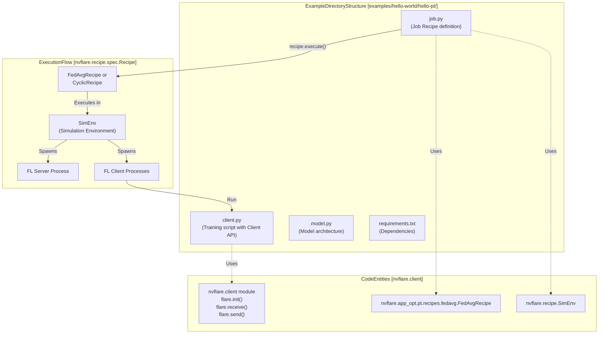
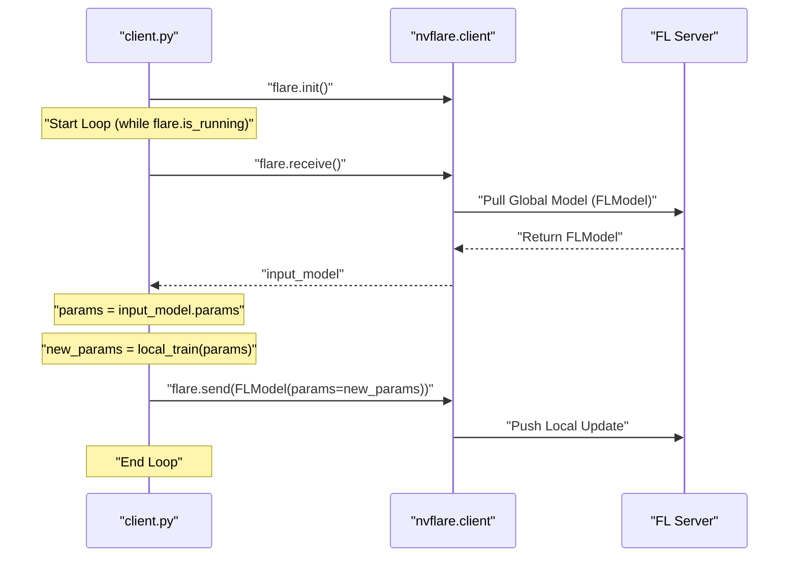
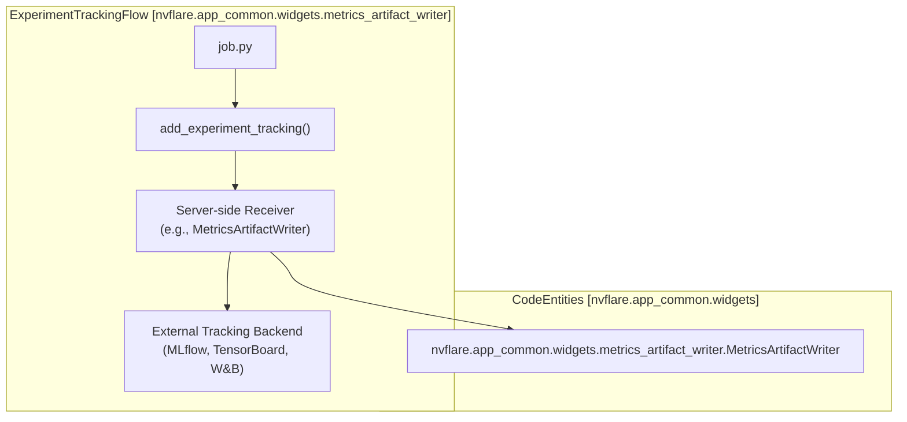

<!-- source: DeepWiki mcp.deepwiki.com · repo NVIDIA/NVFlare · page 2.1 Hello World Examples · fetched 2026-10-26 -->

# Hello World Examples

<details>
<summary>Relevant source files</summary>

The following files were used as context for generating this wiki page:

- [docs/example_applications_algorithms.rst](docs/example_applications_algorithms.rst)
- [docs/examples/federated_statistics_overview.rst](docs/examples/federated_statistics_overview.rst)
- [docs/examples/fl_algorithms.rst](docs/examples/fl_algorithms.rst)
- [docs/examples/hello_pt_job_api.rst](docs/examples/hello_pt_job_api.rst)
- [docs/examples/hello_tf_job_api.rst](docs/examples/hello_tf_job_api.rst)
- [docs/examples/hello_world_examples.rst](docs/examples/hello_world_examples.rst)
- [docs/examples/medical_image_analysis.rst](docs/examples/medical_image_analysis.rst)
- [docs/examples/tutorial_notebooks.rst](docs/examples/tutorial_notebooks.rst)
- [docs/hello-world/hello-cyclic/index.rst](docs/hello-world/hello-cyclic/index.rst)
- [docs/hello-world/hello-lr/index.rst](docs/hello-world/hello-lr/index.rst)
- [docs/hello-world/hello-pt/index.rst](docs/hello-world/hello-pt/index.rst)
- [docs/hello-world/hello-tabular-stats/index.rst](docs/hello-world/hello-tabular-stats/index.rst)
- [docs/hello-world/hello-tf/index.rst](docs/hello-world/hello-tf/index.rst)
- [docs/hello-world/hello-xgboost/index.rst](docs/hello-world/hello-xgboost/index.rst)
- [docs/programming_guide/controllers/cross_site_model_evaluation.rst](docs/programming_guide/controllers/cross_site_model_evaluation.rst)
- [docs/programming_guide/controllers/cyclic_workflow.rst](docs/programming_guide/controllers/cyclic_workflow.rst)
- [docs/programming_guide/controllers/scatter_and_gather_workflow.rst](docs/programming_guide/controllers/scatter_and_gather_workflow.rst)
- [docs/release_notes/flare_220.rst](docs/release_notes/flare_220.rst)
- [docs/release_notes/flare_240.rst](docs/release_notes/flare_240.rst)
- [docs/release_notes/flare_250.rst](docs/release_notes/flare_250.rst)
- [docs/whats_new.rst](docs/whats_new.rst)
- [examples/README.md](examples/README.md)
- [examples/advanced/README.md](examples/advanced/README.md)
- [examples/advanced/finance/README.md](examples/advanced/finance/README.md)
- [examples/advanced/job_api/tf/README.md](examples/advanced/job_api/tf/README.md)
- [examples/advanced/job_api/tf/run_jobs.sh](examples/advanced/job_api/tf/run_jobs.sh)
- [examples/advanced/monitoring/README.md](examples/advanced/monitoring/README.md)
- [examples/advanced/monitoring/jobs/README.md](examples/advanced/monitoring/jobs/README.md)
- [examples/hello-world/README.md](examples/hello-world/README.md)
- [examples/hello-world/hello-cyclic/README.md](examples/hello-world/hello-cyclic/README.md)
- [examples/hello-world/hello-numpy-cross-val/README.md](examples/hello-world/hello-numpy-cross-val/README.md)
- [examples/hello-world/hello-numpy-cross-val/client.py](examples/hello-world/hello-numpy-cross-val/client.py)
- [examples/hello-world/hello-numpy-cross-val/job.py](examples/hello-world/hello-numpy-cross-val/job.py)
- [examples/hello-world/hello-numpy/client.py](examples/hello-world/hello-numpy/client.py)
- [examples/hello-world/hello-pt/README.md](examples/hello-world/hello-pt/README.md)
- [examples/hello-world/hello-pt/hello-pt.ipynb](examples/hello-world/hello-pt/hello-pt.ipynb)
- [examples/hello-world/hello-pt/job.py](examples/hello-world/hello-pt/job.py)
- [examples/hello-world/hello-tabular-stats/df_stats.ipynb](examples/hello-world/hello-tabular-stats/df_stats.ipynb)
- [examples/hello-world/hello-tf/README.md](examples/hello-world/hello-tf/README.md)
- [examples/tutorials/README.md](examples/tutorials/README.md)
- [nvflare/app_common/np/recipes/cross_site_eval.py](nvflare/app_common/np/recipes/cross_site_eval.py)
- [tests/unit_test/recipe/hello_numpy_cross_val_client_test.py](tests/unit_test/recipe/hello_numpy_cross_val_client_test.py)

</details>


## Purpose and Scope

The Hello World Examples demonstrate the core workflows of NVIDIA FLARE through simple, self-contained applications that can be run immediately after installation. Each example showcases how to convert centralized training code into federated learning with minimal modifications, typically requiring only 5 lines of code changes using the **Client API** [examples/hello-world/hello-pt/README.md:87-94]().

These examples utilize **Job Recipes**, a high-level API introduced to provide a pythonic user experience for defining FL jobs without manually editing configuration files [docs/release_notes/flare_250.rst:34-38](). A Job Recipe encapsulates the entire FL workflow, including server-side logic and client execution, making federated learning as easy as running a standard Python script [examples/hello-world/hello-pt/README.md:129-131]().

## Available Hello World Examples

The primary hello-world examples demonstrate various frameworks and algorithms:

| Example | Framework | Algorithm | Primary Concepts | Location |
|---------|-----------|-----------|-----------------|----------|
| Hello PyTorch | PyTorch | FedAvg | Client API, `FedAvgRecipe`, CIFAR-10 | [examples/hello-world/hello-pt/]() |
| Hello TensorFlow | TensorFlow/Keras | FedAvg | Keras integration, MNIST, Memory Flags | [examples/hello-world/hello-tf/]() |
| Hello JAX | JAX/Flax | FedAvg | MNIST, Parameter Tree flattening | [examples/hello-world/hello-jax/]() |
| Hello Cyclic | TensorFlow/PT | Cyclic Weight Transfer | Sequential fine-tuning, `CyclicRecipe` | [examples/hello-world/hello-cyclic/]() |
| Hello Tabular Stats | Pandas | Statistics | Count, Mean, Stddev, Histograms | [examples/hello-world/hello-tabular-stats/]() |
| Hello HuggingFace | HuggingFace | FedAvg | Qwen SFT/PEFT, `nvflare.client.hf` | [examples/hello-world/hello-huggingface/]() |
| Hello Flower | Flower | Flower App | SuperLink/SuperNode on FLARE | [examples/hello-world/hello-flower/]() |
| Hello NumPy Collab | NumPy | Custom | Collab API, `@collab.publish` | [examples/hello-world/hello-collab/]() |

Sources: [examples/README.md:75-85](), [docs/example_applications_algorithms.rst:22-32](), [examples/hello-world/README.md:100-226](), [docs/release_notes/flare_250.rst:43-51]()

## Common Example Structure

All hello-world examples follow a consistent file organization pattern:

### Example Architecture Diagram

Sources: [examples/hello-world/hello-pt/README.md:28-35](), [examples/hello-world/hello-tf/README.md:46-53](), [examples/hello-world/hello-pt/README.md:88-108](), [examples/hello-world/hello-pt/README.md:129-144]()

### File Responsibilities

*   **`client.py`**: The training script. It contains the local training logic adapted for FL using `flare.receive()` to get the global model and `flare.send()` to return updates [examples/hello-world/hello-pt/README.md:82-84]().
*   **`model.py`**: Defines the model architecture (e.g., a `SimpleNetwork` extending `nn.Module` in PyTorch or `Net` extending `models.Sequential` in TensorFlow) [examples/hello-world/hello-pt/README.md:51-54](), [examples/hello-world/hello-tf/README.md:61-72]().
*   **`job.py`**: The entry point that defines the FL job using a `Recipe`. It specifies parameters like `num_rounds`, `min_clients`, and the `train_script` to run [examples/hello-world/hello-pt/README.md:129-144]().

Sources: [examples/hello-world/hello-pt/README.md:28-35](), [examples/hello-world/hello-tf/README.md:46-53](), [examples/hello-world/hello-pt/README.md:82-84](), [examples/hello-world/hello-pt/README.md:51-54](), [examples/hello-world/hello-tf/README.md:61-72](), [examples/hello-world/hello-pt/README.md:129-144]()

## Core FLARE Components for Hello World

### Client API Module (`nvflare.client`)

The Client API provides three essential methods to convert centralized code to federated learning [examples/hello-world/hello-pt/README.md:93-97]():

1.  **`flare.init()`**: Initializes the NVFlare Client API environment [examples/hello-world/hello-pt/README.md:105]().
2.  **`flare.receive()`**: Receives the global model (as an `FLModel` object) from the server [examples/hello-world/hello-pt/README.md:106]().
3.  **`flare.send()`**: Sends the locally trained model back to the server [examples/hello-world/hello-pt/README.md:113]().

### Client Data Flow

Sources: [examples/hello-world/hello-pt/README.md:93-114](), [docs/release_notes/flare_240.rst:18-47]()

### Job Recipe API

Job Recipes simplify job definition by providing pre-configured workflows like `FedAvgRecipe` or `CyclicRecipe` [examples/hello-world/hello-pt/README.md:118]().

```python
from nvflare.app_opt.pt.recipes.fedavg import FedAvgRecipe
from nvflare.recipe import SimEnv

recipe = FedAvgRecipe(
    name="hello-pt",
    min_clients=2,
    num_rounds=3,
    model=SimpleNetwork(),
    train_script="client.py",
    train_args="--batch_size 32",
)

env = SimEnv(num_clients=2)
recipe.execute(env=env)
```
Sources: [examples/hello-world/hello-pt/README.md:132-144](), [examples/hello-world/README.md:57-69]()

## Framework-Specific Examples

### Hello PyTorch
This example trains a CIFAR-10 classifier using PyTorch [examples/hello-world/hello-pt/README.md:2-3](). The `SimpleNetwork` is defined as a standard `nn.Module` [examples/hello-world/hello-pt/README.md:51-54](). It demonstrates the use of `FedAvgRecipe` to coordinate multiple clients [examples/hello-world/hello-pt/README.md:132-141]().

Sources: [examples/hello-world/hello-pt/README.md:2-3](), [examples/hello-world/hello-pt/README.md:51-54](), [examples/hello-world/hello-pt/README.md:132-141]()

### Hello TensorFlow
Uses the MNIST dataset and a Keras `Sequential` model [examples/hello-world/hello-tf/README.md:55-72](). It highlights framework-specific memory management for GPUs using `TF_FORCE_GPU_ALLOW_GROWTH` to prevent TensorFlow from allocating all GPU memory at startup [examples/hello-world/hello-tf/README.md:143-149]().

Sources: [examples/hello-world/hello-tf/README.md:55-72](), [examples/hello-world/hello-tf/README.md:143-149]()

### Hello HuggingFace
Demonstrates federated Qwen SFT/PEFT using the HuggingFace `Trainer` or TRL `SFTTrainer` [examples/hello-world/README.md:181-182](). It uses a specialized `nvflare.client.hf` module to patch the HuggingFace trainer with minimal code changes [examples/hello-world/README.md:185]().

Sources: [examples/hello-world/README.md:181-195](), [docs/example_applications_algorithms.rst:32]()

### Hello Cyclic (CWT)
Unlike FedAvg which aggregates models in parallel, **Cyclic Weight Transfer** passes model weights sequentially from one site to the next for repeated fine-tuning [examples/hello-world/hello-cyclic/README.md:1-4](). It uses the `CyclicRecipe` [examples/hello-world/hello-cyclic/README.md:108-112]().

Sources: [examples/hello-world/hello-cyclic/README.md:1-4](), [examples/hello-world/hello-cyclic/README.md:108-112]()

### Hello Tabular Statistics
Demonstrates generating federated statistics (Count, Mean, Stddev, Histograms) for data represented as Pandas DataFrames [docs/examples/federated_statistics_overview.rst:39-43](). It utilizes a `Local statistics generator` on the client side [docs/examples/federated_statistics_overview.rst:58]().

Sources: [docs/examples/federated_statistics_overview.rst:39-60](), [examples/hello-world/hello-tabular-stats/df_stats.ipynb:10-12]()

### Hello Flower
Allows Flower applications to run on NVFlare infrastructure [docs/release_notes/flare_250.rst:43-45](). It uses `FlowerApplet` and `FlowerController` to wrap Flower's `ServerApp` and `ClientApp` without requiring modifications to the original Flower code [docs/release_notes/flare_250.rst:46-49]().

Sources: [docs/release_notes/flare_250.rst:43-51](), [examples/hello-world/README.md:230-236]()

## Model Input Options

Recipes support flexible model initialization [examples/hello-world/hello-pt/README.md:146-147]():

1.  **Class Instance**: `model=SimpleNetwork()` - Convenient and Pythonic [examples/hello-world/hello-pt/README.md:150]().
2.  **Dict Config**: `model={"class_path": "model.SimpleNetwork", "args": {}}` - Better for large models to avoid unnecessary instantiation overhead [examples/hello-world/hello-pt/README.md:151]().
3.  **Pre-trained Checkpoint**: Use `initial_ckpt` to specify an absolute path to weights on the server to resume training [examples/hello-world/hello-pt/README.md:157-162]().

For **TensorFlow**, Keras `.h5` or `SavedModel` formats contain both architecture and weights, allowing `initial_ckpt` to be used without a `model` parameter [examples/hello-world/hello-cyclic/README.md:139-140]().

Sources: [examples/hello-world/hello-pt/README.md:146-147](), [examples/hello-world/hello-pt/README.md:150](), [examples/hello-world/hello-pt/README.md:151](), [examples/hello-world/hello-pt/README.md:157-162](), [examples/hello-world/hello-cyclic/README.md:139-140]()

## Running Examples

### Basic Execution Flow
1. Clone the repository and navigate to the example directory [examples/hello-world/hello-pt/README.md:17-26]().
2. Install dependencies: `pip install -r requirements.txt` [examples/hello-world/hello-pt/README.md:11-15]().
3. Run the job script: `python job.py` [examples/hello-world/hello-pt/README.md:175]().

Sources: [examples/hello-world/hello-pt/README.md:17-26](), [examples/hello-world/hello-pt/README.md:11-15](), [examples/hello-world/hello-pt/README.md:175]()

### Execution Environments
NVFlare provides different environments to run the same recipe:
*   **SimEnv**: Uses the FL Simulator for local testing. It can specify `num_clients` and `num_threads` [examples/hello-world/hello-pt/README.md:142]().
*   **PocEnv**: Runs in POC mode, mimicking a distributed environment locally [examples/tutorials/setup_poc.ipynb:40]().

Sources: [examples/hello-world/hello-pt/README.md:142](), [docs/example_applications_algorithms.rst:40]()

### Accessing Results and Logs
Results and logs are stored in the workspace directory:
*   PyTorch: `/tmp/nvflare/simulation/hello-pt/` [examples/hello-world/hello-pt/README.md:184]().
*   Cyclic: `/tmp/nvflare/simulation/cyclic` [examples/hello-world/hello-cyclic/README.md:156]().
*   TensorFlow: `/tmp/nvflare/jobs/workdir` [examples/hello-world/hello-tf/README.md:140]().

Sources: [examples/hello-world/hello-pt/README.md:184](), [examples/hello-world/hello-cyclic/README.md:156](), [examples/hello-world/hello-tf/README.md:140]()

### Experiment Tracking
Many examples support experiment tracking (TensorBoard, MLflow, W&B). This functionality dynamically adds tracking receivers to the server and/or clients to stream metrics [examples/hello-world/hello-tf/README.md:98]().


Sources: [examples/hello-world/hello-tf/README.md:98](), [examples/hello-world/README.md:108](), [examples/hello-world/README.md:236]()

---

