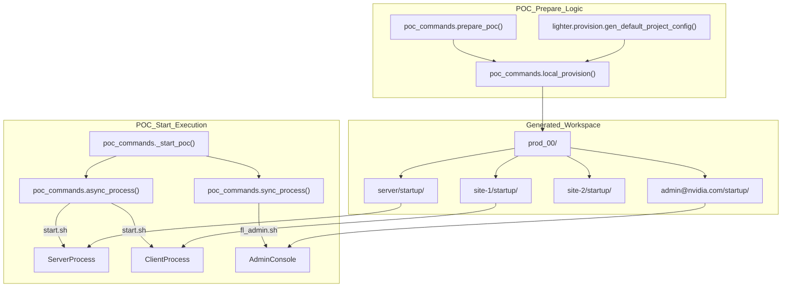
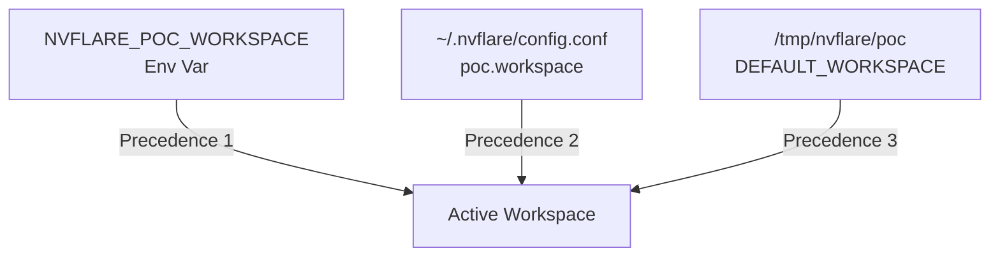
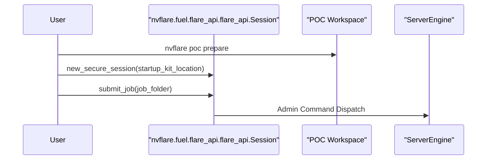

<!-- source: DeepWiki mcp.deepwiki.com · repo NVIDIA/NVFlare · page 2.2 POC Mode Quick Start · fetched 2026-10-26 -->

# POC Mode Quick Start

<details>
<summary>Relevant source files</summary>

The following files were used as context for generating this wiki page:

- [examples/advanced/sklearn-kmeans/sklearn_kmeans_iris.ipynb](examples/advanced/sklearn-kmeans/sklearn_kmeans_iris.ipynb)
- [examples/advanced/sklearn-linear/sklearn_linear_higgs.ipynb](examples/advanced/sklearn-linear/sklearn_linear_higgs.ipynb)
- [examples/advanced/sklearn-svm/sklearn_svm_cancer.ipynb](examples/advanced/sklearn-svm/sklearn_svm_cancer.ipynb)
- [examples/hello-world/hello-lightning/hello_lightning.ipynb](examples/hello-world/hello-lightning/hello_lightning.ipynb)
- [examples/hello-world/hello-pt/requirements.txt](examples/hello-world/hello-pt/requirements.txt)
- [examples/hello-world/hello_world.ipynb](examples/hello-world/hello_world.ipynb)
- [examples/hello-world/hw_pre_start.sh](examples/hello-world/hw_pre_start.sh)
- [examples/tutorials/flare_api.ipynb](examples/tutorials/flare_api.ipynb)
- [examples/tutorials/flare_simulator.ipynb](examples/tutorials/flare_simulator.ipynb)
- [examples/tutorials/setup_poc.ipynb](examples/tutorials/setup_poc.ipynb)
- [nvflare/cli.py](nvflare/cli.py)
- [nvflare/tool/job/config/config_indexer.py](nvflare/tool/job/config/config_indexer.py)
- [nvflare/tool/job/config/configer.py](nvflare/tool/job/config/configer.py)
- [nvflare/tool/job/job_cli.py](nvflare/tool/job/job_cli.py)
- [nvflare/tool/job/job_client_const.py](nvflare/tool/job/job_client_const.py)
- [nvflare/tool/poc/poc_commands.py](nvflare/tool/poc/poc_commands.py)
- [nvflare/tool/poc/service_constants.py](nvflare/tool/poc/service_constants.py)
- [nvflare/utils/cli_utils.py](nvflare/utils/cli_utils.py)
- [tests/unit_test/data/jobs/launch_everytime/app/config/config_fed_client.conf](tests/unit_test/data/jobs/launch_everytime/app/config/config_fed_client.conf)
- [tests/unit_test/data/jobs/launch_everytime/app/config/config_fed_server.conf](tests/unit_test/data/jobs/launch_everytime/app/config/config_fed_server.conf)
- [tests/unit_test/data/jobs/launch_everytime/meta.conf](tests/unit_test/data/jobs/launch_everytime/meta.conf)
- [tests/unit_test/data/jobs/launch_once/app/config/config_fed_client.conf](tests/unit_test/data/jobs/launch_once/app/config/config_fed_client.conf)
- [tests/unit_test/data/jobs/launch_once/app/config/config_fed_server.conf](tests/unit_test/data/jobs/launch_once/app/config/config_fed_server.conf)
- [tests/unit_test/data/jobs/launch_once/meta.conf](tests/unit_test/data/jobs/launch_once/meta.conf)
- [tests/unit_test/lighter/poc_commands_test.py](tests/unit_test/lighter/poc_commands_test.py)
- [tests/unit_test/tool/job/config/config_indexer_test.py](tests/unit_test/tool/job/config/config_indexer_test.py)
- [tests/unit_test/tool/job/config/configer_test.py](tests/unit_test/tool/job/config/configer_test.py)
- [tests/unit_test/tool/job/job_cli_test.py](tests/unit_test/tool/job/job_cli_test.py)
- [tests/unit_test/tool/poc/poc_force_test.py](tests/unit_test/tool/poc/poc_force_test.py)
- [tests/unit_test/tool/poc/poc_output_test.py](tests/unit_test/tool/poc/poc_output_test.py)

</details>


## Purpose and Scope

POC (Proof of Concept) mode is a local multi-process testing environment for NVIDIA FLARE that allows you to run a complete federated learning system on a single machine. It provides a realistic testing environment with separate processes for the server, clients, and admin console, bridging the gap between the FL Simulator (single-process testing) and production deployment [examples/tutorials/setup_poc.ipynb:10-15]().

**When to use POC mode:**
- Testing federated learning workflows with realistic process separation [examples/tutorials/setup_poc.ipynb:12-13]().
- Validating job configurations and `project.yml` before production deployment [examples/tutorials/setup_poc.ipynb:13-14]().
- Debugging multi-client scenarios and GPU resource allocation on a local machine [nvflare/tool/poc/poc_commands.py:116-139]().
- Learning NVIDIA FLARE system behavior and administrative commands in a safe environment [examples/tutorials/setup_poc.ipynb:10-15]().

Sources: [nvflare/tool/poc/poc_commands.py:116-139](), [examples/tutorials/setup_poc.ipynb:10-15]()

---

## POC Mode in the Development Pipeline

POC mode sits between the Simulator and Production deployment, providing an intermediate testing environment. While the FL Simulator runs in a single process (often via `SimEnv`), POC mode establishes distinct server and client "systems" orchestrated via the FLARE Console [examples/tutorials/setup_poc.ipynb:12-13]().

Title: Development Lifecycle
```mermaid
graph LR
    ["Development<br/>Write Code"] -- "flare.init()" --> ["Simulator<br/>SimEnv<br/>Fast Iteration"]
    ["Simulator<br/>SimEnv<br/>Fast Iteration"] -- "PocEnv" --> ["POC Mode<br/>Multi Process<br/>Realistic Testing"]
    ["POC Mode<br/>Multi Process<br/>Realistic Testing"] -- "ProdEnv" --> ["Production<br/>Distributed<br/>Real Deployment"]
    
    ["Simulator<br/>SimEnv<br/>Fast Iteration"] -.fallback.-> ["Development<br/>Write Code"]
    ["POC Mode<br/>Multi Process<br/>Realistic Testing"] -.fallback.-> ["Development<br/>Write Code"]
```

**Development progression:**
1. **Development**: Write and adapt training code using Client API or Job Recipes [examples/hello-world/hello_world.ipynb:48-64]().
2. **Simulator**: Fast iteration with `nvflare simulator` or running `job.py` with `SimEnv` [examples/hello-world/hello_world.ipynb:62-63]().
3. **POC Mode**: Multi-process testing with `nvflare poc` commands or `PocEnv` in Job Recipes [examples/advanced/sklearn-linear/sklearn_linear_higgs.ipynb:91-93]().
4. **Production**: Distributed deployment with provisioned startup kits using `Provisioner` [nvflare/tool/poc/poc_commands.py:39]().

Sources: [nvflare/tool/poc/poc_commands.py:39](), [examples/hello-world/hello_world.ipynb:48-64](), [examples/advanced/sklearn-linear/sklearn_linear_higgs.ipynb:91-93](), [examples/tutorials/setup_poc.ipynb:12-13]()

---

## POC Architecture Overview

POC mode uses local provisioning to create startup kits for all participants, then orchestrates their execution on localhost.

Title: POC Mode Implementation Flow


**Key functions:**
- `prepare_poc()` [nvflare/tool/poc/poc_commands.py:535-594]() - Orchestrates POC preparation by defining the project structure and calling the provisioner.
- `local_provision()` [nvflare/tool/poc/poc_commands.py:316-361]() - Creates local startup kits using `Provisioner` with a specific POC configuration [nvflare/tool/poc/poc_commands.py:359]().
- `_start_poc()` [nvflare/tool/poc/poc_commands.py:764-793]() - Manages the service startup sequence for all participants.
- `async_process()` [nvflare/tool/poc/poc_commands.py:961-967]() - Launches server/client processes as background tasks.
- `sync_process()` [nvflare/tool/poc/poc_commands.py:969-972]() - Launches the admin console in the foreground (blocking).

Sources: [nvflare/tool/poc/poc_commands.py:316-361](), [nvflare/tool/poc/poc_commands.py:535-594](), [nvflare/tool/poc/poc_commands.py:764-793](), [nvflare/tool/poc/poc_commands.py:961-972]()

---

## Command Reference

### nvflare poc prepare

Provisions a local POC environment by generating startup kits for server, clients, and admin.

**Syntax:**
```bash
nvflare poc prepare [options]
```

**Options:**

| Option | Description | Default |
|--------|-------------|---------|
| `-n`, `--number_of_clients` | Number of client sites | 2 [nvflare/tool/poc/poc_commands.py:461]() |
| `-c`, `--clients` | Space-separated client names (overrides `-n`) | - |
| `-i`, `--project_input` | Path to custom project.yml | Auto-generated |
| `-he`, `--he` | Enable homomorphic encryption | False |
| `-d`, `--docker_image` | Docker image name for containerized deployment | None |

**Behavioral Logic:**
1. **Workspace Setup**: Creates the workspace directory, defaulting to `/tmp/nvflare/poc` if not configured [nvflare/tool/poc/poc_commands.py:71]().
2. **Provisioning**: Runs the `Provisioner` with `ProvisionMode.POC` to generate certificates and configurations [nvflare/tool/poc/poc_commands.py:359]().
3. **Workspace Structure**: Generates a `prod_00/` directory containing individual startup kits for each participant. For example, `prod_00/server`, `prod_00/site-1`, `prod_00/admin@nvidia.com` [examples/tutorials/setup_poc.ipynb:226]().
4. **Configuration Update**: Automatically updates the hidden `~/.nvflare/config.conf` with the new POC workspace path and registers the admin identity [nvflare/tool/poc/poc_commands.py:55-59]().

Sources: [nvflare/tool/poc/poc_commands.py:55-59](), [nvflare/tool/poc/poc_commands.py:71](), [nvflare/tool/poc/poc_commands.py:359](), [nvflare/tool/poc/poc_commands.py:461](), [examples/tutorials/setup_poc.ipynb:226]()

---

### nvflare poc start

Starts the POC environment by launching server, client, and optionally admin processes.

**Syntax:**
```bash
nvflare poc start [options]
```

**Startup Sequence:**
1. **Server**: The server process is launched first via `async_process` [nvflare/tool/poc/poc_commands.py:996-997]().
2. **Clients**: Client processes follow, with a 1-second delay between each to prevent resource contention [nvflare/tool/poc/poc_commands.py:999-1001]().
3. **Admin**: The admin console is only started if explicitly requested via the `-p` service flag [nvflare/tool/poc/poc_commands.py:991-995]().

**GPU assignment logic:**
The `client_gpu_assignments()` function [nvflare/tool/poc/poc_commands.py:116-139]() manages hardware allocation:
- **No GPUs**: All clients are assigned an empty list, defaulting to CPU execution [nvflare/tool/poc/poc_commands.py:120-123]().
- **Limited GPUs**: If there are fewer GPUs than clients, assignment uses a round-robin modulo approach [nvflare/tool/poc/poc_commands.py:124-127]().
- **Abundant GPUs**: If GPUs outnumber clients, clients are assigned multiple specific GPU IDs [nvflare/tool/poc/poc_commands.py:128-139]().

Sources: [nvflare/tool/poc/poc_commands.py:116-139](), [nvflare/tool/poc/poc_commands.py:991-1001]()

---

### nvflare poc stop

Stops running POC services using either graceful shutdown or direct process termination.

**Syntax:**
```bash
nvflare poc stop [options]
```

**Shutdown mechanisms:**
1. **Graceful System Shutdown**: Uses the `shutdown_system()` API to send stop commands to all connected participants [nvflare/tool/poc/poc_commands.py:851](), [nvflare/tool/api_utils.py:46]().
2. **File-Based Stop**: For non-Docker services, it creates a `shutdown.fl` file in the service directory, which the running process monitors to trigger exit [nvflare/tool/poc/poc_commands.py:179-182]().
3. **Docker Termination**: For containerized services, it executes `docker stop` on the relevant container names [nvflare/tool/poc/poc_commands.py:169]().

Sources: [nvflare/tool/poc/poc_commands.py:169-182](), [nvflare/tool/poc/poc_commands.py:851](), [nvflare/tool/api_utils.py:46]()

---

### nvflare poc clean

Removes the POC workspace directory after verifying the system is stopped.

**Safety checks:**
1. **Workspace Presence**: Verifies the workspace exists before attempting deletion [nvflare/tool/poc/poc_commands.py:1033]().
2. **Runtime Check**: Checks for the existence of `pid.fl` files to ensure no processes are currently running in the workspace [nvflare/tool/poc/poc_commands.py:1010-1015]().

Sources: [nvflare/tool/poc/poc_commands.py:1010-1015](), [nvflare/tool/poc/poc_commands.py:1033]()

---

## Workspace Configuration

### Hidden Configuration File

POC commands interact with `~/.nvflare/config.conf` to persist workspace settings. This is managed via `save_config` and `load_hidden_config_state` [nvflare/utils/cli_utils.py:107-111]().

Title: Config Precedence


Sources: [nvflare/tool/poc/poc_commands.py:71](), [nvflare/utils/cli_utils.py:107-111](), [examples/tutorials/setup_poc.ipynb:133-146]()

---

## Integration with Flare API

POC mode is fully compatible with the high-level `flare_api` for automated job management.

Title: Job Submission via Flare API


**Job Submission Example:**
Jobs are submitted to a running POC environment by initiating a `new_secure_session()` using the admin startup kit generated in the POC workspace [examples/tutorials/flare_api.ipynb:60-65](). The `Session` object then provides methods like `submit_job()` and `monitor_job()` [examples/tutorials/flare_api.ipynb:148-165]().

Sources: [examples/tutorials/flare_api.ipynb:60-65](), [examples/tutorials/flare_api.ipynb:148-165]()

---

## Advanced Configuration

### Docker-Based POC Mode
By providing a `-d` flag during `prepare`, NVFLARE configures the POC environment to run server and client parent processes within Docker containers [nvflare/tool/poc/poc_commands.py:423-428](). This changes the startup script generation to use `start_docker.sh` [nvflare/tool/poc/poc_commands.py:160]().

### Homomorphic Encryption
The `-he` flag instructs the provisioner to include the `HEBuilder` in the builder list, enabling homomorphic encryption for the local deployment [nvflare/tool/poc/poc_commands.py:443-451]().

Sources: [nvflare/tool/poc/poc_commands.py:160](), [nvflare/tool/poc/poc_commands.py:423-451]()

---

## CLI Command Dispatch

The `nvflare` CLI uses a centralized dispatch mechanism in `nvflare/cli.py` to route subcommands to their respective handlers.

**Handler Registration**:
The `poc` command sub-parsers and their corresponding functions are defined in `nvflare/tool/poc/poc_commands.py` [nvflare/tool/poc/poc_commands.py:1038-1044]():
- `CMD_PREPARE_POC` -> `prepare_poc`
- `CMD_START_POC` -> `start_poc`
- `CMD_STOP_POC` -> `stop_poc`
- `CMD_CLEAN_POC` -> `clean_poc`
- `CMD_CONFIG_POC` -> `config_poc`

Sources: [nvflare/tool/poc/poc_commands.py:1038-1044]()

---

