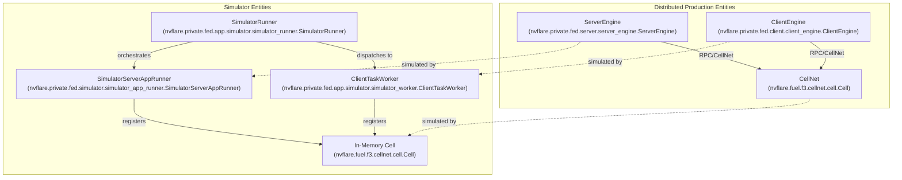
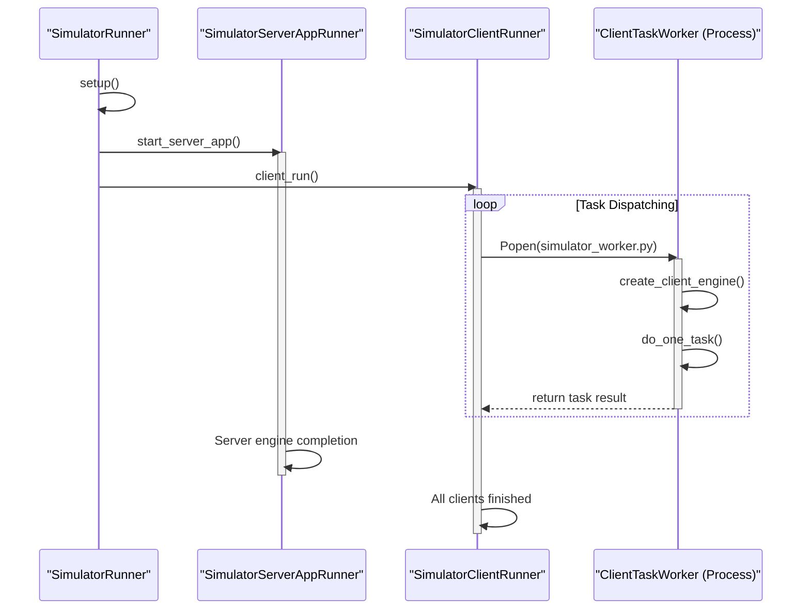

<!-- source: DeepWiki mcp.deepwiki.com · repo NVIDIA/NVFlare · page 2.3 Simulator Usage · fetched 2026-10-26 -->

# Simulator Usage

<details>
<summary>Relevant source files</summary>

The following files were used as context for generating this wiki page:

- [examples/advanced/sklearn-kmeans/sklearn_kmeans_iris.ipynb](examples/advanced/sklearn-kmeans/sklearn_kmeans_iris.ipynb)
- [examples/advanced/sklearn-linear/sklearn_linear_higgs.ipynb](examples/advanced/sklearn-linear/sklearn_linear_higgs.ipynb)
- [examples/advanced/sklearn-svm/sklearn_svm_cancer.ipynb](examples/advanced/sklearn-svm/sklearn_svm_cancer.ipynb)
- [examples/hello-world/hello-lightning/hello_lightning.ipynb](examples/hello-world/hello-lightning/hello_lightning.ipynb)
- [examples/hello-world/hello-pt/requirements.txt](examples/hello-world/hello-pt/requirements.txt)
- [examples/hello-world/hello_world.ipynb](examples/hello-world/hello_world.ipynb)
- [examples/hello-world/hw_pre_start.sh](examples/hello-world/hw_pre_start.sh)
- [examples/tutorials/flare_api.ipynb](examples/tutorials/flare_api.ipynb)
- [examples/tutorials/flare_simulator.ipynb](examples/tutorials/flare_simulator.ipynb)
- [examples/tutorials/setup_poc.ipynb](examples/tutorials/setup_poc.ipynb)
- [nvflare/collab/runtime/controller.py](nvflare/collab/runtime/controller.py)
- [nvflare/fuel/common/multi_process_executor_constants.py](nvflare/fuel/common/multi_process_executor_constants.py)
- [nvflare/fuel/f3/connection.py](nvflare/fuel/f3/connection.py)
- [nvflare/private/fed/app/deployer/base_client_deployer.py](nvflare/private/fed/app/deployer/base_client_deployer.py)
- [nvflare/private/fed/app/deployer/server_deployer.py](nvflare/private/fed/app/deployer/server_deployer.py)
- [nvflare/private/fed/app/deployer/simulator_deployer.py](nvflare/private/fed/app/deployer/simulator_deployer.py)
- [nvflare/private/fed/app/simulator/simulator.py](nvflare/private/fed/app/simulator/simulator.py)
- [nvflare/private/fed/app/simulator/simulator_runner.py](nvflare/private/fed/app/simulator/simulator_runner.py)
- [nvflare/private/fed/app/simulator/simulator_worker.py](nvflare/private/fed/app/simulator/simulator_worker.py)
- [nvflare/private/fed/client/admin.py](nvflare/private/fed/client/admin.py)
- [nvflare/private/fed/server/admin.py](nvflare/private/fed/server/admin.py)
- [nvflare/private/fed/simulator/simulator_client_engine.py](nvflare/private/fed/simulator/simulator_client_engine.py)
- [nvflare/private/fed/simulator/simulator_server.py](nvflare/private/fed/simulator/simulator_server.py)
- [tests/unit_test/collab/runtime/controller_test.py](tests/unit_test/collab/runtime/controller_test.py)
- [tests/unit_test/fuel/f3/streaming/streaming_test.py](tests/unit_test/fuel/f3/streaming/streaming_test.py)
- [tests/unit_test/private/fed/app/deployer/simulator_deployer_test.py](tests/unit_test/private/fed/app/deployer/simulator_deployer_test.py)
- [tests/unit_test/private/fed/app/simulator/simulator_runner_test.py](tests/unit_test/private/fed/app/simulator/simulator_runner_test.py)
- [tests/unit_test/private/fed/server/server_engine_test.py](tests/unit_test/private/fed/server/server_engine_test.py)

</details>


The FL Simulator is a local development and testing tool that enables rapid prototyping of federated learning applications without deploying a distributed system. It allows developers to run an entire federated learning job on a single machine while maintaining process isolation for clients.

For information about POC mode (local multi-process deployment), see [2.2. POC Mode Quick Start](). For production deployment, see [1.3. Deployment Modes]().

---

## Overview and Purpose

The FL Simulator executes federated learning jobs by simulating multiple clients and a server within a single host environment. It provides a fast iteration cycle by eliminating the need for network configuration, certificate management, or manual service orchestration.

**Key Characteristics:**
- **Concurrency Management**: Clients are managed via a `ThreadPoolExecutor` within the `SimulatorRunner` [nvflare/private/fed/app/simulator/simulator_runner.py:25-25](), [nvflare/private/fed/app/simulator/simulator_runner.py:91-94]().
- **Process Isolation**: Individual client tasks are executed in separate subprocesses using `SimulatorClientRunner` which invokes `simulator_worker.py` [nvflare/private/fed/app/simulator/simulator_runner.py:716-720]().
- **Simulated Communication**: Mimics distributed CellNet architecture using local `Cell` objects and in-memory communication patterns [nvflare/private/fed/app/simulator/simulator_runner.py:314-320]().
- **Automated Deployment**: The `SimulatorDeployer` handles the creation of the workspace and application deployment logic [nvflare/private/fed/app/simulator/simulator_runner.py:113-113]().
- **Resource Management**: Supports distributing clients across multiple GPUs by partitioning host GPU IDs [nvflare/private/fed/app/simulator/simulator_worker.py:261-264]().

**Sources:** [nvflare/private/fed/app/simulator/simulator_runner.py:84-113](), [nvflare/private/fed/app/simulator/simulator_worker.py:49-128]()

---

## Architecture Overview

The Simulator architecture maps production components to local equivalents to ensure that the same code (Executors, Controllers) can run unchanged in simulation or production.

**Natural Language to Code Entity Space**



**Component Mapping:**

| Production Component | Simulator Equivalent | Implementation |
|---------------------|---------------------|----------------|
| `ServerEngine` | `SimulatorServerEngine` | The `SimulatorServer` uses `SimulatorServerEngine` [nvflare/private/fed/simulator/simulator_server.py:31-31]() which extends `ServerEngine` to handle simulator-specific communication and persistence. |
| `ClientEngine` | `ClientEngine` | The `ClientTaskWorker` creates a standard `ClientEngine` [nvflare/private/fed/app/simulator/simulator_worker.py:50-55]() to run the client application. |
| `CellNet` | Local `Cell` | Uses `Cell` with local listeners and no encryption [nvflare/private/fed/app/simulator/simulator_worker.py:27-27](). |
| `JobRunner` | `SimulatorRunner` | Handles the overall lifecycle of the simulation job [nvflare/private/fed/app/simulator/simulator_runner.py:84-84]().

**Sources:** [nvflare/private/fed/app/simulator/simulator_runner.py:84-113](), [nvflare/private/fed/app/simulator/simulator_worker.py:49-128](), [nvflare/private/fed/simulator/simulator_server.py:31-31]()

---

## Execution Model

The Simulator uses a hybrid model where the Server runs in a thread and Clients run in isolated processes.

**Component Interaction Flow**



**Process Model Details:**
- **Isolation**: Each client task is isolated in a subprocess launched via `subprocess.Popen` [nvflare/private/fed/app/simulator/simulator_runner.py:716-720]().
- **Worker Initialization**: The `simulator_worker.py` script initializes FOBS, security content, and the `ClientEngine` [nvflare/private/fed/app/simulator/simulator_worker.py:34-41]().
- **Communication**: The worker communicates status back to the parent runner using a `multiprocessing.connection.Listener` [nvflare/private/fed/app/simulator/simulator_worker.py:20-20]().

**Sources:** [nvflare/private/fed/app/simulator/simulator_runner.py:476-538](), [nvflare/private/fed/app/simulator/simulator_worker.py:49-138]()

---

## GPU Support

The Simulator can automatically manage GPU allocation to ensure client processes do not conflict.

- **Discovery**: `SimulatorRunner` identifies host GPUs via `get_host_gpu_ids()` [nvflare/private/fed/app/simulator/simulator_runner.py:56-56]().
- **Splitting**: Available GPUs are split among the number of clients using `split_gpus()` [nvflare/private/fed/app/simulator/simulator_runner.py:240-276]().
- **Assignment**: When spawning a `ClientTaskWorker`, the assigned GPU IDs are passed via environment variables to the subprocess [nvflare/private/fed/app/simulator/simulator_worker.py:261-264]().

**Sources:** [nvflare/private/fed/app/simulator/simulator_runner.py:56-56](), [nvflare/private/fed/app/simulator/simulator_runner.py:240-276](), [nvflare/private/fed/app/simulator/simulator_worker.py:261-264]()

---

## Implementation Details

### SimulatorRunner Class
The central controller [nvflare/private/fed/app/simulator/simulator_runner.py:83-84]() responsible for:
- `setup()`: Preparing the workspace, deployer, and client configurations [nvflare/private/fed/app/simulator/simulator_runner.py:162-238]().
- `run()`: Starting the simulation engine [nvflare/private/fed/app/simulator/simulator_runner.py:597-626]().
- `split_clients()`: Dividing the list of clients into chunks based on available threads/GPUs [nvflare/private/fed/app/simulator/simulator_runner.py:365-376]().

**Sources:** [nvflare/private/fed/app/simulator/simulator_runner.py:83-626](), [nvflare/private/fed/app/simulator/simulator_worker.py:49-128]()

### ClientTaskWorker Class
The worker logic [nvflare/private/fed/app/simulator/simulator_worker.py:48-49]() responsible for:
- `create_client_runner()`: Initializing the `SimulatorClientAppRunner` and `ClientRunner` for the specific client [nvflare/private/fed/app/simulator/simulator_worker.py:57-78]().
- `do_one_task()`: Executing a single task (like training) by calling `client_runner.fetch_and_run_one_task()` [nvflare/private/fed/app/simulator/simulator_worker.py:100-101]().

**Sources:** [nvflare/private/fed/app/simulator/simulator_runner.py:84-626](), [nvflare/private/fed/app/simulator/simulator_worker.py:48-128]()

---

## Workspace Structure

The simulator generates a temporary or persistent workspace mirroring a production layout.

| Directory | Purpose |
|-----------|---------|
| `server/` | Server application and logs. |
| `site-n/` | Individual client application directories (site-1, site-2, etc.). |
| `local/` | Local configuration and resource files. |
| `pool_stats/` | Communication metrics and `simulator_cell_stats.json` [nvflare/private/fed/app/simulator/simulator_runner.py:80-81]().

**Sources:** [nvflare/private/fed/app/simulator/simulator_runner.py:314-343](), [nvflare/private/fed/app/simulator/simulator_runner.py:80-81]()

---

## Simplified Usage via Job Recipes

In NVFLARE 2.7+, the **Job Recipe** API simplifies simulator usage. Instead of using the `nvflare simulator` CLI, users can define a `SimEnv` directly in Python.

```python
from nvflare.recipe import SimEnv
from nvflare.app_opt.pt.recipes.fedavg import FedAvgRecipe

recipe = FedAvgRecipe(
    name="hello-pt",
    num_rounds=2,
    model=SimpleNetwork(),
    train_script="client.py",
)

env = SimEnv(num_clients=2)
run = recipe.execute(env)
```

This internally triggers the `SimulatorRunner` logic, saving results to `/tmp/nvflare/simulation/[job-name]/` [examples/hello-world/hello_world.ipynb:44-44]().

**Sources:** [examples/hello-world/hello_world.ipynb:26-64](), [examples/tutorials/flare_simulator.ipynb:41-46]()

---

