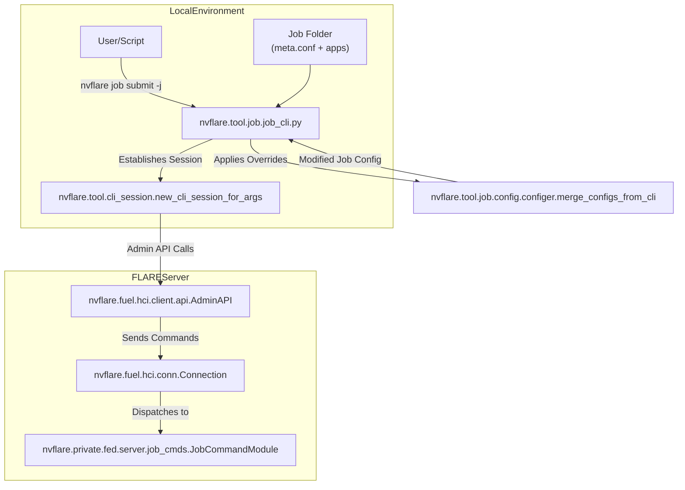
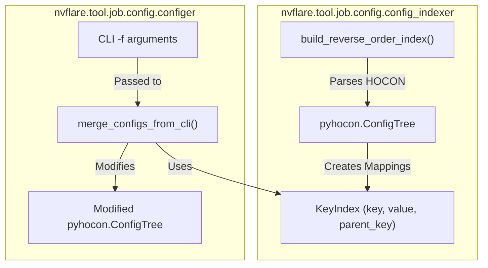
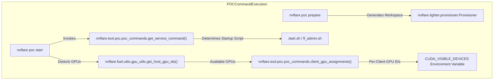

<!-- source: DeepWiki mcp.deepwiki.com · repo NVIDIA/NVFlare · page 2.4 Job CLI Quick Start · fetched 2026-10-26 -->

# Job CLI Quick Start

Relevant source files

The following files were used as context for generating this wiki page:

- [docs/design/cli_agent_readiness_backlog.md](docs/design/cli_agent_readiness_backlog.md)
- [docs/design/job_download_artifact_contract_test_plan.md](docs/design/job_download_artifact_contract_test_plan.md)
- [docs/design/nvflare_cli.md](docs/design/nvflare_cli.md)
- [docs/schemas/recipe_catalog.schema.json](docs/schemas/recipe_catalog.schema.json)
- [docs/user_guide/data_scientist_guide/index.rst](docs/user_guide/data_scientist_guide/index.rst)
- [docs/user_guide/nvflare_cli/config_command.rst](docs/user_guide/nvflare_cli/config_command.rst)
- [docs/user_guide/nvflare_cli/dashboard_command.rst](docs/user_guide/nvflare_cli/dashboard_command.rst)
- [docs/user_guide/nvflare_cli/job_cli.rst](docs/user_guide/nvflare_cli/job_cli.rst)
- [docs/user_guide/nvflare_cli/nvflare_cli.rst](docs/user_guide/nvflare_cli/nvflare_cli.rst)
- [docs/user_guide/nvflare_cli/poc_command.rst](docs/user_guide/nvflare_cli/poc_command.rst)
- [docs/user_guide/nvflare_cli/recipe_command.rst](docs/user_guide/nvflare_cli/recipe_command.rst)
- [docs/user_guide/nvflare_cli/study_command.rst](docs/user_guide/nvflare_cli/study_command.rst)
- [docs/user_guide/nvflare_cli/system_command.rst](docs/user_guide/nvflare_cli/system_command.rst)
- [nvflare/cli.py](nvflare/cli.py)
- [nvflare/tool/job/config/config_indexer.py](nvflare/tool/job/config/config_indexer.py)
- [nvflare/tool/job/config/configer.py](nvflare/tool/job/config/configer.py)
- [nvflare/tool/job/job_cli.py](nvflare/tool/job/job_cli.py)
- [nvflare/tool/job/job_client_const.py](nvflare/tool/job/job_client_const.py)
- [nvflare/tool/poc/poc_commands.py](nvflare/tool/poc/poc_commands.py)
- [nvflare/tool/poc/service_constants.py](nvflare/tool/poc/service_constants.py)
- [nvflare/utils/cli_utils.py](nvflare/utils/cli_utils.py)
- [tests/unit_test/data/jobs/launch_everytime/app/config/config_fed_client.conf](tests/unit_test/data/jobs/launch_everytime/app/config/config_fed_client.conf)
- [tests/unit_test/data/jobs/launch_everytime/app/config/config_fed_server.conf](tests/unit_test/data/jobs/launch_everytime/app/config/config_fed_server.conf)
- [tests/unit_test/data/jobs/launch_everytime/meta.conf](tests/unit_test/data/jobs/launch_everytime/meta.conf)
- [tests/unit_test/data/jobs/launch_once/app/config/config_fed_client.conf](tests/unit_test/data/jobs/launch_once/app/config/config_fed_client.conf)
- [tests/unit_test/data/jobs/launch_once/app/config/config_fed_server.conf](tests/unit_test/data/jobs/launch_once/app/config/config_fed_server.conf)
- [tests/unit_test/data/jobs/launch_once/meta.conf](tests/unit_test/data/jobs/launch_once/meta.conf)
- [tests/unit_test/lighter/poc_commands_test.py](tests/unit_test/lighter/poc_commands_test.py)
- [tests/unit_test/tool/job/config/config_indexer_test.py](tests/unit_test/tool/job/config/config_indexer_test.py)
- [tests/unit_test/tool/job/config/configer_test.py](tests/unit_test/tool/job/config/configer_test.py)
- [tests/unit_test/tool/job/job_cli_test.py](tests/unit_test/tool/job/job_cli_test.py)
- [tests/unit_test/tool/job/job_download_test.py](tests/unit_test/tool/job/job_download_test.py)
- [tests/unit_test/tool/poc/poc_force_test.py](tests/unit_test/tool/poc/poc_force_test.py)
- [tests/unit_test/tool/poc/poc_output_test.py](tests/unit_test/tool/poc/poc_output_test.py)

## Purpose and Scope

This page introduces the **Job CLI** (`nvflare job`), a technical command-line interface for creating, customizing, and submitting NVIDIA FLARE jobs. The Job CLI acts as the primary administrative gateway to the federated learning system, allowing users to manage the full job lifecycle from submission through monitoring to result retrieval.

**Related pages:**
- For running jobs in Simulator mode, see [Simulator Usage](2.3)
- For setting up POC mode environments, see [POC Mode Quick Start](2.2)
- For detailed job management and lifecycle, see [Job CLI](7.4)

---

## Overview

The Job CLI provides a suite of subcommands defined in `nvflare/tool/job/job_cli.py` [nvflare/tool/job/job_cli.py:83-102](). It is designed for both human interaction and machine-driven automation (CI/CD, agents), supporting structured JSON output and retry-safe submission tokens [docs/design/nvflare_cli.md:37-50]().

### Job CLI Command Map

| Command | Purpose | Implementation Constant |
|---------|---------|------------------------|
| `submit` | Submit a pre-built job folder to the server | `CMD_SUBMIT_JOB` [nvflare/tool/job/job_cli.py:86]() |
| `wait` | Block until job completion and return final result | `CMD_JOB_WAIT` [nvflare/tool/job/job_cli.py:100]() |
| `monitor` | Wait for a job and stream progress to stderr | `CMD_JOB_MONITOR` [nvflare/tool/job/job_cli.py:99]() |
| `list` | List jobs currently on the server | `CMD_JOB_LIST` [nvflare/tool/job/job_cli.py:87]() |
| `abort` | Terminate a running job | `CMD_JOB_ABORT` [nvflare/tool/job/job_cli.py:89]() |
| `meta` | Retrieve job execution metadata | `CMD_JOB_META` [nvflare/tool/job/job_cli.py:88]() |
| `logs` | Get job logs from the server-side log store | `CMD_JOB_LOGS` [nvflare/tool/job/job_cli.py:96]() |
| `stats` | Show running job statistics | `CMD_JOB_STATS` [nvflare/tool/job/job_cli.py:95]() |
| `download` | Download job result | `CMD_JOB_DOWNLOAD` [nvflare/tool/job/job_cli.py:91]() |
| `clone` | Clone an existing job | `CMD_JOB_CLONE` [nvflare/tool/job/job_cli.py:90]() |
| `delete` | Remove job artifacts from the server | `CMD_JOB_DELETE` [nvflare/tool/job/job_cli.py:92]() |

### Job Management Data Flow

The diagram below illustrates how the CLI interacts with the backend system to manage jobs, associating CLI components with code entities.

**Title: Job Submission and Management Flow**

The CLI uses `new_cli_session_for_args` [nvflare/tool/cli_session.py:38]() to establish a secure connection to the server. The `handle_job_cli_cmd` function [nvflare/tool/job/job_cli.py:1186]() routes subcommands to their respective handlers.

**Sources:** [nvflare/tool/job/job_cli.py:83-102](), [nvflare/tool/job/job_cli.py:1186](), [nvflare/cli.py:34-41](), [nvflare/tool/cli_session.py:38](), [docs/design/nvflare_cli.md:21-28]()

---

## Job Templates and Recipes

Job templates provide a structured way to define federated learning workflows. While `nvflare job create` is deprecated in favor of the **FedJob API** and **Recipe API** [nvflare/tool/job/job_cli.py:212-214](), the template system remains a core part of the codebase for defining baseline configurations.

### Template Discovery
The system searches for templates in a specific order [nvflare/utils/cli_utils.py:188-214]():
1. `NVFLARE_HOME` environment variable [nvflare/utils/cli_utils.py:195-197]().
2. The hidden configuration file `~/.nvflare/config.conf` under the key `job_template.path` [nvflare/utils/cli_utils.py:200-201]().
3. The internal package directory `nvflare/tool/job/templates` [nvflare/utils/cli_utils.py:208-212]().

### Listing Templates
The command `nvflare job list-templates` (aliased to `nvflare recipe list`) uses `build_job_template_indices` [nvflare/tool/job/job_cli.py:155]() to parse `info.conf` files within template directories.

| Field | Code Key | Description |
|-------|----------|-------------|
| Description | `JOB_INFO_DESC` | Human-readable purpose [nvflare/tool/job/job_client_const.py:57]() |
| Controller | `JOB_INFO_CONTROLLER_TYPE` | Type of FL controller used [nvflare/tool/job/job_client_const.py:55]() |
| API Type | `JOB_INFO_EXECUTION_API_TYPE` | e.g., "Client API" or "Executor" [nvflare/tool/job/job_client_const.py:59]() |

**Sources:** [nvflare/tool/job/job_cli.py:155-173](), [nvflare/utils/cli_utils.py:188-214](), [nvflare/tool/job/job_client_const.py:54-62]()

---

## Configuration Customization

### The Configer and Indexing System
The Job CLI uses `merge_configs_from_cli` [nvflare/tool/job/config/configer.py:35-44]() to allow command-line overrides of job parameters.

**Title: CLI Configuration Override System**

### Advanced Override Syntax
The CLI supports path notation for modifying nested components:
- **Nested Access:** `executors[0].executor.args.lr=0.01` is handled by `split_array_key` [nvflare/tool/job/config/configer.py:121-144]().
- **Deletion:** Appending a minus sign (e.g., `key-`) triggers removal via `config.pop(key)` [nvflare/tool/job/config/configer.py:189-196]().
- **Type Conversion:** The `convert_to_number` function [nvflare/tool/job/config/configer.py:147]() automatically casts string inputs to appropriate numeric types.

**Sources:** [nvflare/tool/job/config/configer.py:35-45](), [nvflare/tool/job/config/configer.py:121-160](), [nvflare/tool/job/config/config_indexer.py:36-68]()

---

## Submitting Jobs

### Submission Workflow
When `nvflare job submit` is called, the CLI performs the following:
1. **Startup Kit Selection:** Resolves the admin identity using `new_cli_session_for_args` [nvflare/tool/cli_session.py:38]().
2. **Job Validation:** Ensures the job folder contains required metadata like `meta.conf` [nvflare/tool/job/job_client_const.py:63]().
3. **Transmission:** Uses the `AdminAPI` to send the `submit_job` command to the server.

### Idempotency with Submit Tokens
To handle network retries safely, the CLI supports `--submit-token` [docs/user_guide/nvflare_cli/job_cli.rst:126-128]().
- **Validation:** Tokens are validated using `validate_submit_token` [nvflare/apis/utils/job_submit_token.py:33]() via the CLI arg parser [nvflare/tool/job/job_cli.py:76-80]().
- **Mechanism:** The server uses this token to deduplicate requests. If a job with the same token and content was already accepted, the server returns the existing `job_id` [nvflare/tool/job/job_cli.py:105-114]().

**Sources:** [nvflare/tool/job/job_cli.py:76-80](), [nvflare/tool/job/job_cli.py:105-114](), [nvflare/tool/job/job_client_const.py:63](), [nvflare/tool/cli_session.py:38](), [docs/user_guide/nvflare_cli/job_cli.rst:126-177]()

---

## POC Mode Integration

The Job CLI is often used in conjunction with POC mode for rapid prototyping [docs/user_guide/nvflare_cli/poc_command.rst:7-10]().

### Local Deployment Lifecycle
1. **Prepare:** `nvflare poc prepare` generates the workspace [nvflare/tool/poc/poc_commands.py:74](). This involves calling `Provisioner` builders [nvflare/tool/poc/poc_commands.py:37-39]().
2. **Start:** `nvflare poc start` launches the server and client processes [nvflare/tool/poc/poc_commands.py:75](). This command uses `get_service_command` [nvflare/tool/poc/poc_commands.py:142-176]() to determine the correct script (e.g., `start.sh` or `fl_admin.sh`).
3. **Stop:** `nvflare poc stop` signals termination by creating a `shutdown.fl` file [nvflare/tool/poc/poc_commands.py:179-182]().

### GPU Assignment in POC
In POC mode, host GPUs are distributed across clients via `client_gpu_assignments` [nvflare/tool/poc/poc_commands.py:116-139]().

**Title: POC Mode Resource Allocation**

**Sources:** [nvflare/tool/poc/poc_commands.py:74-76](), [nvflare/tool/poc/poc_commands.py:142-176](), [nvflare/tool/poc/poc_commands.py:179-182](), [nvflare/tool/poc/poc_commands.py:116-139](), [docs/user_guide/nvflare_cli/poc_command.rst:162-184]()

---

## Configuration Management

The CLI maintains state and user preferences in a hidden directory [nvflare/utils/cli_utils.py:55-63]().

### Workspace and Kit Registry
- **Location:** `~/.nvflare/` [nvflare/utils/cli_utils.py:66-69]().
- **Config File:** `config.conf` [nvflare/utils/cli_utils.py:51-52]().
- **Active Kit:** Managed via `set_active_startup_kit` [nvflare/tool/kit/kit_config.py:36]() and retrieved via `get_active_startup_kit_id` [nvflare/tool/kit/kit_config.py:53]().

### Configuration Utilities
The `cli_utils.py` file provides helper functions like `load_hidden_config_state` [nvflare/utils/cli_utils.py:107-111]() and `create_poc_workspace_config` [nvflare/utils/cli_utils.py:134-156]() to manage these persistent settings.

**Sources:** [nvflare/utils/cli_utils.py:51-70](), [nvflare/utils/cli_utils.py:107-111](), [nvflare/utils/cli_utils.py:134-157](), [nvflare/tool/kit/kit_config.py:36-53](), [docs/design/nvflare_cli.md:27-28]()

---

