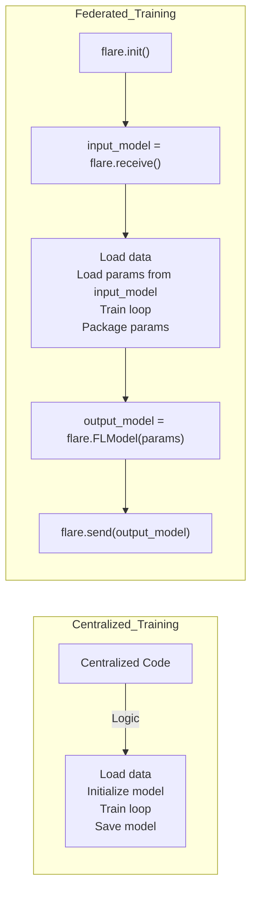
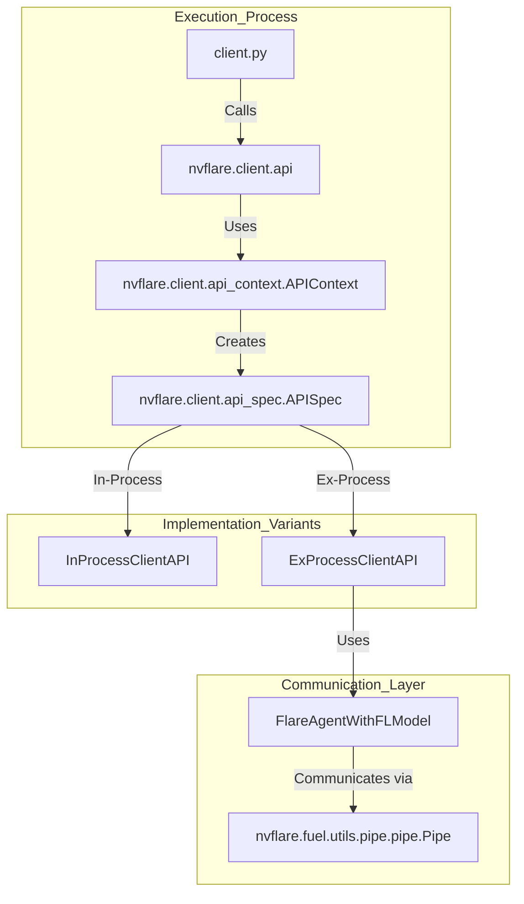
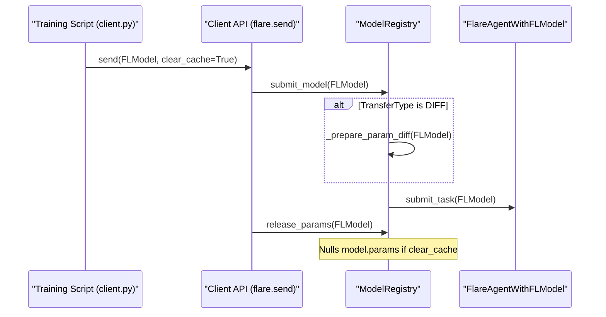

<!-- source: DeepWiki mcp.deepwiki.com · repo NVIDIA/NVFlare · page 2.5 Client API Quick Start · fetched 2026-10-26 -->

# Client API Quick Start

<details>
<summary>Relevant source files</summary>

The following files were used as context for generating this wiki page:

- [docs/programming_guide/controllers/model_controller.rst](docs/programming_guide/controllers/model_controller.rst)
- [docs/programming_guide/execution_api_type.rst](docs/programming_guide/execution_api_type.rst)
- [docs/programming_guide/execution_api_type/3rd_party_integration.rst](docs/programming_guide/execution_api_type/3rd_party_integration.rst)
- [docs/programming_guide/execution_api_type/client_api.rst](docs/programming_guide/execution_api_type/client_api.rst)
- [docs/programming_guide/execution_api_type/model_learner.rst](docs/programming_guide/execution_api_type/model_learner.rst)
- [docs/programming_guide/fed_job_api.rst](docs/programming_guide/fed_job_api.rst)
- [docs/programming_guide/fl_model.rst](docs/programming_guide/fl_model.rst)
- [docs/programming_guide/workflows_and_controllers.rst](docs/programming_guide/workflows_and_controllers.rst)
- [docs/user_guide/data_scientist_guide/client_api_usage.rst](docs/user_guide/data_scientist_guide/client_api_usage.rst)
- [examples/hello-world/hello-numpy-cross-val/generate_pretrain_models.py](examples/hello-world/hello-numpy-cross-val/generate_pretrain_models.py)
- [nvflare/app_common/abstract/model_learner.py](nvflare/app_common/abstract/model_learner.py)
- [nvflare/app_common/ccwf/comps/np_trainer.py](nvflare/app_common/ccwf/comps/np_trainer.py)
- [nvflare/app_common/ccwf/val_result_manager.py](nvflare/app_common/ccwf/val_result_manager.py)
- [nvflare/app_common/np/np_formatter.py](nvflare/app_common/np/np_formatter.py)
- [nvflare/app_common/np/np_model_locator.py](nvflare/app_common/np/np_model_locator.py)
- [nvflare/app_common/np/np_model_persistor.py](nvflare/app_common/np/np_model_persistor.py)
- [nvflare/app_common/np/np_trainer.py](nvflare/app_common/np/np_trainer.py)
- [nvflare/app_common/np/np_validator.py](nvflare/app_common/np/np_validator.py)
- [nvflare/app_common/np/recipes/__init__.py](nvflare/app_common/np/recipes/__init__.py)
- [nvflare/app_common/np/recipes/lr/__init__.py](nvflare/app_common/np/recipes/lr/__init__.py)
- [nvflare/app_common/np/recipes/lr/fedavg.py](nvflare/app_common/np/recipes/lr/fedavg.py)
- [nvflare/app_common/workflows/lr/np_persistor.py](nvflare/app_common/workflows/lr/np_persistor.py)
- [nvflare/app_opt/he/cross_site_model_eval.py](nvflare/app_opt/he/cross_site_model_eval.py)
- [nvflare/client/__init__.py](nvflare/client/__init__.py)
- [nvflare/client/api.py](nvflare/client/api.py)
- [nvflare/client/config.py](nvflare/client/config.py)
- [nvflare/client/constants.py](nvflare/client/constants.py)
- [nvflare/client/decorator.py](nvflare/client/decorator.py)
- [nvflare/client/lightning/__init__.py](nvflare/client/lightning/__init__.py)
- [nvflare/client/model_registry.py](nvflare/client/model_registry.py)
- [nvflare/client/task_registry.py](nvflare/client/task_registry.py)
- [nvflare/client/utils.py](nvflare/client/utils.py)
- [nvflare/fuel/utils/deprecated.py](nvflare/fuel/utils/deprecated.py)
- [nvflare/job_config/api.py](nvflare/job_config/api.py)
- [tests/unit_test/apis/impl/wf_comm_server_test.py](tests/unit_test/apis/impl/wf_comm_server_test.py)
- [tests/unit_test/app_common/abstract/model_learner_test.py](tests/unit_test/app_common/abstract/model_learner_test.py)
- [tests/unit_test/app_common/ccwf/ccwf_np_trainer_test.py](tests/unit_test/app_common/ccwf/ccwf_np_trainer_test.py)
- [tests/unit_test/app_common/np/np_trainer_test.py](tests/unit_test/app_common/np/np_trainer_test.py)
- [tests/unit_test/client/config_test.py](tests/unit_test/client/config_test.py)
- [tests/unit_test/client/package_exports_test.py](tests/unit_test/client/package_exports_test.py)
- [tests/unit_test/fuel/utils/deprecated_test.py](tests/unit_test/fuel/utils/deprecated_test.py)
- [tests/unit_test/job_config/fed_job_test.py](tests/unit_test/job_config/fed_job_test.py)

</details>


This page provides a practical guide to converting centralized training code to federated learning using the NVIDIA FLARE Client API. You will learn how to federate existing ML code with minimal changes and execute your first federated learning job.

**Scope:** This quick start focuses on hands-on usage with working examples. For comprehensive technical documentation including API reference, communication patterns, and advanced features, see the [FLARE Client API](6.3) page.

**Prerequisites:** NVIDIA FLARE installed (`pip install nvflare`). Basic Python and ML framework knowledge (PyTorch, TensorFlow, etc.).

## Why Use the Client API?

The Client API enables federated learning with minimal code changes to existing training scripts:

- **Minimal lines of code** to federate centralized training [docs/programming_guide/execution_api_type/client_api.rst:13-20]().
- **No class restructuring** - works with your existing code structure by using `flare.init()`, `flare.receive()`, and `flare.send()` [nvflare/client/api.py:53-114]().
- **Framework agnostic** - supports PyTorch, PyTorch Lightning, TensorFlow, NumPy, and HuggingFace [docs/programming_guide/execution_api_type/client_api.rst:18-19]().
- **Standardized Data Exchange** - uses the `FLModel` data structure to standardize model parameters and metrics across frameworks [nvflare/client/api.py:18-21](), [nvflare/client/api.py:111-112]().
- **Experiment Tracking** - provides streaming metrics like TensorBoard logs to the server via the tracking API [nvflare/client/api.py:214-229]().

Sources: [nvflare/client/api.py:18-114](), [docs/programming_guide/execution_api_type/client_api.rst:13-20](), [nvflare/client/api.py:214-229]()

## The 3-Line Conversion Pattern

Converting centralized training to federated learning follows this pattern:

| Step | Action | Code Entity |
| :--- | :--- | :--- |
| **1** | Initialize FLARE | `flare.init()` [nvflare/client/api.py:53-89]() |
| **2** | Receive Global Model | `flare.receive()` [nvflare/client/api.py:91-98]() |
| **3** | Send Local Update | `flare.send(FLModel(...))` [nvflare/client/api.py:101-114]()

Title: "Client API Conversion Workflow"


Sources: [nvflare/client/api.py:53-114](), [docs/programming_guide/execution_api_type/client_api.rst:57-71]()

## Complete Working Example

This example demonstrates federated PyTorch training using the Client API.

### Step 1: Training Script with Client API

**File: client.py**

```python
import nvflare.client as flare
import torch

def main():
    # 1. Initialize FLARE Client API
    flare.init()
    
    # Setup model and data
    model = Net()
    
    # Federated Learning Loop
    while flare.is_running():
        # 2. Receive global model from server
        input_model = flare.receive()
        
        # Load received parameters
        model.load_state_dict(input_model.params)
        
        # Standard training logic
        # ... train(model) ...
        
        # 3. Package and send updated model back
        output_model = flare.FLModel(
            params=model.state_dict(),
            metrics={"accuracy": 0.9}
        )
        flare.send(output_model)

if __name__ == "__main__":
    main()
```

**Key points:**
- `flare.init()` initializes the `APIContext` which manages the communication state [nvflare/client/api.py:75-89]().
- `flare.is_running()` checks if the FL system is still active and the job has not been aborted or completed [nvflare/client/api.py:174-181]().
- `flare.receive()` retrieves an `FLModel` containing global weights sent by the server [nvflare/client/api.py:91-98]().
- `flare.send()` returns local updates to the server for aggregation [nvflare/client/api.py:101-114]().

Sources: [nvflare/client/api.py:53-181](), [docs/programming_guide/execution_api_type/client_api.rst:113-180]()

## Client API Core Functions

The Client API provides essential functions for FL communication defined in `nvflare/client/api.py`:

| Function | Purpose | Returns |
| :--- | :--- | :--- |
| `flare.init()` | Initialize FL environment | `APIContext` [nvflare/client/api.py:53-89]() |
| `flare.is_running()` | Check if FL job is active | `bool` [nvflare/client/api.py:174-181]() |
| `flare.receive()` | Receive model from server | `FLModel` [nvflare/client/api.py:91-98]() |
| `flare.send(model)` | Send model to server | `None` [nvflare/client/api.py:101-114]() |
| `flare.system_info()` | Get job ID and site name | `Dict` [nvflare/client/api.py:117-131]() |
| `flare.get_job_id()` | Get the current job ID | `str` [nvflare/client/api.py:144-152]() |
| `flare.get_site_name()` | Get the current client's site name | `str` [nvflare/client/api.py:154-162]() |
| `flare.get_task_name()` | Get the name of the current task | `str` [nvflare/client/api.py:164-172]() |
| `flare.is_train()` | Check if current task is training | `bool` [nvflare/client/api.py:184-192]() |
| `flare.is_evaluate()` | Check if current task is evaluation | `bool` [nvflare/client/api.py:194-202]() |
| `flare.is_submit_model()` | Check if current task is model submission | `bool` [nvflare/client/api.py:204-212]() |
| `flare.log(key, value, data_type)` | Log analytics data | `bool` [nvflare/client/api.py:214-229]() |

### The FLModel Object

The `FLModel` object is the standard data structure for NVFlare to communicate model data [nvflare/client/api.py:21](). It encapsulates model parameters, metadata, and metrics.

```python
# Receiving model
input_model = flare.receive()
params = input_model.params          # Model parameters (e.g., weights)

# Sending model
output_model = flare.FLModel(
    params=model.state_dict(),       # Required: model parameters
    metrics={"accuracy": 0.95}       # Optional: evaluation metrics
)
flare.send(output_model)
```

Sources: [nvflare/client/api.py:91-114](), [nvflare/client/__init__.py:19-20]()

## Code-to-System Mapping

This diagram maps code entities to their roles in the FL execution system.

Title: "Client API Runtime Entity Mapping"


Sources: [nvflare/client/api.py:75-89](), [nvflare/client/api_context.py:24-25](), [nvflare/client/ipc/ipc_agent.py:38]()

## Data Flow Sequence

When a training script uses the Client API, it interacts with the system via the `APIContext` which manages the task state through the underlying `ModelRegistry`.

Title: "Client API Data Flow Sequence"


Sources: [nvflare/client/api.py:101-114](), [nvflare/client/model_registry.py:46-64](), [nvflare/client/model_registry.py:86-105](), [nvflare/client/config.py:174-175]()

## Framework Integration Examples

### PyTorch Lightning Integration

NVFlare provides a `patch` function for PyTorch Lightning `Trainer` to automate the FL loop by injecting an `FLCallback` [nvflare/client/lightning/__init__.py:33-34]().

```python
import pytorch_lightning as pl
import nvflare.client.lightning as flare_lightning

trainer = pl.Trainer(max_epochs=1)
# Automatically handles flare.init, receive, and send via FLCallback
flare_lightning.patch(trainer)

trainer.fit(model, train_loader)
```

Sources: [nvflare/client/lightning/__init__.py:33-45]()

### Task-Specific Logic

You can differentiate between training and evaluation tasks using built-in flags provided by the API [nvflare/client/api.py:184-212]().

```python
while flare.is_running():
    input_model = flare.receive()
    
    if flare.is_train():
        # Training task logic
        print(f"Received training task: {flare.get_task_name()}")
    elif flare.is_evaluate():
        # Validation task logic
        print(f"Received evaluation task: {flare.get_task_name()}")
    elif flare.is_submit_model():
        # Final model submission logic
        print(f"Received submit_model task: {flare.get_task_name()}")
        
    flare.send(output_model)
```

Sources: [nvflare/client/api.py:184-212]()

## Job Configuration with FedJob

Once the training script is federated, use the `FedJob` API to define the server-side workflow and assign the script to clients [nvflare/job_config/api.py:184-192]().

```python
from nvflare.job_config.api import FedJob
from nvflare.job_config.script_runner import ScriptRunner
from nvflare.app_common.workflows.fedavg import FedAvg

job = FedJob(name="my_job")

# Server-side workflow
job.to_server(FedAvg(num_clients=2, num_rounds=5))

# Client-side execution of our federated script
job.to_clients(ScriptRunner(script="client.py"))

job.export_job("/tmp/jobs")
```

Sources: [nvflare/job_config/api.py:184-212](), [docs/programming_guide/fed_job_api.rst:79-102]()

## Advanced Communication Features

### Differential Parameter Exchange
The Client API supports sending only the difference between the local model and the received global model to reduce bandwidth usage. This is controlled by the `transfer_type` configuration [nvflare/client/config.py:51-54](), [nvflare/client/config.py:174-175](). The `ModelRegistry` calculates this difference via `_prepare_param_diff` [nvflare/client/model_registry.py:86-105]().

Sources: [nvflare/client/config.py:51-54](), [nvflare/client/config.py:174-175](), [nvflare/client/model_registry.py:86-105]()

### Memory Management
The `send()` function includes a `clear_cache` parameter (defaulting to `True`). When enabled, the `ModelRegistry.release_params` method is called to nullify large parameter arrays after serialization is complete, freeing memory [nvflare/client/api.py:101-114](), [nvflare/client/model_registry.py:66-85]().

Sources: [nvflare/client/api.py:101-114](), [nvflare/client/model_registry.py:66-85]()

## Troubleshooting

**Common Issues:**

1.  **`APIContext is None`**: Ensure `flare.init()` is called before `receive()` or `send()`. This initializes the global context required for API operations [nvflare/client/api.py:32-50]().
2.  **`model needs to be an instance of FLModel`**: The `send()` function strictly requires the `FLModel` wrapper to ensure metadata and parameters are correctly handled [nvflare/client/api.py:111-112]().
3.  **Multi-GPU/Process Initialization**: When using multiple worker processes (e.g., PyTorch DDP), pass the `rank` to `flare.init(rank=...)` to ensure the correct context is established for each process [nvflare/client/api.py:53-73]().

Sources: [nvflare/client/api.py:32-114]()

---

