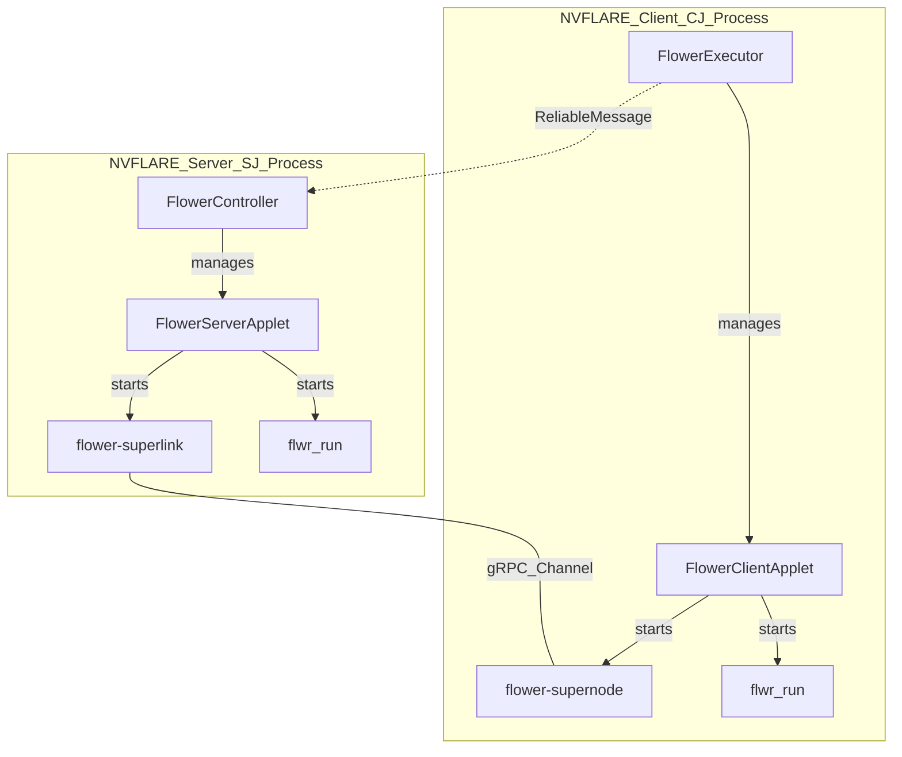
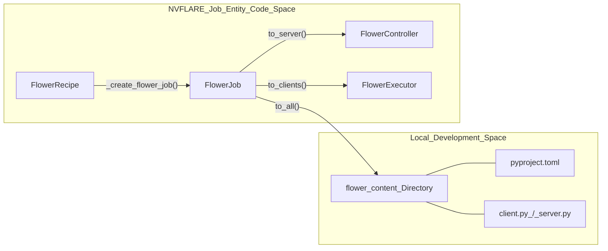

<!-- source: DeepWiki mcp.deepwiki.com · repo NVIDIA/NVFlare · page 20 Flower Framework Integration · fetched 2026-10-26 -->

# Flower Framework Integration

<details>
<summary>Relevant source files</summary>

The following files were used as context for generating this wiki page:

- [docs/user_guide/data_scientist_guide/flower_integration/flower_job_structure.rst](docs/user_guide/data_scientist_guide/flower_integration/flower_job_structure.rst)
- [docs/user_guide/data_scientist_guide/flower_integration/flower_run_as_flare_job.rst](docs/user_guide/data_scientist_guide/flower_integration/flower_run_as_flare_job.rst)
- [examples/hello-world/hello-flower/README.md](examples/hello-world/hello-flower/README.md)
- [examples/hello-world/hello-flower/flwr-pt-tb/flwr_pt_tb/__init__.py](examples/hello-world/hello-flower/flwr-pt-tb/flwr_pt_tb/__init__.py)
- [examples/hello-world/hello-flower/flwr-pt-tb/flwr_pt_tb/client.py](examples/hello-world/hello-flower/flwr-pt-tb/flwr_pt_tb/client.py)
- [examples/hello-world/hello-flower/flwr-pt-tb/flwr_pt_tb/server.py](examples/hello-world/hello-flower/flwr-pt-tb/flwr_pt_tb/server.py)
- [examples/hello-world/hello-flower/flwr-pt-tb/flwr_pt_tb/task.py](examples/hello-world/hello-flower/flwr-pt-tb/flwr_pt_tb/task.py)
- [examples/hello-world/hello-flower/flwr-pt-tb/pyproject.toml](examples/hello-world/hello-flower/flwr-pt-tb/pyproject.toml)
- [examples/hello-world/hello-flower/flwr-pt/flwr_pt/client.py](examples/hello-world/hello-flower/flwr-pt/flwr_pt/client.py)
- [examples/hello-world/hello-flower/flwr-pt/flwr_pt/task.py](examples/hello-world/hello-flower/flwr-pt/flwr_pt/task.py)
- [examples/hello-world/hello-flower/flwr-pt/pyproject.toml](examples/hello-world/hello-flower/flwr-pt/pyproject.toml)
- [examples/hello-world/hello-flower/job.py](examples/hello-world/hello-flower/job.py)
- [examples/hello-world/hello-flower/requirements.txt](examples/hello-world/hello-flower/requirements.txt)
- [nvflare/app_opt/flower/applet.py](nvflare/app_opt/flower/applet.py)
- [nvflare/app_opt/flower/controller.py](nvflare/app_opt/flower/controller.py)
- [nvflare/app_opt/flower/defs.py](nvflare/app_opt/flower/defs.py)
- [nvflare/app_opt/flower/executor.py](nvflare/app_opt/flower/executor.py)
- [nvflare/app_opt/flower/flower_job.py](nvflare/app_opt/flower/flower_job.py)
- [nvflare/app_opt/flower/recipe.py](nvflare/app_opt/flower/recipe.py)
- [tests/unit_test/app_opt/flower/applet_test.py](tests/unit_test/app_opt/flower/applet_test.py)
- [tests/unit_test/recipe/flower_recipe_test.py](tests/unit_test/recipe/flower_recipe_test.py)

</details>


The Flower Framework Integration allows users to run existing Flower (`flwr`) federated learning applications within the NVIDIA FLARE infrastructure. By leveraging NVFLARE's robust communication layer, job management, and security features, Flower users can transition from local simulations to secure, distributed production environments without rewriting their core Flower logic.

This integration requires `flwr>=1.26` [nvflare/app_opt/flower/recipe.py:28-29]() and utilizes the Flower SuperLink/SuperNode model to orchestrate federated runs.

## Overview of Integration Architecture

The integration is built upon the "TIE" (Third-party Integration Element) framework, which allows NVFLARE to manage external process lifecycles. On the server side, NVFLARE starts a Flower `SuperLink` and the corresponding `ServerApp`. On the client side, it starts a Flower `SuperNode` and the `ClientApp`.

NVFLARE acts as the secure communication tunnel and process orchestrator, while Flower handles the high-level FL strategy and local training logic.

### Natural Language to Code Entity Mapping: Architecture

The following diagram maps the logical Flower components to the specific NVFLARE classes and executables that manage them.

**Flower to NVFLARE Process Mapping**


Sources: [nvflare/app_opt/flower/controller.py:26-46](), [nvflare/app_opt/flower/applet.py:133-160](), [nvflare/app_opt/flower/applet.py:36-38](), [nvflare/app_opt/flower/flower_job.py:97-118]()

For a detailed breakdown of the internal communication and applet management, see [Flower Integration Architecture](#20.1).

## Job Structure and Development

To run a Flower application in NVFLARE, the code must follow a specific directory structure. The core requirement is a project folder containing the Flower `client.py`, `server.py`, and a `pyproject.toml` file that defines the `[tool.flwr.app.components]` [docs/user_guide/data_scientist_guide/flower_integration/flower_job_structure.rst:9-16]().

### Natural Language to Code Entity Mapping: Job Configuration

The following diagram shows how the `FlowerJob` class maps local directory content into the NVFLARE job deployment structure.

**FlowerJob Deployment Mapping**


Sources: [nvflare/app_opt/flower/flower_job.py:29-49](), [nvflare/app_opt/flower/recipe.py:55-58](), [nvflare/app_opt/flower/recipe.py:154-171](), [examples/hello-world/hello-flower/job.py:44-49]()

### Key Integration Components

| Component | Code Entity | Role |
| :--- | :--- | :--- |
| **Job API** | `FlowerJob` | High-level API to define the job and include Flower source code [nvflare/app_opt/flower/flower_job.py:29-30]() |
| **Recipe API** | `FlowerRecipe` | Simplified interface for common configurations and simulation [nvflare/app_opt/flower/recipe.py:61-62]() |
| **Server Controller** | `FlowerController` | Orchestrates the `SuperLink` lifecycle and manages client tasks [nvflare/app_opt/flower/controller.py:26-46]() |
| **Client Executor** | `FlowerExecutor` | Receives tasks from the server and manages the `SuperNode` process [nvflare/app_opt/flower/flower_job.py:112-118]() |
| **Metric Streaming** | `MetricRelay` | Forwards metrics (e.g., TensorBoard) from Flower to NVFLARE [nvflare/app_opt/flower/flower_job.py:135-141]() |

## Running Jobs

Users can execute Flower jobs using the `FlowerRecipe` for rapid prototyping in the NVFLARE Simulator or for production deployment. The recipe automatically handles the configuration of the `ExternalConfigurator` and `MetricRelay` to support real-time experiment tracking [nvflare/app_opt/flower/flower_job.py:135-146](). 

The integration ensures that the `ClientAPIType` is set to `EX_PROCESS_API` to allow the Flower client subprocess to communicate metrics back to the NVFLARE client process [nvflare/app_opt/flower/recipe.py:155-163](). Hyperparameters defined in the Flower `pyproject.toml` can be overridden at runtime via the `run_config` argument in the `FlowerRecipe` [nvflare/app_opt/flower/recipe.py:133-134](). The `FlowerClientApplet` (and server applet) uses `_format_run_config_value` to format these values into TOML-compatible scalars for the Flower CLI [nvflare/app_opt/flower/applet.py:119-130]().

### Deployment Modes
The integration supports two primary deployment modes for the Flower application code:
1.  **BYOC (Bring Your Own Code)**: The user provides a `flower_content` directory which is packaged into the job and distributed to all sites [nvflare/app_opt/flower/flower_job.py:77-80]().
2.  **Pre-deployed Mode**: For restricted environments, an administrator can pre-deploy Flower apps on the server. The user specifies a `flower_app_path` (which must be under `local/custom/`), and NVFLARE distributes it via Flower's FAB mechanism [nvflare/app_opt/flower/flower_job.py:82-88]().

For a step-by-step guide on preparing and submitting jobs, see [Running Flower Jobs in NVFLARE](#20.2).

### Example Workflow
```python
# From examples/hello-world/hello-flower/job.py
recipe = FlowerRecipe(
    name=args.job_name,
    flower_content=args.content_dir,
    min_clients=num_of_clients,
    run_config=run_config if run_config else None,
)
# Execute in Simulator
env = SimEnv(num_clients=num_of_clients, workspace_root=args.workdir)
run = recipe.execute(env)
```
Sources: [examples/hello-world/hello-flower/job.py:44-59]()

---

