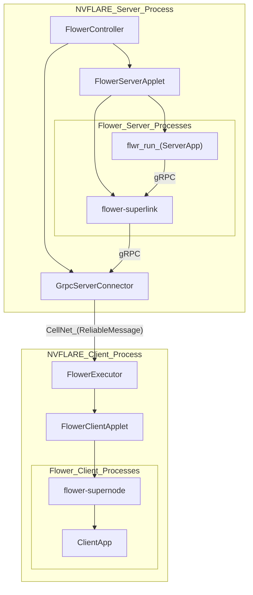
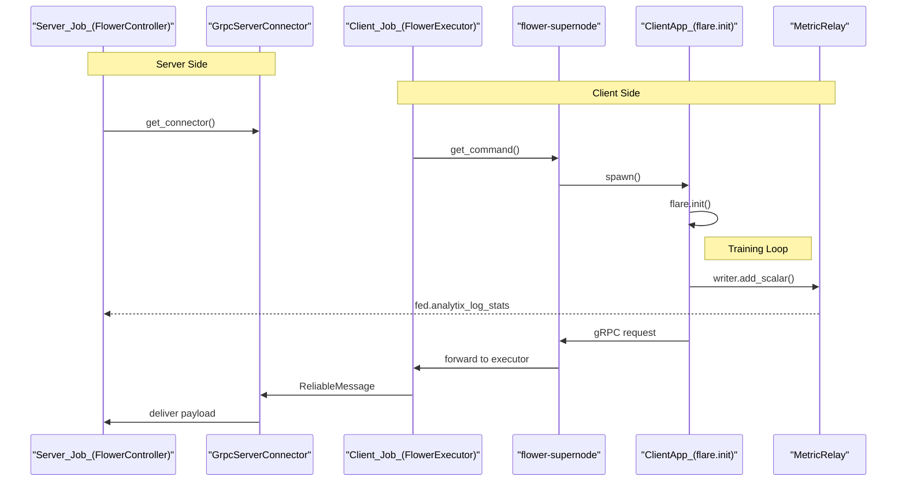

<!-- source: DeepWiki mcp.deepwiki.com · repo NVIDIA/NVFlare · page 20.1 Flower Integration Architecture · fetched 2026-10-26 -->

# Flower Integration Architecture

<details>
<summary>Relevant source files</summary>

The following files were used as context for generating this wiki page:

- [docs/user_guide/data_scientist_guide/flower_integration/flower_job_structure.rst](docs/user_guide/data_scientist_guide/flower_integration/flower_job_structure.rst)
- [docs/user_guide/data_scientist_guide/flower_integration/flower_run_as_flare_job.rst](docs/user_guide/data_scientist_guide/flower_integration/flower_run_as_flare_job.rst)
- [examples/hello-world/hello-flower/README.md](examples/hello-world/hello-flower/README.md)
- [examples/hello-world/hello-flower/flwr-pt-tb/flwr_pt_tb/__init__.py](examples/hello-world/hello-flower/flwr-pt-tb/flwr_pt_tb/__init__.py)
- [examples/hello-world/hello-flower/flwr-pt-tb/flwr_pt_tb/client.py](examples/hello-world/hello-flower/flwr-pt-tb/flwr_pt_tb/client.py)
- [examples/hello-world/hello-flower/flwr-pt-tb/flwr_pt_tb/server.py](examples/hello-world/hello-flower/flwr-pt-tb/flwr_pt_tb/server.py)
- [examples/hello-world/hello-flower/flwr-pt-tb/flwr_pt_tb/task.py](examples/hello-world/hello-flower/flwr-pt-tb/flwr_pt_tb/task.py)
- [examples/hello-world/hello-flower/flwr-pt-tb/pyproject.toml](examples/hello-world/hello-flower/flwr-pt-tb/pyproject.toml)
- [examples/hello-world/hello-flower/flwr-pt/flwr_pt/client.py](examples/hello-world/hello-flower/flwr-pt/flwr_pt/client.py)
- [examples/hello-world/hello-flower/flwr-pt/flwr_pt/task.py](examples/hello-world/hello-flower/flwr-pt/flwr_pt/task.py)
- [examples/hello-world/hello-flower/flwr-pt/pyproject.toml](examples/hello-world/hello-flower/flwr-pt/pyproject.toml)
- [examples/hello-world/hello-flower/job.py](examples/hello-world/hello-flower/job.py)
- [examples/hello-world/hello-flower/requirements.txt](examples/hello-world/hello-flower/requirements.txt)
- [nvflare/app_opt/flower/applet.py](nvflare/app_opt/flower/applet.py)
- [nvflare/app_opt/flower/controller.py](nvflare/app_opt/flower/controller.py)
- [nvflare/app_opt/flower/defs.py](nvflare/app_opt/flower/defs.py)
- [nvflare/app_opt/flower/executor.py](nvflare/app_opt/flower/executor.py)
- [nvflare/app_opt/flower/flower_job.py](nvflare/app_opt/flower/flower_job.py)
- [nvflare/app_opt/flower/recipe.py](nvflare/app_opt/flower/recipe.py)
- [tests/unit_test/app_opt/flower/applet_test.py](tests/unit_test/app_opt/flower/applet_test.py)
- [tests/unit_test/recipe/flower_recipe_test.py](tests/unit_test/recipe/flower_recipe_test.py)

</details>


The NVIDIA FLARE Flower integration allows users to run existing Flower (`flwr`) applications within the NVFLARE ecosystem. This integration leverages NVFLARE's robust communication layer (CellNet), job management, and security features while maintaining the Flower programming model (SuperLink/SuperNode).

## Architectural Overview

NVFLARE wraps the Flower execution model by mapping Flower's infrastructure components into NVFLARE's Controller/Executor paradigm. The integration is built upon the **TIE (Task Interface Extension)** framework, which provides the base classes for managing external processes and reliable messaging between the server and clients.

### Component Mapping

| Flower Component | NVFLARE Component | Implementation Class |
| :--- | :--- | :--- |
| **SuperLink** | Server-side process manager | `FlowerServerApplet` [nvflare/app_opt/flower/applet.py:36-36]() |
| **ServerApp** | Server-side logic runner | Managed by `FlowerServerApplet` [nvflare/app_opt/flower/applet.py:223-224]() |
| **SuperNode** | Client-side process manager | `FlowerClientApplet` [nvflare/app_opt/flower/applet.py:133-133]() |
| **ClientApp** | Client-side logic runner | Managed by `FlowerClientApplet` [nvflare/app_opt/flower/applet.py:160-185]() |
| **Fleet API** | Communication Bridge | `GrpcServerConnector` [nvflare/app_opt/flower/controller.py:95-100]() |

**Sources:** [nvflare/app_opt/flower/applet.py:36-133](), [nvflare/app_opt/flower/controller.py:26-111](), [nvflare/app_opt/flower/executor.py:23-49]()

## Server-Side Architecture

The server-side integration is orchestrated by the `FlowerController`. It manages the lifecycle of the Flower SuperLink and the `ServerApp`.

### FlowerController
The `FlowerController` inherits from `TieController` [nvflare/app_opt/flower/controller.py:26-26](). Its primary responsibility is to initialize the `FlowerServerApplet` and the `GrpcServerConnector`.

*   **`get_applet()`**: Returns a `FlowerServerApplet` which handles the execution of `flower-superlink` and the Flower `ServerApp` [nvflare/app_opt/flower/controller.py:102-111]().
*   **`get_connector()`**: Returns a `GrpcServerConnector` [nvflare/app_opt/flower/controller.py:94-100]() which acts as a bridge, receiving gRPC requests from local Flower components and routing them through NVFLARE's communication layer to the clients.

### FlowerServerApplet
This component manages distinct subprocesses on the NVFLARE Server:
1.  **Flower SuperLink**: Started using the `flower-superlink` executable [nvflare/app_opt/flower/applet.py:36-36]().
2.  **Flower ServerApp**: Started using the `flwr run` command [nvflare/app_opt/flower/applet.py:38-38](). Configuration is passed via `--run-config` if provided [nvflare/app_opt/flower/applet.py:119-130]().

The `FlowerServerApplet` also handles `allow_runtime_dependency_installation` for Flower versions >= 1.29.0 [nvflare/app_opt/flower/applet.py:41-41](), [nvflare/app_opt/flower/applet.py:97-117]().

**Sources:** [nvflare/app_opt/flower/controller.py:26-111](), [nvflare/app_opt/flower/applet.py:36-281]()

## Client-Side Architecture

The client-side integration uses the `FlowerExecutor` to manage the local Flower environment.

### FlowerExecutor
The `FlowerExecutor` inherits from `TieExecutor` [nvflare/app_opt/flower/executor.py:22-22](). It receives tasks from the `FlowerController` and uses the `FlowerClientApplet` to execute the Flower `ClientApp` [nvflare/app_opt/flower/executor.py:70-74]().

### FlowerClientApplet
The `FlowerClientApplet` is responsible for launching the `flower-supernode` process [nvflare/app_opt/flower/applet.py:37-37](). It ensures the `PATH` environment variable includes the current Python virtual environment's bin directory so internal Flower subprocesses (like `flower-superexec`) can be located [nvflare/app_opt/flower/applet.py:149-157]().

*   **`get_command()`**: Generates the CLI command for `flower-supernode`. It includes the `--superlink` address and `--clientappio-api-address` [nvflare/app_opt/flower/applet.py:160-185]().
*   **Partitioning**: It automatically calculates the `partition-id` based on the sorted list of all client names in the `FLContext` to ensure Flower's data partitioning works correctly [nvflare/app_opt/flower/applet.py:44-54]().

**Sources:** [nvflare/app_opt/flower/executor.py:23-49](), [nvflare/app_opt/flower/applet.py:37-185]()

## Data Flow and Communication

The integration uses a "Double Proxy" model to tunnel Flower's gRPC traffic through NVFLARE's secure communication layer.

### Communication Sequence

1.  The Flower `ServerApp` sends a request to the `SuperLink`.
2.  The `SuperLink` forwards the request to the `GrpcServerConnector`.
3.  The `GrpcServerConnector` wraps the gRPC payload into an NVFLARE message.
4.  NVFLARE routes the message to the target `FlowerExecutor` on the client.
5.  The `FlowerExecutor` delivers the payload to the local `flower-supernode`.
6.  The `flower-supernode` executes the task via the Flower `ClientApp`.

### Flower Integration Bridge Diagram

This diagram illustrates how Flower's internal CLI tools and gRPC services are wrapped by NVFLARE code entities.



**Sources:** [nvflare/app_opt/flower/controller.py:94-111](), [nvflare/app_opt/flower/applet.py:36-185](), [nvflare/app_opt/flower/executor.py:23-49]()

## Job Construction

The `FlowerJob` and `FlowerRecipe` classes simplify the creation of jobs by automatically configuring the necessary controllers, executors, and pipes.

### FlowerJob Components
When a `FlowerJob` is initialized, it sets up the following:
*   **`FlowerController`**: Added to the server [nvflare/app_opt/flower/flower_job.py:97-108]().
*   **`FlowerExecutor`**: Added to all clients [nvflare/app_opt/flower/flower_job.py:112-119]().
*   **`CellPipe` & `MetricRelay`**: Configured on clients to support experiment tracking (e.g., TensorBoard) [nvflare/app_opt/flower/flower_job.py:125-143]().

### Flower Recipe
The `FlowerRecipe` provides a high-level declarative API for configuring Flower jobs [nvflare/app_opt/flower/recipe.py:61-114](). It validates the `flwr` package version, requiring `flwr>=1.26` [nvflare/app_opt/flower/recipe.py:28-52](). It enforces the use of `ClientAPIType.EX_PROCESS_API` [nvflare/app_opt/flower/recipe.py:155-164]() to ensure that the NVFLARE Client API works correctly in the external Flower process.

### Pre-deployed vs BYOC Mode
The `FlowerJob` supports two deployment models [nvflare/app_opt/flower/flower_job.py:72-89]():
1.  **BYOC (Bring Your Own Code)**: Uses `flower_content` to point to a local directory containing Flower app code. This code is distributed as part of the job [nvflare/app_opt/flower/flower_job.py:109-110]().
2.  **Pre-deployed**: Uses `flower_app_path` to point to a path on the server where the Flower app is already installed. This is marked in job metadata with `FLOWER_PREDEPLOYED` [nvflare/app_opt/flower/flower_job.py:87-89](). The path must start with `local/custom/` to ensure security and admin control [nvflare/app_opt/flower/applet.py:33-33](), [nvflare/app_opt/flower/flower_job.py:82-83]().

### Flower Job Structure
A Flower job requires a specific directory structure in the `custom` folder [docs/user_guide/data_scientist_guide/flower_integration/flower_job_structure.rst:9-16]():
```text
├── flwr_pt/           # Project Folder (Python Package)
│   ├── client.py      # Contains ClientApp
│   ├── server.py      # Contains ServerApp
│   └── __init__.py    
└── pyproject.toml     # Flower Project Configuration
```
The `pyproject.toml` file is critical as it defines the entry points for `serverapp` and `clientapp` in the `[tool.flwr.app.components]` section [examples/hello-world/hello-flower/flwr-pt/pyproject.toml:31-33]().

**Sources:** [nvflare/app_opt/flower/flower_job.py:29-146](), [nvflare/app_opt/flower/recipe.py:27-164](), [docs/user_guide/data_scientist_guide/flower_integration/flower_job_structure.rst:9-74](), [examples/hello-world/hello-flower/flwr-pt/pyproject.toml:31-33]()

## Metric Streaming

NVFLARE enables experiment tracking for Flower apps through the `nvflare.client.tracking` module and `MetricRelay`.

### Integration with Flower ClientApp
To stream metrics, the Flower `ClientApp` uses the `lifespan` decorator to initialize the NVFLARE Client API [examples/hello-world/hello-flower/flwr-pt-tb/flwr_pt_tb/client.py:113-122]():

```python
@app.lifespan()
def lifespan(ctxt: Context) -> None:
    flare.init() # Initializes NVFLARE Client API
    yield
    flare.shutdown()
```

Inside the `fit` or `evaluate` methods, the `SummaryWriter` is used to send metrics [examples/hello-world/hello-flower/flwr-pt-tb/flwr_pt_tb/client.py:50-82]():
```python
self.writer = SummaryWriter()
self.writer.add_scalar("train_loss", results["train_loss"], step)
```

These metrics are captured by the `MetricRelay` on the client and sent via a `CellPipe` to the server's configured receivers [nvflare/app_opt/flower/flower_job.py:125-143]().

### Component Interaction Diagram

The following diagram maps specific code entities to their roles in the metric streaming and command execution flow.



**Sources:** [nvflare/app_opt/flower/flower_job.py:125-146](), [examples/hello-world/hello-flower/flwr-pt-tb/flwr_pt_tb/client.py:22-122](), [nvflare/app_opt/flower/applet.py:160-185]()

---

