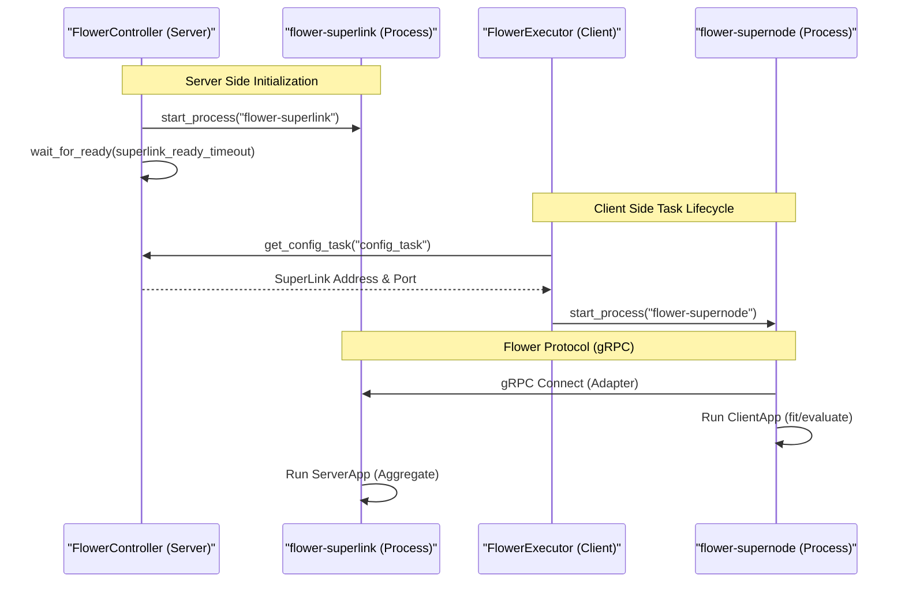

<!-- source: DeepWiki mcp.deepwiki.com · repo NVIDIA/NVFlare · page 20.2 Running Flower Jobs in NVFLARE · fetched 2026-10-26 -->

# Running Flower Jobs in NVFLARE

<details>
<summary>Relevant source files</summary>

The following files were used as context for generating this wiki page:

- [docs/user_guide/data_scientist_guide/flower_integration/flower_job_structure.rst](docs/user_guide/data_scientist_guide/flower_integration/flower_job_structure.rst)
- [docs/user_guide/data_scientist_guide/flower_integration/flower_run_as_flare_job.rst](docs/user_guide/data_scientist_guide/flower_integration/flower_run_as_flare_job.rst)
- [examples/hello-world/hello-flower/README.md](examples/hello-world/hello-flower/README.md)
- [examples/hello-world/hello-flower/flwr-pt-tb/flwr_pt_tb/__init__.py](examples/hello-world/hello-flower/flwr-pt-tb/flwr_pt_tb/__init__.py)
- [examples/hello-world/hello-flower/flwr-pt-tb/flwr_pt_tb/client.py](examples/hello-world/hello-flower/flwr-pt-tb/flwr_pt_tb/client.py)
- [examples/hello-world/hello-flower/flwr-pt-tb/flwr_pt_tb/server.py](examples/hello-world/hello-flower/flwr-pt-tb/flwr_pt_tb/server.py)
- [examples/hello-world/hello-flower/flwr-pt-tb/flwr_pt_tb/task.py](examples/hello-world/hello-flower/flwr-pt-tb/flwr_pt_tb/task.py)
- [examples/hello-world/hello-flower/flwr-pt-tb/pyproject.toml](examples/hello-world/hello-flower/flwr-pt-tb/pyproject.toml)
- [examples/hello-world/hello-flower/flwr-pt/flwr_pt/client.py](examples/hello-world/hello-flower/flwr-pt/flwr_pt/client.py)
- [examples/hello-world/hello-flower/flwr-pt/flwr_pt/task.py](examples/hello-world/hello-flower/flwr-pt/flwr_pt/task.py)
- [examples/hello-world/hello-flower/flwr-pt/pyproject.toml](examples/hello-world/hello-flower/flwr-pt/pyproject.toml)
- [examples/hello-world/hello-flower/job.py](examples/hello-world/hello-flower/job.py)
- [examples/hello-world/hello-flower/requirements.txt](examples/hello-world/hello-flower/requirements.txt)
- [nvflare/app_opt/flower/applet.py](nvflare/app_opt/flower/applet.py)
- [nvflare/app_opt/flower/controller.py](nvflare/app_opt/flower/controller.py)
- [nvflare/app_opt/flower/defs.py](nvflare/app_opt/flower/defs.py)
- [nvflare/app_opt/flower/executor.py](nvflare/app_opt/flower/executor.py)
- [nvflare/app_opt/flower/flower_job.py](nvflare/app_opt/flower/flower_job.py)
- [nvflare/app_opt/flower/recipe.py](nvflare/app_opt/flower/recipe.py)
- [tests/unit_test/app_opt/flower/applet_test.py](tests/unit_test/app_opt/flower/applet_test.py)
- [tests/unit_test/recipe/flower_recipe_test.py](tests/unit_test/recipe/flower_recipe_test.py)

</details>


This page provides a technical guide for converting Flower (`flwr`) applications into NVFLARE jobs. It details the required project structure, the use of the `FlowerJob` and `FlowerRecipe` APIs, and the underlying runtime orchestration between NVFLARE components and Flower's SuperLink/SuperNode architecture.

## Overview

NVFLARE integrates with Flower by wrapping Flower's decentralized components (`flower-superlink`, `flower-supernode`, `ServerApp`, and `ClientApp`) within NVFLARE's managed job lifecycle [nvflare/app_opt/flower/applet.py:35-41](). This allows users to leverage NVFLARE's infrastructure—such as secure communication, resource management, and experiment tracking—while writing native Flower code.

The integration supports `flwr>=1.26` [nvflare/app_opt/flower/recipe.py:27-28](). NVFLARE manages the SuperLink connection through a job-scoped `$FLWR_HOME/config.toml`, eliminating the need for manual federation configuration in `pyproject.toml` [docs/user_guide/data_scientist_guide/flower_integration/flower_job_structure.rst:78-82]().

Sources: [nvflare/app_opt/flower/applet.py:35-41](), [nvflare/app_opt/flower/recipe.py:27-28](), [docs/user_guide/data_scientist_guide/flower_integration/flower_job_structure.rst:78-82]()

## Flower Job Structure

A Flower job in NVFLARE requires a specific directory layout within the job's `custom` folder. This structure ensures that both the NVFLARE `FlowerController` and `FlowerExecutor` can locate the necessary Flower components [docs/user_guide/data_scientist_guide/flower_integration/flower_job_structure.rst:7-16]().

### Directory Layout
```text
my-flower-job/
├── flwr_pt/            # Project folder (Python package)
│   ├── __init__.py     # Required to make it a package
│   ├── client.py       # Contains the Flower ClientApp
│   ├── server.py       # Contains the Flower ServerApp
│   └── task.py         # Model and data logic
└── pyproject.toml      # Flower project configuration
```
Sources: [docs/user_guide/data_scientist_guide/flower_integration/flower_job_structure.rst:9-24](), [examples/hello-world/hello-flower/README.md:37-56]()

### The pyproject.toml File
The `pyproject.toml` is the source of truth for the Flower application. It defines the entry points for the `ServerApp` and `ClientApp` using the format `module:variable` [docs/user_guide/data_scientist_guide/flower_integration/flower_job_structure.rst:93-115]().

Key sections include:
* `[tool.flwr.app.components]`: Specifies the location of the `serverapp` and `clientapp` objects [examples/hello-world/hello-flower/flwr-pt/pyproject.toml:31-33]().
* `[tool.flwr.app.config]`: Defines static hyperparameters passed to the apps via the Flower `Context` [docs/user_guide/data_scientist_guide/flower_integration/flower_job_structure.rst:129-136]().

Sources: [docs/user_guide/data_scientist_guide/flower_integration/flower_job_structure.rst:93-136](), [examples/hello-world/hello-flower/flwr-pt/pyproject.toml:31-33]()

## Creating Jobs with FlowerJob and FlowerRecipe

NVFLARE provides two primary ways to define a Flower job programmatically: the low-level `FlowerJob` and the high-level `FlowerRecipe`.

### FlowerRecipe (Recommended)
`FlowerRecipe` simplifies the process by automatically configuring metric streaming and environment variables [nvflare/app_opt/flower/recipe.py:60-68](). It performs version validation to ensure compatibility with `flwr>=1.26` [nvflare/app_opt/flower/recipe.py:31-52](). It defaults the client API type to `EX_PROCESS_API` to support metric streaming from the Flower subprocess [nvflare/app_opt/flower/recipe.py:155-163]().

```python
from nvflare.app_opt.flower.recipe import FlowerRecipe
from nvflare.recipe import SimEnv

recipe = FlowerRecipe(
    flower_content="./flwr-pt", # Path to directory containing pyproject.toml
    name="hello-flower",
    min_clients=2,
    run_config={"learning-rate": 0.01} # Overrides pyproject.toml
)

# Execute in Simulator
env = SimEnv(num_clients=2)
recipe.execute(env)
```
Sources: [examples/hello-world/hello-flower/job.py:44-59](), [nvflare/app_opt/flower/recipe.py:111-163](), [tests/unit_test/recipe/flower_recipe_test.py:58]()

### FlowerJob
`FlowerJob` is the underlying `FedJob` implementation. It explicitly adds the `FlowerController` to the server and the `FlowerExecutor` to clients [nvflare/app_opt/flower/flower_job.py:97-119](). It also sets up a `CellPipe` and `MetricRelay` to support real-time metric streaming (e.g., to TensorBoard) [nvflare/app_opt/flower/flower_job.py:125-146]().

Sources: [nvflare/app_opt/flower/flower_job.py:29-146]()

## System Architecture and Data Flow

The integration uses a "Sidecar" pattern where NVFLARE processes manage Flower processes.

### Component Mapping: NVFLARE to Flower
| NVFLARE Entity | Flower Entity Managed | Role |
| :--- | :--- | :--- |
| `FlowerController` | `flower-superlink` | Orchestrates the federation and manages the SuperLink gRPC server [nvflare/app_opt/flower/flower_job.py:97-107](). |
| `FlowerServerApplet` | `ServerApp` | Runs the Flower server-side strategy logic via `flwr run` [nvflare/app_opt/flower/applet.py:36-38](). |
| `FlowerExecutor` | `flower-supernode` | Executes tasks and manages the SuperNode gRPC adapter [nvflare/app_opt/flower/flower_job.py:112-119](). |
| `FlowerClientApplet` | `ClientApp` | Runs the local training logic (e.g., PyTorch/TF) [nvflare/app_opt/flower/applet.py:133](). |

Sources: [nvflare/app_opt/flower/applet.py:35-41](), [nvflare/app_opt/flower/flower_job.py:97-119]()

### Code Entity Mapping
The following diagram maps the high-level system names to their specific implementation classes in the codebase.

Title: NVFLARE Flower Integration Code Entities
```mermaid
graph LR
    subgraph "Server_Space"
        "FlowerController"["FlowerController (nvflare/app_opt/flower/controller.py)"]
        "FlowerServerApplet"["FlowerServerApplet (nvflare/app_opt/flower/applet.py)"]
    end

    subgraph "Client_Space"
        "FlowerExecutor"["FlowerExecutor (nvflare/app_opt/flower/executor.py)"]
        "FlowerClientApplet"["FlowerClientApplet (nvflare/app_opt/flower/applet.py)"]
        "MetricRelay"["MetricRelay (nvflare/app_common/widgets/metric_relay.py)"]
    end

    "FlowerController" --> "FlowerServerApplet"
    "FlowerExecutor" --> "FlowerClientApplet"
    "FlowerExecutor" --> "MetricRelay"
```
Sources: [nvflare/app_opt/flower/flower_job.py:97-146](), [nvflare/app_opt/flower/applet.py:133](), [nvflare/app_opt/flower/controller.py:24-107](), [nvflare/app_opt/flower/executor.py:25]()

### Execution Flow Diagram
This diagram shows how `FlowerController` and `FlowerExecutor` interact with Flower binaries and the internal task communication.

Title: Flower Job Execution Flow

Sources: [nvflare/app_opt/flower/applet.py:35-41](), [nvflare/app_opt/flower/flower_job.py:97-119](), [nvflare/app_opt/flower/flower_job.py:38-41]()

## Metric Streaming with TensorBoard

To stream metrics from Flower `ClientApp` to NVFLARE's server-side tracking (TensorBoard), the `nvflare.client.tracking.SummaryWriter` is used inside the Flower client code [examples/hello-world/hello-flower/flwr-pt-tb/flwr_pt_tb/client.py:23-50]().

### Implementation Steps
1. **Initialize Flare**: Use `flare.init()` and `flare.shutdown()` within the `ClientApp` lifespan using the `@app.lifespan()` decorator [examples/hello-world/hello-flower/flwr-pt-tb/flwr_pt_tb/client.py:113-122]().
2. **Log Metrics**: Use `SummaryWriter.add_scalar()` inside the `fit` or `evaluate` methods of your `NumPyClient` [examples/hello-world/hello-flower/flwr-pt-tb/flwr_pt_tb/client.py:79-82]().
3. **Enable Streaming**: Set `stream_metrics=True` in the `FlowerRecipe` or use `add_experiment_tracking(recipe)` in your job script [examples/hello-world/hello-flower/job.py:51-52]().

The metrics flow through a `CellPipe` established by the `FlowerJob` which acts as a bridge between the Flower subprocess and the NVFLARE parent process [nvflare/app_opt/flower/flower_job.py:125-133]().

Sources: [examples/hello-world/hello-flower/job.py:51-52](), [nvflare/app_opt/flower/flower_job.py:125-133](), [examples/hello-world/hello-flower/flwr-pt-tb/flwr_pt_tb/client.py:113-122]()

## Configuration Parameters

### FlowerController Settings
Adjust these via `FlowerRecipe` arguments or when instantiating `FlowerController`:
* `superlink_ready_timeout`: Seconds to wait for `flower-superlink` to become ready before starting the server app (default: 10.0) [nvflare/app_opt/flower/flower_job.py:38]().
* `run_config`: A dictionary of values formatted as TOML literals and passed to the `flwr run` command via `--run-config` [nvflare/app_opt/flower/applet.py:119-130]().
* `allow_runtime_dependency_installation`: Boolean to enable dynamic dependency installation on the server for `flwr>=1.29` [nvflare/app_opt/flower/flower_job.py:48]().
* `flower_app_path`: Absolute path to a pre-deployed Flower app on the server. If set, NVFLARE marks the job as `FLOWER_PREDEPLOYED` in metadata [nvflare/app_opt/flower/flower_job.py:82-88]().

### FlowerExecutor Settings
Adjust these in `FlowerJob` or `FlowerRecipe`:
* `per_msg_timeout`: Per-message timeout for receiving individual messages (default: 10.0) [nvflare/app_opt/flower/flower_job.py:43]().
* `client_shutdown_timeout`: Grace period for the client app to shut down (default: 5.0) [nvflare/app_opt/flower/flower_job.py:45]().
* `extra_env`: Optional environment variables passed to the Flower client process. NVFLARE automatically ensures the current virtual environment's `bin` directory is in the `PATH` [nvflare/app_opt/flower/applet.py:147-156]().
* `allow_runtime_dependency_installation`: Boolean to enable dynamic dependency installation on the client for `flwr>=1.29` [nvflare/app_opt/flower/flower_job.py:48]().

Sources: [nvflare/app_opt/flower/flower_job.py:30-71](), [nvflare/app_opt/flower/applet.py:119-158](), [nvflare/app_opt/flower/flower_job.py:82-88]()

---

