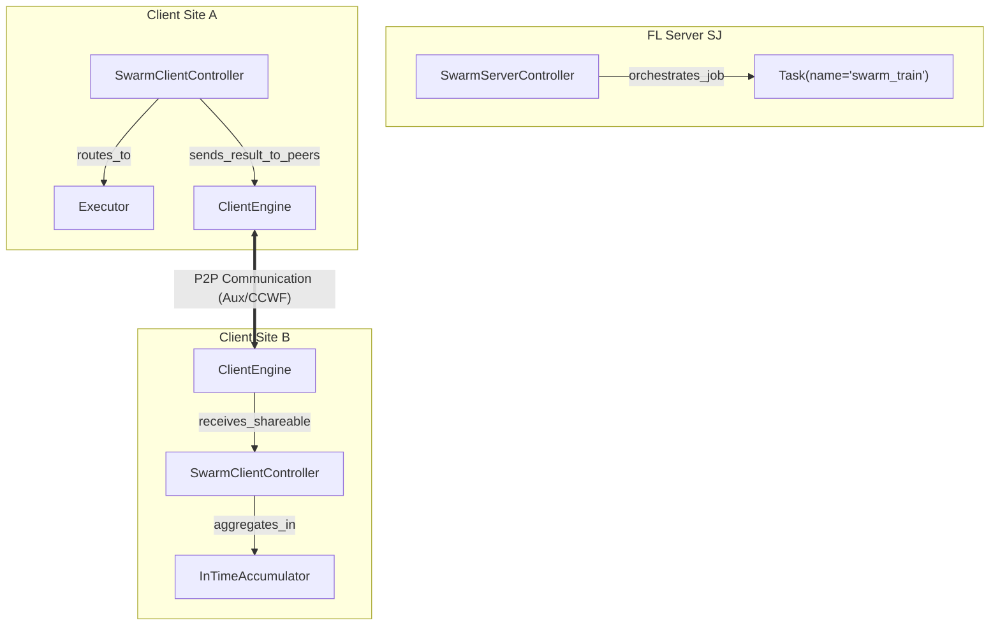
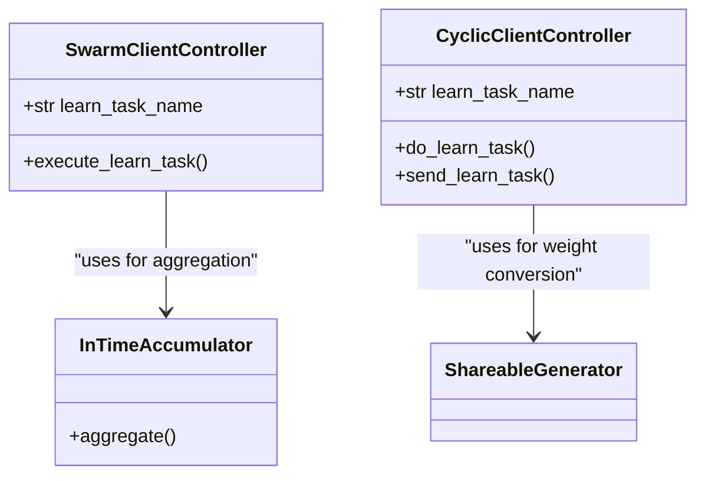

<!-- source: DeepWiki mcp.deepwiki.com · repo NVIDIA/NVFlare · page 21 P2P Distributed Optimization · fetched 2026-10-26 -->

# P2P Distributed Optimization

Relevant source files

The following files were used as context for generating this wiki page:

- [docs/example_applications_algorithms.rst](docs/example_applications_algorithms.rst)
- [docs/examples/federated_statistics_overview.rst](docs/examples/federated_statistics_overview.rst)
- [docs/examples/fl_algorithms.rst](docs/examples/fl_algorithms.rst)
- [docs/examples/hello_world_examples.rst](docs/examples/hello_world_examples.rst)
- [docs/examples/medical_image_analysis.rst](docs/examples/medical_image_analysis.rst)
- [docs/examples/tutorial_notebooks.rst](docs/examples/tutorial_notebooks.rst)
- [docs/programming_guide/controllers/cross_site_model_evaluation.rst](docs/programming_guide/controllers/cross_site_model_evaluation.rst)
- [docs/programming_guide/controllers/cyclic_workflow.rst](docs/programming_guide/controllers/cyclic_workflow.rst)
- [docs/programming_guide/controllers/scatter_and_gather_workflow.rst](docs/programming_guide/controllers/scatter_and_gather_workflow.rst)
- [docs/release_notes/flare_220.rst](docs/release_notes/flare_220.rst)
- [docs/release_notes/flare_240.rst](docs/release_notes/flare_240.rst)
- [docs/release_notes/flare_250.rst](docs/release_notes/flare_250.rst)
- [docs/whats_new.rst](docs/whats_new.rst)
- [examples/README.md](examples/README.md)
- [examples/advanced/README.md](examples/advanced/README.md)
- [examples/advanced/finance/README.md](examples/advanced/finance/README.md)
- [examples/advanced/job_api/tf/README.md](examples/advanced/job_api/tf/README.md)
- [examples/advanced/job_api/tf/run_jobs.sh](examples/advanced/job_api/tf/run_jobs.sh)
- [examples/advanced/monitoring/README.md](examples/advanced/monitoring/README.md)
- [examples/advanced/monitoring/jobs/README.md](examples/advanced/monitoring/jobs/README.md)
- [examples/hello-world/README.md](examples/hello-world/README.md)
- [examples/tutorials/README.md](examples/tutorials/README.md)

The Peer-to-Peer (P2P) Distributed Optimization framework in NVIDIA FLARE enables decentralized learning patterns where clients communicate directly with one another. This capability is essential for scenarios where a central server is used only for orchestration, or where the communication topology favors decentralized consensus and gradient tracking.

The P2P capabilities are primarily implemented within the `nvflare.app_opt.p2p` module. These modules provide the infrastructure for consensus algorithms, distributed stochastic gradient descent (DSGD), and gradient tracking (GT). Additionally, NVFlare supports **Swarm Learning**, a decentralized federated workflow where clients act as both trainers and aggregators [examples/advanced/swarm_learning/README.md:1-3]().

## Architecture Overview

In a P2P configuration, the FL Server transitions from a central aggregator to a **job orchestrator**. The server-side controller is responsible for managing the job lifecycle and broadcasting network topology. Once initialized, clients perform peer-to-peer data exchange using auxiliary communication channels without further server intervention for model aggregation.

In Swarm Learning, the `SwarmServerController` manages the server-side job lifecycle [examples/advanced/swarm_learning/README.md:14-16](), while the `SwarmClientController` handles training logic and aggregation management on the client side [docs/release_notes/flare_240.rst:95-95]().

### Core Components

| Component | Code Entity | Role |
| :--- | :--- | :--- |
| **P2P Controller** | `DistOptController` | Manages job lifecycle and initiates P2P execution. |
| **Swarm Client Controller** | `SwarmClientController` | Orchestrates client-side training, aggregation, and peer synchronization. |
| **Cyclic Controller** | `CyclicClientController` | Manages cyclic P2P workflows where models are passed in a specific or random order. |
| **P2P Executor** | `BaseDistOptExecutor` | Client-side base class that manages local state and handles algorithm iterations. |

### P2P Communication and Entity Mapping
P2P communication utilizes **Auxiliary Channels**. In decentralized workflows, clients register handlers for specific task prefixes. For example, swarm-based workflows route tasks to the `SwarmClientController`. Similarly, cyclic workflows use `CyclicClientController` to manage the relay of model weights between clients [docs/programming_guide/controllers/cyclic_workflow.rst:1-10]().

**P2P Entity Interaction Diagram**

Sources: [docs/release_notes/flare_240.rst:125-132](), [examples/advanced/swarm_learning/README.md:1-20](), [docs/programming_guide/controllers/cyclic_workflow.rst:1-15]()

For a deep dive into the underlying communication and module structure, see **[P2P Architecture and API](#21.1)**.

## Distributed Optimization Algorithms

NVFLARE supports several decentralized optimization algorithms. These algorithms replace standard `FedAvg` with iterative neighbor communication or gradient tracking to handle data heterogeneity.

### Supported Algorithms
The framework provides several decentralized patterns:
*   **Consensus:** Clients cooperatively compute a weighted average of initial local values.
*   **Distributed SGD (DSGD):** Distributed asynchronous deterministic and stochastic gradient optimization.
*   **Gradient Tracking (GT):** Methods that track global gradient directions to improve convergence in heterogeneous settings.
*   **Swarm Learning:** Decentralized aggregation where multiple clients contribute to a shared model without a central aggregator [examples/advanced/swarm_learning/README.md:1-3]().
*   **Cyclic Learning:** Models are trained sequentially across clients in a fixed or random order [docs/programming_guide/controllers/cyclic_workflow.rst:1-5]().

### Code Mapping: Implementation Space
The implementation of these algorithms often relies on specialized client controllers and aggregators.

| Algorithm Class | Code Path | Synchronization |
| :--- | :--- | :--- |
| **Swarm Learning** | `SwarmClientController` | Decentralized aggregation among peers. |
| **Cyclic Learning** | `CyclicClientController` | Sequential relay between client sites. |
| **Cross-Site Eval** | `CrossSiteModelEval` | Handles P2P model validation across sites [docs/programming_guide/controllers/cross_site_model_evaluation.rst:5-9](). |

**Optimization Topology Mapping**

Sources: [docs/release_notes/flare_240.rst:95-97](), [docs/programming_guide/controllers/cyclic_workflow.rst:1-10](), [docs/programming_guide/controllers/cross_site_model_evaluation.rst:5-15]()

For details on configuring and running these algorithms, see **[Distributed Optimization Algorithms](#21.2)**.

## Next Steps

This parent page provides the high-level concepts of P2P optimization. For implementation details, refer to the child pages:

*   **[P2P Architecture and API](#21.1)**: Detailed look at the `nvflare.app_opt.p2p` and `nvflare.app_common.ccwf` module structures, and how peer communication patterns differ from server-centric FL.
*   **[Distributed Optimization Algorithms](#21.2)**: Technical details on Swarm Learning, Cyclic Learning, Consensus, DSGD, and Gradient Tracking, including example configurations for PyTorch and Scikit-Learn.

---

