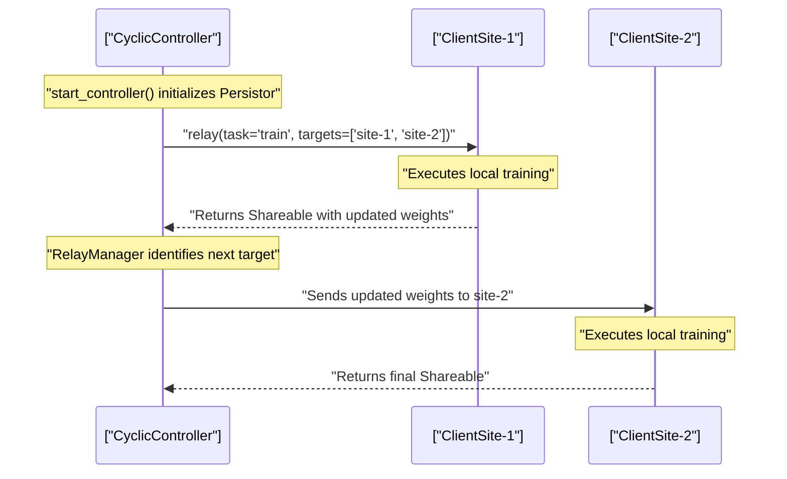

<!-- source: DeepWiki mcp.deepwiki.com · repo NVIDIA/NVFlare · page 21.1 P2P Architecture and API · fetched 2026-10-26 -->

# P2P Architecture and API

<details>
<summary>Relevant source files</summary>

The following files were used as context for generating this wiki page:

- [nvflare/apis/controller_spec.py](nvflare/apis/controller_spec.py)
- [nvflare/apis/event_type.py](nvflare/apis/event_type.py)
- [nvflare/apis/fl_component.py](nvflare/apis/fl_component.py)
- [nvflare/apis/fl_context.py](nvflare/apis/fl_context.py)
- [nvflare/apis/fl_exception.py](nvflare/apis/fl_exception.py)
- [nvflare/apis/impl/controller.py](nvflare/apis/impl/controller.py)
- [nvflare/apis/impl/wf_comm_server.py](nvflare/apis/impl/wf_comm_server.py)
- [nvflare/apis/utils/fl_context_utils.py](nvflare/apis/utils/fl_context_utils.py)
- [nvflare/apis/wf_comm_spec.py](nvflare/apis/wf_comm_spec.py)
- [nvflare/app_common/workflows/broadcast_operator.py](nvflare/app_common/workflows/broadcast_operator.py)
- [nvflare/app_common/workflows/cross_site_model_eval.py](nvflare/app_common/workflows/cross_site_model_eval.py)
- [nvflare/app_common/workflows/cyclic_ctl.py](nvflare/app_common/workflows/cyclic_ctl.py)
- [nvflare/app_common/workflows/global_model_eval.py](nvflare/app_common/workflows/global_model_eval.py)
- [nvflare/app_common/workflows/scatter_and_gather.py](nvflare/app_common/workflows/scatter_and_gather.py)
- [nvflare/app_common/workflows/scatter_and_gather_scaffold.py](nvflare/app_common/workflows/scatter_and_gather_scaffold.py)
- [nvflare/app_opt/statistics/visualization/statistics_visualization.py](nvflare/app_opt/statistics/visualization/statistics_visualization.py)
- [nvflare/fuel/f3/cellnet/cell.py](nvflare/fuel/f3/cellnet/cell.py)
- [nvflare/fuel/utils/fsm.py](nvflare/fuel/utils/fsm.py)
- [nvflare/private/defs.py](nvflare/private/defs.py)
- [nvflare/private/event.py](nvflare/private/event.py)
- [nvflare/private/fed/client/client_req_processors.py](nvflare/private/fed/client/client_req_processors.py)
- [nvflare/private/fed/client/sys_cmd.py](nvflare/private/fed/client/sys_cmd.py)
- [nvflare/private/fed/server/cmd_utils.py](nvflare/private/fed/server/cmd_utils.py)
- [nvflare/private/fed/server/info_coll_cmd.py](nvflare/private/fed/server/info_coll_cmd.py)
- [nvflare/private/fed/server/run_manager.py](nvflare/private/fed/server/run_manager.py)
- [nvflare/private/fed/server/server_engine_internal_spec.py](nvflare/private/fed/server/server_engine_internal_spec.py)
- [nvflare/private/fed/server/sys_cmd.py](nvflare/private/fed/server/sys_cmd.py)
- [nvflare/private/fed/server/training_cmds.py](nvflare/private/fed/server/training_cmds.py)
- [nvflare/security/security.py](nvflare/security/security.py)
- [nvflare/widgets/info_collector.py](nvflare/widgets/info_collector.py)
- [research/auto-fed-rl/src/autofedrl/autofedrl_scatter_and_gather.py](research/auto-fed-rl/src/autofedrl/autofedrl_scatter_and_gather.py)
- [research/fed-sm/jobs/fedsm_prostate/app/custom/workflows/scatter_and_gather_fedsm.py](research/fed-sm/jobs/fedsm_prostate/app/custom/workflows/scatter_and_gather_fedsm.py)
- [tests/unit_test/apis/impl/controller_test.py](tests/unit_test/apis/impl/controller_test.py)
- [tests/unit_test/app_common/workflow/cyclic_ctl_test.py](tests/unit_test/app_common/workflow/cyclic_ctl_test.py)

</details>


The P2P (Peer-to-Peer) architecture in NVIDIA FLARE enables federated learning and distributed optimization patterns where clients communicate directly with one another. While traditional FL is server-centric (Star Topology), the P2P module allows for decentralized optimization, consensus algorithms, and swarm learning where the server's role is limited to orchestration, initial configuration distribution, and lifecycle management.

## Architectural Overview

In peer-to-peer algorithms, clients communicate directly without relying on a central server to aggregate updates. NVFlare provides the primitives to build such systems by exploiting lower-level APIs and specialized controllers that manage decentralized workflows.

### Core Components and Module Structure

The P2P framework is implemented primarily through the `nvflare.app_opt.p2p` and `nvflare.app_common.ccwf` (Cross-Client Workflow) modules. It utilizes `Controller`, `Executor`, and auxiliary messages to facilitate communication.

| Component | Code Entity | Role |
| :--- | :--- | :--- |
| **P2P Controller** | `Controller` | Base server-side component that manages job execution, broadcasts tasks, and monitors client progress [nvflare/apis/impl/controller.py:25-36](). |
| **Cyclic Controller** | `CyclicController` | Implements cyclic P2P training where a model is passed sequentially between clients [nvflare/app_common/workflows/cyclic_ctl.py:43-57](). |
| **Workflow Server** | `WFCommServer` | Manages life cycles of tasks and their destinations, handling dead client grace periods [nvflare/apis/impl/wf_comm_server.py:91-113](). |
| **Task Manager** | `TaskManager` | Tracks task status and handles client responses for specific communication patterns [nvflare/apis/impl/wf_comm_server.py:35-39](). |

Sources: [nvflare/apis/impl/controller.py:25-36](), [nvflare/app_common/workflows/cyclic_ctl.py:43-90](), [nvflare/apis/impl/wf_comm_server.py:91-113]().

### Communication Flow
P2P communication leverages **Auxiliary Channels** to send data outside the main controller task flow. Clients register handlers to process incoming peer data, such as model weights or validation results. In cyclic workflows, the `Controller` uses the `relay` method to pass tasks sequentially through a list of clients.

**Cyclic Training Communication Logic**
In Cyclic Learning, clients perform local training and then the task is relayed to the next site in the order, bypassing the server for intermediate model aggregation.


Sources: [nvflare/app_common/workflows/cyclic_ctl.py:135-150](), [nvflare/apis/impl/controller.py:102-114](), [nvflare/apis/impl/wf_comm_server.py:38-39]().

---

## P2P Distributed Optimization API

The P2P architecture utilizes the `Controller` base class to define peer-to-peer workflows, including `relay` and `broadcast` patterns.

### Topology and Configuration
The network structure and participant roles are defined in the job configuration.
* **Participating Clients**: The set of all clients in the P2P network, often managed via the `ServerEngine` [nvflare/apis/impl/controller.py:38-46]().
* **Relay Order**: In cyclic P2P, the order can be `FIXED`, `RANDOM`, or `RANDOM_WITHOUT_SAME_IN_A_ROW` [nvflare/app_common/workflows/cyclic_ctl.py:34-40]().

### Synchronization and Status Reporting
To ensure the decentralized workflow makes progress, the `WFCommServer` monitors client status:
* **Task Monitor**: A dedicated thread `_monitor_tasks` tracks standing tasks and timeouts [nvflare/apis/impl/wf_comm_server.py:106-107]().
* **Dead Client Grace**: The server allows a grace period (default 60s) for clients deemed disconnected before failing tasks [nvflare/apis/impl/wf_comm_server.py:108-109]().
* **Task Check Period**: The interval at which the controller checks the status of active P2P tasks [nvflare/apis/impl/controller.py:31-33]().

**Entity Relationship: P2P Communication Classes**
```mermaid
classDiagram
    class ["Controller"] {
        +broadcast(task, fl_ctx)
        +relay(task, fl_ctx)
        +send(task, fl_ctx)
    }
    class ["CyclicController"] {
        -num_rounds: int
        -order: str
        +start_controller(fl_ctx)
        +control_flow(abort_signal, fl_ctx)
    }
    class ["WFCommServer"] {
        -task_monitor: Thread
        -tasks: list
        +initialize_run(fl_ctx)
        +handle_event(event_type, fl_ctx)
    }
    class ["TaskManager"] {
        +check_task_status()
        +process_task_reply()
    }

    ["Controller"] <|-- ["CyclicController"]
    ["Controller"] --> ["WFCommSpec"] : "uses"
    ["WFCommSpec"] <|-- ["WFCommServer"]
    ["WFCommServer"] o-- ["TaskManager"] : "manages"
```
Sources: [nvflare/apis/impl/controller.py:25-101](), [nvflare/app_common/workflows/cyclic_ctl.py:43-90](), [nvflare/apis/impl/wf_comm_server.py:91-113]().

---

## Comparison with Server-Centric FL

| Feature | Server-Centric (FedAvg) | P2P (Swarm/Cyclic/Distributed) |
| :--- | :--- | :--- |
| **Aggregation** | Centralized on Server | Sequential or Peer-based [nvflare/app_common/workflows/cyclic_ctl.py:58-61]() |
| **Communication** | Client <-> Server | Sequential Relay (Client-to-Client logic) [nvflare/apis/impl/controller.py:102-114]() |
| **Workflow Logic** | Broadcast-based | Relay-based task transitions [nvflare/app_common/workflows/cyclic_ctl.py:102-105]() |
| **State Management** | Global Model on Server | `Learnable` passed between peers [nvflare/app_common/workflows/cyclic_ctl.py:112-114]() |

Sources: [nvflare/app_common/workflows/cyclic_ctl.py:58-114](), [nvflare/apis/impl/controller.py:102-114]().

## Implementation Details

### Relay and Wait Mechanism
In P2P cyclic workflows, the `relay_and_wait` function is critical. It ensures the `Controller` sends the task to the first client, waits for the result, and then automatically forwards the updated `Shareable` to the next client in the sequence until the chain is complete [nvflare/apis/impl/controller.py:116-136]().

### Memory Management in P2P
Decentralized workflows can be memory-intensive. The `CyclicController` includes a `memory_gc_rounds` configuration to trigger `gc.collect()` and `malloc_trim` periodically to prevent memory leaks during long-running peer transitions [nvflare/app_common/workflows/cyclic_ctl.py:128-133]().

### Event Handling
The P2P architecture responds to system events such as `CLIENT_DISCONNECTED`. When a peer drops, the `WFCommServer` catches the event and updates the internal `_dead_clients` map, allowing the controller to potentially re-route tasks or abort the round [nvflare/apis/impl/wf_comm_server.py:171-190]().

Sources: [nvflare/apis/impl/controller.py:116-136](), [nvflare/app_common/workflows/cyclic_ctl.py:128-133](), [nvflare/apis/impl/wf_comm_server.py:171-190]().

---

