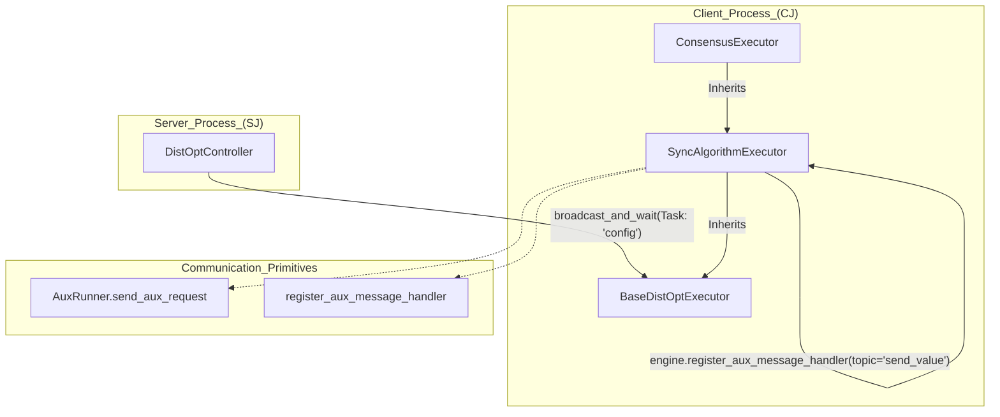
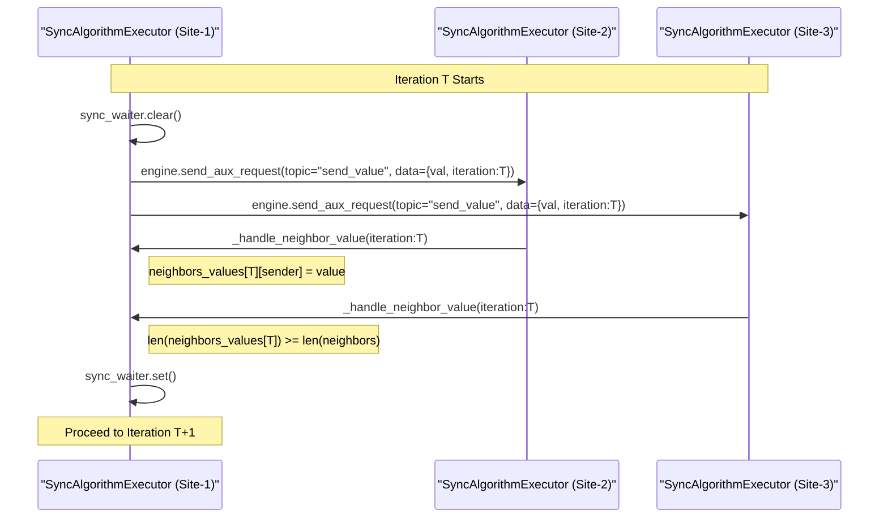

<!-- source: DeepWiki mcp.deepwiki.com · repo NVIDIA/NVFlare · page 21.2 Distributed Optimization Algorithms · fetched 2026-10-26 -->

# Distributed Optimization Algorithms

Relevant source files

The following files were used as context for generating this wiki page:

- [docs/example_applications_algorithms.rst](docs/example_applications_algorithms.rst)
- [docs/examples/federated_statistics_overview.rst](docs/examples/federated_statistics_overview.rst)
- [docs/examples/fl_algorithms.rst](docs/examples/fl_algorithms.rst)
- [docs/examples/hello_world_examples.rst](docs/examples/hello_world_examples.rst)
- [docs/examples/medical_image_analysis.rst](docs/examples/medical_image_analysis.rst)
- [docs/examples/tutorial_notebooks.rst](docs/examples/tutorial_notebooks.rst)
- [docs/programming_guide/controllers/cross_site_model_evaluation.rst](docs/programming_guide/controllers/cross_site_model_evaluation.rst)
- [docs/programming_guide/controllers/cyclic_workflow.rst](docs/programming_guide/controllers/cyclic_workflow.rst)
- [docs/programming_guide/controllers/scatter_and_gather_workflow.rst](docs/programming_guide/controllers/scatter_and_gather_workflow.rst)
- [docs/release_notes/flare_220.rst](docs/release_notes/flare_220.rst)
- [docs/release_notes/flare_240.rst](docs/release_notes/flare_240.rst)
- [docs/release_notes/flare_250.rst](docs/release_notes/flare_250.rst)
- [docs/whats_new.rst](docs/whats_new.rst)
- [examples/README.md](examples/README.md)
- [examples/advanced/README.md](examples/advanced/README.md)
- [examples/advanced/finance/README.md](examples/advanced/finance/README.md)
- [examples/advanced/job_api/tf/README.md](examples/advanced/job_api/tf/README.md)
- [examples/advanced/job_api/tf/run_jobs.sh](examples/advanced/job_api/tf/run_jobs.sh)
- [examples/advanced/monitoring/README.md](examples/advanced/monitoring/README.md)
- [examples/advanced/monitoring/jobs/README.md](examples/advanced/monitoring/jobs/README.md)
- [examples/hello-world/README.md](examples/hello-world/README.md)
- [examples/tutorials/README.md](examples/tutorials/README.md)

Distributed optimization in NVIDIA FLARE enables peer-to-peer (P2P) algorithmic patterns where clients communicate directly with one another to optimize a global objective. This is implemented via the `nvflare.app_opt.p2p` module, providing low-level primitives for decentralized communication where clients communicate without relying on a central server to aggregate updates [examples/advanced/distributed_optimization/README.md:29-30]().

## Architectural Foundation: P2P Primitives

In P2P algorithms, the server primarily orchestrates the network topology and job lifecycle, while clients perform direct data exchange [examples/advanced/distributed_optimization/README.md:116-117]().

### Key Components
*   **DistOptController**: A server-side component that manages job execution, broadcasts network configurations (neighbor lists), and initiates the P2P execution [examples/advanced/distributed_optimization/README.md:116-117](). It implements `control_flow` to send configurations and start the algorithm [examples/advanced/distributed_optimization/README.md:164-180]().
*   **BaseDistOptExecutor**: A client-side base class that handles the reception of network configurations and provides the foundation for P2P communication [nvflare/app_opt/p2p/executors/sync_executor.py:22-25]().
*   **Aux Channels**: The underlying mechanism enabling direct client-to-client `Shareable` transfers [examples/advanced/distributed_optimization/README.md:40-41](). The `send_aux_request` and `register_aux_message_handler` methods allow peers to exchange data outside the main server-client task flow [nvflare/app_opt/p2p/executors/sync_executor.py:71-83](), [nvflare/app_opt/p2p/executors/sync_executor.py:121-125]().
*   **SyncAlgorithmExecutor**: A specialized executor that manages synchronous exchanges, ensuring all neighbors have contributed their values for a specific iteration before proceeding [nvflare/app_opt/p2p/executors/sync_executor.py:25-30]().

### Code Entity Map: P2P Optimization Framework
This diagram bridges the conceptual "Distributed Optimization" to the specific classes in `nvflare.app_opt.p2p`.

**Sources:** [nvflare/app_opt/p2p/executors/sync_executor.py:22-30](), [examples/advanced/distributed_optimization/README.md:116-180]()

---

## Implemented Algorithms

The distributed optimization suite includes several classical and modern decentralized algorithms implemented in `nvflare.app_opt.p2p` [examples/advanced/distributed_optimization/README.md:7-11]().

### 1. Consensus
Based on the DeGroot model (1974), nodes reach agreement on a weighted average of their initial local values [examples/advanced/distributed_optimization/README.md:8-8]().
*   **Mechanism**: $x_i^{t+1} = \sum_{j \in \mathcal{N}_i} a_{ji}x_j^t$, where $a_{ji}$ is the weight client $i$ assigns to neighbor $j$ and $\sum a_{ji} = 1$.
*   **Implementation**: `ConsensusExecutor` converges to a global weighted average using synchronization logic [nvflare/app_opt/p2p/executors/sync_executor.py:25-30]().

### 2. Distributed SGD (D-SGD)
Clients perform local stochastic gradient descent and average their model parameters with peers [examples/advanced/distributed_optimization/README.md:9-9]().
*   **Logic**: Each node updates local weights using its local data subset and then synchronizes with neighbors using the `_exchange_values` logic in the executor [nvflare/app_opt/p2p/executors/sync_executor.py:51-83]().

### 3. Gradient Tracking (GT)
Addresses data heterogeneity (non-IID data) by tracking the difference between local and global gradient directions [examples/advanced/distributed_optimization/README.md:10-10]().
*   **Mechanism**: Nodes maintain an auxiliary variable to track the average gradient across the network, reducing the steady-state error inherent in D-SGD.

### 4. GTAdam
Gradient tracking combined with adaptive momentum for distributed online optimization [examples/advanced/distributed_optimization/README.md:11-11]().

### 5. Swarm Learning
Swarm Learning in NVFlare utilizes a decentralized federated workflow where clients act as both trainers and aggregators [examples/advanced/swarm_learning/README.md:3-3](). This is managed by the `SwarmClientController` [job_templates/swarm_cse_pt/config_fed_client.conf:45-45]() and `SwarmServerController` [job_templates/swarm_cse_pt/config_fed_server.conf:16-16](). It allows for client-side controlled cross-site evaluation [docs/example_applications_algorithms.rst:25-25]().

**Sources:** [examples/advanced/distributed_optimization/README.md:7-18](), [nvflare/app_opt/p2p/executors/sync_executor.py:51-83](), [examples/advanced/swarm_learning/README.md:1-7](), [job_templates/swarm_cse_pt/config_fed_client.conf:41-59](), [docs/example_applications_algorithms.rst:25-25]()

---

## Data Flow: Synchronous P2P Exchange

The `SyncAlgorithmExecutor` ensures that clients remain synchronized across iterations by utilizing `threading.Event` (the `sync_waiter`) to block execution until all neighbors have sent their data [nvflare/app_opt/p2p/executors/sync_executor.py:42-49]().

**Sources:** [nvflare/app_opt/p2p/executors/sync_executor.py:42-117]()

---

## Configuration and Implementation

Decentralized jobs are configured by defining a `Network` topology consisting of `Node`s and their `Neighbor`s [examples/advanced/distributed_optimization/README.md:47-65]().

### Network Configuration Schema
Configurations are defined using dataclasses in `nvflare.app_opt.p2p.types` to facilitate serialization/deserialization [examples/advanced/distributed_optimization/README.md:83-83]().

| Object | Purpose | Key Fields |
| :--- | :--- | :--- |
| `Neighbor` | Defines a peer and its link weight | `id`, `weight` [examples/advanced/distributed_optimization/README.md:52-56]() |
| `Node` | Defines a client and its neighbor list | `id`, `neighbors` [examples/advanced/distributed_optimization/README.md:58-61]() |
| `Network` | The collection of all nodes in the system | `nodes` [examples/advanced/distributed_optimization/README.md:63-65]() |
| `Config` | Global config broadcast by the controller | `network`, `extra` (e.g., iterations) [examples/advanced/distributed_optimization/README.md:70-73]() |

### Cyclic Learning Configuration
For algorithms requiring sequential execution across sites (e.g., Cyclic Weight Transfer), the `CyclicController` [docs/example_applications_algorithms.rst:24-24]() or specialized `CyclicServerController` [nvflare/app_common/ccwf/cyclic_server_ctl.py:20-20]() and `CyclicClientController` [nvflare/app_common/ccwf/cyclic_client_ctl.py:26-26]() manage the order of operations. The `cyclic_order` can be `FIXED` or `RANDOM` [nvflare/app_common/ccwf/cyclic_server_ctl.py:59-63]().

### Implementation Walkthrough
1.  **Topology Definition**: A network topology is generated, defining which sites communicate.
2.  **Controller Setup**: The `DistOptController` is initialized with the `Config` and broadcasts it to all sites [examples/advanced/distributed_optimization/README.md:164-180]().
3.  **Executor Registration**: Clients are assigned executors like `ConsensusExecutor`.
4.  **Aux Registration**: During `EventType.START_RUN`, executors register handlers for the `send_value` topic via `engine.register_aux_message_handler` [nvflare/app_opt/p2p/executors/sync_executor.py:121-125]().
5.  **Execution Loop**: The executor sends local values to neighbors via `engine.send_aux_request` and waits for incoming values using `self.sync_waiter.wait(timeout=self.sync_timeout)` [nvflare/app_opt/p2p/executors/sync_executor.py:71-91]().

**Sources:** [examples/advanced/distributed_optimization/README.md:47-111](), [nvflare/app_opt/p2p/executors/sync_executor.py:42-126](), [nvflare/app_common/ccwf/cyclic_server_ctl.py:20-63](), [nvflare/app_common/ccwf/cyclic_client_ctl.py:26-52](), [docs/example_applications_algorithms.rst:24-24]()

---

