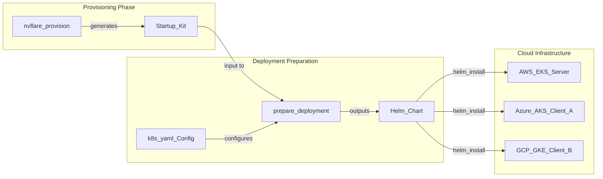

<!-- source: DeepWiki mcp.deepwiki.com · repo NVIDIA/NVFlare · page 22 Kubernetes and Cloud Deployment · fetched 2026-10-26 -->

# Kubernetes and Cloud Deployment

<details>
<summary>Relevant source files</summary>

The following files were used as context for generating this wiki page:

- [docs/design/docker_job_launcher_design.md](docs/design/docker_job_launcher_design.md)
- [docs/design/job_launcher_and_job_handle.md](docs/design/job_launcher_and_job_handle.md)
- [docs/design/site_runtime_packaging_design.md](docs/design/site_runtime_packaging_design.md)
- [docs/design/study_runtime_config.md](docs/design/study_runtime_config.md)
- [docs/user_guide/admin_guide/deployment/containerized_deployment.rst](docs/user_guide/admin_guide/deployment/containerized_deployment.rst)
- [docs/user_guide/admin_guide/deployment/helm_chart.rst](docs/user_guide/admin_guide/deployment/helm_chart.rst)
- [docs/user_guide/admin_guide/deployment/notes_on_large_models.rst](docs/user_guide/admin_guide/deployment/notes_on_large_models.rst)
- [docs/user_guide/admin_guide/deployment/operation.rst](docs/user_guide/admin_guide/deployment/operation.rst)
- [docs/user_guide/admin_guide/deployment/overview.rst](docs/user_guide/admin_guide/deployment/overview.rst)
- [docs/user_guide/admin_guide/diagnostic_commands.rst](docs/user_guide/admin_guide/diagnostic_commands.rst)
- [docs/user_guide/admin_guide/index.rst](docs/user_guide/admin_guide/index.rst)
- [docs/user_guide/core_concepts/job.rst](docs/user_guide/core_concepts/job.rst)
- [docs/user_guide/nvflare_cli/deploy_command.rst](docs/user_guide/nvflare_cli/deploy_command.rst)
- [examples/advanced/docker/Dockerfile](examples/advanced/docker/Dockerfile)
- [examples/advanced/docker/README.md](examples/advanced/docker/README.md)
- [examples/advanced/docker/nvflare_with_docker.ipynb](examples/advanced/docker/nvflare_with_docker.ipynb)
- [examples/advanced/docker/project.yml](examples/advanced/docker/project.yml)
- [examples/devops/openshift/index.md](examples/devops/openshift/index.md)
- [examples/docker/README.md](examples/docker/README.md)
- [examples/docker/jobs/hello-numpy-docker/meta.json](examples/docker/jobs/hello-numpy-docker/meta.json)
- [examples/docker/jobs/hello-pt-docker/meta.json](examples/docker/jobs/hello-pt-docker/meta.json)
- [examples/docker/jobs/pt-ddp-docker/meta.json](examples/docker/jobs/pt-ddp-docker/meta.json)
- [nvflare/app_opt/job_launcher/docker_launcher.py](nvflare/app_opt/job_launcher/docker_launcher.py)
- [nvflare/app_opt/job_launcher/k8s_launcher.py](nvflare/app_opt/job_launcher/k8s_launcher.py)
- [nvflare/app_opt/job_launcher/study_data.py](nvflare/app_opt/job_launcher/study_data.py)
- [nvflare/app_opt/job_launcher/study_runtime.py](nvflare/app_opt/job_launcher/study_runtime.py)
- [nvflare/app_opt/job_launcher/workspace_cell_transfer.py](nvflare/app_opt/job_launcher/workspace_cell_transfer.py)
- [nvflare/fuel/f3/drivers/file_driver.py](nvflare/fuel/f3/drivers/file_driver.py)
- [nvflare/tool/deploy/deploy_cli.py](nvflare/tool/deploy/deploy_cli.py)
- [nvflare/tool/deploy/deploy_commands.py](nvflare/tool/deploy/deploy_commands.py)
- [nvflare/tool/deploy/templates/helm/client/deployment.yaml](nvflare/tool/deploy/templates/helm/client/deployment.yaml)
- [nvflare/tool/deploy/templates/helm/server/deployment.yaml](nvflare/tool/deploy/templates/helm/server/deployment.yaml)
- [nvflare/utils/job_launcher_utils.py](nvflare/utils/job_launcher_utils.py)
- [tests/unit_test/app_opt/job_launcher/docker_launcher_test.py](tests/unit_test/app_opt/job_launcher/docker_launcher_test.py)
- [tests/unit_test/app_opt/job_launcher/k8s_launcher_test.py](tests/unit_test/app_opt/job_launcher/k8s_launcher_test.py)
- [tests/unit_test/app_opt/job_launcher/study_data_test.py](tests/unit_test/app_opt/job_launcher/study_data_test.py)
- [tests/unit_test/app_opt/job_launcher/study_runtime_test.py](tests/unit_test/app_opt/job_launcher/study_runtime_test.py)
- [tests/unit_test/app_opt/job_launcher/workspace_cell_transfer_test.py](tests/unit_test/app_opt/job_launcher/workspace_cell_transfer_test.py)
- [tests/unit_test/fuel/f3/drivers/file_driver_test.py](tests/unit_test/fuel/f3/drivers/file_driver_test.py)
- [tests/unit_test/tool/deploy/deploy_commands_test.py](tests/unit_test/tool/deploy/deploy_commands_test.py)
- [tests/unit_test/utils/job_launcher_utils_test.py](tests/unit_test/utils/job_launcher_utils_test.py)

</details>


NVIDIA FLARE provides native support for Kubernetes (K8s) and cloud-native environments, enabling federated learning (FL) workloads to scale across distributed clusters. The system supports running the main FL services (Server, Client, Overseer) as persistent Kubernetes deployments, while individual FL jobs are launched as isolated, short-lived Pods.

### System Overview

The integration with Kubernetes is primarily handled through two mechanisms:
1.  **Runtime Preparation**: The `nvflare deploy prepare` command processes standard startup kits to generate Kubernetes-specific artifacts, including Helm charts and updated resource configurations [nvflare/tool/deploy/deploy_commands.py:56-113]().
2.  **Job Orchestration**: The `K8sJobLauncher` allows the FL engine to submit training jobs as Kubernetes Pods, providing process isolation and resource management (e.g., GPUs) [nvflare/app_opt/job_launcher/k8s_launcher.py:31-41]().

### Kubernetes Deployment Architecture

The following diagram illustrates how NVFLARE components map to Kubernetes entities and the code classes responsible for them.

**Diagram: NVFLARE to Kubernetes Mapping**
```mermaid
graph TD
    subgraph "NaturalLanguageSpace" ["Natural Language Space"]
        "FL_Server"["FL Server"]
        "FL_Client_Site"["FL Client Site"]
        "FL_Job"["FL Job"]
        "GPU_Resources"["GPU Resources"]
    end

    subgraph "CodeEntitySpace" ["Code Entity Space"]
        SVR["nvflare-server_Deployment"]
        CLN["nvflare-client_Deployment"]
        JOB["K8sJobHandle_Pod"]
        D_PREP["prepare_deployment"]
        LAUNCH["K8sJobLauncher"]
        WS_TRANS["WorkspaceTransferManager"]
    end

    "FL_Server" --> SVR
    "FL_Client_Site" --> CLN
    "FL_Job" --> JOB
    
    D_PREP -- "creates" --> SVR
    D_PREP -- "creates" --> CLN
    LAUNCH -- "launch_job()" --> JOB
    JOB -- "requests_data_from" --> WS_TRANS
```
Sources: [nvflare/tool/deploy/deploy_commands.py:56-113](), [nvflare/app_opt/job_launcher/k8s_launcher.py:31-41](), [nvflare/app_opt/job_launcher/workspace_cell_transfer.py:45-55](), [docs/user_guide/admin_guide/deployment/helm_chart.rst:82-94]()

---

## Kubernetes Job Launcher

The `K8sJobLauncher` (and its specializations `ServerK8sJobLauncher` and `ClientK8sJobLauncher`) is a concrete implementation of `JobLauncherSpec` [nvflare/app_opt/job_launcher/k8s_launcher.py:31](). When a job is submitted to an NVFLARE cluster running in Kubernetes, the launcher translates the job's requirements (defined in `meta.conf` or `meta.json`) into a Kubernetes Pod manifest.

*   **Isolation**: Each FL job runs in its own Pod, separate from the main Client/Server process (parent pod) [docs/user_guide/admin_guide/deployment/helm_chart.rst:82-94]().
*   **Resource Management**: It supports requesting specific resources like `nvidia.com/gpu` by inspecting the `resource_spec` or `launcher_spec` in the job configuration [nvflare/app_opt/job_launcher/k8s_launcher.py:160-167]().
*   **Lifecycle**: The `K8sJobHandle` tracks the Pod's status, mapping Kubernetes `PodPhase` (Pending, Running, Succeeded, Failed) to NVFLARE `JobState` and `JobReturnCode` [nvflare/app_opt/job_launcher/k8s_launcher.py:55-91]().
*   **Workspace Transfer**: Uses `WorkspaceTransferManager` to handle data movement between the persistent client/server and the ephemeral job pod via CellNet [nvflare/app_opt/job_launcher/workspace_cell_transfer.py:16-24](). This manager zips the required workspace files (excluding internal study data mappings) for the job pod [nvflare/app_opt/job_launcher/workspace_cell_transfer.py:177-181]().
*   **Study Runtime Configuration**: Job pod behavior is further refined by `study_runtime.yaml`, which defines dataset mounts, environment variables, and Kubernetes-specific `pod_template` overrides [nvflare/app_opt/job_launcher/study_runtime.py:18-30]().

For details on configuration and GPU scheduling, see [Kubernetes Job Launcher](#22.1).

Sources: [nvflare/app_opt/job_launcher/k8s_launcher.py:55-91](), [nvflare/app_opt/job_launcher/k8s_launcher.py:160-167](), [docs/user_guide/admin_guide/deployment/helm_chart.rst:82-94](), [nvflare/app_opt/job_launcher/workspace_cell_transfer.py:16-24](), [nvflare/app_opt/job_launcher/workspace_cell_transfer.py:177-181](), [nvflare/app_opt/job_launcher/study_runtime.py:18-30]()

---

## Cloud Cluster Setup and Multicloud Deployment

NVFLARE includes tools to automate the creation of FL-ready clusters across major cloud providers (AWS, GCP, Azure) and manage multicloud federated learning environments.

### Provisioning and Runtime Preparation
The deployment workflow typically follows a two-step process:
1.  **Provision**: Use `nvflare provision` to generate standard startup kits containing identity certificates and communication configs [docs/user_guide/admin_guide/deployment/helm_chart.rst:11-15]().
2.  **Prepare**: Use `nvflare deploy prepare` with a `runtime: k8s` configuration [nvflare/tool/deploy/deploy_commands.py:56]() to generate Helm charts and update `resources.json` to use `K8sJobLauncher` [nvflare/tool/deploy/deploy_commands.py:104-108]().

### Multicloud Orchestration
The deployment framework supports complex topologies where the Server might reside in one cloud (e.g., AWS EKS) while Clients reside in others (e.g., Azure AKS or GCP GKE).
*   **Helm Charts**: The prepared participant folder contains a `helm_chart/` directory [docs/user_guide/admin_guide/deployment/helm_chart.rst:152-160](). This chart installs the parent pod, a Kubernetes Service for stable addressing, and RBAC roles allowing the launcher to create job pods [docs/user_guide/admin_guide/deployment/helm_chart.rst:96-110]().
*   **Cloud Templates**: Standardized YAML configurations and scripts in `examples/devops/` facilitate consistent cross-cloud deployments [examples/devops/openshift/index.md:12-26](). Specific guides exist for OpenShift [examples/devops/openshift/index.md:1-5]().
*   **Storage Mapping**: Supports mounting cloud-specific storage (e.g., AWS EBS, Azure Disk) via Persistent Volume Claims (PVCs) for both the parent workspace and study data [docs/user_guide/admin_guide/deployment/helm_chart.rst:121-137]().
*   **Staging Helper**: The `nvflare deploy k8s stage` command (implemented via `stage_k8_deployment`) automates uploading `local/` as a ConfigMap and `startup/` as a Secret to the cluster [nvflare/tool/deploy/deploy_commands.py:30]().

For details on cloud provider setup and the multicloud deployment tool, see [Cloud Cluster Setup and Multicloud Deployment](#22.2).

**Diagram: Cloud Deployment Flow and Code Controllers**

Sources: [docs/user_guide/admin_guide/deployment/helm_chart.rst:11-20](), [nvflare/tool/deploy/deploy_commands.py:56-113](), [examples/devops/openshift/index.md:32-37]()

---

## Slurm Job Launcher

For High-Performance Computing (HPC) environments, NVFLARE provides the `SlurmJobLauncher` [docs/design/job_launcher_and_job_handle.md:36-40](). This allows sites to submit FL jobs as Slurm batch allocations, leveraging existing cluster schedulers for resource management.

*   **Runtime Support**: The `nvflare deploy prepare` command supports a `runtime: slurm` configuration [nvflare/tool/deploy/deploy_commands.py:46-47]().
*   **Interface Compliance**: Like the K8s launcher, the Slurm implementation returns a `SlurmJobHandle` for lifecycle management [docs/design/job_launcher_and_job_handle.md:36-40]().
*   **Communication**: Supports shared-file transport schemes common in HPC environments [docs/user_guide/nvflare_cli/deploy_command.rst:57-61]().

For details on Slurm configuration and batch submission, see [Slurm Job Launcher](#22.3).

Sources: [docs/design/job_launcher_and_job_handle.md:36-40](), [nvflare/tool/deploy/deploy_commands.py:46-47](), [docs/user_guide/nvflare_cli/deploy_command.rst:57-61]()

### Key Components for Cloud/K8s

| Component | Code Entity | Role |
| :--- | :--- | :--- |
| **Job Launcher** | `K8sJobLauncher` | Submits FL jobs as K8s Pods [nvflare/app_opt/job_launcher/k8s_launcher.py:31]() |
| **Job Handle** | `K8sJobHandle` | Manages Pod lifecycle (poll/wait/terminate) [nvflare/app_opt/job_launcher/k8s_launcher.py:186]() |
| **Deployment Prep** | `prepare_deployment` | Main entry for `nvflare deploy prepare` [nvflare/tool/deploy/deploy_commands.py:56]() |
| **Docker Launcher** | `DockerJobLauncher` | Alternative container launcher for Docker-based deployments [nvflare/app_opt/job_launcher/docker_launcher.py:86]() |
| **Study Data** | `study_data.py` | Resolves dataset mounts for K8s PVCs [nvflare/app_opt/job_launcher/study_data.py:32-36]() |
| **Workspace Transfer**| `WorkspaceTransferManager`| Transfers workspace between parent and job pods [nvflare/app_opt/job_launcher/workspace_cell_transfer.py:45]() |
| **Staging Tool** | `stage_k8_deployment` | Stages startup kits as K8s Secrets/ConfigMaps [nvflare/tool/deploy/deploy_commands.py:30]() |

Sources: [nvflare/app_opt/job_launcher/k8s_launcher.py:31-186](), [nvflare/tool/deploy/deploy_commands.py:30-56](), [nvflare/app_opt/job_launcher/study_data.py:32-36](), [nvflare/app_opt/job_launcher/workspace_cell_transfer.py:45](), [nvflare/app_opt/job_launcher/docker_launcher.py:86]()

---

