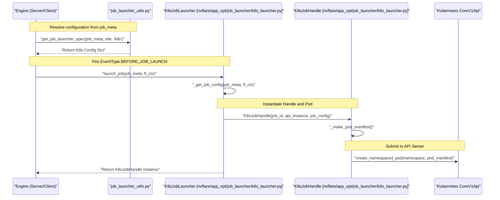
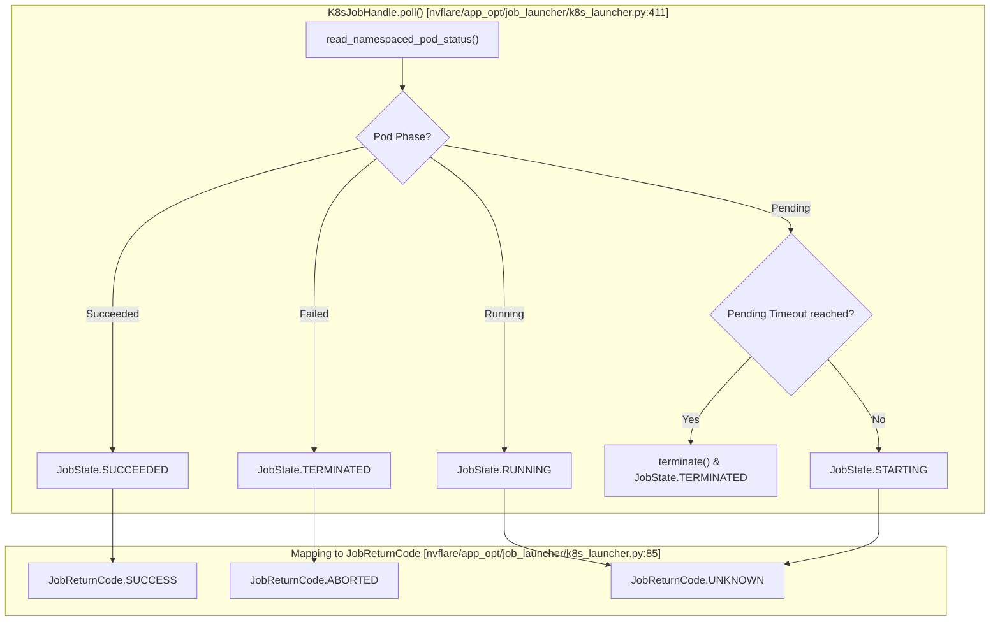
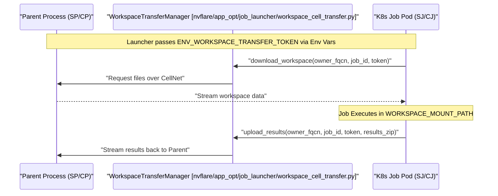

<!-- source: DeepWiki mcp.deepwiki.com · repo NVIDIA/NVFlare · page 22.1 Kubernetes Job Launcher · fetched 2026-10-26 -->

# Kubernetes Job Launcher

Relevant source files

The following files were used as context for generating this wiki page:

- [docs/design/docker_job_launcher_design.md](docs/design/docker_job_launcher_design.md)
- [docs/design/job_launcher_and_job_handle.md](docs/design/job_launcher_and_job_handle.md)
- [docs/design/site_runtime_packaging_design.md](docs/design/site_runtime_packaging_design.md)
- [docs/design/study_runtime_config.md](docs/design/study_runtime_config.md)
- [docs/user_guide/admin_guide/deployment/helm_chart.rst](docs/user_guide/admin_guide/deployment/helm_chart.rst)
- [docs/user_guide/nvflare_cli/deploy_command.rst](docs/user_guide/nvflare_cli/deploy_command.rst)
- [examples/devops/openshift/index.md](examples/devops/openshift/index.md)
- [nvflare/app_opt/job_launcher/docker_launcher.py](nvflare/app_opt/job_launcher/docker_launcher.py)
- [nvflare/app_opt/job_launcher/k8s_launcher.py](nvflare/app_opt/job_launcher/k8s_launcher.py)
- [nvflare/app_opt/job_launcher/study_data.py](nvflare/app_opt/job_launcher/study_data.py)
- [nvflare/app_opt/job_launcher/study_runtime.py](nvflare/app_opt/job_launcher/study_runtime.py)
- [nvflare/app_opt/job_launcher/workspace_cell_transfer.py](nvflare/app_opt/job_launcher/workspace_cell_transfer.py)
- [nvflare/fuel/f3/drivers/file_driver.py](nvflare/fuel/f3/drivers/file_driver.py)
- [nvflare/tool/cli_output.py](nvflare/tool/cli_output.py)
- [nvflare/tool/deploy/deploy_cli.py](nvflare/tool/deploy/deploy_cli.py)
- [nvflare/tool/deploy/deploy_commands.py](nvflare/tool/deploy/deploy_commands.py)
- [nvflare/tool/deploy/deploy_common.py](nvflare/tool/deploy/deploy_common.py)
- [nvflare/tool/deploy/docker_deploy.py](nvflare/tool/deploy/docker_deploy.py)
- [nvflare/tool/deploy/k8s_deploy.py](nvflare/tool/deploy/k8s_deploy.py)
- [nvflare/tool/deploy/k8s_stage.py](nvflare/tool/deploy/k8s_stage.py)
- [nvflare/tool/deploy/templates/docker/start_docker.sh](nvflare/tool/deploy/templates/docker/start_docker.sh)
- [nvflare/tool/deploy/templates/helm/client/deployment.yaml](nvflare/tool/deploy/templates/helm/client/deployment.yaml)
- [nvflare/tool/deploy/templates/helm/server/deployment.yaml](nvflare/tool/deploy/templates/helm/server/deployment.yaml)
- [nvflare/tool/deploy/templates/study_runtime.yaml](nvflare/tool/deploy/templates/study_runtime.yaml)
- [nvflare/utils/job_launcher_utils.py](nvflare/utils/job_launcher_utils.py)
- [tests/unit_test/app_opt/job_launcher/docker_launcher_test.py](tests/unit_test/app_opt/job_launcher/docker_launcher_test.py)
- [tests/unit_test/app_opt/job_launcher/k8s_launcher_test.py](tests/unit_test/app_opt/job_launcher/k8s_launcher_test.py)
- [tests/unit_test/app_opt/job_launcher/study_data_test.py](tests/unit_test/app_opt/job_launcher/study_data_test.py)
- [tests/unit_test/app_opt/job_launcher/study_runtime_test.py](tests/unit_test/app_opt/job_launcher/study_runtime_test.py)
- [tests/unit_test/app_opt/job_launcher/workspace_cell_transfer_test.py](tests/unit_test/app_opt/job_launcher/workspace_cell_transfer_test.py)
- [tests/unit_test/fuel/f3/drivers/file_driver_test.py](tests/unit_test/fuel/f3/drivers/file_driver_test.py)
- [tests/unit_test/tool/cli_output_test.py](tests/unit_test/tool/cli_output_test.py)
- [tests/unit_test/tool/deploy/deploy_commands_test.py](tests/unit_test/tool/deploy/deploy_commands_test.py)
- [tests/unit_test/utils/job_launcher_utils_test.py](tests/unit_test/utils/job_launcher_utils_test.py)

The Kubernetes Job Launcher allows NVIDIA FLARE to orchestrate federated learning jobs as isolated Kubernetes Pods. Instead of running job processes as local subprocesses on the server or client host, the `K8sJobLauncher` translates job requirements into Kubernetes Pod manifests and manages their lifecycle through the Kubernetes API.

## Architecture and Lifecycle

The system utilizes two primary abstractions defined in `nvflare/apis/job_launcher_spec.py`: the `JobLauncherSpec` for starting jobs and the `JobHandleSpec` for monitoring and controlling them [[nvflare/apis/job_launcher_spec.py:45-61]]().

### Component Interaction

When a job is submitted, the `ServerEngine` or `ClientExecutor` triggers an event-based selection process. The `K8sJobLauncher` (implemented as `ServerK8sJobLauncher` and `ClientK8sJobLauncher` in `nvflare/app_opt/job_launcher/k8s_launcher.py`) handles the `EventType.BEFORE_JOB_LAUNCH` event to register itself as the candidate launcher [[nvflare/app_opt/job_launcher/k8s_launcher.py:534-541]](). The launcher selection is determined by site policy: the specific launcher registered in the site's `resources.json` handles all jobs on that site [[docs/design/job_launcher_and_job_handle.md:11-11]]().

The Kubernetes deployment follows a two-layer runtime model [[docs/user_guide/admin_guide/deployment/helm_chart.rst:82-98]]():
1.  **Parent Pod**: A long-lived pod running the FLARE server or client process, installed via Helm. It mounts the configured workspace PVC and manages job pods [[docs/user_guide/admin_guide/deployment/helm_chart.rst:84-89]]().
2.  **Job Pod**: Dynamically created by the launcher for each submitted job. Settings such as image, Python path, CPU, memory, and GPU are derived from the job's `launcher_spec` and `k8s.yaml` defaults [[docs/user_guide/admin_guide/deployment/helm_chart.rst:90-94]]().

### Code Entity Mapping: Launch Flow

The following diagram illustrates how natural language concepts map to specific code entities during the job launch process.

**Job Launch Sequence: Code Entity Mapping**

**Sources:** [[nvflare/app_opt/job_launcher/k8s_launcher.py:553-596]](), [[nvflare/utils/job_launcher_utils.py:182-205]](), [[nvflare/apis/job_launcher_spec.py:45-61]](), [[docs/design/job_launcher_and_job_handle.md:108-126]](), [[docs/user_guide/admin_guide/deployment/helm_chart.rst:90-94]]()

## Kubernetes Manifest Construction

The `K8sJobHandle` generates the Pod manifest by converting NVIDIA FLARE job metadata and site-level configurations into Kubernetes API objects [[nvflare/app_opt/job_launcher/k8s_launcher.py:276-351]]().

### Manifest Mapping Table

| NVFlare Concept | K8s Pod Manifest Mapping | Source |
| :--- | :--- | :--- |
| `Job ID` | `metadata.name` (RFC 1123 compliant via `uuid4_to_rfc1123`) | [[nvflare/app_opt/job_launcher/k8s_launcher.py:211-220]]() |
| `Container Image` | `spec.containers[0].image` | [[nvflare/app_opt/job_launcher/k8s_launcher.py:302]]() |
| `Python Path` | `spec.containers[0].command` | [[nvflare/app_opt/job_launcher/k8s_launcher.py:304]]() |
| `Job Module` | `spec.containers[0].args` (includes `-m <module>`) | [[nvflare/app_opt/job_launcher/k8s_launcher.py:314-317]]() |
| `GPU Resources` | `spec.containers[0].resources` (from `nvidia.com/gpu`) | [[nvflare/app_opt/job_launcher/k8s_launcher.py:335]]() |
| `Volumes` | `spec.volumes` and `volumeMounts` | [[nvflare/app_opt/job_launcher/k8s_launcher.py:292-297]]() |
| `Image Pull Secrets` | `spec.imagePullSecrets` | [[nvflare/app_opt/job_launcher/k8s_launcher.py:288-290]]() |

### Resource Management
The launcher extracts the `resources` block from the job configuration and applies it to the container manifest [[nvflare/app_opt/job_launcher/k8s_launcher.py:335-337]](). This includes `limits` and `requests` for CPU, memory, and `nvidia.com/gpu`. Ephemeral storage defaults to `1Gi` [[nvflare/app_opt/job_launcher/k8s_launcher.py:101]](). The launcher also includes logic to detect resource shortages (e.g., "Insufficient cpu") in pod events [[nvflare/app_opt/job_launcher/k8s_launcher.py:160-167]]().

**Sources:** [[nvflare/app_opt/job_launcher/k8s_launcher.py:276-351]](), [[nvflare/utils/job_launcher_utils.py:182-205]](), [[nvflare/app_opt/job_launcher/k8s_launcher.py:101]](), [[nvflare/app_opt/job_launcher/k8s_launcher.py:160-167]]()

## State Management and Monitoring

The `K8sJobHandle` polls the Kubernetes API to track the status of the Pod and maps Kubernetes phases to NVFLARE job states [[nvflare/app_opt/job_launcher/k8s_launcher.py:411-453]]().

### Pod Phase Mapping
The internal `POD_STATE_MAPPING` translates the status returned by the Kubernetes API into a `JobState` [[nvflare/app_opt/job_launcher/k8s_launcher.py:77-83]]():

*   **Pending**: `JobState.STARTING`
*   **Running**: `JobState.RUNNING`
*   **Succeeded**: `JobState.SUCCEEDED`
*   **Failed**: `JobState.TERMINATED`
*   **Unknown**: `JobState.UNKNOWN`

**State Transition and Polling Logic**

**Sources:** [[nvflare/app_opt/job_launcher/k8s_launcher.py:55-91]](), [[nvflare/app_opt/job_launcher/k8s_launcher.py:411-453]]()

## Workspace Cell Transfer

In Kubernetes environments where job pods use `emptyDir` storage, the `K8sJobLauncher` supports a CellNet-based transfer mechanism [[nvflare/app_opt/job_launcher/workspace_cell_transfer.py:42-46]](). The parent process (Server or Client) acts as a file server, and the launched Pod uses a bootstrap Cell to download the job workspace and upload results [[nvflare/app_opt/job_launcher/workspace_cell_transfer.py:168-185]]().

The workspace is mounted at `/var/tmp/nvflare/workspace` by default [[nvflare/app_opt/job_launcher/k8s_launcher.py:100]](). To shrink the Kubernetes Secret used for startup files, only specific extensions (`.crt`, `.key`, `.pem`, `.json`) are kept in the `startup/` directory [[nvflare/app_opt/job_launcher/k8s_launcher.py:128-132]]().

### Data Flow: CellNet Transfer

The following diagram shows how the `WorkspaceTransferManager` orchestrates data movement between the parent process and the K8s Pod.

**Workspace Transfer: Code Entity Mapping**

**Sources:** [[nvflare/app_opt/job_launcher/workspace_cell_transfer.py:42-46]](), [[nvflare/app_opt/job_launcher/k8s_launcher.py:100-132]](), [[nvflare/app_opt/job_launcher/workspace_cell_transfer.py:168-210]]()

## Deployment Packaging with `nvflare deploy`

The `nvflare deploy` command group prepares provisioned startup kits for Kubernetes, Docker, or Slurm runtimes [[docs/design/site_runtime_packaging_design.md:5-13]]().

### `nvflare deploy prepare`
This command reads the input startup kit, writes a prepared copy to the output directory, and applies runtime-specific artifacts and config changes [[nvflare/tool/deploy/deploy_commands.py:94-108]]().
*   **Input**: A provisioned startup kit and a runtime config (`k8s.yaml` or `docker.yaml`) [[nvflare/tool/deploy/deploy_commands.py:133-137]]().
*   **Output**: A directory containing the participant-specific Helm chart (for K8s) or Docker startup scripts [[docs/user_guide/admin_guide/deployment/helm_chart.rst:11-15]]().
*   **Backend Selection**: The CLI dispatches to `k8s_deploy`, `docker_deploy`, or `slurm_deploy` based on the `runtime` key [[nvflare/tool/deploy/deploy_commands.py:41-47]]().

### Staging for Kubernetes
The CLI provides subcommands in `nvflare/tool/deploy/k8s_stage.py` for staging the prepared kit into the cluster [[nvflare/tool/deploy/deploy_commands.py:28]]():
*   `nvflare deploy k8s stage`: Creates a Kubernetes Secret for the `startup/` folder and a ConfigMap for the `local/` folder.
*   `nvflare deploy k8s unstage`: Removes these objects from the cluster.

**Sources:** [[nvflare/tool/deploy/deploy_commands.py:15-113]](), [[docs/design/site_runtime_packaging_design.md:1-24]](), [[docs/user_guide/nvflare_cli/deploy_command.rst:7-15]](), [[docs/user_guide/admin_guide/deployment/helm_chart.rst:11-15]]()

## Study Runtime Configuration

NVIDIA FLARE provides a specialized configuration system for defining study-specific runtime requirements such as container images, environment variables, and Kubernetes pod templates [[docs/design/study_runtime_config.md:1-10]]().

### `study_runtime.yaml`
This file allows site administrators to define runtime policies that are applied to jobs belonging to specific studies. The `StudyRuntime` dataclass in `nvflare/app_opt/job_launcher/study_runtime.py` holds these settings [[nvflare/app_opt/job_launcher/study_runtime.py:125-134]]().

| Feature | Kubernetes (`k8s`) | Docker (`docker`) | Slurm (`slurm`) |
| :--- | :--- | :--- | :--- |
| `pod_template` | Supported | Not Supported | Not Supported |
| `docker_kwargs` | Not Supported | Supported | Not Supported |
| `slurm` block | Not Supported | Not Supported | Supported |

### Kubernetes Pod Templates
For Kubernetes, `study_runtime.yaml` can specify a `pod_template` [[nvflare/app_opt/job_launcher/study_runtime.py:132]](). The launcher merges this template with the dynamically generated manifest, allowing sites to enforce security contexts, service accounts, or sidecars for specific studies.

**Sources:** [[nvflare/app_opt/job_launcher/study_runtime.py:18-190]](), [[docs/design/study_runtime_config.md:1-20]](), [[nvflare/app_opt/job_launcher/study_runtime.py:125-134]]()

## Job Launcher Configuration Resolution

NVFLARE supports a flexible configuration resolution order for launchers. The `get_job_launcher_spec` function in `nvflare/utils/job_launcher_utils.py` performs resolution by merging defaults with site-specific overrides [[nvflare/utils/job_launcher_utils.py:182-205]]().

### Resolution Order
1.  **Job Metadata**: Settings in the job's `meta.json` under `launcher_spec` [[docs/design/job_launcher_and_job_handle.md:136-141]]().
2.  **Study Runtime**: Policies defined in the site's `local/study_runtime.yaml` [[nvflare/app_opt/job_launcher/study_runtime.py:18-19]]().
3.  **Site Defaults**: Global defaults provided in the `k8s.yaml` or `docker.yaml` during `nvflare deploy prepare` [[docs/user_guide/nvflare_cli/deploy_command.rst:150-156]]().

### K8s Runtime Config (`k8s.yaml`)
Key configuration parameters defined during deployment preparation include [[docs/user_guide/nvflare_cli/deploy_command.rst:130-156]]():
*   `namespace`: The K8s namespace for pods (defaults to `default`) [[nvflare/app_opt/job_launcher/k8s_launcher.py:93]]().
*   `image_pull_secrets`: List of secret names for private registries [[nvflare/app_opt/job_launcher/k8s_launcher.py:135-144]]().
*   `parent_port`: Port used for intra-site parent-to-job communication [[docs/user_guide/admin_guide/deployment/helm_chart.rst:105-107]]().

**Sources:** [[nvflare/utils/job_launcher_utils.py:182-205]](), [[nvflare/app_opt/job_launcher/k8s_launcher.py:93]](), [[docs/user_guide/admin_guide/deployment/helm_chart.rst:105-107]](), [[docs/user_guide/nvflare_cli/deploy_command.rst:130-156]]()

## Study Data and Volume Mounts

The launcher supports mounting datasets through Kubernetes Persistent Volume Claims (PVCs) based on study data configuration [[nvflare/app_opt/job_launcher/study_data.py:32-36]]().

*   **Study Data Resolution**: The launcher uses `resolve_study_dataset_mounts` to determine which volumes should be added to the pod manifest [[nvflare/app_opt/job_launcher/k8s_launcher.py:34]]().
*   **Volume Naming**: Uses `study_dataset_volume_name` to create RFC1123 compliant volume names for datasets [[tests/unit_test/app_opt/job_launcher/k8s_launcher_test.py:70]]().
*   **Mount Path**: Datasets are mounted under paths configured in `study_runtime.yaml`, typically `/data/<study>/<dataset>` [[docs/user_guide/admin_guide/deployment/helm_chart.rst:125]]().

**Sources:** [[nvflare/app_opt/job_launcher/k8s_launcher.py:32-36]](), [[nvflare/app_opt/job_launcher/study_data.py:32-36]](), [[docs/user_guide/admin_guide/deployment/helm_chart.rst:125-137]]()

---

