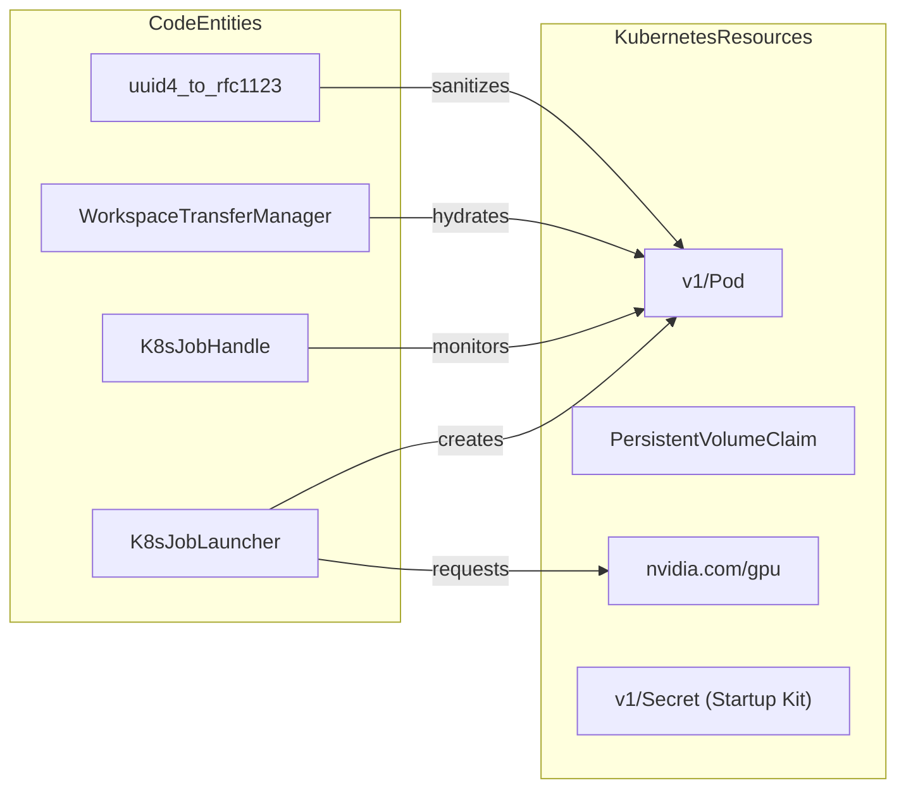

<!-- source: DeepWiki mcp.deepwiki.com · repo NVIDIA/NVFlare · page 22.2 Cloud Cluster Setup and Multicloud Deployment · fetched 2026-10-26 -->

# Cloud Cluster Setup and Multicloud Deployment

<details>
<summary>Relevant source files</summary>

The following files were used as context for generating this wiki page:

- [docker/Dockerfile.parent](docker/Dockerfile.parent)
- [docs/design/docker_job_launcher_design.md](docs/design/docker_job_launcher_design.md)
- [docs/design/job_launcher_and_job_handle.md](docs/design/job_launcher_and_job_handle.md)
- [docs/design/site_runtime_packaging_design.md](docs/design/site_runtime_packaging_design.md)
- [docs/design/study_runtime_config.md](docs/design/study_runtime_config.md)
- [docs/resources/brev_config_instance.png](docs/resources/brev_config_instance.png)
- [docs/resources/brev_creating.png](docs/resources/brev_creating.png)
- [docs/resources/brev_deploy.png](docs/resources/brev_deploy.png)
- [docs/resources/brev_instance.png](docs/resources/brev_instance.png)
- [docs/resources/brev_port.png](docs/resources/brev_port.png)
- [docs/resources/brev_select_k8s.png](docs/resources/brev_select_k8s.png)
- [docs/resources/brev_ssh.png](docs/resources/brev_ssh.png)
- [docs/user_guide/admin_guide/deployment/brev_deployment.rst](docs/user_guide/admin_guide/deployment/brev_deployment.rst)
- [docs/user_guide/admin_guide/deployment/brev_scripts/launch_brev_nvflare.sh](docs/user_guide/admin_guide/deployment/brev_scripts/launch_brev_nvflare.sh)
- [docs/user_guide/admin_guide/deployment/brev_scripts/prepare_brev_startup_kits.sh](docs/user_guide/admin_guide/deployment/brev_scripts/prepare_brev_startup_kits.sh)
- [docs/user_guide/admin_guide/deployment/helm_chart.rst](docs/user_guide/admin_guide/deployment/helm_chart.rst)
- [docs/user_guide/admin_guide/deployment/index.rst](docs/user_guide/admin_guide/deployment/index.rst)
- [docs/user_guide/nvflare_cli/deploy_command.rst](docs/user_guide/nvflare_cli/deploy_command.rst)
- [examples/devops/multicloud/README.md](examples/devops/multicloud/README.md)
- [examples/devops/multicloud/build_and_push.py](examples/devops/multicloud/build_and_push.py)
- [examples/devops/multicloud/deploy.py](examples/devops/multicloud/deploy.py)
- [examples/devops/multicloud/setting-up-dev-cluster.md](examples/devops/multicloud/setting-up-dev-cluster.md)
- [examples/devops/openshift/index.md](examples/devops/openshift/index.md)
- [nvflare/app_opt/job_launcher/docker_launcher.py](nvflare/app_opt/job_launcher/docker_launcher.py)
- [nvflare/app_opt/job_launcher/k8s_launcher.py](nvflare/app_opt/job_launcher/k8s_launcher.py)
- [nvflare/app_opt/job_launcher/study_data.py](nvflare/app_opt/job_launcher/study_data.py)
- [nvflare/app_opt/job_launcher/study_runtime.py](nvflare/app_opt/job_launcher/study_runtime.py)
- [nvflare/app_opt/job_launcher/workspace_cell_transfer.py](nvflare/app_opt/job_launcher/workspace_cell_transfer.py)
- [nvflare/fuel/f3/drivers/file_driver.py](nvflare/fuel/f3/drivers/file_driver.py)
- [nvflare/tool/deploy/deploy_cli.py](nvflare/tool/deploy/deploy_cli.py)
- [nvflare/tool/deploy/deploy_commands.py](nvflare/tool/deploy/deploy_commands.py)
- [nvflare/tool/deploy/templates/helm/client/deployment.yaml](nvflare/tool/deploy/templates/helm/client/deployment.yaml)
- [nvflare/tool/deploy/templates/helm/server/deployment.yaml](nvflare/tool/deploy/templates/helm/server/deployment.yaml)
- [nvflare/utils/job_launcher_utils.py](nvflare/utils/job_launcher_utils.py)
- [tests/unit_test/app_opt/job_launcher/docker_launcher_test.py](tests/unit_test/app_opt/job_launcher/docker_launcher_test.py)
- [tests/unit_test/app_opt/job_launcher/k8s_launcher_test.py](tests/unit_test/app_opt/job_launcher/k8s_launcher_test.py)
- [tests/unit_test/app_opt/job_launcher/study_data_test.py](tests/unit_test/app_opt/job_launcher/study_data_test.py)
- [tests/unit_test/app_opt/job_launcher/study_runtime_test.py](tests/unit_test/app_opt/job_launcher/study_runtime_test.py)
- [tests/unit_test/app_opt/job_launcher/workspace_cell_transfer_test.py](tests/unit_test/app_opt/job_launcher/workspace_cell_transfer_test.py)
- [tests/unit_test/fuel/f3/drivers/file_driver_test.py](tests/unit_test/fuel/f3/drivers/file_driver_test.py)
- [tests/unit_test/tool/deploy/deploy_commands_test.py](tests/unit_test/tool/deploy/deploy_commands_test.py)
- [tests/unit_test/utils/job_launcher_utils_test.py](tests/unit_test/utils/job_launcher_utils_test.py)

</details>


This page details the infrastructure and automation tools within NVIDIA FLARE for deploying federated learning clusters across major cloud providers (AWS, GCP, Azure). It covers the generation of Kubernetes-native artifacts, the `nvflare deploy prepare` workflow, and the integration of specialized job launchers for containerized environments.

## 1. Kubernetes Infrastructure Generation

NVFlare provides tools to transition from standard startup kits to Kubernetes-native deployment artifacts. This is primarily handled by the `nvflare deploy prepare` command [nvflare/tool/deploy/deploy_commands.py:56]().

### 1.1 Deployment Preparation Implementation
The `prepare_deployment` function [nvflare/tool/deploy/deploy_commands.py:56-120]() automates the transformation of a provisioned startup kit into a "prepared kit" containing Helm charts and updated configurations for the Kubernetes runtime. It uses a backend-specific implementation for Kubernetes found in `k8s_deploy` [nvflare/tool/deploy/deploy_commands.py:45]().

| Component | Role in Preparation | K8s Entity | Purpose |
| :--- | :--- | :--- | :--- |
| **Server** | `ROLE_SERVER` [nvflare/tool/deploy/deploy_common.py:44]() | `Service`, `Deployment` | Long-running FL server with stable cluster networking. |
| **Client** | `ROLE_CLIENT` [nvflare/tool/deploy/deploy_common.py:45]() | `Pod`, `ServiceAccount` | FL client process that spawns dynamic job pods. |

Key implementation details:
*   **Helm Chart Generation**: It renders Helm templates into the participant's `helm_chart/` directory [docs/user_guide/admin_guide/deployment/helm_chart.rst:152-160]().
*   **Launcher Configuration**: It replaces standard process launchers with `ServerK8sJobLauncher` or `ClientK8sJobLauncher` [docs/user_guide/admin_guide/deployment/helm_chart.rst:90-91]().
*   **Network Patching**: It patches the internal communication settings to use the generated Service name and `parent_port` [docs/user_guide/admin_guide/deployment/helm_chart.rst:104-106]().

### 1.2 Data Flow: Provisioning to K8s
The following diagram illustrates how the `Provisioner` output is processed into cloud-ready artifacts.

**Figure 1: Preparation Workflow**
```mermaid
graph TD
    subgraph "Provisioning"
        [Provisioner] --> Kit["Standard Startup Kit"]
    end

    subgraph "DeploymentPreparation"
        Kit --> DP["prepare_deployment"]
        Config["k8s.yaml"] --> DP
        Templates["nvflare/tool/deploy/templates/helm/"] --> DP
    end

    subgraph "OutputPreparedKit"
        DP --> S_Chart["helm_chart/"]
        DP --> Res["local/resources.json (K8sJobLauncher)"]
        DP --> SR["local/study_runtime.yaml"]
    end

    subgraph "CloudK8s"
        S_Chart --> Helm["helm install"]
        Res --> KJL["K8sJobLauncher"]
    end
```
**Sources:** [nvflare/tool/deploy/deploy_commands.py:56-120](), [docs/user_guide/admin_guide/deployment/helm_chart.rst:82-98](), [docs/user_guide/nvflare_cli/deploy_command.rst:115-138]()

---

## 2. Kubernetes Job Execution

Once the NVFlare client or server is running in Kubernetes as a "parent pod", it launches individual FL jobs as ephemeral Kubernetes Pods using the `K8sJobLauncher` [nvflare/app_opt/job_launcher/k8s_launcher.py:31]().

### 2.1 K8sJobLauncher and K8sJobHandle
The `K8sJobLauncher` creates a `K8sJobHandle` for each job to manage its lifecycle [nvflare/app_opt/job_launcher/k8s_launcher.py:31]().

*   **Pod Naming**: Pods are named using `uuid4_to_rfc1123`, which sanitizes the job ID to ensure RFC1123 compliance [nvflare/app_opt/job_launcher/k8s_launcher.py:211-220]().
*   **Workspace Management**: The launcher uses `WORKSPACE_MOUNT_PATH` (`/var/tmp/nvflare/workspace`) [nvflare/app_opt/job_launcher/k8s_launcher.py:100]() to mount storage for the job.
*   **State Mapping**: Kubernetes `PodPhase` (Pending, Running, Succeeded, Failed) is mapped to NVFlare `JobState` via `POD_STATE_MAPPING` [nvflare/app_opt/job_launcher/k8s_launcher.py:77-83]().
*   **Workspace Transfer**: Since job pods often use `emptyDir` storage, they use `WorkspaceTransferManager` to download the job workspace from the parent pod over a bootstrap CellNet connection [nvflare/app_opt/job_launcher/workspace_cell_transfer.py:45]().

### 2.2 Resource and GPU Management
Resource allocation is handled during pod manifest generation. The launcher assigns GPU resources if specified in the job configuration via `JobMetaKey` [nvflare/app_opt/job_launcher/k8s_launcher.py:30](). Managed Kubernetes services differ in how they handle GPU drivers, often requiring the NVIDIA GPU Operator [docs/user_guide/admin_guide/deployment/helm_chart.rst:56-59]().

**Entity Association: Code to K8s Concept**

**Sources:** [nvflare/app_opt/job_launcher/k8s_launcher.py:55-83](), [docs/user_guide/admin_guide/deployment/helm_chart.rst:82-98](), [nvflare/app_opt/job_launcher/workspace_cell_transfer.py:45]()

---

## 3. Multicloud Deployment and Cluster Setup

Deploying NVFlare across multiple clouds involves setting up the underlying Kubernetes clusters (EKS, GKE, AKS) and orchestrating the distribution of prepared kits using automation scripts in `examples/devops/` [docs/user_guide/admin_guide/deployment/helm_chart.rst:16-20]().

### 3.1 Multicloud Automation Tools
The `deploy.py` tool in the multicloud devops directory provides a YAML-driven interface for cross-cloud deployment.

*   **Cluster Discovery**: Automation scripts retrieve credentials for EKS, GKE, and AKS clusters using provider-specific CLIs.
*   **Image Management**: Scripts like `build_and_push.py` handle building the parent and job images and pushing them to cloud registries.
*   **Orchestration**: The process typically provisions the server cluster first, then deploys clients in parallel across different clouds.
*   **OpenShift Support**: OpenShift-specific scripts (e.g., `create_openshift_cluster.sh`) handle the additional security constraints and Security Context Constraints (SCC) required by OpenShift [examples/devops/openshift/index.md:1-10]().

### 3.2 Cloud Provider References
Managed Kubernetes services differ in how they handle GPU drivers and plugins. NVFlare supports standard `nvidia.com/gpu` resources across providers [docs/user_guide/admin_guide/deployment/helm_chart.rst:53-59]().

| Cloud | Cluster Type | Storage Integration | Reference |
| :--- | :--- | :--- | :--- |
| **AWS** | EKS | EBS-backed PVCs | [docs/user_guide/admin_guide/deployment/helm_chart.rst:63-66]() |
| **GCP** | GKE | GCE Persistent Disk | [docs/user_guide/admin_guide/deployment/helm_chart.rst:67-71]() |
| **Azure** | AKS | Managed CSI / Azure Disk | [docs/user_guide/admin_guide/deployment/helm_chart.rst:72-75]() |

### 3.3 Workspace Persistence and Staging
A critical step in cloud deployment is staging the workspace. The parent pod mounts the configured workspace PVC and reads `startup/` and `local/` from that storage [docs/user_guide/admin_guide/deployment/helm_chart.rst:86-87](). 

The `stage_k8_deployment` function [nvflare/tool/deploy/deploy_commands.py:28]() facilitates this by:
1.  Verifying prerequisites like `kubectl` and `helm` [docs/user_guide/admin_guide/deployment/helm_chart.rst:25-34]().
2.  Creating the target namespace if it does not exist.
3.  Staging the `local/` and `startup/` folders into the Kubernetes environment, often using `kubectl cp` or by creating Secrets and ConfigMaps [docs/design/site_runtime_packaging_design.md:114-121]().

### 3.4 Study Runtime Configuration (v2)
For cloud environments, site-specific runtime requirements are managed via `local/study_runtime.yaml` [nvflare/app_opt/job_launcher/study_runtime.py:36](). This configuration allows sites to define:
*   **Datasets**: Mapping cloud-stored datasets to pod mount paths [nvflare/app_opt/job_launcher/study_runtime.py:34]().
*   **Secrets**: Injecting Kubernetes Secrets as environment variables or volume mounts [nvflare/app_opt/job_launcher/study_runtime.py:129-130]().
*   **Container Overrides**: Defining site-specific job images or pod templates [nvflare/app_opt/job_launcher/study_runtime.py:131-132]().

**Sources:** [docs/user_guide/admin_guide/deployment/helm_chart.rst:138-151](), [nvflare/tool/deploy/deploy_commands.py:28-30](), [docs/design/site_runtime_packaging_design.md:100-138](), [examples/devops/openshift/index.md:1-26](), [nvflare/app_opt/job_launcher/study_runtime.py:14-57]()

---

