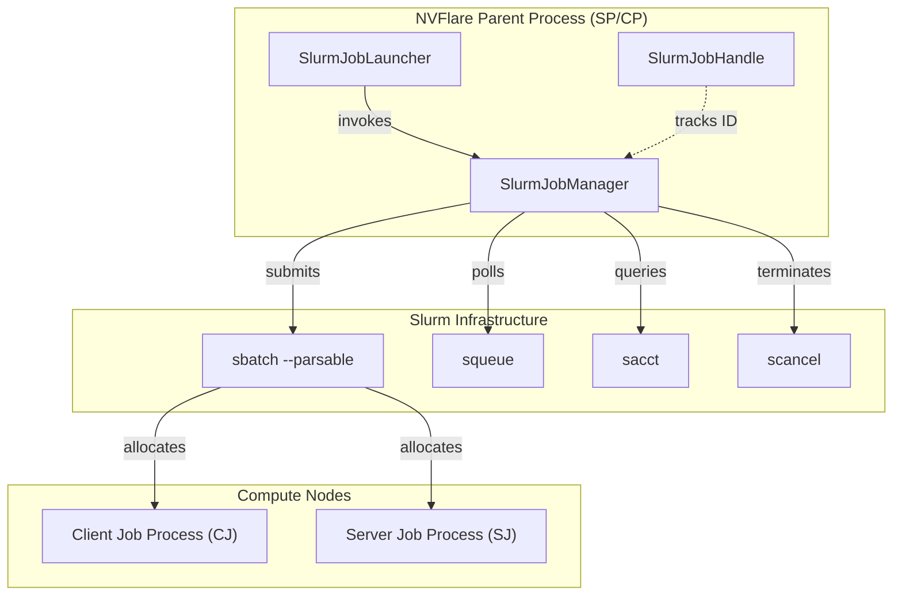
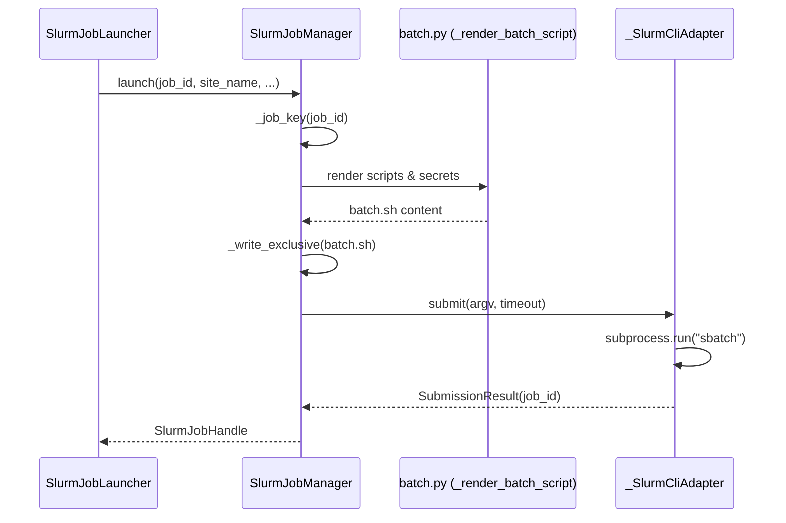

<!-- source: DeepWiki mcp.deepwiki.com · repo NVIDIA/NVFlare · page 22.3 Slurm Job Launcher · fetched 2026-10-26 -->

# Slurm Job Launcher

Relevant source files

The following files were used as context for generating this wiki page:

- [docs/design/slurm_job_launcher_design.md](docs/design/slurm_job_launcher_design.md)
- [docs/user_guide/admin_guide/deployment/slurm_job_launcher.rst](docs/user_guide/admin_guide/deployment/slurm_job_launcher.rst)
- [nvflare/app_opt/job_launcher/slurm/batch.py](nvflare/app_opt/job_launcher/slurm/batch.py)
- [nvflare/app_opt/job_launcher/slurm/config.py](nvflare/app_opt/job_launcher/slurm/config.py)
- [nvflare/app_opt/job_launcher/slurm/launcher.py](nvflare/app_opt/job_launcher/slurm/launcher.py)
- [nvflare/app_opt/job_launcher/slurm/manager.py](nvflare/app_opt/job_launcher/slurm/manager.py)
- [nvflare/tool/deploy/slurm_deploy.py](nvflare/tool/deploy/slurm_deploy.py)
- [tests/unit_test/app_opt/job_launcher/slurm_batch_test.py](tests/unit_test/app_opt/job_launcher/slurm_batch_test.py)
- [tests/unit_test/app_opt/job_launcher/slurm_config_test.py](tests/unit_test/app_opt/job_launcher/slurm_config_test.py)
- [tests/unit_test/app_opt/job_launcher/slurm_launcher_test.py](tests/unit_test/app_opt/job_launcher/slurm_launcher_test.py)
- [tests/unit_test/app_opt/job_launcher/slurm_manager_test.py](tests/unit_test/app_opt/job_launcher/slurm_manager_test.py)
- [tests/unit_test/tool/deploy/slurm_deploy_test.py](tests/unit_test/tool/deploy/slurm_deploy_test.py)

The Slurm Job Launcher enables NVIDIA FLARE to operate within High-Performance Computing (HPC) environments by leveraging the Slurm workload manager for resource allocation and job execution. In this architecture, the long-running NVFlare parent process—either the **Client Parent (CP)** or **Server Parent (SP)**—submits each federated job as a separate Slurm batch job.

## Overview and Purpose

The launcher runs each NVFlare client job process (CJ) or server job process (SJ) as a Slurm batch job [docs/design/slurm_job_launcher_design.md:10-12](). Slurm manages node placement and resource enforcement, while NVFlare handles the lifecycle of submission, monitoring, and cancellation through the `JobLauncherSpec` and `JobHandleSpec` interfaces [docs/design/slurm_job_launcher_design.md:10-12]().

### Supported Execution Backends
The launcher supports three primary execution modes defined by the `job_launcher.sandbox` configuration [docs/user_guide/admin_guide/deployment/slurm_job_launcher.rst:19-36]():

| Sandbox Value | Execution Method | Use Case |
| :--- | :--- | :--- |
| `apptainer` | Launcher-managed Apptainer container | Isolation and reproducibility on validated clusters. |
| `pyxis` | Read-only Pyxis/Enroot container | Trusted container packaging for HPC. |
| `none` | Bare Python directly in the allocation | Site-trusted code; required for multi-node fan-out. |

Sources: [docs/user_guide/admin_guide/deployment/slurm_job_launcher.rst:19-36](), [docs/design/slurm_job_launcher_design.md:14-18]()

---

## Architecture and Data Flow

The architecture separates the long-running NVFlare orchestration from the transient Slurm allocations.

### System Components Diagram
This diagram illustrates the relationship between the NVFlare runtime entities and the Slurm infrastructure.

Sources: [docs/design/slurm_job_launcher_design.md:25-34](), [nvflare/app_opt/job_launcher/slurm/launcher.py:52]()

### Data Flow: Job Submission
1.  **Resolution**: The `SlurmJobLauncher` resolves site, study, and job configuration into an immutable `LaunchPlan` [docs/design/slurm_job_launcher_design.md:36-37]().
2.  **Artifact Generation**: The `SlurmJobManager` creates a transient directory in `.nvflare_slurm/jobs/<sha256-job-id>/` containing `batch.sh`, `secret.env`, and optionally `node.sh` [docs/design/slurm_job_launcher_design.md:88-96]().
3.  **Submission**: The manager invokes `sbatch --parsable` with a scrubbed environment [docs/design/slurm_job_launcher_design.md:118-121]().
4.  **Tracking**: A `SlurmJobHandle` is returned to the framework to track the scheduler ID and pending state [docs/design/slurm_job_launcher_design.md:37-41]().

Sources: [docs/design/slurm_job_launcher_design.md:36-41](), [docs/design/slurm_job_launcher_design.md:88-96](), [nvflare/app_opt/job_launcher/slurm/manager.py:115-135]()

---

## Implementation Details

### Key Classes

| Class | File | Responsibility |
| :--- | :--- | :--- |
| `SlurmJobLauncher` | [nvflare/app_opt/job_launcher/slurm/launcher.py:321]() | High-level entry point; implements `JobLauncherSpec`. |
| `SlurmJobManager` | [nvflare/app_opt/job_launcher/slurm/manager.py:115]() | Manages scheduler CLI access, artifact cleanup, and state polling. |
| `SlurmConfig` | [nvflare/app_opt/job_launcher/slurm/config.py:99]() | Dataclass holding validated site-level Slurm settings. |
| `LaunchPlan` | [nvflare/app_opt/job_launcher/slurm/config.py:48]() | Immutable specification for a single job execution. |
| `_SlurmCliAdapter` | [nvflare/app_opt/job_launcher/slurm/scheduler_client.py]() | Wraps subprocess calls to Slurm binaries (`sbatch`, `sacct`, etc.). |

Sources: [nvflare/app_opt/job_launcher/slurm/launcher.py:321](), [nvflare/app_opt/job_launcher/slurm/manager.py:115](), [nvflare/app_opt/job_launcher/slurm/config.py:99]()

### Implementation Diagram: Component Interaction
This diagram bridges the high-level launcher logic to the internal manager and script rendering entities.

Sources: [nvflare/app_opt/job_launcher/slurm/launcher.py:377-400](), [nvflare/app_opt/job_launcher/slurm/manager.py:218-240](), [nvflare/app_opt/job_launcher/slurm/batch.py:44-80]()

---

## Configuration and Deployment

### Workspace Preparation
The `nvflare deploy prepare` command (via `slurm_deploy.py`) generates the runtime workspace [nvflare/tool/deploy/slurm_deploy.py:15-16](). This command:
1.  Validates the `slurm.yaml` configuration [nvflare/tool/deploy/slurm_deploy.py:114-150]().
2.  Patches `resources.json` to use `ClientSlurmJobLauncher` or `ServerSlurmJobLauncher` [nvflare/tool/deploy/slurm_deploy.py:71]().
3.  Generates `start_slurm.sh` for the parent process and `parent.slurm` for client parent submission [nvflare/tool/deploy/slurm_deploy.py:78-83]().

Sources: [nvflare/tool/deploy/slurm_deploy.py:15-16](), [nvflare/tool/deploy/slurm_deploy.py:114-150]()

### Site Configuration (`slurm.yaml`)
A typical configuration includes:
*   **`sandbox`**: Execution backend (`none`, `apptainer`, `pyxis`) [nvflare/app_opt/job_launcher/slurm/config.py:101]().
*   **`image`**: Absolute path to the container image [nvflare/app_opt/job_launcher/slurm/config.py:104]().
*   **`sbatch_directives`**: Site-wide Slurm flags like `partition`, `account`, and `qos` [nvflare/app_opt/job_launcher/slurm/config.py:54]().
*   **`parent_host`**: The hostname where the parent process is reachable by workers [nvflare/app_opt/job_launcher/slurm/config.py:109]().

Sources: [nvflare/app_opt/job_launcher/slurm/config.py:99-116](), [docs/user_guide/admin_guide/deployment/slurm_job_launcher.rst:145-163]()

### Multi-Node Execution
For multi-node client jobs, the launcher manages a node group fan-out using `srun` [nvflare/app_opt/job_launcher/slurm/batch.py:163-175]().
*   It exports `NVFL_NNODES`, `NVFL_MASTER_ADDR`, and `NVFL_MASTER_PORT` to the allocation [nvflare/app_opt/job_launcher/slurm/batch.py:35-40]().
*   Rendezvous ports are selected from a configurable range (default `29400-30399`) based on the Slurm Job ID to avoid collisions [nvflare/app_opt/job_launcher/slurm/config.py:44]().

Sources: [nvflare/app_opt/job_launcher/slurm/batch.py:163-175](), [nvflare/app_opt/job_launcher/slurm/config.py:44]()

---

## Monitoring and Error Handling

### Job State Polling
The launcher polls `squeue` for live jobs and `sacct` for completed jobs [docs/design/slurm_job_launcher_design.md:130-136]().
*   **Pending Timeout**: If a job stays in a pending state (e.g., `PENDING`, `CONFIGURING`) longer than `pending_timeout`, the launcher aborts the job [docs/design/slurm_job_launcher_design.md:142-145]().
*   **Accounting Requirement**: The site must have `slurmdbd` enabled; the launcher verifies this during bootstrap [nvflare/app_opt/job_launcher/slurm/manager.py:186-192]().

### Artifact Cleanup
Upon job completion (successful or failed), the `SlurmJobManager` removes the transient directory and secret environment files to prevent credential leakage and directory bloat [nvflare/app_opt/job_launcher/slurm/manager.py:92-104]().

Sources: [docs/design/slurm_job_launcher_design.md:130-145](), [nvflare/app_opt/job_launcher/slurm/manager.py:92-104](), [nvflare/app_opt/job_launcher/slurm/manager.py:186-192]()

---

