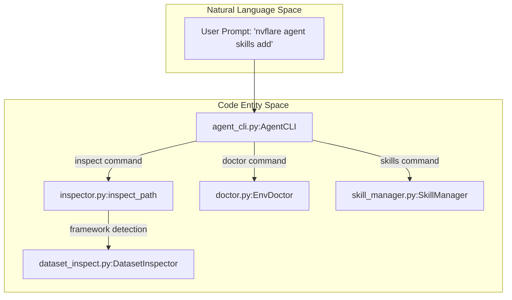
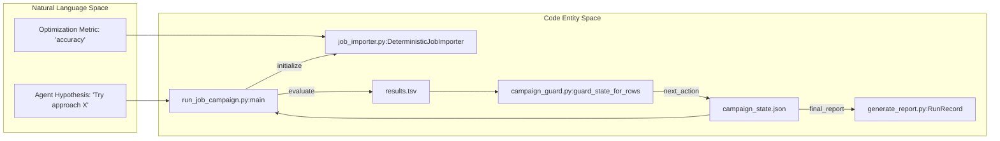

<!-- source: DeepWiki mcp.deepwiki.com · repo NVIDIA/NVFlare · page 23 AI Agent Integration · fetched 2026-10-26 -->

# AI Agent Integration

Relevant source files

The following files were used as context for generating this wiki page:

- [dev_tools/agent/skill_evals/nvflare-autofl-report/evals.json](dev_tools/agent/skill_evals/nvflare-autofl-report/evals.json)
- [dev_tools/agent/skill_evals/nvflare-autofl/evals.json](dev_tools/agent/skill_evals/nvflare-autofl/evals.json)
- [dev_tools/agent/skill_evals/nvflare-autofl/files/SOURCE.md](dev_tools/agent/skill_evals/nvflare-autofl/files/SOURCE.md)
- [dev_tools/agent/skill_evals/nvflare-autofl/files/develop_literature_batch_results.tsv](dev_tools/agent/skill_evals/nvflare-autofl/files/develop_literature_batch_results.tsv)
- [dev_tools/agent/skill_evals/nvflare-autofl/files/develop_literature_batch_state.json](dev_tools/agent/skill_evals/nvflare-autofl/files/develop_literature_batch_state.json)
- [dev_tools/agent/skill_evals/nvflare-autofl/files/diversify_candidates_results.tsv](dev_tools/agent/skill_evals/nvflare-autofl/files/diversify_candidates_results.tsv)
- [dev_tools/agent/skill_evals/nvflare-autofl/files/diversify_candidates_state.json](dev_tools/agent/skill_evals/nvflare-autofl/files/diversify_candidates_state.json)
- [dev_tools/agent/skill_evals/nvflare-convert-lightning/evals.json](dev_tools/agent/skill_evals/nvflare-convert-lightning/evals.json)
- [dev_tools/agent/skill_evals/nvflare-convert-pytorch/evals.json](dev_tools/agent/skill_evals/nvflare-convert-pytorch/evals.json)
- [dev_tools/agent/skill_evals/nvflare-fed-stats/evals.json](dev_tools/agent/skill_evals/nvflare-fed-stats/evals.json)
- [docs/design/autofl_skill.md](docs/design/autofl_skill.md)
- [docs/design/skills_architecture.md](docs/design/skills_architecture.md)
- [docs/user_guide/agent_skills/autofl_skill.rst](docs/user_guide/agent_skills/autofl_skill.rst)
- [nvflare/tool/agent/inspector.py](nvflare/tool/agent/inspector.py)
- [skills/README.md](skills/README.md)
- [skills/nvflare-autofl-report/SKILL.md](skills/nvflare-autofl-report/SKILL.md)
- [skills/nvflare-autofl-report/references/report-contract.md](skills/nvflare-autofl-report/references/report-contract.md)
- [skills/nvflare-autofl-report/scripts/generate_report.py](skills/nvflare-autofl-report/scripts/generate_report.py)
- [skills/nvflare-autofl-report/tests/helper_scripts.md](skills/nvflare-autofl-report/tests/helper_scripts.md)
- [skills/nvflare-autofl/SKILL.md](skills/nvflare-autofl/SKILL.md)
- [skills/nvflare-autofl/references/bounded-campaign-example.md](skills/nvflare-autofl/references/bounded-campaign-example.md)
- [skills/nvflare-autofl/references/continuous-campaigns.md](skills/nvflare-autofl/references/continuous-campaigns.md)
- [skills/nvflare-autofl/references/experiment-comparability.md](skills/nvflare-autofl/references/experiment-comparability.md)
- [skills/nvflare-autofl/scripts/campaign_guard.py](skills/nvflare-autofl/scripts/campaign_guard.py)
- [skills/nvflare-autofl/scripts/job_importer.py](skills/nvflare-autofl/scripts/job_importer.py)
- [skills/nvflare-autofl/scripts/plot_progress.py](skills/nvflare-autofl/scripts/plot_progress.py)
- [skills/nvflare-autofl/scripts/run_job_campaign.py](skills/nvflare-autofl/scripts/run_job_campaign.py)
- [skills/nvflare-convert-lightning/assets/lightning_client.py](skills/nvflare-convert-lightning/assets/lightning_client.py)
- [skills/nvflare-convert-lightning/references/lightning-conversion.md](skills/nvflare-convert-lightning/references/lightning-conversion.md)
- [skills/nvflare-orient/references/orientation-routing.md](skills/nvflare-orient/references/orientation-routing.md)
- [skills/nvflare-shared/assets/aggregator.py](skills/nvflare-shared/assets/aggregator.py)
- [tests/unit_test/tool/agent/agent_cli_test.py](tests/unit_test/tool/agent/agent_cli_test.py)
- [tests/unit_test/tool/agent/agent_inspector_test.py](tests/unit_test/tool/agent/agent_inspector_test.py)
- [tests/unit_test/tool/agent_skill_checks/autofl_trigger_evals_test.py](tests/unit_test/tool/agent_skill_checks/autofl_trigger_evals_test.py)
- [tests/unit_test/tool/autofl_skill_campaign_guard_test.py](tests/unit_test/tool/autofl_skill_campaign_guard_test.py)
- [tests/unit_test/tool/autofl_skill_job_importer_test.py](tests/unit_test/tool/autofl_skill_job_importer_test.py)
- [tests/unit_test/tool/autofl_skill_plot_progress_test.py](tests/unit_test/tool/autofl_skill_plot_progress_test.py)
- [tests/unit_test/tool/autofl_skill_report_test.py](tests/unit_test/tool/autofl_skill_report_test.py)
- [tests/unit_test/tool/autofl_skill_runner_test.py](tests/unit_test/tool/autofl_skill_runner_test.py)

NVFLARE provides a comprehensive suite of tools and frameworks to support AI coding agents (such as GitHub Copilot, Cursor, or Claude Code) in automating Federated Learning (FL) workflows. This integration bridges the gap between natural language requirements and executable FL code through a specialized CLI, installable "skills" that provide context-aware guidance, and an automated research framework for iterative experimentation.

## Agent CLI and Inspector

The `nvflare agent` command group is the primary entry point for managing the AI agent environment. It includes tools for environment validation, project analysis, and skill management. The implementation is housed within the `nvflare/tool/agent/` module [nvflare/tool/agent/agent_cli.py:1-25]().

*   **`nvflare agent doctor`**: Checks the local environment for readiness, ensuring necessary dependencies and configurations are present [nvflare/tool/agent/agent_cli.py:65-67]().
*   **`nvflare agent inspect`**: Performs static analysis on a source project to understand its structure, such as detecting PyTorch usage or existing FLARE integration, and provides recommendations for FL conversion [nvflare/tool/agent/inspector.py:15-32](). It extracts evidence without executing user modules to maintain safety [nvflare/tool/agent/inspector.py:100-110]().
*   **`nvflare agent skills`**: Manages the installation of specialized context packages into agent-specific directories (e.g., `.claude/skills`) using the `SkillManager` [nvflare/tool/agent/inspector.py:91-99]().

For details, see [Agent CLI and Inspector](#23.1).

### Natural Language to Code Entity Mapping: CLI
The following diagram illustrates how the `agent` CLI interacts with internal tool modules to process user requests.

**Sources:** `nvflare/tool/agent/agent_cli.py` [nvflare/tool/agent/agent_cli.py:35-80](), `nvflare/tool/agent/inspector.py` [nvflare/tool/agent/inspector.py:15-45]().

## NVFLARE Skills for Coding Agents

Skills are installable packages designed to provide AI agents with high-quality context, templates, and rules for specific FL tasks. Each skill includes a `SKILL.md` file with frontmatter metadata that defines its purpose, versioning, and `blast_radius` (the security level/extent of changes it is permitted to make) [skills/nvflare-autofl/SKILL.md:1-13]().

*   **`nvflare-convert-pytorch`**: Guidance for converting standard PyTorch training scripts into NVFLARE-compatible jobs using the Client API.
*   **`nvflare-diagnose-job`**: Provides patterns for analyzing job failures and logs to suggest fixes across simulation and production.
*   **`nvflare-orient`**: Routes ambiguous requests by running `nvflare agent inspect` and recommending the appropriate workflow skill.
*   **`nvflare-autofl`**: Enables agent-assisted optimization of existing jobs through a campaign runner [skills/nvflare-autofl/SKILL.md:2-12]().
*   **`nvflare-autofl-report`**: Generates reproducible final reports and literature synthesis for stopped Auto-FL campaigns [skills/nvflare-autofl-report/SKILL.md:2-14]().

For details, see [NVFLARE Skills for Coding Agents](#23.2).

### Skill Packaging and Installation
Skills are bundled into the `skills/` directory and follow a standard contract for agent interaction.

| Component | Role |
| :--- | :--- |
| `blast_radius` | Metadata field defining execution safety (e.g., `submits_production`, `edits_files`) [skills/nvflare-autofl/SKILL.md:10-10]() |
| `SKILL.md` | Primary instruction file containing Use When/Do Not Use When rules [skills/nvflare-autofl/SKILL.md:19-23]() |
| `references/` | Directory for shared logic like `experiment-comparability.md` or `continuous-campaigns.md` [skills/nvflare-autofl/SKILL.md:87-88]() |

**Sources:** `skills/nvflare-autofl/SKILL.md`, `skills/nvflare-autofl-report/SKILL.md`.

## Auto-FL Research Framework

The Auto-FL Research framework provides an automated loop for agent-driven experimentation. It allows an agent to propose hypotheses, prepare candidate mutations, and evaluate them in a controlled environment.

*   **Campaign Runner (`run_job_campaign.py`)**: The authoritative lifecycle manager that snapshots source, validates patches, and records reproducible campaign state [skills/nvflare-autofl/scripts/run_job_campaign.py:16-21]().
*   **Deterministic Importer (`job_importer.py`)**: Statically parses `job.py` to extract trust contracts, training budgets, and tunable parameters without executing user code [skills/nvflare-autofl/scripts/job_importer.py:15-21]().
*   **Campaign Guard (`campaign_guard.py`)**: A read-only ledger diagnostic that evaluates plateau conditions and determines the `next_action` (e.g., `propose_candidate`, `run_literature_loop`) [tests/unit_test/tool/autofl_skill_campaign_guard_test.py:43-50]().
*   **Report Generator (`generate_report.py`)**: Validates stopped campaign evidence and produces human-readable Markdown and machine-readable JSON summaries [skills/nvflare-autofl-report/scripts/generate_report.py:16-17]().

For details, see [Auto-FL Research Framework](#23.3).

### Research Loop Diagram
This diagram shows the relationship between the high-level campaign actions and the underlying Python implementation entities.

**Sources:** `skills/nvflare-autofl/scripts/run_job_campaign.py` [skills/nvflare-autofl/scripts/run_job_campaign.py:833-850](), `skills/nvflare-autofl/scripts/job_importer.py` [skills/nvflare-autofl/scripts/job_importer.py:122-137](), `skills/nvflare-autofl/scripts/campaign_guard.py`.

## Related Pages
- [Agent CLI and Inspector](#23.1)
- [NVFLARE Skills for Coding Agents](#23.2)
- [Auto-FL Research Framework](#23.3)

---

