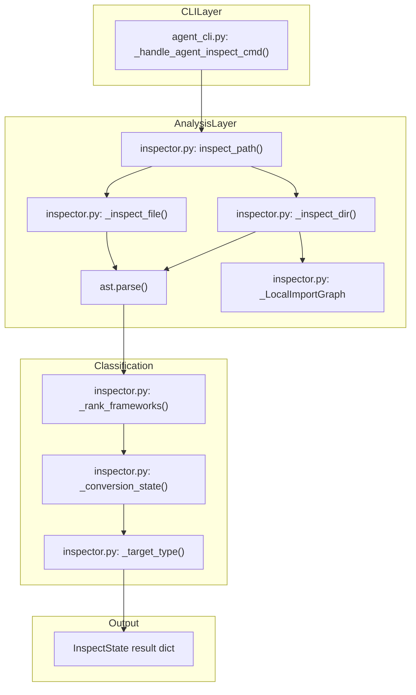
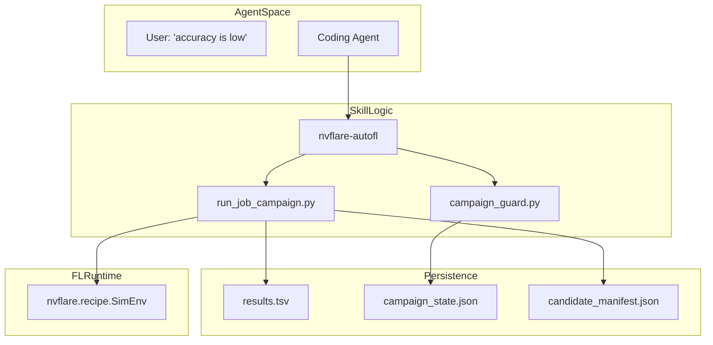

<!-- source: DeepWiki mcp.deepwiki.com · repo NVIDIA/NVFlare · page 23.1 Agent CLI and Inspector · fetched 2026-10-26 -->

# Agent CLI and Inspector

Relevant source files

The following files were used as context for generating this wiki page:

- [dev_tools/agent/skill_evals/nvflare-autofl/evals.json](dev_tools/agent/skill_evals/nvflare-autofl/evals.json)
- [dev_tools/agent/skill_evals/nvflare-autofl/files/SOURCE.md](dev_tools/agent/skill_evals/nvflare-autofl/files/SOURCE.md)
- [dev_tools/agent/skill_evals/nvflare-autofl/files/develop_literature_batch_results.tsv](dev_tools/agent/skill_evals/nvflare-autofl/files/develop_literature_batch_results.tsv)
- [dev_tools/agent/skill_evals/nvflare-autofl/files/develop_literature_batch_state.json](dev_tools/agent/skill_evals/nvflare-autofl/files/develop_literature_batch_state.json)
- [dev_tools/agent/skill_evals/nvflare-autofl/files/diversify_candidates_results.tsv](dev_tools/agent/skill_evals/nvflare-autofl/files/diversify_candidates_results.tsv)
- [dev_tools/agent/skill_evals/nvflare-autofl/files/diversify_candidates_state.json](dev_tools/agent/skill_evals/nvflare-autofl/files/diversify_candidates_state.json)
- [dev_tools/agent/skill_evals/nvflare-convert-lightning/evals.json](dev_tools/agent/skill_evals/nvflare-convert-lightning/evals.json)
- [dev_tools/agent/skill_evals/nvflare-convert-pytorch/evals.json](dev_tools/agent/skill_evals/nvflare-convert-pytorch/evals.json)
- [dev_tools/agent/skill_evals/nvflare-fed-stats/evals.json](dev_tools/agent/skill_evals/nvflare-fed-stats/evals.json)
- [docs/design/skills_architecture.md](docs/design/skills_architecture.md)
- [nvflare/tool/agent/inspector.py](nvflare/tool/agent/inspector.py)
- [skills/README.md](skills/README.md)
- [skills/nvflare-convert-lightning/assets/lightning_client.py](skills/nvflare-convert-lightning/assets/lightning_client.py)
- [skills/nvflare-convert-lightning/references/lightning-conversion.md](skills/nvflare-convert-lightning/references/lightning-conversion.md)
- [skills/nvflare-orient/references/orientation-routing.md](skills/nvflare-orient/references/orientation-routing.md)
- [skills/nvflare-shared/assets/aggregator.py](skills/nvflare-shared/assets/aggregator.py)
- [tests/unit_test/tool/agent/agent_cli_test.py](tests/unit_test/tool/agent/agent_cli_test.py)
- [tests/unit_test/tool/agent/agent_inspector_test.py](tests/unit_test/tool/agent/agent_inspector_test.py)
- [tests/unit_test/tool/agent_skill_checks/autofl_trigger_evals_test.py](tests/unit_test/tool/agent_skill_checks/autofl_trigger_evals_test.py)

The `nvflare agent` command group and its associated tools provide a suite of utilities designed to assist AI coding agents and developers in analyzing, diagnosing, and automating Federated Learning (FL) workflows. This subsystem includes a static code inspector for project analysis, a "doctor" tool for environment readiness verification, and a skill management system for extending agent capabilities.

## Overview and Purpose

The agent tools are located in the `nvflare/tool/agent/` module. They bridge the gap between high-level user intent and the technical requirements of the NVIDIA FLARE ecosystem, providing machine-readable outputs for automated systems.

| Component | Role | Implementation |
| :--- | :--- | :--- |
| **Agent CLI** | Entry point for agent-specific commands (`info`, `inspect`, `doctor`, `skills`). | [nvflare/tool/agent/agent_cli.py:15-162]() |
| **Inspector** | Performs static analysis on source code to identify training patterns, frameworks, and project structure. | [nvflare/tool/agent/inspector.py:126-164]() |
| **Dataset Inspector** | Classifies data-only directories as tabular or image datasets for stats routing. | [nvflare/tool/agent/dataset_inspect.py:128-135]() |
| **Doctor** | Checks environment readiness, dependencies, and connectivity. | [nvflare/tool/agent/doctor.py:15-100]() |
| **Skill System** | Defines tasks and prompts for agents (e.g., `nvflare-autofl`, `nvflare-orient`). | [skills/nvflare-orient/references/orientation-routing.md:1-44]() |

**Sources:**
- [nvflare/tool/agent/agent_cli.py:15-162]()
- [nvflare/tool/agent/inspector.py:15-164]()
- [nvflare/tool/agent/dataset_inspect.py:15-86]()

---

## Agent CLI Implementation

The Agent CLI is integrated into the main `nvflare` command-line interface via `def_agent_cli_parser` [nvflare/tool/agent/agent_cli.py:38-92](). It is designed to provide structured output, supporting a global `--schema` flag to print command argument contracts as JSON [nvflare/tool/agent/agent_cli.py:47-47]().

### Command Structure
Key sub-commands handled by `handle_agent_cmd` [nvflare/tool/agent/agent_cli.py:111-160]() include:
- `nvflare agent info`: Shows the available NVFLARE agent command surface and version [nvflare/tool/agent/agent_cli.py:50-56]().
- `nvflare agent inspect`: Invokes the static inspector to analyze local code, job artifacts, or data directories without execution [nvflare/tool/agent/agent_cli.py:58-66]().
- `nvflare agent doctor`: Runs environment checks to ensure the system is ready for FL operations [nvflare/tool/agent/agent_cli.py:68-75]().
- `nvflare agent skills`: Manages installable agent skills [nvflare/tool/agent/agent_cli.py:77-85]().

### Machine-Readable Output
All agent-facing commands support `--format json` [nvflare/tool/agent/agent_cli.py:28-33](). When an error occurs, the CLI emits a structured envelope with an `error_code`, `message`, and `recovery_category` (e.g., `FIXABLE_BY_CONFIG` or `ENVIRONMENT_FAILURE`) [nvflare/tool/agent/agent_cli.py:184-202]().

**Sources:**
- [nvflare/tool/agent/agent_cli.py:38-110]()
- [nvflare/tool/agent/agent_cli.py:111-160]()
- [nvflare/tool/agent/agent_cli.py:184-202]()

---

## Static Code Inspector

The `Inspector` provides static, read-only analysis of Python projects using the `ast` module [nvflare/tool/agent/inspector.py:17-17](). It is used by agents to understand the structure of a user's training code without importing or executing user modules, preventing side effects during analysis [tests/unit_test/tool/agent/agent_inspector_test.py:41-61]().

### Inspection Logic and State
The inspection process is encapsulated in `InspectState` [nvflare/tool/agent/inspector.py:87-124](). It tracks:
- **Framework Evidence**: Weights assigned to imports and symbols (e.g., `torch`, `lightning`) [nvflare/tool/agent/inspector.py:101-101]().
- **Conversion State**: Identifies if a project is `not_converted`, an `exported_job`, or `unknown` [nvflare/tool/agent/inspector.py:105-111]().
- **Safety Findings**: Detects sensitive file suffixes (e.g., `.key`, `.pem`) and secret-like patterns in code [nvflare/tool/agent/inspector.py:79-81]().
- **Local Import Graph**: Builds a directed graph of local dependencies to identify project components and anchors using `_LocalImportGraph` [nvflare/tool/agent/inspector.py:107-139]().

### Framework Detection
The inspector ranks frameworks based on evidence found in the source tree [nvflare/tool/agent/inspector.py:148-148](). It uses specialized detectors for families like `pytorch` and `lightning` [tests/unit_test/tool/agent/agent_inspector_test.py:22-32](). For example, it can distinguish between raw PyTorch and PyTorch Lightning by analyzing class body ranges and promotion rules [tests/unit_test/tool/agent/agent_inspector_test.py:35-38]().

**Natural Language to Code Entity Mapping: Inspection Flow**

**Sources:**
- [nvflare/tool/agent/inspector.py:87-164]()
- [nvflare/tool/agent/inspector.py:17-25]()
- [tests/unit_test/tool/agent/agent_inspector_test.py:41-61]()

---

## Dataset Classification

When code classification fails to identify a training target, the inspector falls back to `dataset_inspect.py` [nvflare/tool/agent/inspector.py:160-163](). This module classifies data-only directories by reading bounded file headers [nvflare/tool/agent/dataset_inspect.py:15-28]().

### Modality Rules
- **Tabular**: Detects `.csv`, `.tsv`, and `.parquet` files [nvflare/tool/agent/dataset_inspect.py:94-94](). It checks for header presence by verifying if numeric-bodied columns carry non-numeric first values [nvflare/tool/agent/dataset_inspect.py:111-120]().
- **Image**: Detects common image extensions (e.g., `.png`, `.jpg`, `.dcm`) [nvflare/tool/agent/dataset_inspect.py:95-95]().
- **Mixed**: Sites containing both modalities beyond specific tolerance windows (e.g., > 2 images in a tabular site) are marked as `mixed` [nvflare/tool/agent/dataset_inspect.py:32-41]().

**Sources:**
- [nvflare/tool/agent/dataset_inspect.py:15-86]()
- [nvflare/tool/agent/dataset_inspect.py:94-110]()

---

## Skill Selection and Routing

The `nvflare-orient` skill acts as the primary router for ambiguous agent requests [skills/nvflare-orient/references/orientation-routing.md:3-4](). It uses the output of `nvflare agent inspect` to decide the next skill to invoke.

### Routing Logic
| Evidence Found | Recommended Skill |
| :--- | :--- |
| Existing PyTorch training loop | `nvflare-convert-pytorch` |
| Lightning `Trainer` owning training | `nvflare-convert-lightning` |
| `tabular_dataset` or `image_dataset` | `nvflare-fed-stats` |
| Existing FLARE job with errors/logs | `nvflare-diagnose-job` |
| Job needing accuracy optimization | `nvflare-autofl` |

**Sources:**
- [skills/nvflare-orient/references/orientation-routing.md:13-31]()
- [dev_tools/agent/skill_evals/nvflare-autofl/evals.json:91-102]()

---

## Auto-FL Integration

The `nvflare-autofl` skill automates the optimization of FL jobs. It uses a structured campaign state to manage candidate generation and evaluation [dev_tools/agent/skill_evals/nvflare-autofl/files/develop_literature_batch_state.json:1-38]().

### Campaign Lifecycle
1. **Import**: Runs deterministic job import to establish a baseline [dev_tools/agent/skill_evals/nvflare-autofl/evals.json:21-23]().
2. **Exploration**: Agents author code candidates or tunable sweeps based on literature or heuristics [dev_tools/agent/skill_evals/nvflare-autofl/evals.json:11-15]().
3. **Execution**: Candidates are run using standard FLARE execution surfaces (e.g., Simulator) [dev_tools/agent/skill_evals/nvflare-autofl/evals.json:41-43]().
4. **Provenance**: Records `candidate_manifest.json` with patch hashes, artifacts, and results [dev_tools/agent/skill_evals/nvflare-autofl/evals.json:37-39]().

**Natural Language to Code Entity Mapping: Auto-FL Campaign**

**Sources:**
- [dev_tools/agent/skill_evals/nvflare-autofl/evals.json:1-102]()
- [dev_tools/agent/skill_evals/nvflare-autofl/files/develop_literature_batch_state.json:1-38]()
- [tests/unit_test/tool/agent_skill_checks/autofl_trigger_evals_test.py:35-56]()

---

## Skill Validation (Lints)

The `dev_tools/agent/skills/checks/lints.py` module provides deterministic lints to ensure agent skills are high-quality and safe.

### Key Lint Checks
- **Frontmatter Lint**: Validates `SKILL.md` metadata like `name`, `description`, and `blast_radius` [dev_tools/agent/skills/checks/lints.py:85-85]().
- **Trigger Lint**: Ensures skills have positive and negative trigger evaluations in their `evals.json` [dev_tools/agent/skills/checks/lints.py:87-87]().
- **Runtime Boundary**: Verifies that skills do not exceed recommended text size limits (max 200 lines) to avoid overwhelming agent context windows [dev_tools/agent/skills/checks/lints.py:95-100]().

**Sources:**
- [dev_tools/agent/skills/checks/lints.py:85-102]()
- [dev_tools/agent/skills/checks/lints.py:165-194]()

---

