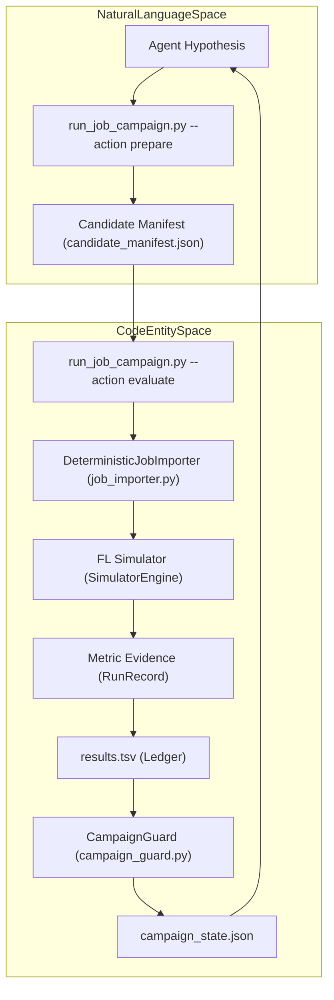
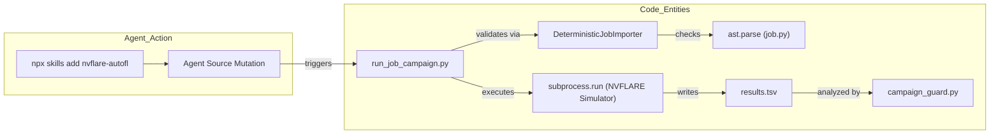

<!-- source: DeepWiki mcp.deepwiki.com · repo NVIDIA/NVFlare · page 23.3 Auto-FL Research Framework · fetched 2026-10-26 -->

# Auto-FL Research Framework

Relevant source files

The following files were used as context for generating this wiki page:

- [dev_tools/agent/skill_evals/nvflare-autofl-report/evals.json](dev_tools/agent/skill_evals/nvflare-autofl-report/evals.json)
- [docs/design/autofl_skill.md](docs/design/autofl_skill.md)
- [docs/user_guide/agent_skills/autofl_skill.rst](docs/user_guide/agent_skills/autofl_skill.rst)
- [skills/nvflare-autofl-report/SKILL.md](skills/nvflare-autofl-report/SKILL.md)
- [skills/nvflare-autofl-report/references/report-contract.md](skills/nvflare-autofl-report/references/report-contract.md)
- [skills/nvflare-autofl-report/scripts/generate_report.py](skills/nvflare-autofl-report/scripts/generate_report.py)
- [skills/nvflare-autofl-report/tests/helper_scripts.md](skills/nvflare-autofl-report/tests/helper_scripts.md)
- [skills/nvflare-autofl/SKILL.md](skills/nvflare-autofl/SKILL.md)
- [skills/nvflare-autofl/references/bounded-campaign-example.md](skills/nvflare-autofl/references/bounded-campaign-example.md)
- [skills/nvflare-autofl/references/continuous-campaigns.md](skills/nvflare-autofl/references/continuous-campaigns.md)
- [skills/nvflare-autofl/references/experiment-comparability.md](skills/nvflare-autofl/references/experiment-comparability.md)
- [skills/nvflare-autofl/scripts/campaign_guard.py](skills/nvflare-autofl/scripts/campaign_guard.py)
- [skills/nvflare-autofl/scripts/job_importer.py](skills/nvflare-autofl/scripts/job_importer.py)
- [skills/nvflare-autofl/scripts/plot_progress.py](skills/nvflare-autofl/scripts/plot_progress.py)
- [skills/nvflare-autofl/scripts/run_job_campaign.py](skills/nvflare-autofl/scripts/run_job_campaign.py)
- [tests/unit_test/tool/autofl_skill_campaign_guard_test.py](tests/unit_test/tool/autofl_skill_campaign_guard_test.py)
- [tests/unit_test/tool/autofl_skill_job_importer_test.py](tests/unit_test/tool/autofl_skill_job_importer_test.py)
- [tests/unit_test/tool/autofl_skill_plot_progress_test.py](tests/unit_test/tool/autofl_skill_plot_progress_test.py)
- [tests/unit_test/tool/autofl_skill_report_test.py](tests/unit_test/tool/autofl_skill_report_test.py)
- [tests/unit_test/tool/autofl_skill_runner_test.py](tests/unit_test/tool/autofl_skill_runner_test.py)

The **Auto-FL Research Framework** provides an automated, agent-driven experimentation loop designed to accelerate Federated Learning (FL) research. It implements an **autoresearch** operating model that manages iterative experiment cycles, including task profiling, deterministic job importing, bounded mutation of hyperparameters or algorithms, and automated reporting [skills/nvflare-autofl/SKILL.md:33-40]().

This framework bridges the gap between natural language research objectives and executable NVFLARE code by utilizing a structured mutation schema, the **NVFLARE Client API**, and the **Recipe API**.

## System Architecture and Data Flow

The framework operates as a closed-loop system where an agent-authored "campaign" defines the research trajectory. It leverages the `run_job_campaign.py` authoritative runner to manage candidate lifecycle and snapshots [skills/nvflare-autofl/scripts/run_job_campaign.py:16-21]().

### Core Components

| Component | Description |
| :--- | :--- |
| `run_job_campaign.py` | The authoritative campaign lifecycle runner. It handles initialization, preparation of candidates, evaluation, and recording of results [skills/nvflare-autofl/SKILL.md:28-28](). |
| `job_importer.py` | A deterministic importer that parses Python source with `ast` to create `autofl.yaml`. It identifies tunable arguments and trust boundaries without executing the user's code [skills/nvflare-autofl/scripts/job_importer.py:15-21](). |
| `campaign_guard.py` | A read-only diagnostic tool that analyzes the `results.tsv` ledger to decide if a campaign should continue, plateau, or switch to literature-inspired exploration [skills/nvflare-autofl/scripts/campaign_guard.py:16-21](). |
| `generate_report.py` | Validates stopped campaign evidence and generates a reproducible Markdown report and machine-readable JSON summary [skills/nvflare-autofl-report/SKILL.md:42-42](). |
| `autofl.yaml` | The human-reviewable campaign configuration containing metrics, environment profiles, and the search space [skills/nvflare-autofl/SKILL.md:96-104](). |
| `results.tsv` | The experiment ledger tracking status (`keep`, `discard`, `crash`), scores, runtimes, and algorithm families [skills/nvflare-autofl/scripts/run_job_campaign.py:62-81](). |

### Research Loop Diagram
This diagram illustrates the flow from the high-level research objectives to the execution of mutated FL jobs.

**Auto-FL Research Execution Loop**

Sources: [skills/nvflare-autofl/scripts/run_job_campaign.py:16-45](), [skills/nvflare-autofl/scripts/job_importer.py:122-137](), [skills/nvflare-autofl/scripts/campaign_guard.py:16-21]()

## Implementation Details

### Integration with Recipe API
The framework uses the **Recipe API** to dynamically generate and execute jobs. The `DeterministicJobImporter` specifically looks for `FedAvgRecipe` and `SimEnv` patterns to extract fixed budgets like `num_rounds` and `min_clients` [skills/nvflare-autofl/scripts/job_importer.py:53-54]().

*   **Fixed Budget Enforcement**: The runner ensures candidates do not override protected fields such as `num_rounds` or `n_clients` defined in the initial job [skills/nvflare-autofl/scripts/run_job_campaign.py:185-189]().
*   **Environment Passthrough**: The simulator child processes receive a sanitized environment, only allowing variables explicitly declared in `simulator_env_passthrough` [skills/nvflare-autofl/scripts/run_job_campaign.py:141-182]().

### Integration with Client API
The framework relies on the standard Client API for training execution.
*   **Metric Extraction**: The runner extracts scores from `cross_val_results.json` or job logs. It prefers the server global model's metric over per-site results [skills/nvflare-autofl/scripts/run_job_campaign.py:83-90]().
*   **Negated Metrics**: Because NVFLARE selection always maximizes, loss-based objectives must be reported as negated metrics (e.g., `neg_val_loss`) [skills/nvflare-autofl/SKILL.md:46-49]().

### Iteration and Campaign Management
Campaigns are managed through a series of lifecycle actions:
1.  **Initialize**: Creates the `autofl.yaml` and snapshots the best source [skills/nvflare-autofl/SKILL.md:42-44]().
2.  **Prepare**: Generates a candidate directory and manifest based on an agent's hypothesis [skills/nvflare-autofl/SKILL.md:53-55]().
3.  **Evaluate**: Executes the candidate (in simulation) or materializes it (in POC/Prod) [skills/nvflare-autofl/SKILL.md:61-65]().
4.  **Record**: Updates the ledger with external execution results and artifacts [skills/nvflare-autofl/SKILL.md:68-71]().
5.  **Status**: Refreshes authoritative state and checks for plateau or literature triggers [skills/nvflare-autofl/references/continuous-campaigns.md:62-64]().

**Agent-to-Code Mapping**

Sources: [skills/nvflare-autofl/scripts/run_job_campaign.py:16-21](), [skills/nvflare-autofl/scripts/job_importer.py:15-21](), [skills/nvflare-autofl/scripts/campaign_guard.py:16-21]()

## Key Functions and Classes

The framework utilizes specialized classes to maintain deterministic behavior and campaign state.

| Entity | Location | Role |
| :--- | :--- | :--- |
| `RunRecord` | [skills/nvflare-autofl/scripts/run_job_campaign.py:208]() | Data class representing a single execution result in the ledger [skills/nvflare-autofl/scripts/run_job_campaign.py:208-226](). |
| `DeterministicJobImporter` | [skills/nvflare-autofl/scripts/job_importer.py:122]() | Parses job scripts to identify tunable `ArgSpec` fields and trust boundaries [skills/nvflare-autofl/scripts/job_importer.py:122-137](). |
| `ArgSpec` | [skills/nvflare-autofl/scripts/job_importer.py:81]() | Represents a static `argparse` field extracted from the source code [skills/nvflare-autofl/scripts/job_importer.py:81-93](). |
| `MetricEvidence` | [skills/nvflare-autofl/scripts/run_job_campaign.py:230]() | Represents the canonical score and its provenance [skills/nvflare-autofl/scripts/run_job_campaign.py:230-235](). |
| `JobRun` | [skills/nvflare-autofl/scripts/run_job_campaign.py:238]() | Tracks candidate metadata, including hypothesis and family [skills/nvflare-autofl/scripts/run_job_campaign.py:238-250](). |

Sources: [skills/nvflare-autofl/scripts/run_job_campaign.py:208-250](), [skills/nvflare-autofl/scripts/job_importer.py:81-137](), [skills/nvflare-autofl/SKILL.md:25-32]()

---

