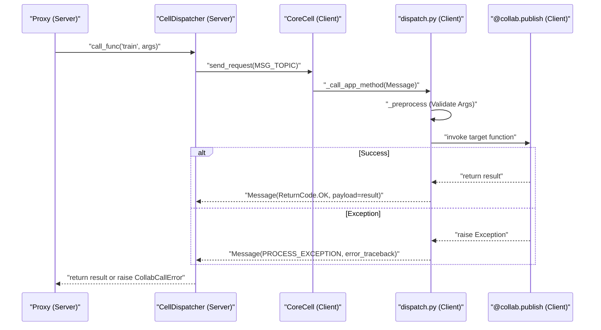

<!-- source: DeepWiki mcp.deepwiki.com · repo NVIDIA/NVFlare · page 24 Collab API · fetched 2026-10-26 -->

# Collab API

<details>
<summary>Relevant source files</summary>

The following files were used as context for generating this wiki page:

- [nvflare/collab/api/exceptions.py](nvflare/collab/api/exceptions.py)
- [nvflare/collab/api/group_call_context.py](nvflare/collab/api/group_call_context.py)
- [nvflare/collab/api/proxy.py](nvflare/collab/api/proxy.py)
- [nvflare/collab/runtime/cell_dispatcher.py](nvflare/collab/runtime/cell_dispatcher.py)
- [nvflare/collab/runtime/controller.py](nvflare/collab/runtime/controller.py)
- [nvflare/collab/runtime/dispatch.py](nvflare/collab/runtime/dispatch.py)
- [nvflare/fuel/common/multi_process_executor_constants.py](nvflare/fuel/common/multi_process_executor_constants.py)
- [nvflare/fuel/f3/connection.py](nvflare/fuel/f3/connection.py)
- [nvflare/private/fed/app/deployer/base_client_deployer.py](nvflare/private/fed/app/deployer/base_client_deployer.py)
- [nvflare/private/fed/app/deployer/server_deployer.py](nvflare/private/fed/app/deployer/server_deployer.py)
- [nvflare/private/fed/app/deployer/simulator_deployer.py](nvflare/private/fed/app/deployer/simulator_deployer.py)
- [nvflare/private/fed/app/simulator/simulator.py](nvflare/private/fed/app/simulator/simulator.py)
- [nvflare/private/fed/app/simulator/simulator_runner.py](nvflare/private/fed/app/simulator/simulator_runner.py)
- [nvflare/private/fed/app/simulator/simulator_worker.py](nvflare/private/fed/app/simulator/simulator_worker.py)
- [nvflare/private/fed/client/admin.py](nvflare/private/fed/client/admin.py)
- [nvflare/private/fed/server/admin.py](nvflare/private/fed/server/admin.py)
- [nvflare/private/fed/simulator/simulator_client_engine.py](nvflare/private/fed/simulator/simulator_client_engine.py)
- [nvflare/private/fed/simulator/simulator_server.py](nvflare/private/fed/simulator/simulator_server.py)
- [tests/unit_test/collab/invocation_test.py](tests/unit_test/collab/invocation_test.py)
- [tests/unit_test/collab/proxy_test.py](tests/unit_test/collab/proxy_test.py)
- [tests/unit_test/collab/runtime/cell_dispatcher_test.py](tests/unit_test/collab/runtime/cell_dispatcher_test.py)
- [tests/unit_test/collab/runtime/controller_test.py](tests/unit_test/collab/runtime/controller_test.py)
- [tests/unit_test/collab/runtime/dispatch_test.py](tests/unit_test/collab/runtime/dispatch_test.py)
- [tests/unit_test/fuel/f3/cellnet/core_cell_test.py](tests/unit_test/fuel/f3/cellnet/core_cell_test.py)
- [tests/unit_test/fuel/f3/streaming/streaming_test.py](tests/unit_test/fuel/f3/streaming/streaming_test.py)
- [tests/unit_test/private/fed/app/deployer/simulator_deployer_test.py](tests/unit_test/private/fed/app/deployer/simulator_deployer_test.py)
- [tests/unit_test/private/fed/app/simulator/simulator_runner_test.py](tests/unit_test/private/fed/app/simulator/simulator_runner_test.py)
- [tests/unit_test/private/fed/server/server_engine_test.py](tests/unit_test/private/fed/server/server_engine_test.py)

</details>


The **Collab API** is a high-level Python function-call interface in NVIDIA FLARE designed to simplify the development of federated and distributed workflows. It allows developers to write collaborative logic using standard Python function calls and decorators, removing the need to manually manage low-level `Task` objects, `Shareable` messages, or explicit controller-executor communication patterns.

The Collab API abstracts the underlying NVFLARE communication infrastructure into a "Proxy" model, where the server can call functions on clients as if they were local objects, and clients can publish functions to be executed in the federated environment.

## Conceptual Overview

The Collab API shifts the programming model from "Message Passing" to "Collaborative Function Execution."

### Key Concepts
*   **Published Functions**: Client-side functions decorated with `@collab.publish` that become callable by the server. [nvflare/collab/api/decorators.py:21-21]()
*   **Proxies**: The server interacts with clients via `Proxy` objects, which provide a method-call interface to trigger remote execution. [nvflare/collab/api/proxy.py:56-74]()
*   **Automatic Serialization**: Arguments and return values are automatically handled by NVFLARE's FOBS serialization system during transport over `CellNet`. [nvflare/collab/runtime/dispatch.py:88-155]()
*   **Workflow Orchestration**: The server-side main loop is defined using `@collab.main`, providing a clear entry point for the federated strategy.

### Code Entity Space Bridge

The following diagram illustrates how the Collab API entities map to the internal NVFLARE execution components.

**Collab API to Runtime Mapping**
```mermaid
graph TD
    subgraph "Natural Language / User Space"
        [UserScript] --> ["collab_script.py"]
        [MainFunc] --> ["@collab.main function"]
        [PubFunc] --> ["@collab.publish function"]
    end

    subgraph "Code Entity Space (nvflare.collab)"
        [Facade] --> ["collab facade"]
        [App] --> ["App / ClientApp"]
        [Proxy] --> ["Proxy / ProxyList"]
        [Dispatcher] --> ["CellDispatcher"]
    end

    subgraph "Core Runtime Space"
        [CoreCell] --> ["CoreCell (F3)"]
        [Adapter] --> ["Adapter"]
        [Executor] --> ["ThreadPoolExecutor"]
    end

    [UserScript] --> [Facade]
    [MainFunc] --> [App]
    [App] --> [Proxy]
    [Proxy] -- "uses" --> [Dispatcher]
    [Dispatcher] -- "send_request" --> [CoreCell]
    [CoreCell] -- "remote invoke" --> [Adapter]
    [Adapter] -- "submit" --> [Executor]
    [Executor] -- "calls" --> [PubFunc]
```
**Sources:** `nvflare/collab/api/proxy.py:56-74` (Proxy definition), `nvflare/collab/runtime/dispatch.py:28-40` (Cell registration), `nvflare/collab/runtime/cell_dispatcher.py:28-37` (CellDispatcher initialization).

## Architecture and Components

The Collab API is built on top of the **CellNet (F3)** communication framework. It utilizes specialized dispatchers and adapters to manage the lifecycle of function calls across the network.

*   **Facade and Decorators**: The `nvflare.collab` package provides the primary interface, including `@collab.publish`, `@collab.main`, `@collab.init`, and `@collab.final`. [nvflare/collab/api/decorators.py:21-21]()
*   **CellDispatcher**: Resides on the caller side (usually server); it handles the routing of function calls to specific FQCNs (Fully Qualified Cell Names) and manages timeouts. [nvflare/collab/runtime/cell_dispatcher.py:43-82]()
*   **App / ClientApp**: Manages the collection of collab-enabled objects and their published interfaces on a specific site. [nvflare/collab/api/app.py:19-19]()
*   **Proxy and Group Calls**: Proxies allow calling a single site, while `ProxyList` facilitates group calls to multiple clients simultaneously, supporting both synchronous and asynchronous results. [nvflare/collab/api/proxy.py:197-208](), [nvflare/collab/api/group_call_context.py:122-135]()

For a deep dive into the internal structure, see [Collab API Architecture](#24.1).

## Usage and Patterns

Writing a Collab application involves defining what clients can do and how the server coordinates those actions.

### Basic Workflow Pattern
1.  **Client Definition**: Define functions for training or evaluation and mark them with `@collab.publish`.
2.  **Server Workflow**: Define a `main` function that iterates through rounds, calling client functions via proxies (e.g., `collab.clients.all.train()`).
3.  **Argument Normalization**: The API automatically converts positional arguments to keyword arguments before transport to ensure robust filtering and validation. [nvflare/collab/api/proxy.py:167-195]()

### Component Interaction Diagram

This diagram shows the flow of a remote collaborative function call, including error handling and context restoration.

**Collab Function Call Flow**

**Sources:** `nvflare/collab/runtime/dispatch.py:88-155` (Server-side method invocation), `nvflare/collab/runtime/cell_dispatcher.py:43-119` (Client-side request dispatching).

### Examples and Migration
The Collab API supports various patterns, including:
*   **Synchronous Aggregation**: Traditional FedAvg where the server waits for all clients.
*   **Error Handling**: Remote exceptions are captured, serialized, and re-raised on the caller side as `CollabCallError`. [nvflare/collab/api/exceptions.py:22-46]()
*   **Secure Calls**: Support for hardware-backed or certificate-based secure communication channels. [nvflare/collab/runtime/cell_dispatcher.py:39-41]()

For implementation details and migration guides from local scripts, see [Collab API Usage and Examples](#24.2).

## Related Components

| Component | Description | Reference |
| :--- | :--- | :--- |
| **CoreCell** | The underlying F3 communication node used for message routing. | [nvflare/fuel/f3/cellnet/core_cell.py:24]() |
| **FOBS** | Handles the serialization of complex Python objects passed through Collab calls. | [nvflare/fuel/f3/cellnet/core_cell.py:39]() |
| **CollabCallError** | Exception raised when a remote collab function fails, containing remote tracebacks. | [nvflare/collab/api/exceptions.py:22]() |
| **GroupCallContext** | Manages state and results for calls dispatched to multiple clients. | [nvflare/collab/api/group_call_context.py:73-86]() |

**Sources:** `nvflare/collab/runtime/defs.py:21-25` (Message definitions), `nvflare/collab/api/context.py:20-20` (Call context management).

---

