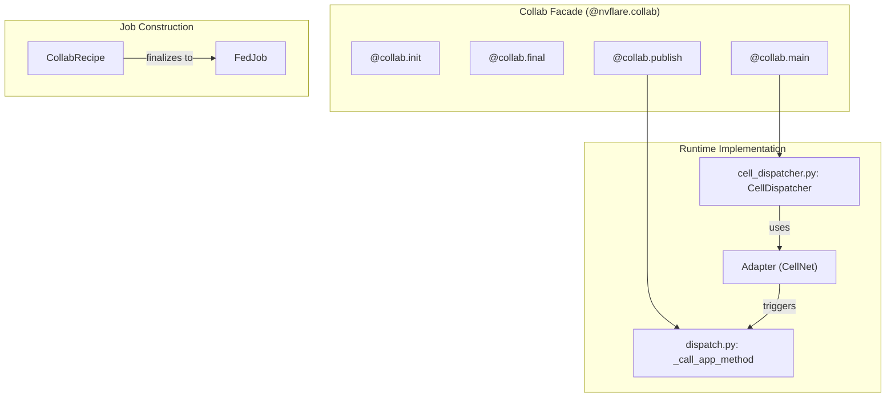
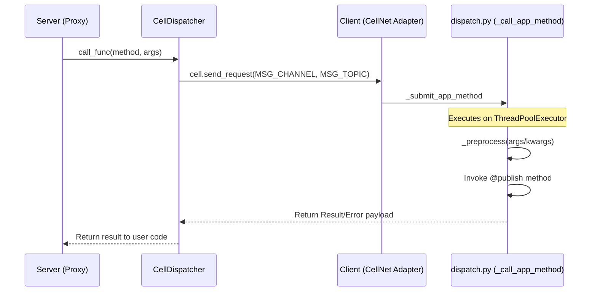

<!-- source: DeepWiki mcp.deepwiki.com · repo NVIDIA/NVFlare · page 24.1 Collab API Architecture · fetched 2026-10-26 -->

# Collab API Architecture

Relevant source files

The following files were used as context for generating this wiki page:

- [nvflare/collab/api/exceptions.py](nvflare/collab/api/exceptions.py)
- [nvflare/collab/api/group_call_context.py](nvflare/collab/api/group_call_context.py)
- [nvflare/collab/api/proxy.py](nvflare/collab/api/proxy.py)
- [nvflare/collab/runtime/cell_dispatcher.py](nvflare/collab/runtime/cell_dispatcher.py)
- [nvflare/collab/runtime/dispatch.py](nvflare/collab/runtime/dispatch.py)
- [tests/unit_test/collab/invocation_test.py](tests/unit_test/collab/invocation_test.py)
- [tests/unit_test/collab/proxy_test.py](tests/unit_test/collab/proxy_test.py)
- [tests/unit_test/collab/runtime/cell_dispatcher_test.py](tests/unit_test/collab/runtime/cell_dispatcher_test.py)
- [tests/unit_test/collab/runtime/dispatch_test.py](tests/unit_test/collab/runtime/dispatch_test.py)
- [tests/unit_test/fuel/f3/cellnet/core_cell_test.py](tests/unit_test/fuel/f3/cellnet/core_cell_test.py)

The Collab API provides a high-level, Pythonic function-call interface for writing federated and distributed workflows. It abstracts away the low-level details of task messaging, `Shareable` objects, and manual component wiring, allowing developers to focus on the collaborative logic between a server and its clients using standard Python method calls.

## Overview

The `nvflare.collab` package introduces a facade that simplifies the development of Federated Learning (FL) applications by using decorators and proxies. It allows the server to treat clients as remote objects with callable methods, while clients "publish" their local functions to be reachable by the server.

The architecture bridges the gap between a standard Python execution model and the NVIDIA FLARE task-based runtime, utilizing a dedicated communication channel over CellNet for low-latency method invocation.

### Key Components

| Component | Description |
| :--- | :--- |
| **Collab Facade** | The primary entry point for the API, providing decorators like `@collab.publish` and `@collab.main`. |
| **Decorators** | Used to define the lifecycle and visibility of functions (`@collab.init`, `@collab.final`, etc.) [nvflare/collab/api/decorators.py:1-100](). |
| **App Abstractions** | `App`, `ServerApp`, and `ClientApp` encapsulate the logic for different sites [nvflare/collab/api/app.py:1-200](). |
| **Proxy Model** | The server uses a `Proxy` to represent a client, enabling group calls and individual site interactions [nvflare/collab/api/proxy.py:56-75](). |
| **Runtime Dispatch** | `CellDispatcher` (caller side) and `_call_app_method` (callee side) manage the underlying message passing [nvflare/collab/runtime/cell_dispatcher.py:28-38](), [nvflare/collab/runtime/dispatch.py:88-167](). |
| **CollabRecipe** | A specialized recipe that finalizes the Collab application into a standard `FedJob`. |

**Sources:**
- `nvflare/collab/api/proxy.py` [56-75]() (Proxy definition)
- `nvflare/collab/runtime/dispatch.py` [88-167]() (Method dispatch implementation)
- `nvflare/collab/runtime/cell_dispatcher.py` [28-38]() (Cell-based invocation)

---

## Code Entity Mapping

The following diagram illustrates how the Collab API concepts map to specific classes and decorators within the codebase.

### Natural Language to Code Entity Space

**Sources:**
- `nvflare/collab/runtime/dispatch.py` [28-40]() (CellNet Adapter registration)
- `nvflare/collab/runtime/cell_dispatcher.py` [28-38]() (CellDispatcher initialization)
- `nvflare/collab/api/proxy.py` [63-65]() (Proxy/Dispatcher relationship)

---

## Decorators and Lifecycle

The Collab API uses decorators to define how functions behave within the federated lifecycle.

*   **`@collab.init`**: Marks a function to be executed during the initialization phase of the app.
*   **`@collab.main`**: Defines the main workflow logic on the server. This function typically orchestrates the clients via `Proxy` objects.
*   **`@collab.publish`**: Applied to client functions to make them discoverable by the server's controller [tests/unit_test/collab/runtime/dispatch_test.py:31-33]().
*   **`@collab.final`**: Marks a function to be executed during the shutdown/cleanup phase.

### Execution Data Flow
The Collab runtime uses a dedicated CellNet channel (`MSG_CHANNEL`) and topic (`MSG_TOPIC`) for method calls [nvflare/collab/runtime/defs.py:21-23]().

**Sources:**
- `nvflare/collab/runtime/dispatch.py` [42-51]() (Offloading to executor)
- `nvflare/collab/runtime/dispatch.py` [67-85]() (Argument preprocessing)
- `nvflare/collab/runtime/cell_dispatcher.py` [69-119]() (Request/Reply handling)
- `nvflare/collab/runtime/defs.py` [21-23]() (Message channel and topic constants)

---

## Proxy and Group Call Model

The `Proxy` represents a remote object (usually a client) [nvflare/collab/api/proxy.py:56-65](). It handles argument normalization, ensuring that positional arguments are converted to keyword arguments based on the remote function's signature before transmission [nvflare/collab/api/proxy.py:167-195]().

### Group Calls and Result Aggregation
When calling methods on a `ProxyList`, the system initiates a group call.
1.  **`ResultWaiter`**: Manages the state of multiple parallel calls [nvflare/collab/api/group_call_context.py:122-136]().
2.  **`ResultQueue`**: A thread-safe queue that collects results as they arrive [nvflare/collab/api/group_call_context.py:36-50]().
3.  **Parallelism Control**: `ResultWaiter.wait_for_call_permission` enforces limits on concurrent active calls [nvflare/collab/api/group_call_context.py:156-176]().

**Sources:**
- `nvflare/collab/api/proxy.py` [197-210]() (Proxy function invocation)
- `nvflare/collab/api/group_call_context.py` [137-155]() (Call count management)
- `nvflare/collab/api/group_call_context.py` [87-111]() (Result iteration)

---

## Runtime Architecture: Dispatch and Error Handling

The runtime ensures that remote exceptions are captured, serialized, and re-raised on the caller side with full context.

### Server/Client Dispatch
The `_call_app_method` function is the entry point for incoming remote calls [nvflare/collab/runtime/dispatch.py:88](). It:
1.  Extracts `CALLER`, `METHOD_NAME`, and `TARGET_NAME` from the payload [nvflare/collab/runtime/dispatch.py:94-100]().
2.  Locates the target object within the `App` [nvflare/collab/runtime/dispatch.py:126-140]().
3.  Validates arguments against the published interface [nvflare/collab/runtime/dispatch.py:72-85]().
4.  Executes the method and wraps any exceptions in a `PROCESS_EXCEPTION` reply [nvflare/collab/runtime/dispatch.py:156-164]().

### Error Propagation
If a remote call fails, the `CellDispatcher` raises a `CollabCallError` [nvflare/collab/api/exceptions.py:22-32](). This error includes:
*   `cause_type`: The original exception class name [nvflare/collab/api/exceptions.py:43]().
*   `remote_traceback`: The stack trace from the remote site [nvflare/collab/api/exceptions.py:44]().

**Sources:**
- `nvflare/collab/runtime/dispatch.py` [156-164]() (Exception formatting)
- `nvflare/collab/runtime/cell_dispatcher.py` [96-102]() (Remote error handling)
- `nvflare/collab/api/exceptions.py` [22-46]() (CollabCallError definition)

---

## CollabRecipe and FedJob Finalization

A `CollabRecipe` is the mechanism used to turn a Collab-based Python script into a deployable `FedJob`.

1.  **Instantiation**: The user defines a `CollabRecipe` with server and client apps.
2.  **Configuration**: Parameters like `min_clients` and `num_rounds` are set.
3.  **Finalization**: The recipe inspects the decorated functions and automatically generates the standard NVFlare job configuration.
4.  **Deployment**: The resulting `FedJob` is then ready for execution.

**Sources:**
- `nvflare/collab/runtime/cell_dispatcher.py` [30-38]() (CellDispatcher initialization with manager and engine)
- `nvflare/collab/runtime/dispatch.py` [28-40]() (Registration of collab callback in CellNet)
- `nvflare/collab/api/exceptions.py` [16-19]() (RunAborted exception for job termination)

---

