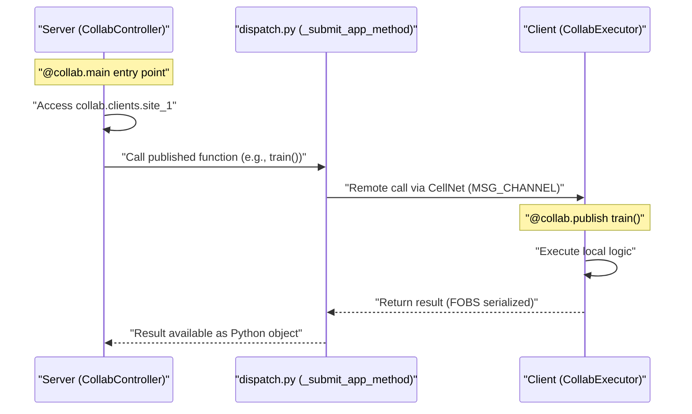

<!-- source: DeepWiki mcp.deepwiki.com · repo NVIDIA/NVFlare · page 24.2 Collab API Usage and Examples · fetched 2026-10-26 -->

# Collab API Usage and Examples

<details>
<summary>Relevant source files</summary>

The following files were used as context for generating this wiki page:

- [docs/example_applications_algorithms.rst](docs/example_applications_algorithms.rst)
- [docs/examples/federated_statistics_overview.rst](docs/examples/federated_statistics_overview.rst)
- [docs/examples/fl_algorithms.rst](docs/examples/fl_algorithms.rst)
- [docs/examples/hello_world_examples.rst](docs/examples/hello_world_examples.rst)
- [docs/examples/medical_image_analysis.rst](docs/examples/medical_image_analysis.rst)
- [docs/examples/tutorial_notebooks.rst](docs/examples/tutorial_notebooks.rst)
- [docs/programming_guide/controllers/cross_site_model_evaluation.rst](docs/programming_guide/controllers/cross_site_model_evaluation.rst)
- [docs/programming_guide/controllers/cyclic_workflow.rst](docs/programming_guide/controllers/cyclic_workflow.rst)
- [docs/programming_guide/controllers/scatter_and_gather_workflow.rst](docs/programming_guide/controllers/scatter_and_gather_workflow.rst)
- [docs/release_notes/flare_220.rst](docs/release_notes/flare_220.rst)
- [docs/release_notes/flare_240.rst](docs/release_notes/flare_240.rst)
- [docs/release_notes/flare_250.rst](docs/release_notes/flare_250.rst)
- [docs/whats_new.rst](docs/whats_new.rst)
- [examples/README.md](examples/README.md)
- [examples/advanced/README.md](examples/advanced/README.md)
- [examples/advanced/finance/README.md](examples/advanced/finance/README.md)
- [examples/advanced/job_api/tf/README.md](examples/advanced/job_api/tf/README.md)
- [examples/advanced/job_api/tf/run_jobs.sh](examples/advanced/job_api/tf/run_jobs.sh)
- [examples/advanced/monitoring/README.md](examples/advanced/monitoring/README.md)
- [examples/advanced/monitoring/jobs/README.md](examples/advanced/monitoring/jobs/README.md)
- [examples/hello-world/README.md](examples/hello-world/README.md)
- [examples/tutorials/README.md](examples/tutorials/README.md)
- [nvflare/collab/api/exceptions.py](nvflare/collab/api/exceptions.py)
- [nvflare/collab/api/group_call_context.py](nvflare/collab/api/group_call_context.py)
- [nvflare/collab/api/proxy.py](nvflare/collab/api/proxy.py)
- [nvflare/collab/runtime/cell_dispatcher.py](nvflare/collab/runtime/cell_dispatcher.py)
- [nvflare/collab/runtime/dispatch.py](nvflare/collab/runtime/dispatch.py)
- [tests/unit_test/collab/invocation_test.py](tests/unit_test/collab/invocation_test.py)
- [tests/unit_test/collab/proxy_test.py](tests/unit_test/collab/proxy_test.py)
- [tests/unit_test/collab/runtime/cell_dispatcher_test.py](tests/unit_test/collab/runtime/cell_dispatcher_test.py)
- [tests/unit_test/collab/runtime/dispatch_test.py](tests/unit_test/collab/runtime/dispatch_test.py)
- [tests/unit_test/fuel/f3/cellnet/core_cell_test.py](tests/unit_test/fuel/f3/cellnet/core_cell_test.py)

</details>


The **Collab API** provides a high-level Python function-call interface for orchestrating federated and distributed workflows in NVIDIA FLARE. It abstracts away the complexities of manual task definitions, `Shareable` message handling, and low-level communication protocols, allowing developers to focus on the logical flow of data and functions between the server and clients [docs/release_notes/flare_250.rst:7-18]().

## Overview of the Collab Workflow

The Collab API operates by decorating standard Python functions to make them available across the federated network. The server orchestrates these functions using a proxy-based model, where calls to client functions are transparently routed through the FLARE communication infrastructure.

### Data Flow and Interaction

The following diagram illustrates the interaction between a `ServerApp` (the orchestrator) and `ClientApp` instances (the executors) using the Collab API. The runtime uses a specialized `Adapter` to bridge the `Cell` communication layer to the application logic.

**Collab API Execution Flow**


Sources: [nvflare/collab/runtime/dispatch.py:28-39](), [nvflare/collab/runtime/dispatch.py:42-52](), [nvflare/collab/runtime/dispatch.py:88-120]()

---

## Publishing Client Functions

To make a function available for the server to call, it must be decorated with `@collab.publish`. This registers the function within the `ClientApp` on the client side.

### Key Implementation Details
- **Registration**: The `prepare_for_remote_call` function registers a callback on the `Cell` for the `MSG_CHANNEL` and `MSG_TOPIC` [nvflare/collab/runtime/dispatch.py:28-39]().
- **Serialization**: Arguments passed from the server and results returned by the client are automatically serialized using **FOBS** (FLARE Object Serialization). FOBS includes auto-registration of decomposers to simplify the transfer of custom data classes [docs/release_notes/flare_250.rst:71-83]().
- **Execution Context**: The function runs within the client's job process. The `_submit_app_method` ensures user code is offloaded to a `CollabExecutor` to avoid blocking the shared communication threads [nvflare/collab/runtime/dispatch.py:42-52]().
- **Argument Normalization**: Positional arguments are normalized to keyword arguments (`kwargs`) before transport to ensure filters and validation can identify them reliably [nvflare/collab/runtime/dispatch.py:114-118]().

Sources: [nvflare/collab/runtime/dispatch.py:28-39](), [nvflare/collab/runtime/dispatch.py:42-52](), [nvflare/collab/runtime/dispatch.py:114-118](), [docs/release_notes/flare_250.rst:71-83]()

---

## Server Workflows with `collab.clients`

The server-side logic resides in a function decorated with `@collab.main`. The `collab.clients` object acts as a dynamic proxy for all connected sites.

### Usage Patterns

1.  **Individual Site Calls**: Access a specific client by its site name: `collab.clients.site_1.my_function(arg1)`.
2.  **Group Calls**: Perform operations on multiple clients simultaneously using `collab.clients.all_clients` or filtered subsets.
3.  **Callbacks**: For asynchronous or iterative workflows, group calls support callbacks to process results as they arrive.
4.  **Per-Site Configuration**: Workflows can use site-specific logic or configurations passed during the call context [nvflare/collab/runtime/dispatch.py:67-85]().

### Error Handling with `CollabCallError`
Communication failures, client timeouts, or exceptions within the published client function raise a `CollabCallError`. The runtime captures remote exceptions, including the error type and traceback, and returns them to the caller as a `PROCESS_EXCEPTION` [nvflare/collab/runtime/dispatch.py:156-164](). The `nvflare.collab.api.exceptions` module defines the specific error types encountered during these remote invocations.

Sources: [nvflare/collab/runtime/dispatch.py:54-64](), [nvflare/collab/runtime/dispatch.py:156-164](), [nvflare/collab/api/exceptions.py:1-20]()

---

## Simulation and Runtime Infrastructure

The Collab API leverages the FLARE Simulator for rapid prototyping. The `SimulatorRunner` orchestrates the execution of multiple client sites and the server within a single environment.

**Entity Mapping: Collab Runtime to Code**
```mermaid
graph TD
    subgraph "Natural Language Space"
        "Collab Orchestrator"
        "Client Remote Interface"
        "Remote Call Dispatcher"
        "Serialization Layer"
    end

    subgraph "Code Entity Space"
        CC["nvflare.collab.api.decorators.main"]
        CP["nvflare.collab.api.proxy.Proxy"]
        CD["nvflare.collab.runtime.dispatch._call_app_method"]
        FOBS["nvflare.fuel.f3.fobs"]
    end

    "Collab Orchestrator" --> CC
    "Client Remote Interface" --> CP
    "Remote Call Dispatcher" --> CD
    "Serialization Layer" --> FOBS
```

### Execution Characteristics

- **In-Process Execution**: The Collab API can utilize the `InProcessClientAPIExecutor` for higher efficiency, where communication occurs in memory rather than across process boundaries [docs/release_notes/flare_250.rst:21-33]().
- **Context Management**: The runtime manages a `CallContext` to track caller and callee information, ensuring that published methods have access to their execution environment [nvflare/collab/runtime/dispatch.py:67-85]().
- **Positional Argument Restoration**: While arguments are sent as kwargs for transport safety, the runtime restores positional-only argument signatures before invoking the local function on the client [nvflare/collab/runtime/dispatch.py:167-182]().

Sources: [docs/release_notes/flare_250.rst:21-33](), [nvflare/collab/runtime/dispatch.py:67-85](), [nvflare/collab/runtime/dispatch.py:167-182]()

---

## Examples in `examples/collab/`

The codebase includes several reference implementations demonstrating the versatility of the Collab API:

1.  **hello_numpy_collab**: A basic example showing how to pass NumPy arrays between server and clients for simple arithmetic operations [examples/hello-world/README.md:214-226]().
2.  **hello_fedavg**: Implements the standard Federated Averaging algorithm using `@collab.publish` for local training and server-side aggregation logic [examples/README.md:79-80]().
3.  **async_aggregation**: Demonstrates non-blocking group calls where the server aggregates results as they arrive, rather than waiting for all clients to finish [examples/advanced/README.md:11-13]().
4.  **swarm**: An implementation of Swarm Learning where clients communicate and coordinate without a central aggregator, utilizing the P2P capabilities underlying the Collab API [examples/advanced/README.md:48-50]().

### Migration from Local Simulation to Collab

The migration path involves three primary steps:
1.  **Refactor**: Wrap training logic in `@collab.publish` and orchestration in `@collab.main`.
2.  **Recipe Definition**: Use the `FedJob` API or a specialized `CollabRecipe` to define the job structure, which automatically generates the necessary configuration files [docs/release_notes/flare_250.rst:34-42]().
3.  **Execution**: Switch the execution environment (e.g., from `SimEnv` to `PocEnv`) without changing the core application logic. The `CollabRecipe` handles the finalization to a standard FLARE job [examples/hello-world/README.md:56-70]().

Sources: [examples/hello-world/README.md:214-226](), [docs/release_notes/flare_250.rst:34-42](), [examples/hello-world/README.md:56-70](), [examples/README.md:79-80]()

---

