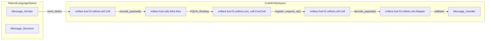
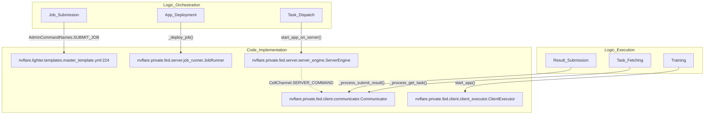

<!-- source: DeepWiki mcp.deepwiki.com · repo NVIDIA/NVFlare · page 25 Glossary · fetched 2026-10-26 -->

# Glossary

Relevant source files

The following files were used as context for generating this wiki page:

- [README.md](README.md)
- [docs/examples/hello_cross_val.rst](docs/examples/hello_cross_val.rst)
- [docs/examples/hello_numpy.rst](docs/examples/hello_numpy.rst)
- [docs/faq.rst](docs/faq.rst)
- [docs/flare_overview.rst](docs/flare_overview.rst)
- [docs/index.rst](docs/index.rst)
- [docs/installation.rst](docs/installation.rst)
- [docs/programming_guide/filters.rst](docs/programming_guide/filters.rst)
- [docs/programming_guide/provisioning_system.rst](docs/programming_guide/provisioning_system.rst)
- [docs/programming_guide/system_architecture.rst](docs/programming_guide/system_architecture.rst)
- [docs/quickstart.rst](docs/quickstart.rst)
- [docs/resources/nvidia_eye.wwPt122j.png](docs/resources/nvidia_eye.wwPt122j.png)
- [docs/user_guide/admin_guide/security/unsafe_component_detection.rst](docs/user_guide/admin_guide/security/unsafe_component_detection.rst)
- [docs/user_guide/nvflare_cli/provision_command.rst](docs/user_guide/nvflare_cli/provision_command.rst)
- [examples/advanced/psi/README.md](examples/advanced/psi/README.md)
- [examples/advanced/psi/psi.jpg](examples/advanced/psi/psi.jpg)
- [nvflare/apis/client_engine_spec.py](nvflare/apis/client_engine_spec.py)
- [nvflare/apis/event_type.py](nvflare/apis/event_type.py)
- [nvflare/apis/fl_component.py](nvflare/apis/fl_component.py)
- [nvflare/apis/fl_constant.py](nvflare/apis/fl_constant.py)
- [nvflare/apis/job_scheduler_spec.py](nvflare/apis/job_scheduler_spec.py)
- [nvflare/apis/server_engine_spec.py](nvflare/apis/server_engine_spec.py)
- [nvflare/apis/utils/fl_context_utils.py](nvflare/apis/utils/fl_context_utils.py)
- [nvflare/apis/utils/format_check.py](nvflare/apis/utils/format_check.py)
- [nvflare/app_common/default_component_policy.py](nvflare/app_common/default_component_policy.py)
- [nvflare/app_common/job_schedulers/job_scheduler.py](nvflare/app_common/job_schedulers/job_scheduler.py)
- [nvflare/app_common/widgets/component_path_authorizer.py](nvflare/app_common/widgets/component_path_authorizer.py)
- [nvflare/cli.py](nvflare/cli.py)
- [nvflare/edge/simulation/README.md](nvflare/edge/simulation/README.md)
- [nvflare/fuel/f3/cellnet/cell.py](nvflare/fuel/f3/cellnet/cell.py)
- [nvflare/fuel/hci/server/authz.py](nvflare/fuel/hci/server/authz.py)
- [nvflare/fuel/sec/authz.py](nvflare/fuel/sec/authz.py)
- [nvflare/lighter/constants.py](nvflare/lighter/constants.py)
- [nvflare/lighter/ctx.py](nvflare/lighter/ctx.py)
- [nvflare/lighter/dummy_project.yml](nvflare/lighter/dummy_project.yml)
- [nvflare/lighter/edge_project.yml](nvflare/lighter/edge_project.yml)
- [nvflare/lighter/entity.py](nvflare/lighter/entity.py)
- [nvflare/lighter/impl/cert.py](nvflare/lighter/impl/cert.py)
- [nvflare/lighter/impl/docker.py](nvflare/lighter/impl/docker.py)
- [nvflare/lighter/impl/static_file.py](nvflare/lighter/impl/static_file.py)
- [nvflare/lighter/provision.py](nvflare/lighter/provision.py)
- [nvflare/lighter/provisioner.py](nvflare/lighter/provisioner.py)
- [nvflare/lighter/templates/master_template.yml](nvflare/lighter/templates/master_template.yml)
- [nvflare/lighter/tree_prov.py](nvflare/lighter/tree_prov.py)
- [nvflare/private/aux_runner.py](nvflare/private/aux_runner.py)
- [nvflare/private/defs.py](nvflare/private/defs.py)
- [nvflare/private/event.py](nvflare/private/event.py)
- [nvflare/private/fed/app/client/client_train.py](nvflare/private/fed/app/client/client_train.py)
- [nvflare/private/fed/app/client/sub_worker_process.py](nvflare/private/fed/app/client/sub_worker_process.py)
- [nvflare/private/fed/app/client/worker_process.py](nvflare/private/fed/app/client/worker_process.py)
- [nvflare/private/fed/app/server/runner_process.py](nvflare/private/fed/app/server/runner_process.py)
- [nvflare/private/fed/app/server/server_train.py](nvflare/private/fed/app/server/server_train.py)
- [nvflare/private/fed/client/client_app_runner.py](nvflare/private/fed/client/client_app_runner.py)
- [nvflare/private/fed/client/client_engine.py](nvflare/private/fed/client/client_engine.py)
- [nvflare/private/fed/client/client_engine_executor_spec.py](nvflare/private/fed/client/client_engine_executor_spec.py)
- [nvflare/private/fed/client/client_engine_internal_spec.py](nvflare/private/fed/client/client_engine_internal_spec.py)
- [nvflare/private/fed/client/client_executor.py](nvflare/private/fed/client/client_executor.py)
- [nvflare/private/fed/client/client_req_processors.py](nvflare/private/fed/client/client_req_processors.py)
- [nvflare/private/fed/client/client_run_manager.py](nvflare/private/fed/client/client_run_manager.py)
- [nvflare/private/fed/client/client_runner.py](nvflare/private/fed/client/client_runner.py)
- [nvflare/private/fed/client/command_agent.py](nvflare/private/fed/client/command_agent.py)
- [nvflare/private/fed/client/communicator.py](nvflare/private/fed/client/communicator.py)
- [nvflare/private/fed/client/fed_client.py](nvflare/private/fed/client/fed_client.py)
- [nvflare/private/fed/client/fed_client_base.py](nvflare/private/fed/client/fed_client_base.py)
- [nvflare/private/fed/client/sys_cmd.py](nvflare/private/fed/client/sys_cmd.py)
- [nvflare/private/fed/server/cmd_utils.py](nvflare/private/fed/server/cmd_utils.py)
- [nvflare/private/fed/server/fed_server.py](nvflare/private/fed/server/fed_server.py)
- [nvflare/private/fed/server/info_coll_cmd.py](nvflare/private/fed/server/info_coll_cmd.py)
- [nvflare/private/fed/server/job_runner.py](nvflare/private/fed/server/job_runner.py)
- [nvflare/private/fed/server/run_manager.py](nvflare/private/fed/server/run_manager.py)
- [nvflare/private/fed/server/server_command_agent.py](nvflare/private/fed/server/server_command_agent.py)
- [nvflare/private/fed/server/server_commands.py](nvflare/private/fed/server/server_commands.py)
- [nvflare/private/fed/server/server_engine.py](nvflare/private/fed/server/server_engine.py)
- [nvflare/private/fed/server/server_engine_internal_spec.py](nvflare/private/fed/server/server_engine_internal_spec.py)
- [nvflare/private/fed/server/server_runner.py](nvflare/private/fed/server/server_runner.py)
- [nvflare/private/fed/server/sys_cmd.py](nvflare/private/fed/server/sys_cmd.py)
- [nvflare/private/fed/server/training_cmds.py](nvflare/private/fed/server/training_cmds.py)
- [nvflare/private/fed/utils/fed_utils.py](nvflare/private/fed/utils/fed_utils.py)
- [nvflare/private/fed/utils/site_config.py](nvflare/private/fed/utils/site_config.py)
- [nvflare/security/security.py](nvflare/security/security.py)
- [nvflare/tool/job/config/config_indexer.py](nvflare/tool/job/config/config_indexer.py)
- [nvflare/tool/job/config/configer.py](nvflare/tool/job/config/configer.py)
- [nvflare/tool/job/job_cli.py](nvflare/tool/job/job_cli.py)
- [nvflare/tool/job/job_client_const.py](nvflare/tool/job/job_client_const.py)
- [nvflare/tool/poc/poc_commands.py](nvflare/tool/poc/poc_commands.py)
- [nvflare/tool/poc/service_constants.py](nvflare/tool/poc/service_constants.py)
- [nvflare/utils/cli_utils.py](nvflare/utils/cli_utils.py)
- [nvflare/widgets/info_collector.py](nvflare/widgets/info_collector.py)
- [tests/unit_test/app_common/job_schedulers/job_scheduler_test.py](tests/unit_test/app_common/job_schedulers/job_scheduler_test.py)
- [tests/unit_test/app_common/widgets/component_path_authorizer_test.py](tests/unit_test/app_common/widgets/component_path_authorizer_test.py)
- [tests/unit_test/data/jobs/launch_everytime/app/config/config_fed_client.conf](tests/unit_test/data/jobs/launch_everytime/app/config/config_fed_client.conf)
- [tests/unit_test/data/jobs/launch_everytime/app/config/config_fed_server.conf](tests/unit_test/data/jobs/launch_everytime/app/config/config_fed_server.conf)
- [tests/unit_test/data/jobs/launch_everytime/meta.conf](tests/unit_test/data/jobs/launch_everytime/meta.conf)
- [tests/unit_test/data/jobs/launch_once/app/config/config_fed_client.conf](tests/unit_test/data/jobs/launch_once/app/config/config_fed_client.conf)
- [tests/unit_test/data/jobs/launch_once/app/config/config_fed_server.conf](tests/unit_test/data/jobs/launch_once/app/config/config_fed_server.conf)
- [tests/unit_test/data/jobs/launch_once/meta.conf](tests/unit_test/data/jobs/launch_once/meta.conf)
- [tests/unit_test/fuel/flare_api_test.py](tests/unit_test/fuel/flare_api_test.py)
- [tests/unit_test/fuel/hci/server/authz_filter_test.py](tests/unit_test/fuel/hci/server/authz_filter_test.py)
- [tests/unit_test/lighter/__init__.py](tests/unit_test/lighter/__init__.py)
- [tests/unit_test/lighter/cert_builder_test.py](tests/unit_test/lighter/cert_builder_test.py)
- [tests/unit_test/lighter/participant_test.py](tests/unit_test/lighter/participant_test.py)
- [tests/unit_test/lighter/poc_commands_test.py](tests/unit_test/lighter/poc_commands_test.py)
- [tests/unit_test/lighter/project_test.py](tests/unit_test/lighter/project_test.py)
- [tests/unit_test/lighter/static_file_builder_test.py](tests/unit_test/lighter/static_file_builder_test.py)
- [tests/unit_test/private/fed/client/client_executor_test.py](tests/unit_test/private/fed/client/client_executor_test.py)
- [tests/unit_test/private/fed/server/fed_server_test.py](tests/unit_test/private/fed/server/fed_server_test.py)
- [tests/unit_test/private/fed/server/job_runner_test.py](tests/unit_test/private/fed/server/job_runner_test.py)
- [tests/unit_test/private/fed/utils/site_config_test.py](tests/unit_test/private/fed/utils/site_config_test.py)
- [tests/unit_test/tool/job/config/config_indexer_test.py](tests/unit_test/tool/job/config/config_indexer_test.py)
- [tests/unit_test/tool/job/config/configer_test.py](tests/unit_test/tool/job/config/configer_test.py)
- [tests/unit_test/tool/job/job_cli_test.py](tests/unit_test/tool/job/job_cli_test.py)
- [tests/unit_test/tool/poc/poc_force_test.py](tests/unit_test/tool/poc/poc_force_test.py)
- [tests/unit_test/tool/poc/poc_output_test.py](tests/unit_test/tool/poc/poc_output_test.py)

This page defines codebase-specific terms, jargon, and architectural concepts used within NVIDIA FLARE. It serves as a reference for onboarding engineers to map high-level federated learning concepts to specific code entities and implementations.

## Core System Entities

The following terms describe the primary structural components of the NVFLARE runtime.

| Term | Definition | Key Code Entities |
| :--- | :--- | :--- |
| **Server Engine** | The central coordinator on the server side responsible for job orchestration, client management, and communication. | `ServerEngine` [nvflare/private/fed/server/server_engine.py:89-128](), `ServerEngineInternalSpec` [nvflare/private/fed/server/server_engine_internal_spec.py]() |
| **Client Engine** | The counterpart to the Server Engine running on each participant site, managing task execution and communication. | `ClientEngine` [nvflare/private/fed/client/client_engine.py](), `ClientEngineInternalSpec` [nvflare/private/fed/client/communicator.py:46]() |
| **Job Runner** | A component within the Server Engine that manages the lifecycle of a specific Job (deployment, starting, monitoring, stopping). | `JobRunner` [nvflare/private/fed/server/job_runner.py:94-102]() |
| **Communicator** | The abstraction layer on the client side that handles registration, heartbeats, and task fetching from the server. | `Communicator` [nvflare/private/fed/client/communicator.py:52-104]() |
| **FLContext** | A state-sharing object passed through components (Controllers, Executors, Filters) to provide access to the engine and job metadata. | `FLContext` [nvflare/apis/fl_context.py:33-40](), `FLContextKey` [nvflare/apis/fl_constant.py:123-180]() |
| **Job Manager** | Handles the storage, retrieval, and metadata validation of submitted jobs. | `JobDefManagerSpec` [nvflare/apis/impl/job_def_manager.py:42-42](), `SimpleJobDefManager` [nvflare/lighter/templates/master_template.yml:224-224]() |

**Sources:** [nvflare/private/fed/server/server_engine.py:89-128](), [nvflare/private/fed/server/job_runner.py:94-102](), [nvflare/private/fed/client/communicator.py:52-104](), [nvflare/apis/fl_constant.py:123-180](), [nvflare/lighter/templates/master_template.yml:224-224]()

## Communication Jargon

NVFLARE uses a custom communication stack called CellNet (F3).

### Cell and FQCN
A **Cell** is the primary communication endpoint [nvflare/fuel/f3/cellnet/cell.py:72-81](). Every participant in the network is identified by a **FQCN** (Fully Qualified Cell Name) [nvflare/fuel/f3/cellnet/fqcn.py:20-25](). The root server is always `server` [nvflare/fuel/f3/cellnet/fqcn.py:185-185]().

### Channels and Topics
Communication is segmented into **Channels** to isolate different types of traffic [nvflare/fuel/f3/cellnet/defs.py:25-35]():
*   `SERVER_COMMAND`: Used for operational tasks like `GET_TASK` and `SUBMIT_UPDATE` [nvflare/private/fed/client/communicator.py:133-144]().
*   `AUX`: Used for auxiliary data flow like metrics streaming and logging [nvflare/fuel/f3/cellnet/defs.py:33]().
*   `MAIN`: Used for the primary FL algorithm data exchange [nvflare/fuel/f3/cellnet/defs.py:26]().

### FOBS
**FOBS** (FLARE Object Serialization) is the internal serialization framework used to convert complex Python objects into byte streams for transmission over CellNet [nvflare/fuel/f3/cellnet/cell.py:27-27](). It uses a `FOBSContext` to handle features like `PASS_THROUGH` where tensors are not downloaded at every hop [nvflare/fuel/f3/cellnet/cell.py:102-112]().

### Concept to Code Mapping: Communication
The following diagram bridges the natural language concepts of "Sending a Message" to the actual CellNet entities.

Title: CellNet Communication Flow

**Sources:** [nvflare/fuel/f3/cellnet/cell.py:72-132](), [nvflare/fuel/f3/cellnet/fqcn.py:185-185](), [nvflare/private/fed/client/communicator.py:133-144]()

## Execution Model Terms

### Parent and Job Processes
NVFLARE utilizes process isolation for security and stability:
*   **SP/CP (Server/Client Parent):** The persistent background processes (e.g., `BaseServer` [nvflare/private/fed/server/fed_server.py:85](), `FederatedClientBase` [nvflare/private/fed/client/fed_client_base.py:39]()) that manage the connection and job scheduling [nvflare/apis/fl_constant.py:118]().
*   **SJ/CJ (Server/Client Job):** Subprocesses spawned to execute a specific job's code [nvflare/apis/fl_constant.py:118](). This ensures that a crash in user training code does not kill the main NVFLARE daemon.

### Controller and Executor
*   **Controller:** A server-side component (subclass of `FLComponent`) that defines the FL workflow logic, such as `FedAvg` or `ScatterAndGather` [nvflare/private/fed/server/job_runner.py:149-160]().
*   **Executor:** A client-side component responsible for performing the actual work (training, validation) for a task assigned by the Controller [nvflare/apis/fl_constant.py:85-88](). It is routed via the `ClientExecutor` [nvflare/private/fed/client/client_executor.py:86-110]().

### Concept to Code Mapping: Execution Lifecycle
This diagram maps the logical steps of running a federated job to the specific classes and methods.

Title: Job Execution Logic to Code Entities

**Sources:** [nvflare/private/fed/server/job_runner.py:125-172](), [nvflare/private/fed/client/communicator.py:153-172](), [nvflare/private/fed/server/server_engine.py:177-200](), [nvflare/apis/fl_constant.py:118](), [nvflare/private/fed/client/client_executor.py:86-110]()

## Provisioning and Deployment

| Term | Definition | Key Code Entities |
| :--- | :--- | :--- |
| **Lighter** | The subsystem used to generate "Startup Kits" (certificates, configs, scripts) for participants. | `StaticFileBuilder` [nvflare/lighter/impl/static_file.py:38-49](), `Builder` [nvflare/lighter/impl/static_file.py:38-38]() |
| **Startup Kit** | A package containing the necessary security credentials and configuration files to join an NVFLARE federation. | `StaticFileBuilder` [nvflare/lighter/impl/static_file.py:38-64](), `master_template.yml` [nvflare/lighter/templates/master_template.yml]() |
| **POC Mode** | A simplified deployment mode where all participants run on a single machine without formal certificates. | `ProvisionMode.POC` [nvflare/lighter/constants.py:29]() |
| **Simulator** | A rapid prototyping tool that runs the entire FL workflow in a local environment. | `CellChannel.SIMULATOR_RUNNER` [nvflare/fuel/f3/cellnet/cell.py:44]() |
| **Workspace** | The directory structure where NVFLARE stores its configuration, models, and run-time data. | `Workspace` [nvflare/apis/workspace.py:25](), `FilesystemStorage` [nvflare/lighter/templates/master_template.yml:206-206]() |

**Sources:** [nvflare/lighter/impl/static_file.py:38-64](), [nvflare/fuel/f3/cellnet/cell.py:37-46](), [nvflare/lighter/constants.py:29](), [nvflare/apis/workspace.py:25](), [nvflare/lighter/templates/master_template.yml:206-206]()

## Common Abbreviations and Keys

*   **DXO (Data Exchange Object):** A standardized structure for packaging data (weights, gradients, metrics) exchanged between server and client [nvflare/apis/fl_constant.py:100]().
*   **SSID (Service Session ID):** A unique identifier for a server's operational session, used by the Communicator to handle high availability and failover [nvflare/private/fed/client/communicator.py:88](), [nvflare/apis/fl_constant.py:171]().
*   **SP (Service Provider):** In the context of High Availability, refers to the server endpoint details [nvflare/private/fed/client/communicator.py:109-112]().
*   **mTLS:** mutual Transport Layer Security; the default security mode for NVFLARE production where both client and server verify each other's certificates [nvflare/lighter/impl/static_file.py:114-128]().
*   **SAI (Server Admin Interface):** The internal context manager for administrative operations [nvflare/private/fed/server/job_runner.py:68-69]().
*   **JobMetaKey:** Standard keys used in the metadata of a job to define its properties like `deploy_map` and `min_clients` [nvflare/apis/job_def.py:41-41](), [nvflare/apis/fl_constant.py:110-110]().
*   **RunStatus:** Enum representing the lifecycle state of a job, such as `SUBMITTED`, `RUNNING`, or `FINISHED_COMPLETED` [nvflare/apis/job_def.py:41-41]().

**Sources:** [nvflare/private/fed/client/communicator.py:83-113](), [nvflare/lighter/impl/static_file.py:114-128](), [nvflare/private/fed/server/job_runner.py:68-69](), [nvflare/apis/fl_constant.py:100-171]()