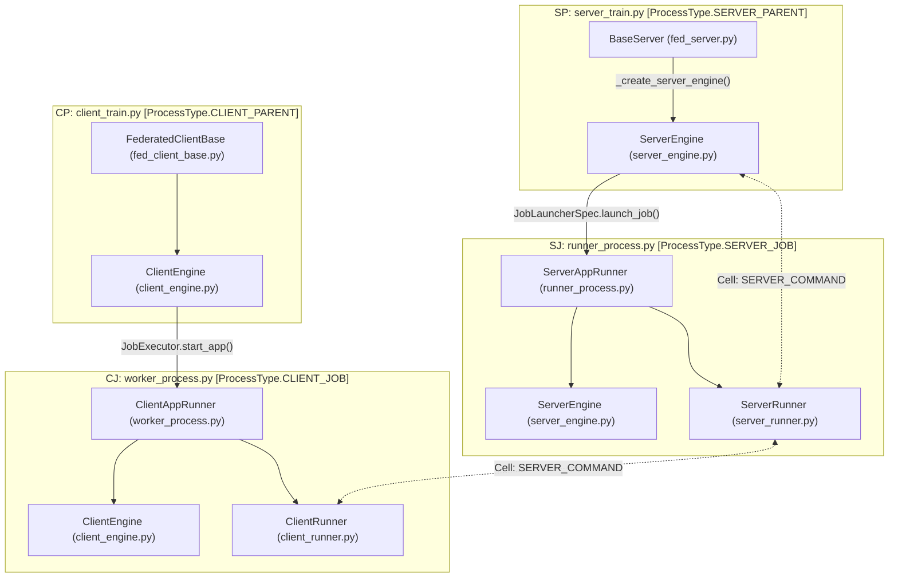
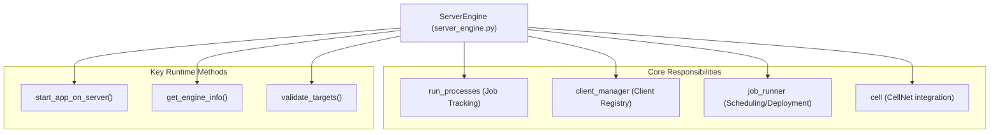
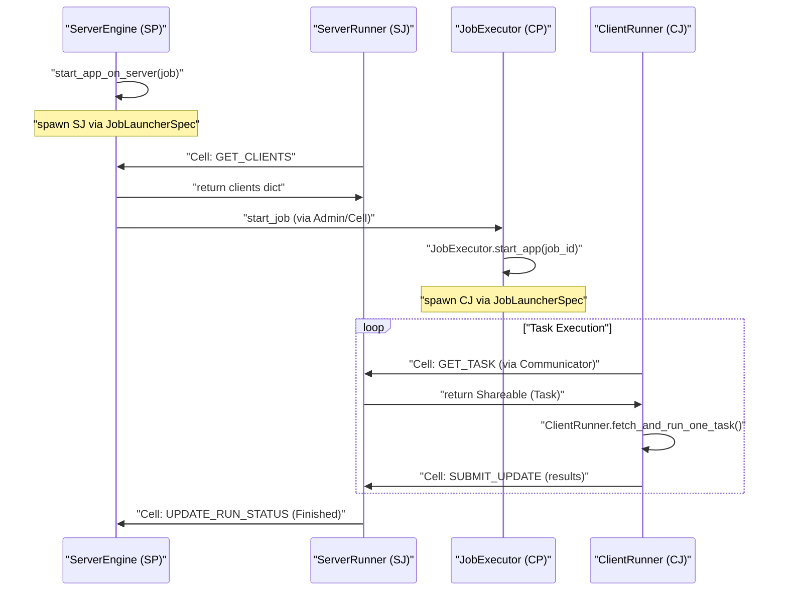

<!-- source: DeepWiki mcp.deepwiki.com · repo NVIDIA/NVFlare · page 3 Core Runtime Architecture · fetched 2026-10-26 -->

# Core Runtime Architecture

Relevant source files

The following files were used as context for generating this wiki page:

- [docs/user_guide/admin_guide/configurations/variable_resolution.rst](docs/user_guide/admin_guide/configurations/variable_resolution.rst)
- [nvflare/apis/client_engine_spec.py](nvflare/apis/client_engine_spec.py)
- [nvflare/apis/fl_constant.py](nvflare/apis/fl_constant.py)
- [nvflare/apis/job_scheduler_spec.py](nvflare/apis/job_scheduler_spec.py)
- [nvflare/apis/server_engine_spec.py](nvflare/apis/server_engine_spec.py)
- [nvflare/app_common/job_schedulers/job_scheduler.py](nvflare/app_common/job_schedulers/job_scheduler.py)
- [nvflare/fuel/utils/component_builder.py](nvflare/fuel/utils/component_builder.py)
- [nvflare/fuel/utils/config_service.py](nvflare/fuel/utils/config_service.py)
- [nvflare/fuel/utils/wfconf.py](nvflare/fuel/utils/wfconf.py)
- [nvflare/private/aux_runner.py](nvflare/private/aux_runner.py)
- [nvflare/private/fed/app/client/client_train.py](nvflare/private/fed/app/client/client_train.py)
- [nvflare/private/fed/app/client/sub_worker_process.py](nvflare/private/fed/app/client/sub_worker_process.py)
- [nvflare/private/fed/app/client/worker_process.py](nvflare/private/fed/app/client/worker_process.py)
- [nvflare/private/fed/app/fl_conf.py](nvflare/private/fed/app/fl_conf.py)
- [nvflare/private/fed/app/server/runner_process.py](nvflare/private/fed/app/server/runner_process.py)
- [nvflare/private/fed/app/server/server_train.py](nvflare/private/fed/app/server/server_train.py)
- [nvflare/private/fed/client/client_app_runner.py](nvflare/private/fed/client/client_app_runner.py)
- [nvflare/private/fed/client/client_engine.py](nvflare/private/fed/client/client_engine.py)
- [nvflare/private/fed/client/client_engine_executor_spec.py](nvflare/private/fed/client/client_engine_executor_spec.py)
- [nvflare/private/fed/client/client_engine_internal_spec.py](nvflare/private/fed/client/client_engine_internal_spec.py)
- [nvflare/private/fed/client/client_executor.py](nvflare/private/fed/client/client_executor.py)
- [nvflare/private/fed/client/client_json_config.py](nvflare/private/fed/client/client_json_config.py)
- [nvflare/private/fed/client/client_run_manager.py](nvflare/private/fed/client/client_run_manager.py)
- [nvflare/private/fed/client/client_runner.py](nvflare/private/fed/client/client_runner.py)
- [nvflare/private/fed/client/command_agent.py](nvflare/private/fed/client/command_agent.py)
- [nvflare/private/fed/client/communicator.py](nvflare/private/fed/client/communicator.py)
- [nvflare/private/fed/client/fed_client.py](nvflare/private/fed/client/fed_client.py)
- [nvflare/private/fed/client/fed_client_base.py](nvflare/private/fed/client/fed_client_base.py)
- [nvflare/private/fed/server/fed_server.py](nvflare/private/fed/server/fed_server.py)
- [nvflare/private/fed/server/job_runner.py](nvflare/private/fed/server/job_runner.py)
- [nvflare/private/fed/server/server_app_runner.py](nvflare/private/fed/server/server_app_runner.py)
- [nvflare/private/fed/server/server_command_agent.py](nvflare/private/fed/server/server_command_agent.py)
- [nvflare/private/fed/server/server_commands.py](nvflare/private/fed/server/server_commands.py)
- [nvflare/private/fed/server/server_engine.py](nvflare/private/fed/server/server_engine.py)
- [nvflare/private/fed/server/server_json_config.py](nvflare/private/fed/server/server_json_config.py)
- [nvflare/private/fed/server/server_runner.py](nvflare/private/fed/server/server_runner.py)
- [nvflare/private/fed/simulator/simulator_app_runner.py](nvflare/private/fed/simulator/simulator_app_runner.py)
- [nvflare/private/fed/utils/fed_utils.py](nvflare/private/fed/utils/fed_utils.py)
- [nvflare/private/fed_json_config.py](nvflare/private/fed_json_config.py)
- [nvflare/private/json_configer.py](nvflare/private/json_configer.py)
- [tests/unit_test/app_common/job_schedulers/job_scheduler_test.py](tests/unit_test/app_common/job_schedulers/job_scheduler_test.py)
- [tests/unit_test/fuel/utils/component_builder_test.py](tests/unit_test/fuel/utils/component_builder_test.py)
- [tests/unit_test/fuel/utils/config_service_test.py](tests/unit_test/fuel/utils/config_service_test.py)
- [tests/unit_test/fuel/utils/mock_component_builder.py](tests/unit_test/fuel/utils/mock_component_builder.py)
- [tests/unit_test/fuel/utils/wfconf_test.py](tests/unit_test/fuel/utils/wfconf_test.py)
- [tests/unit_test/private/fed/client/client_executor_test.py](tests/unit_test/private/fed/client/client_executor_test.py)
- [tests/unit_test/private/fed/server/fed_server_test.py](tests/unit_test/private/fed/server/fed_server_test.py)
- [tests/unit_test/private/fed/server/job_runner_test.py](tests/unit_test/private/fed/server/job_runner_test.py)

## Purpose and Scope

This page documents the core runtime systems that execute federated learning jobs in NVIDIA FLARE. It covers the process architecture, runtime engines, and how server and client components coordinate during job execution. This is an architectural overview focusing on the key runtime components and their interactions.

For details on specific components:
- Server orchestration and job management: see [ServerEngine and Orchestration](#3.1)
- Job runner and scheduling: see [Job Runner and Scheduling](#3.2)
- Client-side execution details: see [ClientEngine Architecture](#3.3)
- Process isolation mechanisms: see [Process Model and Job Isolation](#3.4)
- Single-process testing mode: see [Simulator Architecture](#3.5)
- Event system and plugin architecture: see [Event System and Plugins](#3.6)

For information about workflows and controllers that implement FL algorithms, see [Workflows and Controllers](#5). For communication infrastructure, see [Communication Framework](#4).

## Overview

NVFlare's runtime architecture is designed around a **parent-job process model** that provides isolation, resilience, and support for concurrent job execution. The system has distinct runtime components for server-side orchestration and client-side execution, communicating through the Cell/F3 network layer.

### Key Design Principles

| Principle | Implementation |
|---|---|
| **Process Isolation** | Each job runs in a separate child process (SJ/CJ) while parent processes (SP/CP) manage lifecycle [nvflare/apis/fl_constant.py:118-119]() |
| **Fault Tolerance** | Parent processes monitor and track job processes in `run_processes`; jobs can fail without affecting the parent [nvflare/private/fed/server/server_engine.py:102-103]() |
| **Concurrent Execution** | Multiple jobs can run simultaneously, tracked by `job_id` in the engine's process map [nvflare/private/fed/server/server_engine.py:147-156]() |
| **Clean Separation** | Parent processes (SP/CP) handle management/communication; job processes (SJ/CJ) execute specific workflows/tasks [nvflare/apis/fl_constant.py:118-119]() |
| **Unified Communication** | All processes communicate through Cell/F3 network using FQCN addressing [nvflare/fuel/f3/cellnet/fqcn.py:51-52]()

## Runtime Process Architecture

The following diagram maps the Natural Language concepts of "Parent" and "Job" processes to their specific code entities and entry points.

**Process Types, Classes, and Entry Points**

Sources: [nvflare/private/fed/server/server_engine.py:89-106](), [nvflare/private/fed/server/fed_server.py:85-111](), [nvflare/private/fed/client/fed_client_base.py:45-99](), [nvflare/apis/fl_constant.py:118-119](), [nvflare/private/fed/client/client_runner.py:126-162](), [nvflare/private/fed/client/client_executor.py:189-211]()

## Server-Side Runtime Components

### ServerEngine

`ServerEngine` is the core orchestrator running in the Server Parent (SP) process. It manages the entire lifecycle of jobs on the server side. For details, see [ServerEngine and Orchestration](#3.1).

**ServerEngine State and Key Attributes**

Key data structures in `ServerEngine` ([nvflare/private/fed/server/server_engine.py:89-128]()):

| Field | Type | Purpose |
|---|---|---|
| `run_processes` | `Dict` | Tracking running jobs indexed by `job_id` [nvflare/private/fed/server/server_engine.py:102]() |
| `client_manager` | `ClientManager` | Registry and management of connected `Client` objects [nvflare/private/fed/server/server_engine.py:107]() |
| `job_runner` | `JobRunner` | High-level component for job deployment and scheduling [nvflare/private/fed/server/server_engine.py:125]() |
| `cell` | `Cell` | The CellNet communication node for the process [nvflare/private/fed/server/server_engine.py:106]() |
| `executor` | `ThreadPoolExecutor` | Thread pool for concurrent internal operations [nvflare/private/fed/server/server_engine.py:119]() |

Each entry in `run_processes[job_id]` tracks the process handle and metadata for active jobs ([nvflare/private/fed/server/server_engine.py:142-157]()).

Sources: [nvflare/private/fed/server/server_engine.py:89-128](), [nvflare/apis/fl_constant.py:69-121](), [nvflare/private/fed/server/job_runner.py:94-102]()

### FederatedServer

`BaseServer` is the abstract server object that manages server state, client connections, and admin operations. It initializes the `ClientManager` to track participant status ([nvflare/private/fed/server/fed_server.py:103-105]()). It establishes the `Cell` for the root server ([nvflare/private/fed/server/fed_server.py:183-192]()).

Sources: [nvflare/private/fed/server/fed_server.py:85-119](), [nvflare/private/fed/server/fed_server.py:148-192]()

## Client-Side Runtime Components

### ClientEngine

`ClientEngine` runs in the client parent process (CP) and manages job execution on the client side via the `JobExecutor` ([nvflare/private/fed/client/client_engine.py:58-75]()). It tracks running child processes in `run_processes` within the executor ([nvflare/private/fed/client/client_executor.py:182]()). It initializes the `FLContextManager` with stickers identifying the site as `ProcessType.CLIENT_PARENT` ([nvflare/private/fed/client/client_engine.py:85-101]()). For details, see [ClientEngine Architecture](#3.3).

Sources: [nvflare/private/fed/client/client_engine.py:58-111](), [nvflare/private/fed/client/client_executor.py:170-184](), [nvflare/private/fed/client/client_executor.py:189-211]()

### FederatedClient

`FederatedClientBase` is the main client object that handles client-side initialization, registration, and communication via the `Communicator` ([nvflare/private/fed/client/fed_client_base.py:87-96]()). It maintains the `ClientStatus` lifecycle and establishes connectivity to the server via `_create_cell` ([nvflare/private/fed/client/fed_client_base.py:141-153]()).

Sources: [nvflare/private/fed/client/fed_client_base.py:45-112](), [nvflare/private/fed/client/communicator.py:52-104]()

## Job Execution Workflow

The following diagram shows how a job flows through the runtime system from submission to completion. For details on job lifecycle and scheduling, see [Job Runner and Scheduling](#3.2).

Sources: [nvflare/private/fed/server/server_engine.py:177-191](), [nvflare/private/fed/server/job_runner.py:125-174](), [nvflare/private/fed/client/client_executor.py:189-211](), [nvflare/private/fed/client/client_runner.py:126-165]()

## Parent-Job Communication Patterns

Communication between parent and job processes uses specific `CellChannel` constants and topic names. For more information on the process model and isolation, see [Process Model and Job Isolation](#3.4).

**Inter-Process Message Routing via CellChannel and Topic Constants**

| Source Class | Target | Method | `CellChannel` | Topic |
|---|---|---|---|---|
| `ServerEngine` (SP) | SJ | `_start_runner_process` | `SERVER_COMMAND` | Deployment commands [nvflare/private/fed/server/server_engine.py:191-200]() |
| `Communicator` (CJ) | SJ | `_process_get_task` | `SERVER_COMMAND` | `GET_TASK` [nvflare/private/fed/client/communicator.py:133-137]() |
| `Communicator` (CJ) | SJ | `_process_submit_result` | `SERVER_COMMAND` | `SUBMIT_UPDATE` [nvflare/private/fed/client/communicator.py:140-144]() |
| `ClientEngine` (CP) | SJ/SP | `_handle_aux_message` | `AUX_COMMUNICATION` | Generic topic handling [nvflare/private/fed/client/client_engine.py:141-147]() |

Sources: [nvflare/private/fed/server/server_engine.py:177-210](), [nvflare/private/fed/client/communicator.py:133-144](), [nvflare/private/fed/client/client_engine.py:134-158]()

## Simulator Architecture

The Simulator provides a lightweight runtime that mimics the distributed architecture using local processes or threads. It uses `SimulatorRunner` to deploy and manage both the server and multiple clients within a single environment. For a detailed explanation, see [Simulator Architecture](#3.5).

- **Process Isolation**: The simulator can use `multiprocessing.Process` to run clients in isolation.
- **Task Distribution**: `ClientTaskWorker` manages the execution of tasks for simulated clients, handling the swap-in/swap-out of client contexts.

Sources: [nvflare/private/fed/utils/fed_utils.py:52]()

## Event System and Plugins

NVFlare uses an event-driven architecture where components can react to system lifecycle changes. For a comprehensive guide, see [Event System and Plugins](#3.6).

- **FLComponent**: The base class for all components that can handle events ([nvflare/apis/fl_component.py:23-27]()).
- **Event Dispatching**: Engines use `fire_event()` to notify components of events like `SYSTEM_START`, `SWAP_IN`, or `JOB_COMPLETED` ([nvflare/private/fed/server/server_engine.py:456-457]()), ([nvflare/private/fed/client/client_engine.py:112-113]()).

Sources: [nvflare/apis/fl_component.py:1-30](), [nvflare/private/fed/server/server_engine.py:456-457](), [nvflare/private/fed/client/client_engine.py:112-113]()

---

