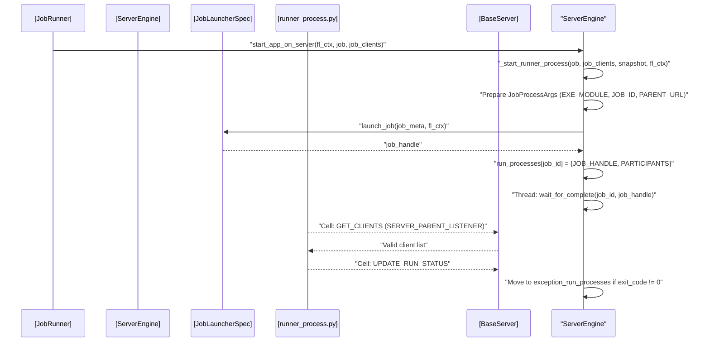
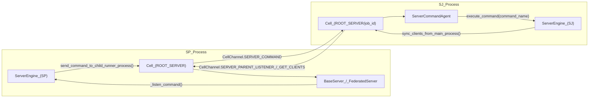

<!-- source: DeepWiki mcp.deepwiki.com · repo NVIDIA/NVFlare · page 3.1 ServerEngine and Orchestration · fetched 2026-10-26 -->

# ServerEngine and Orchestration

<details>
<summary>Relevant source files</summary>

The following files were used as context for generating this wiki page:

- [nvflare/apis/client_engine_spec.py](nvflare/apis/client_engine_spec.py)
- [nvflare/apis/event_type.py](nvflare/apis/event_type.py)
- [nvflare/apis/fl_component.py](nvflare/apis/fl_component.py)
- [nvflare/apis/fl_constant.py](nvflare/apis/fl_constant.py)
- [nvflare/apis/job_scheduler_spec.py](nvflare/apis/job_scheduler_spec.py)
- [nvflare/apis/server_engine_spec.py](nvflare/apis/server_engine_spec.py)
- [nvflare/apis/utils/fl_context_utils.py](nvflare/apis/utils/fl_context_utils.py)
- [nvflare/app_common/job_schedulers/job_scheduler.py](nvflare/app_common/job_schedulers/job_scheduler.py)
- [nvflare/fuel/f3/cellnet/cell.py](nvflare/fuel/f3/cellnet/cell.py)
- [nvflare/private/aux_runner.py](nvflare/private/aux_runner.py)
- [nvflare/private/defs.py](nvflare/private/defs.py)
- [nvflare/private/event.py](nvflare/private/event.py)
- [nvflare/private/fed/app/client/client_train.py](nvflare/private/fed/app/client/client_train.py)
- [nvflare/private/fed/app/client/sub_worker_process.py](nvflare/private/fed/app/client/sub_worker_process.py)
- [nvflare/private/fed/app/client/worker_process.py](nvflare/private/fed/app/client/worker_process.py)
- [nvflare/private/fed/app/server/runner_process.py](nvflare/private/fed/app/server/runner_process.py)
- [nvflare/private/fed/app/server/server_train.py](nvflare/private/fed/app/server/server_train.py)
- [nvflare/private/fed/client/client_app_runner.py](nvflare/private/fed/client/client_app_runner.py)
- [nvflare/private/fed/client/client_engine.py](nvflare/private/fed/client/client_engine.py)
- [nvflare/private/fed/client/client_engine_executor_spec.py](nvflare/private/fed/client/client_engine_executor_spec.py)
- [nvflare/private/fed/client/client_engine_internal_spec.py](nvflare/private/fed/client/client_engine_internal_spec.py)
- [nvflare/private/fed/client/client_executor.py](nvflare/private/fed/client/client_executor.py)
- [nvflare/private/fed/client/client_req_processors.py](nvflare/private/fed/client/client_req_processors.py)
- [nvflare/private/fed/client/client_run_manager.py](nvflare/private/fed/client/client_run_manager.py)
- [nvflare/private/fed/client/client_runner.py](nvflare/private/fed/client/client_runner.py)
- [nvflare/private/fed/client/command_agent.py](nvflare/private/fed/client/command_agent.py)
- [nvflare/private/fed/client/communicator.py](nvflare/private/fed/client/communicator.py)
- [nvflare/private/fed/client/fed_client.py](nvflare/private/fed/client/fed_client.py)
- [nvflare/private/fed/client/fed_client_base.py](nvflare/private/fed/client/fed_client_base.py)
- [nvflare/private/fed/client/sys_cmd.py](nvflare/private/fed/client/sys_cmd.py)
- [nvflare/private/fed/server/cmd_utils.py](nvflare/private/fed/server/cmd_utils.py)
- [nvflare/private/fed/server/fed_server.py](nvflare/private/fed/server/fed_server.py)
- [nvflare/private/fed/server/info_coll_cmd.py](nvflare/private/fed/server/info_coll_cmd.py)
- [nvflare/private/fed/server/job_runner.py](nvflare/private/fed/server/job_runner.py)
- [nvflare/private/fed/server/run_manager.py](nvflare/private/fed/server/run_manager.py)
- [nvflare/private/fed/server/server_command_agent.py](nvflare/private/fed/server/server_command_agent.py)
- [nvflare/private/fed/server/server_commands.py](nvflare/private/fed/server/server_commands.py)
- [nvflare/private/fed/server/server_engine.py](nvflare/private/fed/server/server_engine.py)
- [nvflare/private/fed/server/server_engine_internal_spec.py](nvflare/private/fed/server/server_engine_internal_spec.py)
- [nvflare/private/fed/server/server_runner.py](nvflare/private/fed/server/server_runner.py)
- [nvflare/private/fed/server/sys_cmd.py](nvflare/private/fed/server/sys_cmd.py)
- [nvflare/private/fed/server/training_cmds.py](nvflare/private/fed/server/training_cmds.py)
- [nvflare/private/fed/utils/fed_utils.py](nvflare/private/fed/utils/fed_utils.py)
- [nvflare/security/security.py](nvflare/security/security.py)
- [nvflare/widgets/info_collector.py](nvflare/widgets/info_collector.py)
- [tests/unit_test/app_common/job_schedulers/job_scheduler_test.py](tests/unit_test/app_common/job_schedulers/job_scheduler_test.py)
- [tests/unit_test/private/fed/client/client_executor_test.py](tests/unit_test/private/fed/client/client_executor_test.py)
- [tests/unit_test/private/fed/server/fed_server_test.py](tests/unit_test/private/fed/server/fed_server_test.py)
- [tests/unit_test/private/fed/server/job_runner_test.py](tests/unit_test/private/fed/server/job_runner_test.py)

</details>


## Purpose and Scope

This page documents the `ServerEngine` class, its role in the NVIDIA FLARE server runtime, how it manages running jobs, dispatches commands, coordinates client interactions, and ties together the federated learning execution lifecycle on the server side.

This page focuses on the server parent process (SP) orchestration layer. For job scheduling policies and the `JobRunner` scheduling loop, see [3.2](). For the client-side equivalent (`ClientEngine`), see [3.3](). For the subprocess isolation model, see [3.4](). For CellNet communication internals, see [4]().

---

## Class Hierarchy and Interface Contract

`ServerEngine` is the central coordination object on the server. It implements several internal and external interfaces to manage job lifecycles and communication.

| Interface | Defined In | Purpose |
|---|---|---|
| `ServerEngineInternalSpec` | [nvflare/private/fed/server/server_engine_internal_spec.py:85-85]() | Internal server-side operations (job launching, client management, command dispatch) |
| `StreamableEngine` | [nvflare/private/fed/server/server_engine.py:89-89]() | Object streaming registration and dispatch |
| `ServerEngineSpec` | [nvflare/apis/server_engine_spec.py:23-23]() | Public interface visible to workflows and controllers |

**Component relationship diagram:**

```mermaid
classDiagram
    class "ServerEngineSpec" {
        <<interface>>
        +get_clients()
        +send_aux_request()
        +register_aux_message_handler()
        +new_context()
        +fire_event()
    }
    class "ServerEngineInternalSpec" {
        <<interface>>
        +start_app_on_server()
        +abort_app_on_server()
        +send_command_to_child_runner_process()
        +persist_components()
        +restore_components()
    }
    class "StreamableEngine" {
        <<interface>>
        +stream_objects()
        +register_stream_processing()
    }
    class "ServerEngine" {
        +server: BaseServer
        +run_processes: dict
        +exception_run_processes: dict
        +client_manager: ClientManager
        +run_manager: RunManager
        +job_runner: JobRunner
        +cell: Cell
        +executor: ThreadPoolExecutor
        +lock: Lock
    }
    class "BaseServer" {
        +client_manager: ClientManager
        +cell: Cell
        +status: ServerStatus
    }
    "ServerEngineSpec" <|-- "ServerEngine"
    "ServerEngineInternalSpec" <|-- "ServerEngine"
    "StreamableEngine" <|-- "ServerEngine"
    "BaseServer" *-- "ServerEngine"
```
Sources: [nvflare/private/fed/server/server_engine.py:89-128](), [nvflare/private/fed/server/fed_server.py:85-121](), [nvflare/private/fed/server/server_engine_internal_spec.py:85-85]()

---

## Initialization

`ServerEngine` is instantiated inside the server deployment process. It requires a `ClientManager` to track connected sites and a `snapshot_persistor` for state management and snapshots.

`ServerEngine.__init__` [nvflare/private/fed/server/server_engine.py:90-129]() establishes:

| Attribute | Type | Purpose |
|---|---|---|
| `self.server` | `BaseServer` | Back-reference to the server object [nvflare/private/fed/server/server_engine.py:100-100]() |
| `self.run_processes` | `dict` | Active job processes, keyed by `job_id` [nvflare/private/fed/server/server_engine.py:102-102]() |
| `self.exception_run_processes` | `dict` | Processes that exited with errors [nvflare/private/fed/server/server_engine.py:103-103]() |
| `self.client_manager` | `ClientManager` | Registry of connected clients [nvflare/private/fed/server/server_engine.py:107-107]() |
| `self.executor` | `ThreadPoolExecutor` | Pool for worker threads [nvflare/private/fed/server/server_engine.py:119-119]() |
| `self.widgets` | `dict` | System widgets, initially `InfoCollector` [nvflare/private/fed/server/server_engine.py:109-112]() |

Core initialization involves setting up the `RunManager` and `JobRunner` to bridge the gap between job definition and execution.

Sources: [nvflare/private/fed/server/server_engine.py:90-129]()

---

## Job Process Management

### The `run_processes` Dictionary

Each active job is tracked in `self.run_processes` using keys defined in `RunProcessKey` [nvflare/apis/fl_constant.py:33-33]().

```python
# Internal structure of a run process entry
run_processes[job_id] = {
    RunProcessKey.JOB_HANDLE: launcher_handle,
    RunProcessKey.JOB_ID: job_id,
    RunProcessKey.PARTICIPANTS: {token: Client, ...},
    RunProcessKey.PROCESS_FINISHED: False,
    RunProcessKey.PROCESS_EXE_ERROR: False
}
```
Sources: [nvflare/private/fed/server/server_engine.py:102-102](), [nvflare/apis/fl_constant.py:33-33]()

### Job Launch Sequence

When a job is scheduled, `ServerEngine.start_app_on_server()` [nvflare/private/fed/server/server_engine.py:177-191]() initiates the runner process.

**Job launch sequence:**


Sources: [nvflare/private/fed/server/server_engine.py:177-198](), [nvflare/private/fed/server/job_runner.py:125-141]()

### Process Completion Monitoring

`wait_for_complete()` [nvflare/private/fed/server/server_engine.py:200-224]() runs in a background thread for each job. It waits for the launcher handle to signal process termination and then checks if the job reported a successful finish via the `UPDATE_RUN_STATUS` message. If the process exits with a non-zero code, it is moved to `exception_run_processes` [nvflare/private/fed/server/server_engine.py:218-219]().

Sources: [nvflare/private/fed/server/server_engine.py:200-224]()

---

## SP ↔ SJ Communication

The Server Parent (SP) and Server Job (SJ) processes communicate over CellNet using hierarchical FQCNs. The SJ cell is typically a child of the SP cell.

| Channel | Direction | Purpose |
|---|---|---|
| `CellChannel.SERVER_COMMAND` | SP → SJ | Admin/Monitoring (abort, show_stats, get_errors) [nvflare/private/defs.py:61-61]() |
| `CellChannel.SERVER_PARENT_LISTENER` | SJ → SP | Client list requests, run status updates [nvflare/private/fed/server/fed_server.py:463-463]() |

### SP → SJ: `send_command_to_child_runner_process()`

[nvflare/private/fed/server/server_engine.py:788-817]()

This method routes commands to the SJ cell (FQCN: `ROOT_SERVER/job_id`). It supports both synchronous requests and asynchronous messages if `timeout <= 0` [nvflare/private/fed/server/server_engine.py:811-811]().

### SJ → SP: `_listen_command()`

In the `BaseServer` implementation [nvflare/private/fed/server/fed_server.py:463-498](), the server listens for requests from SJ processes via the `SERVER_PARENT_LISTENER` channel:
- `GET_CLIENTS`: SJ asks for the list of authorized clients for its job [nvflare/private/fed/server/fed_server.py:465-465]().
- `UPDATE_RUN_STATUS`: SJ reports it has finished or encountered a fatal error [nvflare/private/fed/server/fed_server.py:488-488]().

**SP ↔ SJ Code Entity Mapping:**


Sources: [nvflare/private/fed/server/server_engine.py:788-817](), [nvflare/private/fed/server/fed_server.py:463-498](), [nvflare/private/fed/server/server_command_agent.py:40-44](), [nvflare/private/fed/server/server_command_agent.py:52-54]()

---

## Client Management

`ServerEngine` manages site connectivity through the `ClientManager`.

| Method | Description |
|---|---|
| `get_clients()` | Returns all registered clients as a list [nvflare/private/fed/server/server_engine.py:171-172]() |
| `validate_targets()` | Validates a list of client names and returns `(List[Client], List[invalid_names])` [nvflare/private/fed/server/server_engine.py:174-175]() |
| `get_client_from_name()` | Retrieves a `Client` object by site name [nvflare/private/fed/server/server_engine.py:297-298]() |
| `get_client_name_from_token()` | Resolves a client token to its site name [nvflare/private/fed/server/server_engine.py:303-304]() |

Sources: [nvflare/private/fed/server/server_engine.py:171-175](), [nvflare/private/fed/server/server_engine.py:297-304]()

---

## Aux Message Routing

The Aux communication system allows workflows to send arbitrary messages to clients or the server itself.

- **`send_aux_request()`** [nvflare/private/fed/server/server_engine.py:567-580](): Sends a request to specific targets (clients or "server").
- **`multicast_aux_requests()`** [nvflare/private/fed/server/server_engine.py:582-612](): Sends different payloads to multiple clients simultaneously.
- **`register_aux_message_handler()`** [nvflare/private/fed/server/server_engine.py:564-565](): Registers a listener for a specific topic on the server.

The `ServerEngine` delegates these calls to the `RunManager`'s `AuxRunner` [nvflare/private/fed/server/server_engine.py:568-568]().

Sources: [nvflare/private/fed/server/server_engine.py:564-612]()

---

## Snapshot and HA Support

`ServerEngine` handles the persistence of the FL environment state to support recovery and High Availability.

- **`persist_components()`** [nvflare/private/fed/server/server_engine.py:819-866](): Collects the state of all `FLComponent` objects in the `RunManager`, serializes `FLContext` properties, and zips the run directory into a `RunSnapshot` [nvflare/private/fed/server/server_engine.py:863-863]().
- **`restore_components()`** [nvflare/private/fed/server/server_engine.py:868-873](): Reconstitutes component states and context properties from a provided snapshot.

Sources: [nvflare/private/fed/server/server_engine.py:819-873](), [nvflare/apis/fl_snapshot.py:41-41]()

---

