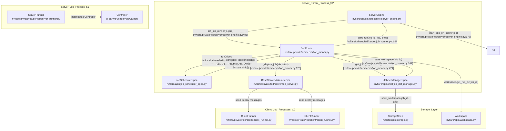
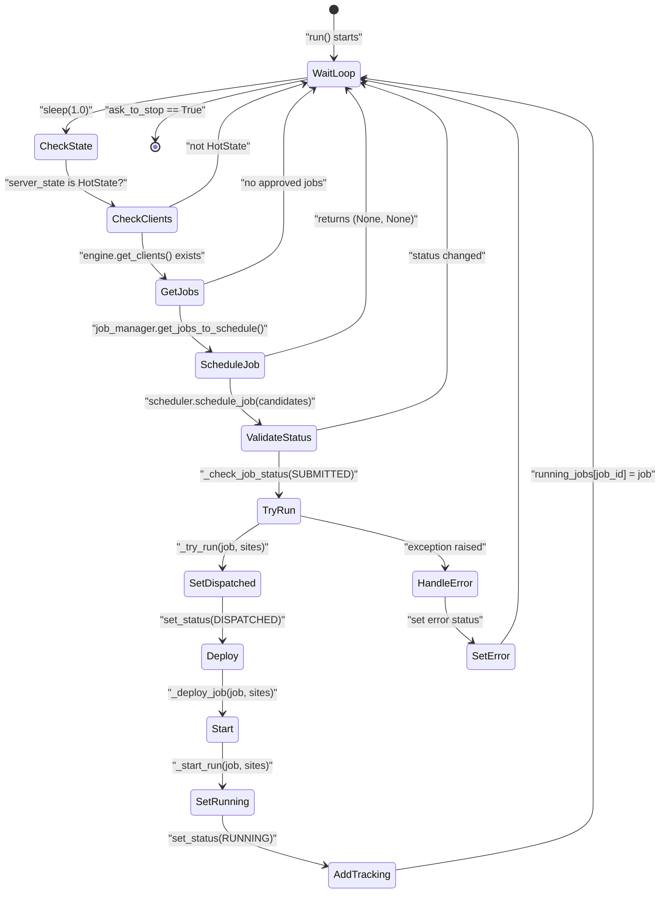

<!-- source: DeepWiki mcp.deepwiki.com · repo NVIDIA/NVFlare · page 3.2 Job Runner and Scheduling · fetched 2026-10-26 -->

# Job Runner and Scheduling

<details>
<summary>Relevant source files</summary>

The following files were used as context for generating this wiki page:

- [nvflare/apis/client_engine_spec.py](nvflare/apis/client_engine_spec.py)
- [nvflare/apis/fl_constant.py](nvflare/apis/fl_constant.py)
- [nvflare/apis/job_scheduler_spec.py](nvflare/apis/job_scheduler_spec.py)
- [nvflare/apis/resource_manager_spec.py](nvflare/apis/resource_manager_spec.py)
- [nvflare/apis/server_engine_spec.py](nvflare/apis/server_engine_spec.py)
- [nvflare/app_common/job_schedulers/job_scheduler.py](nvflare/app_common/job_schedulers/job_scheduler.py)
- [nvflare/app_common/resource_consumers/gpu_resource_consumer.py](nvflare/app_common/resource_consumers/gpu_resource_consumer.py)
- [nvflare/app_common/resource_managers/auto_clean_resource_manager.py](nvflare/app_common/resource_managers/auto_clean_resource_manager.py)
- [nvflare/app_common/resource_managers/gpu_resource_manager.py](nvflare/app_common/resource_managers/gpu_resource_manager.py)
- [nvflare/app_common/resource_managers/list_resource_manager.py](nvflare/app_common/resource_managers/list_resource_manager.py)
- [nvflare/fuel/utils/gpu_utils.py](nvflare/fuel/utils/gpu_utils.py)
- [nvflare/private/aux_runner.py](nvflare/private/aux_runner.py)
- [nvflare/private/fed/app/client/client_train.py](nvflare/private/fed/app/client/client_train.py)
- [nvflare/private/fed/app/client/sub_worker_process.py](nvflare/private/fed/app/client/sub_worker_process.py)
- [nvflare/private/fed/app/client/worker_process.py](nvflare/private/fed/app/client/worker_process.py)
- [nvflare/private/fed/app/server/runner_process.py](nvflare/private/fed/app/server/runner_process.py)
- [nvflare/private/fed/app/server/server_train.py](nvflare/private/fed/app/server/server_train.py)
- [nvflare/private/fed/client/client_app_runner.py](nvflare/private/fed/client/client_app_runner.py)
- [nvflare/private/fed/client/client_engine.py](nvflare/private/fed/client/client_engine.py)
- [nvflare/private/fed/client/client_engine_executor_spec.py](nvflare/private/fed/client/client_engine_executor_spec.py)
- [nvflare/private/fed/client/client_engine_internal_spec.py](nvflare/private/fed/client/client_engine_internal_spec.py)
- [nvflare/private/fed/client/client_executor.py](nvflare/private/fed/client/client_executor.py)
- [nvflare/private/fed/client/client_run_manager.py](nvflare/private/fed/client/client_run_manager.py)
- [nvflare/private/fed/client/client_runner.py](nvflare/private/fed/client/client_runner.py)
- [nvflare/private/fed/client/command_agent.py](nvflare/private/fed/client/command_agent.py)
- [nvflare/private/fed/client/communicator.py](nvflare/private/fed/client/communicator.py)
- [nvflare/private/fed/client/fed_client.py](nvflare/private/fed/client/fed_client.py)
- [nvflare/private/fed/client/fed_client_base.py](nvflare/private/fed/client/fed_client_base.py)
- [nvflare/private/fed/client/scheduler_cmds.py](nvflare/private/fed/client/scheduler_cmds.py)
- [nvflare/private/fed/server/fed_server.py](nvflare/private/fed/server/fed_server.py)
- [nvflare/private/fed/server/job_runner.py](nvflare/private/fed/server/job_runner.py)
- [nvflare/private/fed/server/server_command_agent.py](nvflare/private/fed/server/server_command_agent.py)
- [nvflare/private/fed/server/server_commands.py](nvflare/private/fed/server/server_commands.py)
- [nvflare/private/fed/server/server_engine.py](nvflare/private/fed/server/server_engine.py)
- [nvflare/private/fed/server/server_runner.py](nvflare/private/fed/server/server_runner.py)
- [nvflare/private/fed/utils/fed_utils.py](nvflare/private/fed/utils/fed_utils.py)
- [nvflare/private/scheduler_constants.py](nvflare/private/scheduler_constants.py)
- [tests/unit_test/app_common/job_schedulers/job_scheduler_test.py](tests/unit_test/app_common/job_schedulers/job_scheduler_test.py)
- [tests/unit_test/app_common/resource_managers/gpu_resource_manager_test.py](tests/unit_test/app_common/resource_managers/gpu_resource_manager_test.py)
- [tests/unit_test/app_common/resource_managers/list_resource_manager_test.py](tests/unit_test/app_common/resource_managers/list_resource_manager_test.py)
- [tests/unit_test/private/fed/client/client_executor_test.py](tests/unit_test/private/fed/client/client_executor_test.py)
- [tests/unit_test/private/fed/server/fed_server_test.py](tests/unit_test/private/fed/server/fed_server_test.py)
- [tests/unit_test/private/fed/server/job_runner_test.py](tests/unit_test/private/fed/server/job_runner_test.py)

</details>


## Purpose and Scope

This page documents the Job Runner and Scheduling subsystem in NVIDIA FLARE's server-side runtime. The `JobRunner` class [nvflare/private/fed/server/job_runner.py:94-102]() orchestrates the complete job lifecycle: deployment, process spawning, monitoring, and cleanup. The `JobSchedulerSpec` interface [nvflare/apis/job_scheduler_spec.py:42-71]() determines which jobs can execute based on client resource availability and job requirements.

**Scope:**
- Job lifecycle orchestration by `JobRunner`.
- Resource-based scheduling via `JobSchedulerSpec`.
- Job deployment to server and clients.
- Process spawning and monitoring via `ServerEngine`.
- Job abortion and workspace persistence.

Sources: [nvflare/private/fed/server/job_runner.py:94-102](), [nvflare/apis/job_scheduler_spec.py:42-71]()

## Overview

The Job Runner and Scheduling system consists of:

- **JobRunner** [nvflare/private/fed/server/job_runner.py:94](): `FLComponent` that manages job lifecycle orchestration.
- **JobScheduler** [nvflare/apis/job_scheduler_spec.py:42](): Interface for resource-based job selection.
- **JobDefManagerSpec** [nvflare/apis/impl/job_def_manager.py:42](): Interface for job metadata and storage management.

The `JobRunner` runs a continuous loop that queries `JobDefManager.get_jobs_to_schedule()` for approved jobs, invokes `JobScheduler.schedule_job()` to select executable jobs, then coordinates deployment and execution. Jobs are deployed to participating clients via admin commands, spawned as isolated server processes via `JobLauncherSpec`, monitored for completion, and persisted to storage upon finish.

Sources: [nvflare/private/fed/server/job_runner.py:94-102](), [nvflare/private/fed/server/job_runner.py:410-460]()

## Component Architecture

**Component Relationships Diagram**



**Component Responsibilities:**

| Component | Class/Interface | Primary Responsibilities | Key Methods |
|-----------|-----------------|-------------------------|-------------|
| `JobRunner` | `FLComponent` | Job lifecycle orchestration, deployment coordination, completion monitoring | `run()`, `_deploy_job()`, `_start_run()`, `abort_job()` |
| `JobScheduler` | `JobSchedulerSpec` | Resource-based job selection, client availability checking | `schedule_job()` |
| `ServerEngine` | `ServerEngineInternalSpec` | Process spawning, inter-process communication, engine coordination | `start_app_on_server()`, `abort_app_on_server()`, `set_job_runner()` |
| `JobDefManager` | `JobDefManagerSpec` | Job metadata management, status tracking, storage interface | `get_jobs_to_schedule()`, `set_status()`, `save_workspace()` |
| `ServerRunner` | `TBI` | In-process job execution, controller instantiation, task coordination | `_execute_run()`, workflow execution |

Sources: [nvflare/private/fed/server/job_runner.py:94-102](), [nvflare/private/fed/server/server_engine.py:89-126](), [nvflare/apis/job_scheduler_spec.py:42-71](), [nvflare/private/fed/server/server_runner.py:80-109]()

## JobRunner Architecture

### Initialization and Configuration

The `JobRunner` class [nvflare/private/fed/server/job_runner.py:94]() is initialized with a workspace root and registered as a component in the server's engine.

**JobRunner Class Structure**

| Attribute | Type | Purpose |
|-----------|------|---------|
| `workspace_root` | `str` | Root directory for job workspaces |
| `ask_to_stop` | `bool` | Signals the runner to terminate |
| `scheduler` | `JobSchedulerSpec` | Job scheduler instance (set during `SYSTEM_START`) |
| `running_jobs` | `Dict[str, Job]` | Maps job_id to Job object for active jobs |
| `_finished_job_states` | `Dict[str, _FinishedJobState]` | Stores final status and workspace save state for finished jobs |
| `lock` | `threading.Lock()` | Protects concurrent access to `running_jobs` |

**Initialization Code** [nvflare/private/fed/server/job_runner.py:95-102]():
```python
class JobRunner(FLComponent):
    def __init__(self, workspace_root: str) -> None:
        super().__init__()
        self.workspace_root = workspace_root
        self.ask_to_stop = False
        self.scheduler = None
        self.running_jobs = {}
        self._finished_job_states = {}
        self.lock = threading.Lock()
```

The runner obtains a reference to the `JobScheduler` during the `SYSTEM_START` event [nvflare/private/fed/server/job_runner.py:104-107]():
```python
def handle_event(self, event_type: str, fl_ctx: FLContext):
    if event_type == EventType.SYSTEM_START:
        engine = fl_ctx.get_engine()
        self.scheduler = engine.get_component(SystemComponents.JOB_SCHEDULER)
```

Sources: [nvflare/private/fed/server/job_runner.py:94-107]()

### Main Execution Loop

The `JobRunner.run()` method [nvflare/private/fed/server/job_runner.py:410]() implements the primary job management loop.

**JobRunner.run() State Machine**



Key loop operations [nvflare/private/fed/server/job_runner.py:410-460]():

1.  **State Check**: Verify `engine.server.server_state` is `HotState` instance [nvflare/private/fed/server/job_runner.py:419]().
2.  **Client Check**: Verify `engine.get_clients()` returns non-empty list [nvflare/private/fed/server/job_runner.py:420]().
3.  **Query Approved Jobs**: Call `job_manager.get_jobs_to_schedule(fl_ctx)` for candidates [nvflare/private/fed/server/job_runner.py:424]().
4.  **Schedule**: Invoke `scheduler.schedule_job(job_manager, job_candidates, fl_ctx)` returning `(job, sites)` [nvflare/apis/job_scheduler_spec.py:56-71]().
5.  **Validate Status**: Check `_check_job_status(job_manager, job.job_id, RunStatus.SUBMITTED)` before proceeding [nvflare/private/fed/server/job_runner.py:438]().
6.  **Execute**: Call `_try_run(job_manager, job, sites, fl_ctx)` which manages deployment and execution [nvflare/private/fed/server/job_runner.py:442]().
7.  **Sleep**: `time.sleep(1.0)` between iterations [nvflare/private/fed/server/job_runner.py:460]().

Sources: [nvflare/private/fed/server/job_runner.py:410-460](), [nvflare/apis/job_scheduler_spec.py:56-71]()

### Job Completion Monitoring

A separate thread runs `_job_complete_process()` [nvflare/private/fed/server/job_runner.py:331]() to detect job completion.

**Completion Monitoring Logic** [nvflare/private/fed/server/job_runner.py:334-347]():
- Iterates over `list(self.running_jobs.keys())` to detect completed jobs.
- Checks if `job_id not in engine.run_processes.keys()` to detect termination.
- Calls `_update_job_status(engine, job, job_manager, fl_ctx)` to determine final status [nvflare/private/fed/server/job_runner.py:349-379]().
- Removes job from `self.running_jobs` under lock.
- Sets `FLContextKey.CURRENT_JOB_ID` and fires `EventType.JOB_COMPLETED`.
- Calls `engine.remove_exception_process(job_id)` for cleanup [nvflare/private/fed/server/job_runner.py:347]().

Sources: [nvflare/private/fed/server/job_runner.py:331-379]()

## Job Lifecycle States and Transitions

Jobs progress through well-defined states managed by `JobDefManager`:

**State Descriptions:**

| State | Description | Set By |
|-------|-------------|--------|
| `SUBMITTED` | Job uploaded and validated | Job submission handler |
| `APPROVED` | Job approved for execution | Job approval handler |
| `DISPATCHED` | Scheduler selected job, deployment starting | `JobRunner._try_run()` [nvflare/private/fed/server/job_runner.py:445]() |
| `RUNNING` | Job executing on server and clients | `JobRunner._try_run()` [nvflare/private/fed/server/job_runner.py:458]() |
| `FINISHED_COMPLETED` | Job completed successfully | `JobRunner._update_job_status()` [nvflare/private/fed/server/job_runner.py:378]() |
| `FINISHED_ABORTED` | Job aborted by admin command | `JobRunner.abort_job()` [nvflare/private/fed/server/job_runner.py:503]() |
| `FINISHED_EXECUTION_EXCEPTION` | Job failed with execution error | `JobRunner._update_job_status()` [nvflare/private/fed/server/job_runner.py:365]() |
| `FINISHED_ABNORMAL` | Job process crashed unexpectedly | `JobRunner._update_job_status()` [nvflare/private/fed/server/job_runner.py:363]() |

Sources: [nvflare/apis/job_def.py:27-40](), [nvflare/private/fed/server/job_runner.py:438-460](), [nvflare/private/fed/server/job_runner.py:349-379]()

## JobScheduler and Resource-Based Scheduling

The `JobSchedulerSpec` interface [nvflare/apis/job_scheduler_spec.py:42]() determines which approved jobs can execute based on client resource availability.

### Scheduling Interface

The `JobSchedulerSpec.schedule_job()` method signature [nvflare/apis/job_scheduler_spec.py:56-71]():

```python
def schedule_job(
    self, 
    job_manager: JobDefManagerSpec, 
    job_candidates: List[Job], 
    fl_ctx: FLContext
) -> Tuple[Optional[Job], Optional[Dict[str, DispatchInfo]]]
```

**Scheduling Process**:
1.  **Iterate Candidates**: Loop through `job_candidates` in priority order [nvflare/private/fed/server/job_runner.py:432]().
2.  **Extract Requirements**: Check `job.meta` for `MIN_CLIENTS`, `MANDATORY_CLIENTS`, and `RESOURCE_SPEC` [nvflare/apis/job_def.py:59-64]().
3.  **Check Client Availability**: Verify clients are connected via `ClientManager.get_clients()` [nvflare/private/fed/server/server_engine.py:171]().
4.  **Build Dispatch Info**: Generate `Dict[str, DispatchInfo]` containing target app names and resource requirements [nvflare/apis/job_scheduler_spec.py:32-40]().
5.  **Return Decision**: Return the selected `Job` and site mapping, or `(None, None)` if no job can be scheduled.

Sources: [nvflare/apis/job_scheduler_spec.py:15-71](), [nvflare/private/fed/server/job_runner.py:432-435](), [nvflare/apis/job_def.py:49-81]()

## Job Deployment Process

Job deployment involves distributing application code to all participants via `_deploy_job()` [nvflare/private/fed/server/job_runner.py:125]().

### Deployment Steps

**Server Deployment** [nvflare/private/fed/server/job_runner.py:149-182]():
1.  Identify `SiteType.SERVER` in deployment map.
2.  Fire `DEPLOY_JOB_TO_SERVER` event.
3.  Use `AppDeployer` to extract app to `workspace/job_id/app_server` [nvflare/private/fed/server/job_runner.py:161-169]().
4.  Verify folder signature in secure mode [nvflare/private/fed/server/job_runner.py:174-180]().

**Client Deployment** [nvflare/private/fed/server/job_runner.py:184-205]():
1.  Create `TrainingTopic.DEPLOY` message with app data [nvflare/private/fed/server/job_runner.py:114]().
2.  Send to participating clients via `_send_to_clients()` [nvflare/private/fed/server/job_runner.py:58]().
3.  Collect replies and track `failed_clients` [nvflare/private/fed/server/job_runner.py:214-225]().

**Failure Handling** [nvflare/private/fed/server/job_runner.py:228-240]():
- Abort if `num_ok_sites < job.min_sites`.
- Abort if any `job.required_sites` failed to deploy.

Sources: [nvflare/private/fed/server/job_runner.py:114-240]()

## Job Starting and Process Spawning

### Server Process Spawning

The `ServerEngine.start_app_on_server()` method [nvflare/private/fed/server/server_engine.py:177]() coordinates process creation.

**Launch Sequence** [nvflare/private/fed/server/server_engine.py:226-295]():
1.  **Prepare Arguments**: Build `job_args` using `JobProcessArgs` [nvflare/private/fed/server/server_engine.py:201-224]().
2.  **Identify Launcher**: Call `get_job_launcher(job.meta, fl_ctx)` [nvflare/private/fed/server/server_engine.py:226]().
3.  **Launch**: Call `job_launcher.launch_job(job.meta, fl_ctx)` [nvflare/private/fed/server/server_engine.py:281]().
4.  **Track**: Store process handle in `self.run_processes[job.job_id]` [nvflare/private/fed/server/server_engine.py:287]().
5.  **Monitor**: Start `wait_for_complete()` thread to wait on process exit [nvflare/private/fed/server/server_engine.py:294]().

Sources: [nvflare/private/fed/server/server_engine.py:177-295](), [nvflare/apis/job_launcher_spec.py:44-52]()

### Monitoring and Status Tracking

**Completion Detection Logic** [nvflare/private/fed/server/server_engine.py:200-224]():
1.  **Wait**: Call `process.wait()` to block until exit [nvflare/private/fed/server/server_engine.py:201]().
2.  **Check Finish Flag**: Poll for `RunProcessKey.PROCESS_FINISHED` reported by the job process [nvflare/private/fed/server/server_engine.py:204-214]().
3.  **Read Return Code**: Use `get_return_code()` to read exit status [nvflare/private/fed/server/server_engine.py:215]().
4.  **Update Tracking**: If non-zero exit, add to `self.exception_run_processes` [nvflare/private/fed/server/server_engine.py:218-222]().

Sources: [nvflare/private/fed/server/job_runner.py:349-379](), [nvflare/private/fed/server/server_engine.py:200-224]()

## Job Abortion and Cleanup

### Aborting Running Jobs

The `JobRunner.abort_job()` method [nvflare/private/fed/server/job_runner.py:465]() handles termination.

**Abortion Steps**:
1.  **Abort Clients**: Call `_abort_client_run()` sending `TrainingTopic.ABORT` to all participants [nvflare/private/fed/server/job_runner.py:489]().
2.  **Abort Server**: Call `engine.abort_app_on_server(job_id)` [nvflare/private/fed/server/job_runner.py:494]().
3.  **Force Kill**: If server job process doesn't exit, `ServerEngine` calls `child_process.terminate()` [nvflare/private/fed/server/server_engine.py:336-339]().
4.  **Clean Up**: Remove from `run_processes` and set final status to `FINISHED_ABORTED` [nvflare/private/fed/server/job_runner.py:346-357]().

Sources: [nvflare/private/fed/server/job_runner.py:465-507](), [nvflare/private/fed/server/server_engine.py:320-357]()

### Workspace Saving and Persistence

After completion, `_save_workspace()` [nvflare/private/fed/server/job_runner.py:381]() persists results.

**Workspace Saving Process** [nvflare/private/fed/server/job_runner.py:381-406]():
1.  **Collect Dirs**: Identify `run_dir`, `result_root`, `log_root`, and `audit_root` [nvflare/private/fed/server/job_runner.py:384-399]().
2.  **Persist**: Call `job_manager.save_workspace(job_id, ws_dirs, fl_ctx)` [nvflare/private/fed/server/job_runner.py:401]().
3.  **Clean Up**: Delete local directories using `shutil.rmtree()` [nvflare/private/fed/server/job_runner.py:405-406]().

Sources: [nvflare/private/fed/server/job_runner.py:381-406]()

## Integration with ServerEngine

The `JobRunner` and `ServerEngine` collaborate through defined interfaces.

**Integration Mapping:**

| JobRunner Method | ServerEngine Method | Purpose |
|------------------|---------------------|---------|
| `_deploy_job()` | `validate_targets()` | Validate client names [nvflare/private/fed/server/server_engine.py:174]() |
| `_start_run()` | `start_app_on_server()` | Spawn server job process [nvflare/private/fed/server/server_engine.py:177]() |
| `_start_run()` | `get_clients()` | Get client objects for job [nvflare/private/fed/server/server_engine.py:171]() |
| `abort_job()` | `abort_app_on_server()` | Terminate server process [nvflare/private/fed/server/server_engine.py:320]() |
| `_job_complete_process()` | `run_processes` (attr) | Monitor process status [nvflare/private/fed/server/server_engine.py:102]() |

Sources: [nvflare/private/fed/server/job_runner.py:125-507](), [nvflare/private/fed/server/server_engine.py:495-497]()

---

