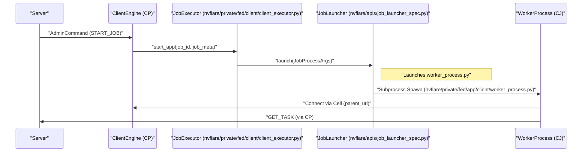

<!-- source: DeepWiki mcp.deepwiki.com · repo NVIDIA/NVFlare · page 3.3 ClientEngine Architecture · fetched 2026-10-26 -->

# ClientEngine Architecture

<details>
<summary>Relevant source files</summary>

The following files were used as context for generating this wiki page:

- [docs/design/distributed_provisioning.md](docs/design/distributed_provisioning.md)
- [nvflare/apis/client_engine_spec.py](nvflare/apis/client_engine_spec.py)
- [nvflare/apis/fl_constant.py](nvflare/apis/fl_constant.py)
- [nvflare/apis/job_scheduler_spec.py](nvflare/apis/job_scheduler_spec.py)
- [nvflare/apis/server_engine_spec.py](nvflare/apis/server_engine_spec.py)
- [nvflare/app_common/job_schedulers/job_scheduler.py](nvflare/app_common/job_schedulers/job_scheduler.py)
- [nvflare/private/aux_runner.py](nvflare/private/aux_runner.py)
- [nvflare/private/fed/app/client/client_train.py](nvflare/private/fed/app/client/client_train.py)
- [nvflare/private/fed/app/client/sub_worker_process.py](nvflare/private/fed/app/client/sub_worker_process.py)
- [nvflare/private/fed/app/client/worker_process.py](nvflare/private/fed/app/client/worker_process.py)
- [nvflare/private/fed/app/server/runner_process.py](nvflare/private/fed/app/server/runner_process.py)
- [nvflare/private/fed/app/server/server_train.py](nvflare/private/fed/app/server/server_train.py)
- [nvflare/private/fed/client/client_app_runner.py](nvflare/private/fed/client/client_app_runner.py)
- [nvflare/private/fed/client/client_engine.py](nvflare/private/fed/client/client_engine.py)
- [nvflare/private/fed/client/client_engine_executor_spec.py](nvflare/private/fed/client/client_engine_executor_spec.py)
- [nvflare/private/fed/client/client_engine_internal_spec.py](nvflare/private/fed/client/client_engine_internal_spec.py)
- [nvflare/private/fed/client/client_executor.py](nvflare/private/fed/client/client_executor.py)
- [nvflare/private/fed/client/client_run_manager.py](nvflare/private/fed/client/client_run_manager.py)
- [nvflare/private/fed/client/client_runner.py](nvflare/private/fed/client/client_runner.py)
- [nvflare/private/fed/client/command_agent.py](nvflare/private/fed/client/command_agent.py)
- [nvflare/private/fed/client/communicator.py](nvflare/private/fed/client/communicator.py)
- [nvflare/private/fed/client/fed_client.py](nvflare/private/fed/client/fed_client.py)
- [nvflare/private/fed/client/fed_client_base.py](nvflare/private/fed/client/fed_client_base.py)
- [nvflare/private/fed/client/training_cmds.py](nvflare/private/fed/client/training_cmds.py)
- [nvflare/private/fed/server/fed_server.py](nvflare/private/fed/server/fed_server.py)
- [nvflare/private/fed/server/job_runner.py](nvflare/private/fed/server/job_runner.py)
- [nvflare/private/fed/server/server_command_agent.py](nvflare/private/fed/server/server_command_agent.py)
- [nvflare/private/fed/server/server_commands.py](nvflare/private/fed/server/server_commands.py)
- [nvflare/private/fed/server/server_engine.py](nvflare/private/fed/server/server_engine.py)
- [nvflare/private/fed/server/server_runner.py](nvflare/private/fed/server/server_runner.py)
- [nvflare/private/fed/utils/fed_utils.py](nvflare/private/fed/utils/fed_utils.py)
- [nvflare/tool/cli_errors.py](nvflare/tool/cli_errors.py)
- [tests/unit_test/app_common/job_schedulers/job_scheduler_test.py](tests/unit_test/app_common/job_schedulers/job_scheduler_test.py)
- [tests/unit_test/private/fed/client/client_executor_test.py](tests/unit_test/private/fed/client/client_executor_test.py)
- [tests/unit_test/private/fed/client/test_training_cmds_sig_verify.py](tests/unit_test/private/fed/client/test_training_cmds_sig_verify.py)
- [tests/unit_test/private/fed/server/fed_server_test.py](tests/unit_test/private/fed/server/fed_server_test.py)
- [tests/unit_test/private/fed/server/job_runner_test.py](tests/unit_test/private/fed/server/job_runner_test.py)
- [tests/unit_test/private/fed/server/test_job_runner_sig_verify.py](tests/unit_test/private/fed/server/test_job_runner_sig_verify.py)
- [tests/unit_test/private/fed/server/test_require_signed_jobs_config.py](tests/unit_test/private/fed/server/test_require_signed_jobs_config.py)
- [tests/unit_test/tool/package/package_commands_test.py](tests/unit_test/tool/package/package_commands_test.py)

</details>


## Purpose and Scope

This document describes the **ClientEngine** architecture, which is the core client-side orchestration component in NVIDIA FLARE. The ClientEngine runs in the **Client Parent process (CP)** and is responsible for managing job lifecycles, handling communication with the server, processing admin commands, and coordinating between the parent process and client job processes.

For information about server-side orchestration, see [ServerEngine and Orchestration](3.1). For details on how tasks are executed within client job processes, see [Process Model and Job Isolation](3.4).

---

## ClientEngine Role and Responsibilities

The `ClientEngine` is the top-level client-side engine that runs continuously in the Client Parent process. It is distinct from components that run within individual job processes (CJ).

### Key Responsibilities

| Responsibility | Description |
|---------------|-------------|
| **Job Process Management** | Creates and monitors client job processes (CJ) through `JobExecutor` [nvflare/private/fed/client/client_executor.py:171-188]() |
| **Communication** | Manages the Cell network connection and message routing [nvflare/private/fed/client/communicator.py:127-144]() |
| **Auxiliary Messages** | Handles auxiliary messages through `AuxRunner` [nvflare/private/aux_runner.py:34-45]() |
| **Context Management** | Fires and handles FL events across components via `FLContext` [nvflare/private/fed/client/client_engine.py:85-101]() |
| **Task Forwarding** | Forwards task requests from child job processes to the server [nvflare/private/fed/client/communicator.py:153-172]() |

Sources: [nvflare/private/fed/client/client_engine.py:58-123](), [nvflare/private/fed/client/client_executor.py:171-188](), [nvflare/private/fed/client/communicator.py:52-144]()

---

## Process Architecture: CP vs CJ

The client architecture uses a **multi-process model** with two process types defined in `ReservedKey.PROCESS_TYPE` [nvflare/apis/fl_constant.py:118-118]():

### Bridge between Natural Language and Code Space: Process Model

Title: "Client Process Hierarchy and Code Entities"
```mermaid
graph TB
    subgraph "ClientParentProcess (CP)"
        [CE] --> ["ClientEngine (nvflare/private/fed/client/client_engine.py)"]
        [FC] --> ["FederatedClient (nvflare/private/fed/client/fed_client.py)"]
        [Cell_CP] --> ["Cell (nvflare/fuel/f3/cellnet/cell.py)"]
        [JobExec] --> ["JobExecutor (nvflare/private/fed/client/client_executor.py)"]
        [AuxRun] --> ["AuxRunner (nvflare/private/aux_runner.py)"]
        [Comm] --> ["Communicator (nvflare/private/fed/client/communicator.py)"]
        
        [CE] -->|manages| [JobExec]
        [CE] -->|uses| [Cell_CP]
        [CE] -->|has| [AuxRun]
        [FC] -->|owns| [CE]
        [FC] -->|has| [Comm]
    end
    
    subgraph "ClientJobProcess (CJ)"
        [CR] --> ["ClientRunner (nvflare/private/fed/client/client_runner.py)"]
        [Cell_CJ] --> ["Cell (nvflare/fuel/f3/cellnet/cell.py)"]
        [Executors] --> ["Executor (nvflare/apis/executor.py)"]
        [Filters] --> ["Filter (nvflare/apis/filter.py)"]
        [CRM] --> ["ClientRunManager (nvflare/private/fed/client/client_run_manager.py)"]
        
        [CR] -->|uses| [CRM]
        [CRM] -->|manages| [Cell_CJ]
        [CR] -->|routes to| [Executors]
        [CR] -->|applies| [Filters]
    end
    
    [JobExec] -->|launches via JobLauncher| [CR]
    [Cell_CP] -.->|parent_url| [Cell_CJ]
    [JobExec] -->|monitors| [CR]
```
Sources: [nvflare/private/fed/client/client_engine.py:58-60](), [nvflare/apis/fl_constant.py:118-118](), [nvflare/private/fed/client/client_executor.py:171-188](), [nvflare/private/fed/client/fed_client_base.py:39-112](), [nvflare/private/fed/client/client_run_manager.py:55-124]()

### Client Parent (CP)
- **Process Type:** `CP` (Client Parent) [nvflare/apis/fl_constant.py:118-118]()
- **Main Class:** `ClientEngine` [nvflare/private/fed/client/client_engine.py:58-58]()
- **Lifespan:** Runs continuously, persists across jobs.
- **Responsibilities:** Job management, communication infrastructure, and security token handling.

### Client Job (CJ)
- **Process Type:** `CJ` (Client Job) [nvflare/apis/fl_constant.py:118-118]()
- **Main Class:** `ClientRunner` [nvflare/private/fed/client/client_runner.py:126-126]()
- **Runtime Engine:** `ClientRunManager` [nvflare/private/fed/client/client_run_manager.py:55-55]()
- **Lifespan:** Created per job, terminates when job completes.
- **Responsibilities:** Task execution, local training logic, and application-level filters.

---

## ClientEngine Component Architecture

### Core Components and Data Flow

Title: "ClientEngine Internal Architecture"
```mermaid
graph LR
    subgraph "ClientEngine (CP)"
        [CE] --> ["ClientEngine (nvflare/private/fed/client/client_engine.py)"]
        
        subgraph "JobLifecycle"
            [JE] --> ["JobExecutor (nvflare/private/fed/client/client_executor.py)"]
            [RP] --> ["run_processes (dict)"]
        end
        
        subgraph "NetworkStack"
            [Cell] --> ["Cell (nvflare/fuel/f3/cellnet/cell.py)"]
            [Comm] --> ["Communicator (nvflare/private/fed/client/communicator.py)"]
        end
        
        subgraph "AdminAndAux"
            [AuxR] --> ["AuxRunner (nvflare/private/aux_runner.py)"]
            [Streamer] --> ["ObjectStreamer (nvflare/private/stream_runner.py)"]
        end
        
        [CE] -->|start_app| [JE]
        [JE] -->|tracks| [RP]
        [CE] -->|uses| [Comm]
        [Comm] -->|wraps| [Cell]
        [CE] -->|manages| [AuxR]
        [AuxR] -->|uses| [Streamer]
    end
```
Sources: [nvflare/private/fed/client/client_engine.py:58-110](), [nvflare/private/fed/client/communicator.py:52-105](), [nvflare/private/fed/client/client_executor.py:171-188]()

### Component Details

#### 1. JobExecutor
The `JobExecutor` manages the lifecycle of client job processes. It uses a `JobLauncher` to spawn the worker process [nvflare/private/fed/client/client_executor.py:246-246]().
- **start_app:** Prepares `JobProcessArgs` (including authentication tokens and parent URL) and launches the process [nvflare/private/fed/client/client_executor.py:190-281]().
- **check_status:** Queries the status of the running client job [nvflare/private/fed/client/client_executor.py:113-122]().
- **abort_app:** Terminates the running application process [nvflare/private/fed/client/client_executor.py:125-131]().

#### 2. Communicator
The `Communicator` handles low-level registration and heartbeat logic with the server [nvflare/private/fed/client/communicator.py:52-63](). 
- It manages the authentication tokens (`token`, `token_signature`) issued by the server [nvflare/private/fed/client/communicator.py:113-118]().
- It provides callback registration for `CellChannel.SERVER_COMMAND` to handle `GET_TASK` and `SUBMIT_UPDATE` from child processes [nvflare/private/fed/client/communicator.py:133-144]().

#### 3. AuxRunner
Manages auxiliary communication for non-task messages, such as metrics, system info, or sync requests [nvflare/private/aux_runner.py:25-45](). It allows components to register handlers for specific topics and dispatches incoming messages [nvflare/private/fed/client/client_engine.py:159-175]().

---

## Job Lifecycle Management

### Job Startup Flow

Title: "Job Launch Sequence (CP to CJ)"

Sources: [nvflare/private/fed/client/client_executor.py:190-281](), [nvflare/private/fed/client/communicator.py:153-172]()

### Job Process Arguments
Standardized arguments prepared by `JobExecutor` for the `JobLauncher` [nvflare/private/fed/client/client_executor.py:247-269]():
- `JobProcessArgs.EXE_MODULE`: `nvflare.private.fed.app.client.worker_process` [nvflare/private/fed/client/client_executor.py:248-248]()
- `JobProcessArgs.JOB_ID`: The unique ID of the job [nvflare/private/fed/client/client_executor.py:249-249]().
- `JobProcessArgs.CLIENT_NAME`: Name of the client site [nvflare/private/fed/client/client_executor.py:250-250]().
- `JobProcessArgs.PARENT_URL`: The URL for CJ to connect back to CP for task forwarding [nvflare/private/fed/client/client_executor.py:253-253]().

---

## Communication and Task Flow

### Task Routing in CJ
Within the job process, the `ClientRunner` uses a `TaskRouter` to map task names to specific `Executor` implementations [nvflare/private/fed/client/client_runner.py:49-76]().

Title: "CJ Task Routing and Execution"
```mermaid
graph LR
    subgraph "ClientRunner (CJ)"
        [TR] --> ["TaskRouter (nvflare/private/fed/client/client_runner.py)"]
        [E1] --> ["ExecutorA (nvflare/apis/executor.py)"]
        [E2] --> ["ExecutorB (nvflare/apis/executor.py)"]
        [F1] --> ["DataFilter (nvflare/apis/filter.py)"]
        [F2] --> ["ResultFilter (nvflare/apis/filter.py)"]
    end
    
    [Task] --> ["TaskName"]
    ["TaskName"] --> [TR]
    [TR] -->|route| [E1]
    [E1] -->|preprocess| [F1]
    [F1] -->|execute| [Training] --> ["TrainingLogic"]
    [Training] -->|postprocess| [F2]
    [F2] --> [Result] --> ["TaskResult"]
```
Sources: [nvflare/private/fed/client/client_runner.py:49-76](), [nvflare/private/fed/client/client_runner.py:166-180]()

### Communication via Parent (Hierarchical)
When a job is running, the CJ (Client Job) pulls tasks from the server *through* the CP (Client Parent) [nvflare/private/fed/client/communicator.py:133-144]().
- CJ sends `GET_TASK` request to CP via `CellChannel.SERVER_COMMAND` [nvflare/private/fed/client/communicator.py:133-137]().
- CP forwards the request to the Server via `_process_get_task` [nvflare/private/fed/client/communicator.py:153-172](). If the task is not yet ready, it returns `SpecialTaskName.TRY_AGAIN` [nvflare/private/fed/client/communicator.py:147-151]().

---

## Initialization and Context

### Startup Sequence
1. **FederatedClientBase Init:** Initializes the `Communicator` [nvflare/private/fed/client/fed_client_base.py:87-96]().
2. **Cell Creation:** Determines FQCN and creates the `Cell` network connection to the server [nvflare/private/fed/client/fed_client_base.py:141-180]().
3. **Engine Start:** `ClientEngine` initializes the `FLContextManager` with system components and process type `ProcessType.CLIENT_PARENT` [nvflare/private/fed/client/client_engine.py:85-101]().

### FLContext Key Management
The engine uses `FLContext` to share state across components. Key stickers include:
- `ReservedKey.FQSN`: Fully Qualified Site Name [nvflare/private/fed/client/client_engine.py:90-90]().
- `ReservedKey.IS_LEAF`: Indicates if the client is a leaf node in a hierarchical topology [nvflare/private/fed/client/client_engine.py:91-91]().
- `FLContextKey.PROCESS_TYPE`: Set to `ProcessType.CLIENT_PARENT` in CP [nvflare/private/fed/client/client_engine.py:99-99]() or `ProcessType.CLIENT_JOB` in CJ [nvflare/private/fed/client/client_run_manager.py:109-109]().

Sources: [nvflare/private/fed/client/client_engine.py:85-101](), [nvflare/apis/fl_constant.py:69-121](), [nvflare/private/fed/client/fed_client_base.py:39-112](), [nvflare/private/fed/client/client_run_manager.py:106-123]()

---

