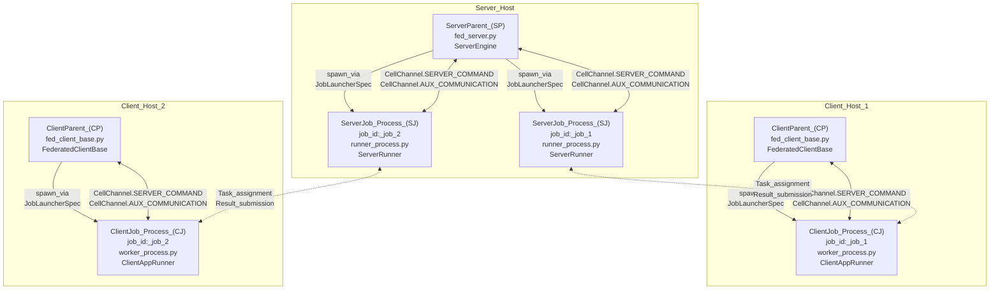
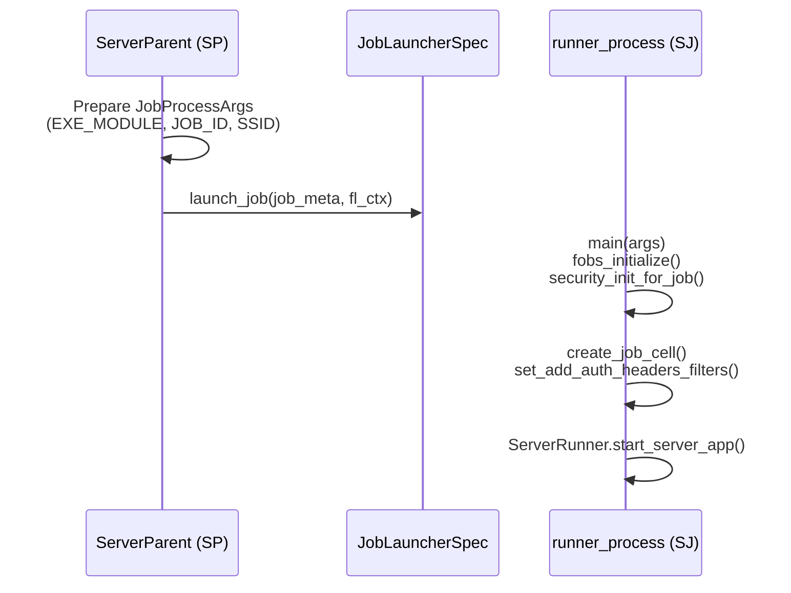
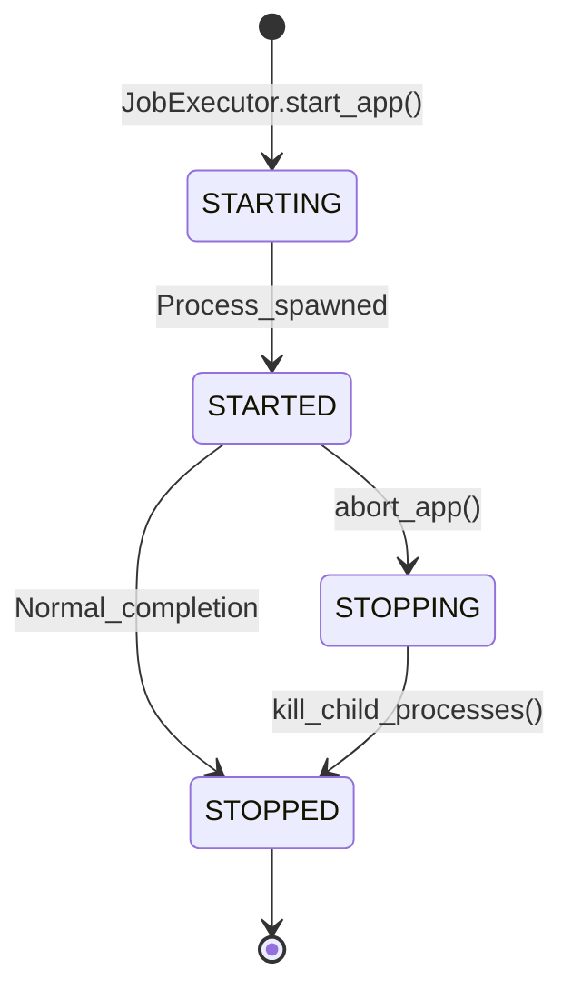
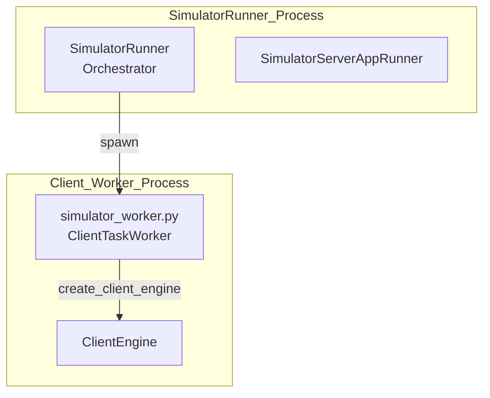

<!-- source: DeepWiki mcp.deepwiki.com · repo NVIDIA/NVFlare · page 3.4 Process Model and Job Isolation · fetched 2026-10-26 -->

# Process Model and Job Isolation

<details>
<summary>Relevant source files</summary>

The following files were used as context for generating this wiki page:

- [docs/design/job_process_credential_transport_design.md](docs/design/job_process_credential_transport_design.md)
- [nvflare/apis/client_engine_spec.py](nvflare/apis/client_engine_spec.py)
- [nvflare/apis/fl_constant.py](nvflare/apis/fl_constant.py)
- [nvflare/apis/job_launcher_spec.py](nvflare/apis/job_launcher_spec.py)
- [nvflare/apis/job_scheduler_spec.py](nvflare/apis/job_scheduler_spec.py)
- [nvflare/apis/server_engine_spec.py](nvflare/apis/server_engine_spec.py)
- [nvflare/app_common/job_launcher/process_launcher.py](nvflare/app_common/job_launcher/process_launcher.py)
- [nvflare/app_common/job_schedulers/job_scheduler.py](nvflare/app_common/job_schedulers/job_scheduler.py)
- [nvflare/fuel/hci/conn.py](nvflare/fuel/hci/conn.py)
- [nvflare/fuel/hci/server/binary_transfer.py](nvflare/fuel/hci/server/binary_transfer.py)
- [nvflare/fuel/hci/server/hci.py](nvflare/fuel/hci/server/hci.py)
- [nvflare/fuel/hci/server/login.py](nvflare/fuel/hci/server/login.py)
- [nvflare/fuel/hci/server/sess.py](nvflare/fuel/hci/server/sess.py)
- [nvflare/private/aux_runner.py](nvflare/private/aux_runner.py)
- [nvflare/private/fed/app/client/client_train.py](nvflare/private/fed/app/client/client_train.py)
- [nvflare/private/fed/app/client/sub_worker_process.py](nvflare/private/fed/app/client/sub_worker_process.py)
- [nvflare/private/fed/app/client/worker_process.py](nvflare/private/fed/app/client/worker_process.py)
- [nvflare/private/fed/app/relay/relay.py](nvflare/private/fed/app/relay/relay.py)
- [nvflare/private/fed/app/server/runner_process.py](nvflare/private/fed/app/server/runner_process.py)
- [nvflare/private/fed/app/server/server_train.py](nvflare/private/fed/app/server/server_train.py)
- [nvflare/private/fed/client/client_app_runner.py](nvflare/private/fed/client/client_app_runner.py)
- [nvflare/private/fed/client/client_engine.py](nvflare/private/fed/client/client_engine.py)
- [nvflare/private/fed/client/client_engine_executor_spec.py](nvflare/private/fed/client/client_engine_executor_spec.py)
- [nvflare/private/fed/client/client_engine_internal_spec.py](nvflare/private/fed/client/client_engine_internal_spec.py)
- [nvflare/private/fed/client/client_executor.py](nvflare/private/fed/client/client_executor.py)
- [nvflare/private/fed/client/client_run_manager.py](nvflare/private/fed/client/client_run_manager.py)
- [nvflare/private/fed/client/client_runner.py](nvflare/private/fed/client/client_runner.py)
- [nvflare/private/fed/client/command_agent.py](nvflare/private/fed/client/command_agent.py)
- [nvflare/private/fed/client/communicator.py](nvflare/private/fed/client/communicator.py)
- [nvflare/private/fed/client/fed_client.py](nvflare/private/fed/client/fed_client.py)
- [nvflare/private/fed/client/fed_client_base.py](nvflare/private/fed/client/fed_client_base.py)
- [nvflare/private/fed/server/client_manager.py](nvflare/private/fed/server/client_manager.py)
- [nvflare/private/fed/server/fed_server.py](nvflare/private/fed/server/fed_server.py)
- [nvflare/private/fed/server/job_runner.py](nvflare/private/fed/server/job_runner.py)
- [nvflare/private/fed/server/server_command_agent.py](nvflare/private/fed/server/server_command_agent.py)
- [nvflare/private/fed/server/server_commands.py](nvflare/private/fed/server/server_commands.py)
- [nvflare/private/fed/server/server_engine.py](nvflare/private/fed/server/server_engine.py)
- [nvflare/private/fed/server/server_runner.py](nvflare/private/fed/server/server_runner.py)
- [nvflare/private/fed/utils/fed_utils.py](nvflare/private/fed/utils/fed_utils.py)
- [nvflare/private/fed/utils/identity_utils.py](nvflare/private/fed/utils/identity_utils.py)
- [tests/unit_test/app_common/job_schedulers/job_scheduler_test.py](tests/unit_test/app_common/job_schedulers/job_scheduler_test.py)
- [tests/unit_test/fuel/hci/phase2_login_study_test.py](tests/unit_test/fuel/hci/phase2_login_study_test.py)
- [tests/unit_test/fuel/hci/session_study_test.py](tests/unit_test/fuel/hci/session_study_test.py)
- [tests/unit_test/private/fed/client/client_executor_test.py](tests/unit_test/private/fed/client/client_executor_test.py)
- [tests/unit_test/private/fed/server/client_manager_test.py](tests/unit_test/private/fed/server/client_manager_test.py)
- [tests/unit_test/private/fed/server/fed_server_test.py](tests/unit_test/private/fed/server/fed_server_test.py)
- [tests/unit_test/private/fed/server/job_runner_test.py](tests/unit_test/private/fed/server/job_runner_test.py)
- [tests/unit_test/private/fed/utils/identity_utils_test.py](tests/unit_test/private/fed/utils/identity_utils_test.py)

</details>


## Purpose and Scope

This document describes NVIDIA FLARE's multi-process architecture and job isolation mechanisms. It explains how the system separates parent processes from job processes to provide resource isolation, prevent interference between concurrent jobs, and enable clean resource management. This covers the process types (SP, SJ, CP, CJ), their lifecycles, and inter-process communication patterns.

For information about job scheduling and resource allocation, see [Job Runner and Scheduling](3.2). For details on communication protocols between processes, see [Cell Architecture and FQCN Routing](4.1).

## Process Types

NVIDIA FLARE uses a hierarchical process model with four distinct process types defined via the `ReservedKey.PROCESS_TYPE` constant: [nvflare/apis/fl_constant.py:118-124]().

| Process Type | Code Symbol | Description | Role |
|-------------|-------------|-------------|------|
| **Server Parent** | `SERVER_PARENT` (SP) | Long-running server parent process | Manages server lifecycle, client connections, job scheduling. [nvflare/private/fed/server/server_engine.py:89-102]() |
| **Server Job** | `SERVER_JOB` (SJ) | Per-job server process | Executes workflow controllers and server-side logic via `ServerRunner`. [nvflare/private/fed/server/server_runner.py:80-108]() |
| **Client Parent** | `CLIENT_PARENT` (CP) | Long-running client parent process | Manages client lifecycle, authentication, and job process management via `ClientEngine`. [nvflare/private/fed/client/client_engine.py:58-111]() |
| **Client Job** | `CLIENT_JOB` (CJ) | Per-job client process | Executes executors and client-side training logic via `ClientAppRunner`. [nvflare/private/fed/app/client/worker_process.py:32-33]() |

Each job spawns isolated SJ and CJ processes, ensuring complete isolation between concurrent jobs and clean resource cleanup.

**Sources:** [nvflare/apis/fl_constant.py:118-124](), [nvflare/private/fed/server/server_engine.py:89-102](), [nvflare/private/fed/server/server_runner.py:80-108](), [nvflare/private/fed/client/client_engine.py:58-111](), [nvflare/private/fed/app/client/worker_process.py:32-33]()

## Process Hierarchy and Communication

The following diagram illustrates the relationship between parent processes and job processes across the server and clients.

### Process Hierarchy Diagram


**Sources:** [nvflare/private/fed/server/server_engine.py:191-205](), [nvflare/private/fed/server/server_runner.py:80-108](), [nvflare/private/fed/client/client_executor.py:171-185](), [nvflare/private/fed/app/client/worker_process.py:46-125]()

## Server-Side Process Model

### Server Parent Process (SP)

The `ServerEngine` (instantiated during `fed_server.py` execution) runs in the SP and is responsible for managing the server lifecycle, client connections, and job scheduling. It delegates job execution to separate processes via `_start_runner_process` [nvflare/private/fed/server/server_engine.py:191-205]().

### Server Job Process (SJ) Launch Sequence

The SJ launch sequence is orchestrated when a job is scheduled. The SJ process runs the module specified in `JobProcessArgs.EXE_MODULE`, which resolves to `nvflare.private.fed.app.server.runner_process` [nvflare/private/fed/app/server/runner_process.py:15-43]().

### Server Job Launch Sequence


The SJ process initializes its own communication cell and registers authentication filters to communicate back to the SP [nvflare/private/fed/app/server/runner_process.py:15-43]().

**Sources:** [nvflare/private/fed/app/server/runner_process.py:15-43](), [nvflare/private/fed/server/server_engine.py:191-205]()

## Client-Side Process Model

### Client Parent Process (CP)

The `FederatedClientBase` runs in the CP and is responsible for managing client registration and tracking CJ processes via `JobExecutor` [nvflare/private/fed/client/fed_client_base.py:39-45]().

```python
class JobExecutor(ClientExecutor):
    def __init__(self, client, startup):
        self.client = client
        self.run_processes = {}  # job_id -> process info
```

**Sources:** [nvflare/private/fed/client/client_executor.py:182-183](), [nvflare/private/fed/client/fed_client_base.py:39-45]()

### Client Job Process (CJ) Launch Sequence

The CJ launch implementation is in `JobExecutor.start_app`: [nvflare/private/fed/client/client_executor.py:190-212]()

1.  **Update job metadata**: Write received job meta to the job's workspace (`meta.json`) [nvflare/private/fed/client/client_executor.py:216-221]().
2.  **Prepare job arguments**: Build `JobProcessArgs` dictionary including `EXE_MODULE` (typically `nvflare.private.fed.app.client.worker_process`), `AUTH_TOKEN`, and `PARENT_URL` [nvflare/private/fed/client/client_executor.py:223-230]().
3.  **Launch via JobLauncherSpec**: Spawn the CJ process using the launcher configured for the job (e.g., `ProcessLauncher`) [nvflare/private/fed/client/client_executor.py:232-235]().
4.  **Monitor status**: Start a monitoring thread to track job completion and exit codes [nvflare/private/fed/client/client_executor.py:244-245]().

**Sources:** [nvflare/private/fed/client/client_executor.py:190-245](), [nvflare/private/fed/app/client/worker_process.py:46-125]()

## Process Communication Channels

Parent and job processes communicate through dedicated CellNet channels and connection parameters. The `Communicator` class on the client side handles these registrations [nvflare/private/fed/client/communicator.py:134-144]().

### Client CP ↔ CJ Communication

The CJ connects to the parent using the `PARENT_URL` argument passed during launch [nvflare/private/fed/client/client_executor.py:223-230]().

Inside the CJ (`worker_process.py`), the `ClientAppRunner` is started, which manages the connection back to the parent process and monitors the parent's health via `monitor_parent_process` [nvflare/private/fed/app/client/worker_process.py:122]().

**Sources:** [nvflare/private/fed/app/client/worker_process.py:46-125](), [nvflare/private/fed/client/client_executor.py:223-230](), [nvflare/private/fed/client/communicator.py:134-144]()

## Process Lifecycle Management

### Job Process Lifecycle States

The lifecycle of a job process transitions through several states managed by the parent process via `MachineStatus` [nvflare/apis/fl_constant.py:56-68]().



**Sources:** [nvflare/apis/fl_constant.py:56-68](), [nvflare/private/fed/client/client_executor.py:125-131]()

## Job Isolation Mechanisms

### Process-Level Isolation

Each job runs in a completely isolated process with:

1.  **Independent Python environment**: Each process loads its own modules and can have its own `sys.path`. The `_remove_custom_path` utility helps manage this by stripping previous job paths [nvflare/private/fed/client/client_engine.py:51-55]().
2.  **Isolated workspace**: Separate directories for job artifacts (`run_XX`) defined in the `Workspace` object [nvflare/private/fed/app/client/worker_process.py:62-63]().
3.  **Custom Import Paths**: The `refresh_custom_dir_import_path` ensures that job-specific custom code is available to the launched process [nvflare/private/fed/app/client/worker_process.py:63]().

**Sources:** [nvflare/private/fed/app/client/worker_process.py:62-63](), [nvflare/private/fed/client/client_engine.py:51-55]()

### Authentication and Security

Job processes authenticate to their parent using a token and signature:

1.  **Token transmission**: Token and signature passed as launch arguments via `JobProcessArgs.TOKEN` and `JobProcessArgs.TOKEN_SIGNATURE` [nvflare/private/fed/client/client_executor.py:223-230]().
2.  **Verification**: `require_signed_jobs` ensures job content and certificates are valid before deployment [nvflare/private/fed/utils/fed_utils.py:73-140]().
3.  **Security Initialization**: Both `worker_process.py` and `runner_process.py` call `security_init_for_job` to ensure the integrity of the job environment [nvflare/private/fed/app/client/worker_process.py:79](), [nvflare/private/fed/app/server/runner_process.py:77]().

**Sources:** [nvflare/private/fed/client/client_executor.py:223-230](), [nvflare/private/fed/utils/fed_utils.py:73-140](), [nvflare/private/fed/app/client/worker_process.py:79](), [nvflare/private/fed/app/server/runner_process.py:77]()

## Simulator Process Model

The Simulator uses a specialized model where clients can be run as threads or separate processes. The `SimulatorRunner` orchestrates this local mimicry of a distributed system.

### Simulator Architecture


In the simulator, `ClientTaskWorker` manages the execution of tasks for a client in a dedicated worker process [nvflare/private/fed/simulator/simulator_worker.py:48-56]().

**Sources:** [nvflare/private/fed/simulator/simulator_runner.py:84-112](), [nvflare/private/fed/simulator/simulator_worker.py:48-155]()

## JobProcessArgs Specification

Standardized arguments used for launching both SJ and CJ processes: [nvflare/apis/job_launcher_spec.py:23-44]()

| Argument | Code Constant | Description |
|----------|-------------|-------------|
| `EXE_MODULE` | `JobProcessArgs.EXE_MODULE` | Python module to execute (e.g., `worker_process`). |
| `JOB_ID` | `JobProcessArgs.JOB_ID` | Unique job identifier. |
| `WORKSPACE` | `JobProcessArgs.WORKSPACE` | Root workspace directory. |
| `TOKEN` | `JobProcessArgs.TOKEN` | Authentication token for parent-child comms. |
| `PARENT_URL` | `JobProcessArgs.PARENT_URL` | Parent process connection URL for CellNet. |

**Sources:** [nvflare/apis/job_launcher_spec.py:23-44](), [nvflare/private/fed/client/client_executor.py:223-230]()

---

