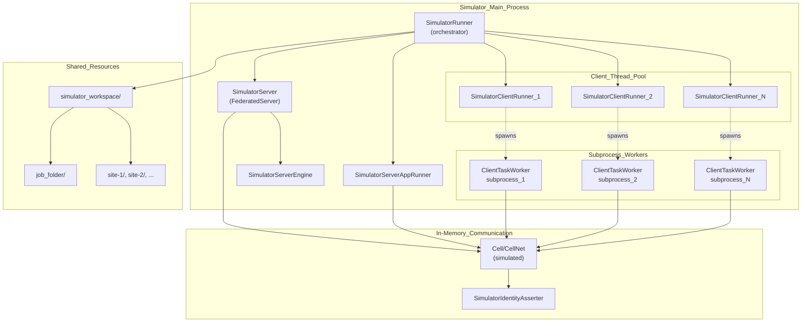
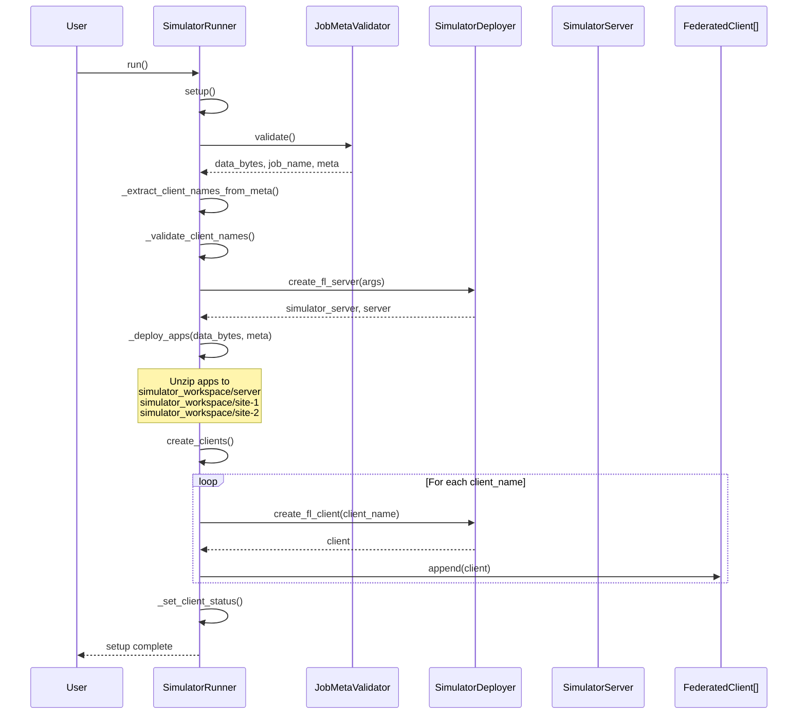
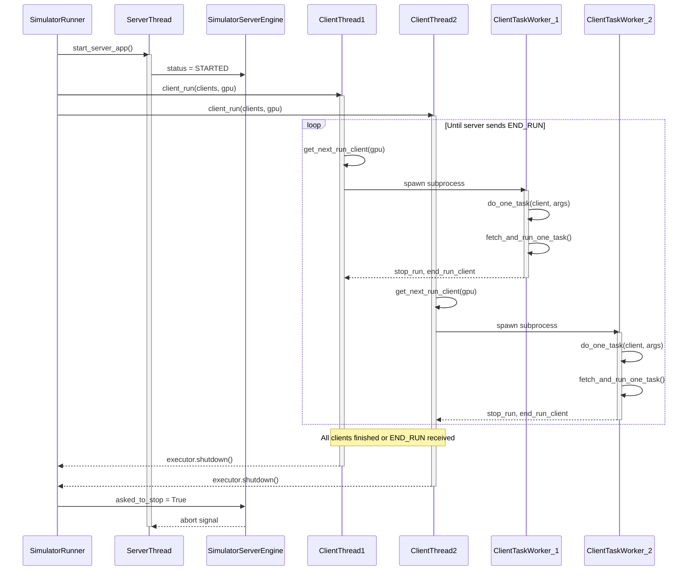
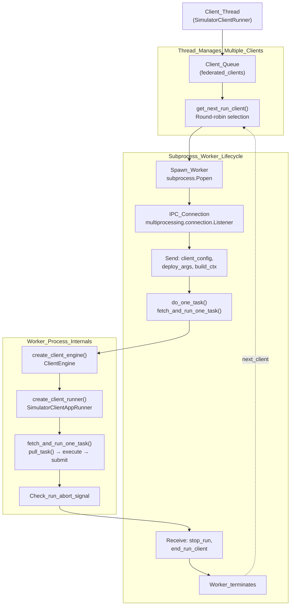

<!-- source: DeepWiki mcp.deepwiki.com · repo NVIDIA/NVFlare · page 3.5 Simulator Architecture · fetched 2026-10-26 -->

# Simulator Architecture

<details>
<summary>Relevant source files</summary>

The following files were used as context for generating this wiki page:

- [nvflare/collab/runtime/controller.py](nvflare/collab/runtime/controller.py)
- [nvflare/fuel/common/multi_process_executor_constants.py](nvflare/fuel/common/multi_process_executor_constants.py)
- [nvflare/fuel/f3/connection.py](nvflare/fuel/f3/connection.py)
- [nvflare/private/fed/app/deployer/base_client_deployer.py](nvflare/private/fed/app/deployer/base_client_deployer.py)
- [nvflare/private/fed/app/deployer/server_deployer.py](nvflare/private/fed/app/deployer/server_deployer.py)
- [nvflare/private/fed/app/deployer/simulator_deployer.py](nvflare/private/fed/app/deployer/simulator_deployer.py)
- [nvflare/private/fed/app/simulator/simulator.py](nvflare/private/fed/app/simulator/simulator.py)
- [nvflare/private/fed/app/simulator/simulator_runner.py](nvflare/private/fed/app/simulator/simulator_runner.py)
- [nvflare/private/fed/app/simulator/simulator_worker.py](nvflare/private/fed/app/simulator/simulator_worker.py)
- [nvflare/private/fed/client/admin.py](nvflare/private/fed/client/admin.py)
- [nvflare/private/fed/server/admin.py](nvflare/private/fed/server/admin.py)
- [nvflare/private/fed/simulator/simulator_client_engine.py](nvflare/private/fed/simulator/simulator_client_engine.py)
- [nvflare/private/fed/simulator/simulator_server.py](nvflare/private/fed/simulator/simulator_server.py)
- [tests/unit_test/collab/runtime/controller_test.py](tests/unit_test/collab/runtime/controller_test.py)
- [tests/unit_test/fuel/f3/streaming/streaming_test.py](tests/unit_test/fuel/f3/streaming/streaming_test.py)
- [tests/unit_test/private/fed/app/deployer/simulator_deployer_test.py](tests/unit_test/private/fed/app/deployer/simulator_deployer_test.py)
- [tests/unit_test/private/fed/app/simulator/simulator_runner_test.py](tests/unit_test/private/fed/app/simulator/simulator_runner_test.py)
- [tests/unit_test/private/fed/server/server_engine_test.py](tests/unit_test/private/fed/server/server_engine_test.py)

</details>


## Purpose and Scope

This document describes the architecture of the NVIDIA FLARE Simulator, a development tool that replicates the federated learning environment in a single process for rapid prototyping and testing. The Simulator enables developers to test FL workflows locally without provisioning, deployment, or multi-machine setup.

For information about:
- Production multi-process architecture, see [Process Model and Job Isolation](3.4)()
- Server and client runtime engines, see [ServerEngine and Orchestration](3.1)() and [ClientEngine Architecture](3.3)()
- Deployment modes for realistic multi-process local testing, see [Deployment Modes](1.3)()

Sources: [nvflare/private/fed/app/simulator/simulator_runner.py:84-107]()

---

## Overview

The Simulator provides a lightweight FL execution environment where:
- Server and multiple clients run in the same Python process context.
- No network communication or authentication is required.
- Client tasks execute in parallel using threads or subprocess workers.
- The same job configuration and application code work in both Simulator and production modes.

The Simulator is designed for the **fastest iteration cycle** during development, trading realism for speed.

Sources: [nvflare/private/fed/app/simulator/simulator_runner.py:84-107]()

---

## Component Architecture

The Simulator architecture uses a specialized runner to orchestrate server and client instances within a single environment, mimicking a distributed system through internal task routing and in-memory communication.

### Simulator Component Hierarchy



**Component Roles:**

| Component | File | Responsibility |
|-----------|------|----------------|
| `SimulatorRunner` | [nvflare/private/fed/app/simulator/simulator_runner.py:84-96]() | Main orchestrator, setup, lifecycle management. |
| `SimulatorServer` | [nvflare/private/fed/simulator/simulator_server.py:96-125]() | Specialized server without network/auth requirements. |
| `SimulatorClientRunner` | [nvflare/private/fed/app/simulator/simulator_runner.py:597-612]() | Thread-based client task executor. |
| `ClientTaskWorker` | [nvflare/private/fed/app/simulator/simulator_worker.py:48-55]() | Subprocess worker for task execution. |
| `SimulatorDeployer` | [nvflare/private/fed/app/deployer/simulator_deployer.py:35-41]() | Creates server and client instances for simulation. |
| `SimulatorServerAppRunner` | [nvflare/private/fed/simulator/simulator_app_runner.py:65-65]() | Manages server app lifecycle in simulator. |
| `SimulatorClientAppRunner` | [nvflare/private/fed/simulator/simulator_app_runner.py:37-37]() | Manages client app lifecycle in simulator. |

Sources: [nvflare/private/fed/app/simulator/simulator_runner.py:84-107](), [nvflare/private/fed/app/simulator/simulator_worker.py:48-55](), [nvflare/private/fed/app/simulator/simulator_runner.py:597-612](), [nvflare/private/fed/simulator/simulator_server.py:96-125](), [nvflare/private/fed/app/deployer/simulator_deployer.py:35-41](), [nvflare/private/fed/simulator/simulator_app_runner.py:65-65](), [nvflare/private/fed/simulator/simulator_app_runner.py:37-37]()

---

## Process and Thread Model

The Simulator manages concurrency through a mix of threads and subprocesses, depending on the hardware allocation (CPU vs GPU).

### Concurrency and IPC Flow

```mermaid
graph TB
    MainProcess["Main_Process<br/>(SimulatorRunner)"]
    
    subgraph "Main_Process_Threads"
        SetupThread["Setup_Thread<br/>(validate, deploy)"]
        ServerThread["Server_Thread<br/>(start_server_app)"]
        
        subgraph "Client_Thread_Pool"
            ClientThread1["Client_Thread_1"]
            ClientThread2["Client_Thread_2"]
            ClientThreadN["Client_Thread_N"]
        end
    end
    
    subgraph "Subprocess_Workers_Optional"
        SubProc1["Worker_Process_1<br/>(simulator_worker.py)"]
        SubProc2["Worker_Process_2<br/>(simulator_worker.py)"]
        SubProcN["Worker_Process_N<br/>(simulator_worker.py)"]
    end
    
    MainProcess --> SetupThread
    MainProcess --> ServerThread
    MainProcess --> ClientThread1
    MainProcess --> ClientThread2
    MainProcess --> ClientThreadN
    
    ClientThread1 -.spawns_via<br/>subprocess.Popen.-> SubProc1
    ClientThread2 -.spawns.-> SubProc2
    ClientThreadN -.spawns.-> SubProcN
    
    SubProc1 -.IPC_via<br/>multiprocessing.connection.Listener.-> ClientThread1
    SubProc2 -.IPC.-> ClientThread2
    SubProcN -.IPC.-> ClientThreadN
```

**Thread/Process Usage:**

- **Main Process**: Runs `SimulatorRunner.run()` which initializes the environment [nvflare/private/fed/app/simulator/simulator_runner.py:440-452]().
- **Server Thread**: Started via `threading.Thread(target=self.start_server_app)`, runs the server controller [nvflare/private/fed/app/simulator/simulator_runner.py:507-509]().
- **Client Threads**: A `ThreadPoolExecutor` manages parallel client execution based on `threads` or GPU groups [nvflare/private/fed/app/simulator/simulator_runner.py:513-525]().
- **Subprocess Workers**: When executing tasks, the runner spawns `nvflare.private.fed.app.simulator.simulator_worker` using `subprocess.Popen` [nvflare/private/fed/app/simulator/simulator_runner.py:727-754](). Communication occurs via `multiprocessing.connection.Listener` [nvflare/private/fed/app/simulator/simulator_worker.py:20-21]().

Sources: [nvflare/private/fed/app/simulator/simulator_runner.py:440-452](), [nvflare/private/fed/app/simulator/simulator_runner.py:507-509](), [nvflare/private/fed/app/simulator/simulator_runner.py:513-525](), [nvflare/private/fed/app/simulator/simulator_runner.py:727-754](), [nvflare/private/fed/app/simulator/simulator_worker.py:20-21]()

---

## Simulation Setup Process

Before execution, the Simulator prepares a virtual workspace and unzips job applications into participant-specific directories.



**Setup Steps:**

1. **Job Validation**: The job folder is zipped and validated using `JobMetaValidator.validate()` [nvflare/private/fed/app/simulator/simulator_runner.py:344-353]().
2. **Server Creation**: `SimulatorDeployer.create_fl_server()` creates a `SimulatorServer` with no network binding [nvflare/private/fed/app/deployer/simulator_deployer.py:41-54]().
3. **App Deployment**: Applications are unzipped to `simulator_workspace/{site}/job_id/app` [nvflare/private/fed/app/simulator/simulator_runner.py:379-403]().
4. **Client Creation**: `FederatedClient` instances are instantiated with dummy tokens and assigned to the runner [nvflare/private/fed/app/simulator/simulator_runner.py:415-430]().

Sources: [nvflare/private/fed/app/simulator/simulator_runner.py:344-353](), [nvflare/private/fed/app/deployer/simulator_deployer.py:41-54](), [nvflare/private/fed/app/simulator/simulator_runner.py:379-403](), [nvflare/private/fed/app/simulator/simulator_runner.py:415-430]()

---

## Execution Flow

The simulation loop cycles through clients, executing tasks until the server issues an `END_RUN` signal.



**Key Execution Phases:**

1. **Server Start**: The server app runs in a dedicated thread and initializes the job cell [nvflare/private/fed/app/simulator/simulator_runner.py:546-574]().
2. **Client Parallel Execution**: Clients are partitioned across threads or GPU groups based on user configuration [nvflare/private/fed/app/simulator/simulator_runner.py:513-525]().
3. **Task Execution Loop**: `SimulatorClientRunner` picks a client and executes `do_one_task()` via the subprocess worker [nvflare/private/fed/app/simulator/simulator_runner.py:706-769]().
4. **Worker Logic**: `ClientTaskWorker` in the subprocess creates a `ClientEngine` and `ClientRunner` to execute the specific task logic [nvflare/private/fed/app/simulator/simulator_worker.py:50-78]().

Sources: [nvflare/private/fed/app/simulator/simulator_runner.py:546-574](), [nvflare/private/fed/app/simulator/simulator_runner.py:513-525](), [nvflare/private/fed/app/simulator/simulator_runner.py:706-769](), [nvflare/private/fed/app/simulator/simulator_worker.py:50-78]()

---

## Client Task Execution Model

The `ClientTaskWorker` is the core entity that mimics a real NVFLARE client within the simulation.



**Worker Process Execution:**

- **Initialization**: Receives job context and client configuration over the IPC connection [nvflare/private/fed/app/simulator/simulator_worker.py:143-146]().
- **Engine Creation**: Instantiates `ClientEngine` and `FederatedClient` [nvflare/private/fed/app/simulator/simulator_worker.py:50-55]().
- **Task Fetching**: The `ClientRunner` within the worker calls `fetch_and_run_one_task()` to interact with the simulated server [nvflare/private/fed/app/simulator/simulator_worker.py:101-106]().
- **Resource Management**: GPU visibility is restricted at the process level using `CUDA_VISIBLE_DEVICES` based on assigned IDs [nvflare/private/fed/app/simulator/simulator_runner.py:261-263]().

Sources: [nvflare/private/fed/app/simulator/simulator_worker.py:143-146](), [nvflare/private/fed/app/simulator/simulator_worker.py:50-55](), [nvflare/private/fed/app/simulator/simulator_worker.py:101-106](), [nvflare/private/fed/app/simulator/simulator_runner.py:261-263]()

---

## Communication Architecture in Simulator

Simulator communication uses `CellNet` but bypasses network stacks and security filters for speed.

1. **No Network Stack**: Cells are created with `secure=False` and local targets [nvflare/private/fed/app/deployer/simulator_deployer.py:93-99]().
2. **Simplified Addressing**: Uses hierarchical FQCNs (e.g., `client_name`) [nvflare/private/fed/app/deployer/simulator_deployer.py:94-94]().
3. **No Authentication**: The `SimulatorIdentityAsserter` provides dummy signatures and always returns `True` for verification [nvflare/private/fed/simulator/simulator_server.py:81-93]().
4. **Direct IPC**: `SimulatorClientRunner` and `ClientTaskWorker` communicate via `multiprocessing.connection` for status updates [nvflare/private/fed/app/simulator/simulator_worker.py:20-21]().

Sources: [nvflare/private/fed/app/deployer/simulator_deployer.py:93-99](), [nvflare/private/fed/simulator/simulator_server.py:81-93](), [nvflare/private/fed/app/simulator/simulator_worker.py:20-21]()

---

## Key Classes and Responsibilities

### SimulatorRunner

The main orchestrator that manages the entire simulation lifecycle.

**Location**: [nvflare/private/fed/app/simulator/simulator_runner.py:84-96]()

| Method | Responsibility |
|--------|---------------|
| `setup()` | Validates job, creates server/clients, and deploys apps [nvflare/private/fed/app/simulator/simulator_runner.py:162-312](). |
| `_deploy_apps()` | Unzips and copies applications to participant workspaces [nvflare/private/fed/app/simulator/simulator_runner.py:379-403](). |
| `simulator_run_main()` | Main simulation loop managing threads and subprocesses [nvflare/private/fed/app/simulator/simulator_runner.py:488-538](). |
| `start_server_app()` | Launches the server workflow in a separate thread [nvflare/private/fed/app/simulator/simulator_runner.py:546-586](). |

### SimulatorClientRunner

Manages client execution in a thread pool and spawns workers for task execution.

**Location**: [nvflare/private/fed/app/simulator/simulator_runner.py:597-612]()

| Method | Responsibility |
|--------|---------------|
| `run()` | Initializes the thread pool and starts client threads [nvflare/private/fed/app/simulator/simulator_runner.py:614-634](). |
| `do_one_task()` | Spawns the subprocess worker and handles IPC for a single task [nvflare/private/fed/app/simulator/simulator_runner.py:706-769](). |

### ClientTaskWorker

The entry point for the subprocess worker executing client-side tasks.

**Location**: [nvflare/private/fed/app/simulator/simulator_worker.py:48-55]()

| Method | Responsibility |
|--------|---------------|
| `run()` | Receives config via IPC and enters the task execution loop [nvflare/private/fed/app/simulator/simulator_worker.py:137-175](). |
| `do_one_task()` | Orchestrates the `ClientRunner` to fetch and execute tasks [nvflare/private/fed/app/simulator/simulator_worker.py:79-128](). |

Sources: [nvflare/private/fed/app/simulator/simulator_runner.py:84-595](), [nvflare/private/fed/app/simulator/simulator_worker.py:48-176](), [nvflare/private/fed/app/simulator/simulator_runner.py:162-312](), [nvflare/private/fed/app/simulator/simulator_runner.py:379-403](), [nvflare/private/fed/app/simulator/simulator_runner.py:488-538](), [nvflare/private/fed/app/simulator/simulator_runner.py:546-586](), [nvflare/private/fed/app/simulator/simulator_runner.py:614-634](), [nvflare/private/fed/app/simulator/simulator_runner.py:706-769](), [nvflare/private/fed/app/simulator/simulator_worker.py:137-175](), [nvflare/private/fed/app/simulator/simulator_worker.py:79-128]()

---

